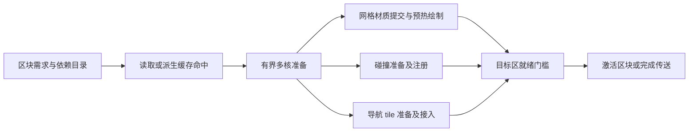
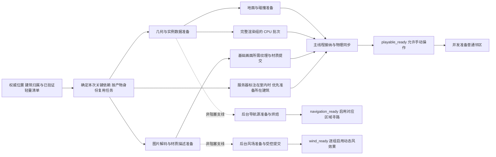

# 引用地图性能续修（2026-10-08）

## 当前处理决定（2026-10-12）

用户要求将剩余性能事项标记为 **(未解决-跳过)**。本计划中尚未完成的游戏/编辑器加载、持续卡顿、保存、并发与硬件利用率、共享/驻留/退役、G1/G2 等候选复测及旧 RSS 异常归因，均从当前执行队列移出；不再自动继续性能排查、实施或压测，待用户明确恢复。统一清单见 [剩余性能事项](world_editor_todo.md#当前性能事项状态2026-10-12)。

已完成的修复、模型发布、实测结果及开关状态保留：纹理共享开启，原先关闭的候选继续关闭。此状态是跳过剩余工作，不是验收通过或性能问题解决；下方 2026-10-11 及更早的“当前状态”“P0 未关闭”“下一步”均为历史执行记录，不再构成自动续做指令。

**当前状态（2026-10-11，preferred 正式接入收尾）：** 已原字节迁移 **11 类模型、59 个实例**，正式地图 SHA 为 `c58118c2a96ab7d39f7834787a00d932892e0f967da39959892118029762d36f`。32 项 native/footprint 已统一到共享默认开启后的生成器，正式索引、游戏、传送及 270 项素材库/编辑器验收通过；G3 保留默认开启，G1/G2 先定位、修复再复测，当前关闭不等于放弃。最新同版本只读内存配对未复现旧持续约 256 MiB 的 RSS 增幅，末尾仅增加 6.14 MiB，同时纹理计数少约 431.6 MiB；旧根因未被证明，继续监控，加载/卡顿 **P0 未关闭**。新临时路径的 37.066 s 入场包含未预建依赖索引的重建，不能替代暖缓存约 17 s 对照；单次编辑器 51.934 s 也不作为新的 A/B 收益。详见 [正式接入收尾](#preferred-模型正式接入收尾2026-10-11)及[共享内存最终复测](#正式版本纹理共享内存复测2026-10-11)；下方旧状态表和“待发布/待验收”段保留各自时点，不代表当前发布状态。

**阅读入口：** 本文件按时间保留研究、实施与实测记录。方案依据为[加载方案综合复核](#加载方案综合复核2026-10-10待实施)，执行状态见下表和后续验收记录；原方案标题中的“待实施”是当时状态。历史“导航/风材质阻塞入场”、旧 worker 数与旧耗时不代表最新测量。实现、实验开关和正式启用分别记录，不能等同。

用户要求继续优化 `medieval_river_town`。本轮保持 v2 引用格式；初始性能研究及 HTTP 验收使用临时地图。2026-10-11 经离线派生、实际 GPU 和画面对照后，已受控迁移正式地图的 5 座石桥 LOD，见文末迁移记录；不能继续把该项写成“正式地图未改”。GPU 场景通过 `tools/run_godot_background.py` 独立桌面运行。

## 历史方案执行状态（2026-10-11；剩余性能项于 2026-10-12 标记为未解决-跳过）

最新续修：石桥缺失贴图定向准备和编辑器共享预制件双 worker 已分别完成同代码 A/B/B/A，默认启用；5 座正式石桥已恢复冻结 LOD，独立远景实际减面约 25%–29%，代价是桥资源约增加 8.3%，不构成加载提速。升级地图新副本的入口与固定路线已通过，传送测试正在修正落点夹具并重验，不能预支通过。完整碰撞先行仍为默认关闭实验；具体证据与开关边界见文末各项记录。

| 阶段 | 已实现及实测 | 尚未完成（未解决-跳过） |
|---|---|---|
| S0 合同与观测 | 真实入口、硬件、阶段和帧耗时记录；关键依赖及本地就绪合同接入 | **(未解决-跳过)** 随新入口继续补齐失败/传送矩阵，不能将局部 Store ready 当闭包完整 |
| S1 拆分准备 | 冷目录同次恢复、水面 CPU 路径已启用；独立 GLB 碰撞目录和真实离线产品通过 | **(未解决-跳过)** 更多原生长调用、共享桥/建筑准备；独立产物需要完整城镇吞吐验证 |
| S2 调度与生命周期 | 有界结果队列、取消回收、共享消费者票据、移动需求去重和公平派发已实现 | **(未解决-跳过)** 共用帧预算/共享贴图实验尚无稳定整体收益，保持默认关闭；关键闭包和 CPU/GPU 总驻留预算未完成 |
| S3 提前入场 | 建筑归属本地适配、导航/风场分项开关；碰撞先行实际入口和同图/跨图功能验收通过 | **(未解决-跳过)** 城镇 A/B/B/A 入口慢 13.7%、长帧更差，实验保持默认关闭；外部持久服务器和完整建筑协议尚未交付 |
| S4 运行与驻留 | 原反馈点四段往返可达；队列反复取消、角点/台阶与冷风变体问题已修；正式 5 桥 LOD 静态 GPU/画质及升级图入口/路线验收完成 | **(未解决-跳过)** 旧默认路线帧 P99 仍 180–266 ms；升级图传送测试正在修正夹具并重验；真正远区退役重访、原生建筑/地形有界驻留未完成 |
| S5 编辑器 | 有界模型/贴图队列与独立共享预制件预热均默认 2 worker；后者同图完整打开均值 65.212→59.993 s，HTTP 增删/撤销/保存重开已验证 | **(未解决-跳过)** 该组对照在 LOD 迁移前完成；模型等待/精确拾取和渐进视口能力仍需处理，不改变 `open_world` 完整完成语义 |

阶段工作量不同，未用勾选数量折算完成百分比。最近默认配置完整入口 16.634 s 属于已验收旧门槛；碰撞先行的新实验不能沿用它作为自身收益。所有加载/持续卡顿 P0 仍开放。

## 已复核并实施的保存优化

原 32 MiB 编码热缓存遇到城镇约 135 MB 的唯一资源定义，会反复清空，普通位姿保存仍重新压缩所有定义。本轮保留热缓存的深相等检查，增加最多 16,384 项的内容身份索引，仅存原始内容 SHA/长度与已验证压缩资源 SHA/长度。冷开通过完整资源 SHA、解压和合法性检查后填充索引。每次保存仍检查当前定义、序列化并计算完整 SHA，嵌套修改会生成新资源；目标已有资源仍完整读取验证，缺失或另存为才按需压缩。没有扩大大型数据缓存，也不以 mtime、32 位 Variant hash 或旧文件名代替完整性验证。

城镇纯资源保存探针：4,437 个物件、1,762 个定义；移动与删除均 0 次压缩、0 资源写入，资源阶段约 3.4 秒，仍完整检查约 97 MB 磁盘资源。身份索引序列化约 379 KiB。这个计时不含完整 UI 业务校验和发布，不能直接当作 Ctrl+S 总耗时。首次资源生成需要额外原始内容 SHA；另存为仍需写入缺少的资源。

保存业务校验和缺失素材检查在单次操作内复用重复路径检查；每次保存重新建立模型路径集合，并在分帧检查末尾重新检查其权限与存在性。完整逐实例业务校验保留。该末尾模型复核只覆盖 `kind=asset` 路径，不宣称额外覆盖所有贴图和套件。

`save_world` 参数、工具清单及分发不变，UI 与 MCP 共用保存作业。`timings.export` 增加 `identity_cache_hits`、`serialized_raw_bytes`、`compression_count`、`identity_cache_entries`；`encoded_raw_bytes` 表示实际送入压缩的字节数。命中资源身份仍可能序列化和 SHA，不应称作完全零处理。

## 已复核并实施的游戏加载优化

由 subagent 调用本机 Grok 初审后逐项复核。资源引用完成 SHA 校验、依赖闭包和顺序核对后，以定义 SHA 复用面材质检查；实例状态白名单不能覆盖材质定义，逐实例位姿、楼层、活动件及业务校验仍执行。已验证的贴图请求提前后台解码，与模型及地形准备重叠；取消和失败路径回收贴图线程。

只读 CPU 对比中，材质所在的串行批次验证 1,864 → 525 ms，贴图请求集合一致。不能将这一局部数字直接当作整个游戏加载收益。Grok 所提重复 SHA、缺少拾取缓存、直接跳过模型导入等推测不符合源码，未采用。

## 测试及证据

- `test_map_resource_store.gd`：79 PASS，含冷开、嵌套修改、缺失、另存为、损坏、并发、hash 碰撞及有界索引。目录 junction 通过；文件 symlink 夹具因本机权限跳过。
- `test_reference_map_loading.gd`：40 PASS，含同定义不同状态/位姿、损坏资源不能授予身份、逐实例非法值拒绝、贴图工作提前启动及取消回收。
- `test_reference_save_validation.gd`：9 PASS，含单操作路径复用、验证中删除、修复后新操作可见及越界拒绝。
- `test_reference_map_save.gd`：30 PASS，含最终资源变动、并发主文件写入、发布故障、撤销资源复用和标准 glTF 代理解析。
- `test_reference_map_recovery.gd`：14 PASS，含 v2/迁移检查点、损坏拒绝、缺失主文件恢复与地图目录过滤。
- `test_reference_cursor_validation.gd`：27 PASS，含同定义不同实例状态、非法实例、非根节点、同步/分帧一致、坏 prefab、最终路径 junction 替换拒绝。
- `test_reference_map_http.gd`：独立桌面真实 3D HTTP 回归失败数 0；包含真实 GLB 添加/删除、撤销重做、修改、非法调用无副作用、保存重开、发布失败/冲突以及游戏实际模型材质和碰撞。
- 原始报告位于 `D:/code/rmmo_runtime/review_artifacts/`：`map_resource_store_20261008.log`、`reference_encoding_town_20261008.log`、`reference_save_validation_regression_20261008.log`、`reference_map_http_20261008.json`、`reference_load_audit_20261008/review.txt`。

## 编辑器加载测量边界

`profile_reference_editor_load.gd` 通过真实 HTTP `open_world` 触发实际分帧加载；同一临时检查点用新进程重复，避免把同步 `attach_editor` 构建当成用户入口。

本轮初始基线总耗时 107.679 秒、最大帧间隔 825.323 ms；校验 18.685 秒、构建阶段 88.411 秒，其中 32 个首次使用模型的串行解析等待 36.798 秒。各层嵌套计时不能相加。13,314 次 node 调度并不是逐记录校验三遍，实际公共与文档记录校验各 4,437 次。初版探针的物理射线检查失败，加载记录/身份及元数据检查通过；该基线只用于计时，不称作完整验收通过。

编辑器本轮实施三类改动：

1. Cursor 只对已完成引用校验的根记录传入私有材质身份，复用重复面材质检查；模型路径单次去重、完成前重新核验权限。非根额外记录、旧格式和外部静态调用不借用该身份，缺失模型仍沿用编辑器原有占位语义。
2. 在现有引用读取线程预热唯一 prefab 的 CPU 解码缓存，全部实例业务校验仍运行；不增加一份城镇副本，也不在该线程创建节点、网格或材质。同步打开同样通过该线程，线程启动失败则沿用原校验流程。
3. 素材库作用域建立后提前解析下一个唯一模型，让模型解析与地形/物件准备重叠。最多一个资产线程、一个未消费 GLTF 状态；仍按原记录顺序在主线程创建场景、写共享缓存、释放状态后调度下一个。结束/退出均回收线程，失败缓存限本次加载。

MCP 和 UI 继续共用 `load_job`。`timings.asset_lookahead` 报告唯一模型数、开始/消费/就绪数、启动失败和最大未消费数；`asset_wait` 是消费时剩余等待，`asset_parse_worker` 是完整后台工作，两者不可相加。`timings.validation` 增加已验证材质身份/模型路径数和 prefab 后台预热统计。新进程对比不清空系统文件缓存，不称作磁盘冷启动。

最终 `reference_editor_load_after_20261008.json` 完整验收失败数 0：

| 实际 HTTP 编辑器加载 | 初始基线 | 本轮 |
|---|---:|---:|
| 请求至作业完成 | 107.679 s | 101.237 s |
| 验证阶段墙钟 | 18.685 s | 15.993 s |
| 主线程 node 单元累计 | 11.240 s | 2.452 s |
| 首次模型解析剩余等待 | 36.798 s | 33.540 s |
| 最长帧间隔 | 825.323 ms | 801.952 ms |

699 个 prefab 后台预热 7.665 s，这部分是转移到后台，不是工作消失。32 个模型全部按序消费，4 个消费时已就绪，最大未消费数 1；总加载仅改善约 6%，不夸大为秒开。4,437 条记录和元数据与独立重开一致，4,437 个独立视觉节点及 6,189 个拾取体身份正确；5 个实际射线命中独立 UUID，HTTP 选择通过，检查点 SHA 不变。原射线探针单向短线且集中于相邻地形；修订为全城采样及双向射线后通过，没有修改生产碰撞来迎合测试。两轮截图均已查看，正式场景未写入。

`test_editor_asset_preparation.gd` 最终独立桌面真实 HTTP 回归失败数 0：两个唯一模型只各解析一次，提前启动/容量/退出清理通过；地形雕刻、区域遮罩、撤销重做和保存重开通过，损坏模型占位、修复后重新加载通过。日志中的 glTF 解析错误是主动写入坏模型的预期夹具，无脚本错误。生产主线程依然有完整资源末尾复核和原生大型形状构建长单位，最长帧并未显著改善。

最高优先级总项仍开放：游戏反馈坐标卡顿、编辑器大型模型的单次碰撞构建、地图加载和持续镜头移动需分别验收，不能用保存提速代替。

## 整城保存及游戏实际验收

`reference_map_town_20261008.json`：4,437 个原有物件，通过真实 HTTP 添加共享素材库的「方窗石砌窗套」GLB，完整记录、材质贴图、独立身份、碰撞和撤销重做通过，失败数 0。正式地图及原模型/素材库 SHA 不变。

| 操作后的保存 | 上轮 | 本轮 | 新写定义 / 实际压缩次数 |
|---|---:|---:|---:|
| 移动已有模型 | 9.645 s | 7.158 s | 0 / 0 |
| 添加此前未用模型 | 9.675 s | 7.441 s | 1 / 1 |
| 撤销添加 | 9.873 s | 7.953 s | 0 / 0 |
| 重做添加 | 9.437 s | 7.445 s | 0 / 0 |
| 删除模型 | 11.655 s | 7.250 s | 0 / 0 |
| 撤销删除 | 9.171 s | 7.190 s | 0 / 0 |

所有阶段 0 图片导出；新增模型业务操作本身约 541 ms，与随后保存计时分开。首次写入新的临时资源目录 26.103 s，写入 1,762 个定义；这不是已有地图普通保存。常规保存业务校验约 2.1–2.7 s，资源编码约 2.5–2.6 s，剩余为完整磁盘校验、小型地图序列化及原子发布。

游戏 MapLoader 总耗时本轮 58.049 s，上轮 58.213 s，整体基本未变；这是同进程编辑器准备后的 MapLoader 局部计时，不包含完整进入游戏过程，也不是新进程首次进入时间。实际恢复 6,190 个流式条目，新增模型真实网格、4 张可读贴图及附近 29 个碰撞体通过。本轮不据此关闭游戏加载或坐标卡顿待办。

## 游戏附近优先加载（2026-10-08 续修）

用户调整顺序为先游戏、后编辑器，并要求区块及物件都优先准备角色附近。新增 `profile_game_entry.gd` 从真实 `GameSession.go_world_3d()` 经过 loading、MapLoader、导航、HUD、第一帧和淡出，到角色可操作计时。使用同一临时城镇检查点，每次新进程；只清理该临时地图的派生网格缓存，不清系统文件缓存，不称物理磁盘冷启动。

旧流程完整首次进入 97.008 s，派生缓存存在时 97.082 s；32 个外部 GLB 合计约 2.8 GiB，首次串行解析约 48.285 s。旧缓存即使读到 1,000 个网格，因普通模型记录未写入原生缓存而误判全部 spec 不完整，实际恢复数为 0。修复缓存 UUID 闭包及固定头身份校验后，普通模型缺省槽不再使原生缓存整体失效；旧格式和身份不匹配在读取大型 payload 前拒绝，命中仍完整校验。

游戏加载入口现按目标位置准备：

- 初始 ±96 m 范围内以及无法可靠判定静态边界的模型沿原严格流程准备；远处静态自包含 GLB 读取边界清单，完整 SHA、解析、场景和 CPU 碰撞数组交由独立后台队列。
- GLB 边界来自标准 accessor min/max、节点变换和实例变换，不冒充扫描了所有 BIN 顶点。动画、蒙皮、morph、特殊实例生成器及未知格式走提前准备；后台再次验证 JSON 边界快照、完整文件 SHA 和原生地图标记。
- 物件按当前请求位置到世界包围盒的距离选择。同路径只准备一次，但其远处实例不能排在另一种近处模型前；玩家位置变化会重新排序。独占模型资源完成后才在主线程写素材库，增量追加空间索引、导航和小地图，保留作者记录、UUID、变换、活动件与楼层语义。
- 发布按约 2 ms 片段调度，单个物件仍可能超出该预算。worker 预捕获独占三角 ArrayMesh；必要时预热精确碰撞面，不能称物理形状构建和 GPU 上传成本已消失。
- 同区块计划进行时，新发布项先累积，不反复取消正在准备的碰撞。角色行走仅等待脚下 4×4 m 安全范围及实际碰撞；远处任务不阻止本地放行。缺少脚下几何时暂停重力，普通 UI 输入锁仍保持原物理行为。
- 几何未齐时禁止全图导航缓存读写与“全图已就绪”标记。完成后加入全部模型来源 SHA，再恢复全图后台导航；小地图追加真实新条目，已有绘制 RID 保留。

当前仍需提前完成完整引用资源校验、原生地形邻接上下文和原生几何目录；这些目录按距离准备，但没有全部改成按需读取。实际渲染/碰撞沿用区块驻留，远处外部模型为本轮主要延后对象。编辑器加载路径不在这次游戏队列变更范围内。

回收专项发现并修复两项真实问题：退出时主线程同步等待 GPU worker 会死锁；未发布场景直接销毁会先释放材质而渲染实例仍活。现由 SceneTree 所有的回收器取消并异步 join；应用退出刷新渲染命令，销毁期间暂持网格/材质资源。没有用跳过测试或吞错误处理。

`test_deferred_asset_scene.gd` GPU 对照覆盖完整网格、贴图、草色、叶片背光、可见范围、打包后 CPU 缓存身份、源变动、取消与退出；坏 JSON 夹具有明确预期日志区间，其余无材质错误。`test_stream_append_runtime.gd` 验证同区块追加、跨区打断、连续 80 帧发布不饿死原碰撞、真实射线、局部放行与按距离实际发布。`test_world_map_append.gd` 增量与完整绘制逐像素一致，`test_runtime_load_caches.gd` 原有真实 GPU 回归通过。

最后增加真实 MapLoader 近远同路径验证：临时引用图同一标准 GLB 放在近处和 304 m 处，初始只解析一次，远实例保留 pending；后台继承已成功准备的不可变场景，后续模型准备次数为 0。两处均有完整网格、材质和真实射线碰撞，缓存场景身份和作者记录保持一致。日志 `stream_append_reuse_final_20261008.log` 失败数 0，无脚本/材质错误。

初版整城延后队列测得 27.846 s 进入、897 个延后实例最终恢复至 6,189 条目，但跨区最终稳定检查失败，且局部放行仍等了约 89 s。因此该轮只是诊断数据，不作为验收通过；之后修正了重复重启区块计划及等待远处工作的门槛。最终复测及传送验收见下文追加结果。

### 整城进入与后台完成实测

| 入口条件（均为新进程） | 改动前 | 附近优先 |
|---|---:|---:|
| 清理临时图派生网格缓存后，完整可操作 | 97.008 s | 30.852 s |
| 保留派生网格缓存，完整可操作 | 97.082 s | 41.925 s |
| 缓存轮原生构建阶段 | 21.564 s | 4.452 s |
| 缓存轮成功恢复原生 spec | 0 | 1,025 |

两轮均通过作者记录、全部元数据、HUD、附近碰撞/导航和源 SHA 检查。缓存轮引用资源解包阶段 19.069 s，明显高于清理派生缓存轮的 4.834 s；该波动原因未确认，不能说命中缓存必然更快。另一轮真实城镇传送探针的新进程进入为 26.282 s，记录为独立样本，不用它替换较慢的缓存轮结果。

`game_entry_chunks_cold_20261008.json`：897 个延后实例、32 个模型全部完成，总计 6,189 个流式条目；后台完成耗时 113.426 s，最后区块收尾 1.092 s。压力探针直接将位置移至未驻留桥头，2.643 s 后脚下物件/碰撞就绪即可恢复移动，远处队列继续执行。这是流式保护压力测试，不冒充正式传送入口。捕获 88 个共享网格，CPU 数组约 68 MB、碰撞面约 17 MB；后台单次发布最大 7.147 ms，整帧仍测到 230.492 ms。持续帧率和密集区首次模型处理仍未完成优化。

### 传送 loading 验收

用户新增要求：目标区块未准备时显示 loading，完成后才进入。现使用独立全屏传送遮罩，显示阶段、条数及耗时；先绘制遮罩，再解析目标。等待期间冻结角色输入和物理、暂停旧地图后续素材调度，并暂停遮罩下无效的 3D 绘制。目标附近模型、实际碰撞、初始导航、渲染批次、风场/灯光材料和小地图准备完毕后，才检查落点及 `before_commit`，完成地图提交；目标首个绘制帧后撤下遮罩。取消条件/缺失地图/堵塞/没有导航表面保持旧地图与状态，不提前消耗提交条件。UI/MCP 编辑器能力未新增，此处为游戏运行时行为。

`test_transfer_loading_gpu.gd` 通过真实 `GameSession.go_world_3d()`，使用标准自包含 GLB 证明同图 300 m 远处确有未发布素材，再测试同图远传、跨图、缺失地图、堵塞落点、无可行走表面和提交条件变化。检查加载期间原位置、冻结物理、遮罩先于读取、目标导航实际路径、失败地图/导航/战斗对象身份、恢复绘制与旧队列、最后小地图及首帧就绪。

`town_transfer_final_20261008.json`：同一城镇临时检查点，进入后直接传到 `(292.9, 151.4) m` 附近；Y 来自已加载原生桥面三角求交，角色中心高度约 1.797 m，不猜落点。目标区确有未准备普通模型。全程遮罩、禁止提前落点/恢复输入、实际附近模型/碰撞/导航、小地图和正式源 SHA 检查失败数 0；加载画面与最终桥头截图已查看。

本次真实传送耗时 **93.780 s**。目前同图远传仍走隔离准备并提交整图的既有事务，目标 ±96 m 内涉及大量首次模型；没有宣称传送提速或只构建一块。首次密集区传送、全引用校验及原生目录构建继续列为性能最高优先级。

退出时少量 `RefCounted` 的 ObjectDB 告警已作对照：改动前 `game_entry_before_wrapper_20261008.log`、`game_entry_before_warm_wrapper_20261008.log` 均有 10 项；本轮完全不传送的 `transfer_entry_baseline_20261008.log` 仍有 7 项。显式等待导航烘焙、自建线程、所有 loader 退休及 drainer 清空后，传送专项仍有 4 项，151 个被追踪候选均未匹配。能够确认改动前已有同类退出告警，且不依赖传送；具体对象来源未确认，单独保留生命周期排查，不能宣称泄露已修复。关键线程队列的退出/取消检查通过。

## 硬件协同资源流水线：优化方案补充（调研，尚未实施）

2026-10-08 用户要求继续参考游戏技术文章和论文，针对昨晚 CPU、GPU 都未充分利用的现象补充架构设计。本节记录当时的研究方案；随后获授权添加监控并测量，结果与调整见下节。流水线改造仍未实施。此前探针主要记录阶段墙钟和帧间隔，没有足够的逐线程 CPU、GPU 队列及等待数据，不能据此确认是哪一阶段限制了吞吐。

这项设计纳入最高优先级，与前述“本区块优先、按需准备、同图传送只准备目的区域、分块派生缓存”一起实施。目标是缩短必需区域的准备时间，并减少行走、传送和编辑过程的长帧。CPU/GPU 利用率用于解释流水线中的空档；帧率受限、loading 下暂停旧场景绘制和缓存已经命中时，低利用率可以是正常结果。

### 游戏技术及论文依据

下表区分学术论文、游戏开发演讲和引擎文档。GDC 的两项多核演讲本轮读到官方摘要，不冒充已观看完整视频。其余列出的 PDF 已读取相关章节；Sunset 与 Nanite 大型 PDF 的文字提取副本位于 `D:/code/rmmo_runtime/review_artifacts/hardware_pipeline_research_20261008/`。

| 资料 | 对方案的直接启发 | 本项目采用范围 |
|---|---|---|
| Bungie / Barry Genova，GDC 2015：[Multithreading the Entire Destiny Engine](https://www.gdcvault.com/play/1022164/Multithreading-the-Entire-Destiny)；官方摘要 | 细粒度任务图、系统流水线与数据并行；显式追踪资源读写和生命周期。 | 地形、模型、碰撞、导航采用统一任务依赖和资源所有权，先用现有线程池能力表达任务图。 |
| Naughty Dog / Christian Gyrling，GDC 2015：[Parallelizing the Naughty Dog Engine Using Fibers](https://www.gdcvault.com/play/1022186/Paral)；官方摘要 | 多核任务调度需要同时处理帧组织、内存分配及锁。 | 消除批次等待空档、约束共享资源访问；不将自研 fiber 系统列为先决条件。 |
| Insomniac / Elan Ruskin，GDC 2015：[Streaming in Sunset Overdrive's Open World](https://media.gdcvault.com/gdc2015/presentations/Ruskin_Elan_SunsetOverdriveStreaming.pdf)；游戏流送工程演讲 | 资源初始化的 CPU 峰值可以比磁盘读取更突出；把确定性准备前移到构建阶段，并把空间驻留与不同资源的流送分开管理。参见 PDF 第 123、128–134、164–175 页。 | 导入时预编译；共享模型只准备一次；区块控制实例驻留，缓存控制共享资源驻留，卸载采用回滞。 |
| Ubisoft / Ulrich Haar、Sebastian Aaltonen，SIGGRAPH 2015：[GPU-Driven Rendering Pipelines](https://advances.realtimerendering.com/s2015/aaltonenhaar_siggraph2015_combined_final_footer_220dpi.pdf)；游戏渲染工程演讲 | 静态实例数据持久驻留 GPU，动态变换通过缓冲更新；按材质/状态组织绘制，并由 GPU 做实例、簇级剔除，避免同步往返。参见 PDF 第 12–20 页。 | 先继续完善当前分组静态合批、重复模型实例化及变换增量提交；完整 GPU 间接绘制属于引擎级后续路线。 |
| Epic / Brian Karis，SIGGRAPH 2021：[Nanite: A Deep Dive](https://advances.realtimerendering.com/s2021/Karis_Nanite_SIGGRAPH_Advances_2021_final.pdf)；游戏几何流送工程演讲 | 小型层次元数据保持驻留，细节按需求分页；请求有优先级并异步完成，低优先级页可驱逐。参见 PDF 第 124–127、138 页。 | 借用轻量目录常驻、按需求准备、按字节限制在途资源的原则；不计划移植 Nanite。其 PS5 转码性能不作为本项目估算。 |
| AMD：[RDNA Performance Guide](https://gpuopen.com/learn/rdna-performance-guide/)；包含 RDNA 3 的官方工程指南 | 减少零碎提交和同步，让 CPU 准备与 GPU 工作重叠；async compute 需要匹配工作负载，并非添加计算队列就有收益。 | 批量准备上传描述、减少重复资源更新；低层命令缓冲/队列控制留在 Godot 渲染后端可支持的范围。 |
| Blumofe、Leiserson，JACM 1999：[Scheduling Multithreaded Computations by Work Stealing](https://www.cs.utexas.edu/~venkatar/sys_perf_analysis/ws_theory.pdf)；学术论文 | 对文中 fully strict 任务，执行时间受总工作量除以处理器数量及关键路径共同限制。 | 用就绪任务持续补充空闲 worker，缩短必需区依赖链；论文界限不直接套用于带 I/O、GPU 和引擎锁的任意任务图。 |
| Williams、Waterman、Patterson，Berkeley 2008 技术报告：[Roofline](https://www2.eecs.berkeley.edu/Pubs/TechRpts/2008/EECS-2008-134.pdf)；多核计算论文 | 算术吞吐和内存带宽都可能成为上限；减少数据搬运、改进连续访问与向量化影响多核收益。 | 对地形和几何热点采用连续数组、共享不可变数据；该模型不是完整游戏加载器的耗时预测。 |
| Burns、Hunt，JCGT 2013：[The Visibility Buffer: A Cache-Friendly Approach to Deferred Shading](https://jcgt.org/published/0002/02/04/paper.pdf)；实时图形学论文 | 用紧凑的可见性数据降低 GPU 工作集与带宽消耗。 | 作为渲染数据组织的研究参考。当前没有证据要求重写 Godot 的着色管线，不列入近期实施。 |

### 与当前代码对应的限制

- `scripts/world3d/model_parse_preparation.gd` 的并发限值为 1–2；每一批全部 join 后才启动下一批。当两个模型耗时不同，已完成的一侧不能立即补入下一个任务。该限制原本用于资源独占与回收安全，扩大并发必须保留这些约束。
- `scripts/world3d/deferred_asset_loader.gd` 当前只有一个模型准备 worker；完成后消费和发布，再安排后续模型。其队列最终仍会准备所有 pending，尚未成为具有驻留上限的按需系统。
- `map_loader.gd` 的 prefab、贴图、地形遮罩等已有多线程，`ground_batcher.gd` 也有最多三个 worker。当前缺少跨子系统的统一并发和内存预算，不能把整个加载过程描述成“只有一个线程”，也不能独立把每个上限都提高到核心数量。
- 部分模型场景生成、物理形状构建、注册和提交仍有较大的单次操作。现有约 2 ms 发布预算只能在操作之间让出，不能打断一个已经开始的原生调用。
- `map_resource_store.gd` 的 32 MiB 热数据缓存满时整池清空；此前加入的内容身份索引已避免大量重复压缩，但大型数据缓存仍需单独管理。素材库的静态 `_scenes` 缓存也没有统一容量及驱逐策略。
- 同图远传当前仍隔离构建整图；native 几何及导航的某些派生阶段仍有整图依赖。只提高并发无法去掉这部分额外工作。

### 新增环节：从区块请求到硬件协同准备

请求单位沿用当前 32 m 逻辑区块。磁盘包、渲染批次和导航 tile 各自选择合适粒度，并保留地形采样/过渡的邻接范围。每个区块形成独立依赖图，按必需落点、当前可见区、运动前方及远处预取排序；任务加入等待老化，防止持续移动饿死必要收尾。



**1. 导入/构建阶段生成可直接消费的运行时资源，列为 P0。**

保留 v2 作者地图与外部原始模型引用，新增可丢弃的派生构建产物。按资源内容 SHA、依赖 SHA、生成器及引擎版本，缓存标准化网格数组、材质描述、所需 CPU 碰撞数据和引擎可加载的场景资源；地形及导航按区块版本缓存。优先验证 Godot 原生资源能消除多少重复 glTF/PNG 解析，再决定是否需要专用二进制包。碰撞面数组缓存不等于物理服务器内部加速结构已经可持久化，该成本仍须验证。

贴图优先利用引擎支持的 mip 与 VRAM 压缩格式，避免每次运行都从大 PNG 解码并上传完整原图；格式适配、法线/透明通道和视觉质量需单独验收。依据：[Godot 图像导入说明](https://docs.godotengine.org/en/stable/tutorials/assets_pipeline/importing_images.html)。首次导入允许较高并发；已有资源冷进程加载复用磁盘产物。修改物件位置仅失效所在区块的实例派生数据，不能重新处理共享材质/贴图或全地图。

**2. 统一就绪任务调度与资源所有权，列为 P0。**

使用长驻 worker/现有 `WorkerThreadPool` 执行独立的数据任务；计算 worker 仅执行依赖已满足的任务。读取等待使用单独的有界读取队列；完成一个模型即可安排下一个，取消两两批次屏障。几何、贴图解码、SHA、碰撞数组和导航准备共享应用层并发预算；Godot 内部线程数量也纳入观察，不假定外层四个任务只使用四个核心。

本机 6 个物理核心、12 个逻辑线程，候选总计算并发以 2/4/6 对比，初始实验档可取 4；更高核心机器按吞吐和帧时间逐步扩展。loading 与交互使用不同预算，加载期间扩大必需区准备能力，交互期间为主线程、渲染、物理及用户其他应用留余量。读取并发与计算并发分开调整。

任务写入自身拥有的输出，以只读结果交接；同内容共享一个 preparation future，多个区块引用同一结果。任务包含内容身份、区块 generation、优先级、估算输出字节及取消标记。版本过期结果丢弃，失败明确传播，退出沿用已验证的异步回收机制。共享材质、场景缓存及 glTF 扩展注册表不得被并发改写；默认 glTF 解析接口涉及哪些引擎资源需重新审核，不能仅取消限值。处于同一池中的任务避免阻塞等待池内子任务。

依据：[Godot WorkerThreadPool](https://docs.godotengine.org/en/stable/classes/class_workerthreadpool.html)、[Godot 线程安全边界](https://docs.godotengine.org/en/stable/tutorials/performance/thread_safe_apis.html)。活跃 SceneTree 的变更保持在主线程提交；不能因增加 worker 绕过场景/渲染资源线程安全要求。

**3. 用内存连接各阶段，列为 P0。**

分别核算活跃区资源、CPU 派生缓存、已完成待提交结果、GPU 资源和传送暂存区。以字节而非单纯条数限制在途工作：结果队列达到高水位即暂停低优先级准备，消费至低水位后恢复。容量满时逐项驱逐最久未使用且未被 pin 的资源，避免整池清空；当前位置与传送目的地必需资源不得被驱逐。

共享模型的网格、材质和贴图按内容身份常驻，实例主要保存变换和语义；CPU 数组尽量只读共享，避免多份大 Dictionary 深复制。CPU/显存分别设预算，CPU 缓存不要求全部上传 GPU。卸载有距离和时间回滞，避免区块边界往返反复加载。当前、目的地、在途解码和上传临时内存一起计算峰值，传送成功后才退休旧区域。

本机 CPU 缓存可将 2/4/8 GiB 作为独立实验变量，实际上限按可用内存和其他应用占用动态下降，并预留系统空间；这些数字是调参候选，不是生产默认值。显存使用设备预算、实测驻留及峰值决定，不能由“内存很多”推导无限驻留。

**4. 让 GPU 提交与下一批 CPU 工作重叠，列为 P0。**

CPU 就绪结果按区块和材质准备批量上传描述；主线程/引擎提交小而受限的网格、贴图及实例变更，同时 worker 准备后续区块。交互保留约 1–2 ms 的应用层提交起始档，loading 按 UI 响应和实际帧余量扩大；同时设置提交字节数、原生资源数及最长单操作限制。对于单次不可拆操作，优先在构建阶段拆成可消费的资源块，或在必需区 loading 中提前完成，不能用循环时间预算声称已切片。

资源共享和静态批次减少 CPU 逐节点、逐 surface 提交；重复网格可评估按区块的实例化，移动物件只更新变换/局部批次。房屋按楼层、屋顶/天花板及材质分组，活动门窗保持独立；独立选择、UUID、碰撞和作者记录继续存在。建筑长距离可见与本区块近景细节分开驻留，保持当前写实外观及自动合批要求。

新增明确的 `CpuReady`、`RenderReady`、`CollisionReady`、`NavReady` 状态。`CpuReady` 不能触发角色放行；必需区域满足实际碰撞、导航接入、渲染提交和目标首帧后才通过就绪门槛。loading 下旧场景暂停绘制的机制需要允许目标区域必要的引擎预热帧，否则 GPU 预热不能真正执行。

提前创建目标区将用到的材质/网格组合及相关渲染特性，在遮罩下绘制最小预热视图，复用 Godot 的 pipeline 预编译与后台 specialization。不为预热加载整城所有组合。依据：[Godot pipeline 编译说明](https://docs.godotengine.org/en/stable/tutorials/performance/pipeline_compilations.html)。该步骤减少首次看见新模型时的潜在编译长帧；当前坐标卡顿尚未证实由 pipeline 导致。

**5. 选择适合留在 GPU 的工作，作为条件性的 P1/P2。**

可候选的工作包括大批量实例可见性/LOD、纯视觉地形遮罩和混合图、草木风场等，优先选择输出直接被渲染消费且无需每帧读回 CPU 的任务。需精确参与角色碰撞、导航及编辑撤销的权威数据继续有 CPU 表示，避免 GPU 结果同步读回重新阻断流水线。

先充分使用现有 Godot 实例化、LOD、遮挡与合批能力。若 CPU 绘制提交仍是已测热点，再评估原生扩展或渲染后端的 GPU 剔除/间接绘制；`RenderingDevice` 的计算能力不等于应用脚本能控制内建渲染器的异步队列。GPU 转码、完整 virtual texturing、visibility-buffer 渲染和自研 Nanite 不列为近期交付。必要的少量 CPU 几何热点可在数据布局调整后移入 GDExtension，保持脚本业务接口及资源校验，不整体重写引擎。

### 纳入原方案的顺序与验收

实施依赖顺序为：**本区块需求/版本与就绪协议 → 资源预编译及内容缓存 → 统一任务调度与有界缓存 → 分段提交及局部预热 → 同图传送双驻留 → 条件性的 GPU 计算优化**。前四项为 P0，可在协议明确后按独立资源类型逐步接入，避免先扩容线程再处理资源共享。编辑器随后复用同一派生资源和调度器，位置更新/添加/删除只更新相关区块；若新增用户或 MCP 参数，UI 与当前 3D MCP 同时交付。

验收使用城镇原有三处反馈坐标 `(262.7, 125.8)`、`(292.9, 151.4)`、`(321.2, 160.3)`，覆盖首次进入、连续行走、返回刚卸载区域、同图未驻留远传和跨图传送；编辑器覆盖首次打开、单模型/大预制件添加、连续移动、删除、撤销重做及保存重开。保持临时地图和不激活独立桌面测试约定。首进与缓存命中分开报告，不能把新进程等同于磁盘冷读，也不能以 loading 隐藏长帧宣称交互卡顿修复。

每个阶段记录排队/执行/完成待消费时间、产物字节及缓存命中；记录整体可操作时间、传送时间、P95/P99 帧间隔、最长原生操作与 CPU/显存峰值。逐线程 CPU 时间及 GPU 提交/执行时间用于判断下一步：就绪任务很多而 worker 空闲则修调度；CPU 忙而 GPU 无命令则修准备/提交；待提交结果堆积则修发布；GPU 已有足够命令但执行慢才处理着色/带宽/几何工作。GPU 时间捕获受本机工具和驱动支持约束，采集不到时注明缺项。

预期收益按优先级分别来自：消除重复导入；让不同资源阶段重叠；降低资源准备的批次空档；减少主线程零碎提交和首次编译；只准备必需区域。具体收益须实测确认。现有 30.852/41.925 秒首次进入与 93.780 秒同图远传仍是实施前证据，本节没有新的提速数字。

## 加载监控实测与方案修订（2026-10-08）

用户随后授权“加监控点，跑游戏和内容编辑器加载，确定卡点并修改方案”。本次实现诊断和探针，没有实施上文的资源预编译、任务池、区块解包或调度预算改造；不把计时波动写成优化收益。正式地图未修改，性能最高优先级总项保持开放。

### 入口和测量边界

两条真实入口使用同一临时 v2 城镇检查点 `reference_load_checkpoint_26004507/map.gltf`：4,437 个作者记录、1,762 个定义；897 个普通 GLB 实例对应 32 个模型，原始 GLB 约 2.8 GiB。检查点及正式地图主文件 SHA 均为 `c2fe187dba08978b873515bb3877830262ff2ee7608e7fa9a56b24a9201c6e3a`。

游戏从 `GameSession.go_world_3d()` 测至 loading 撤下、角色可操作，另测 10 秒后台活动；完整远处队列另有一次观察。编辑器通过真实 3D HTTP `open_world` 测至加载作业完成，另测桥区静止视图 10 秒；记录/身份/射线校验位于计时结束后。

GPU 场景均经独立桌面包装器串行运行，未激活窗口。Godot 4.7.2 / Vulkan、RX 7900 XTX、60 FPS 上限；i7-7800X、6 个物理核 / 12 个逻辑线程、32 GiB RAM。未清系统文件缓存、驱动 shader cache，也未关闭用户其他应用；新进程不是严格物理磁盘冷启动。

`load_trace.gd` 默认关闭，启用后在内存记录阶段、线程、UUID/模型路径及起止时间，最多 40,000 个不短于 0.5 ms 的事件，同时累计短调用统计，worker 不写日志。覆盖引用读取/SHA、解压、安全校验、实例复制、prefab 预热、模型解析/生成、地形/贴图准备、主线程构建、拾取 shape/body、派生缓存、完整性复核、角色准备及渲染提交区间。

`load_monitor.gd` 每 200 ms 记录视口 CPU/GPU 绘制时间、更新模式、pipeline 编译数量、内存及 draw calls，逐帧记录阶段帧间隔；通过 `node_added` 发现新视口，不周期遍历全城。`profile_load_hardware.py` 约每 0.6 秒记录目标 PID 的进程/原生线程 CPU、逻辑读取量、RSS/private bytes、分 engine GPU 活跃时间与显存；`summarize_load_monitor.py` 对齐时钟，交错阶段按不相交区间累计。

诊断限制：Godot trace 线程 ID 与 Win32 TID 不可直接匹配；原生主线程由 CreateProcess 返回值确定。CPU 当量是 CPU 秒 / 墙钟秒，不等于物理核心数量；短命 worker 的逐线程 CPU 可能漏采，进程 CPU 仍有覆盖。读取量包含系统缓存命中，不等于磁盘吞吐。GPU 百分比取同类型最高的单 engine，不能将多个 engine 相加；视口 GPU 时间也不等于渲染提交墙钟。UPDATE_DISABLED 视口可能保留旧时间。没有原生锁等待栈、GPU fence 或精确上传时间；重叠不能单独证明磁盘、锁或 shader 编译根因。

第一版周期扫描视口在编辑器每次平均约 13.9 ms，会污染帧时间。取消扫描后最终编辑器采样平均 **0.078 ms**、最大 **0.244 ms**；游戏平均约 **0.075–0.082 ms**。下表用最终版本，初版只保留阶段/波动线索。外部 PDH 每次自身约 52–60 ms，位于独立 Python 进程，不纳入 Godot CPU，但仍有系统开销；不是零开销基准。

### 最终实测

| 真实入口 | 可操作/完成时间 | 最长加载帧间隔 | 平均 CPU 当量 / 12 线程总占用 | GPU 3D engine 平均 |
|---|---:|---:|---:|---:|
| 游戏，清除该临时图派生缓存 | 28.876 s | 3,129.659 ms | 2.182 / 18.18% | 1.52% |
| 游戏，派生缓存存在的新进程 | 20.907 s | 2,954.537 ms | 1.866 / 15.55% | 1.79% |
| 编辑器，真实 HTTP 打开 | 106.763 s | 873.806 ms | 1.048 / 8.73% | 1.95% |

游戏两轮峰值 RSS 约 3.72 / 3.54 GiB、private bytes 4.94 / 4.72 GiB、独立 GPU 内存约 1.81 GiB；编辑器约 5.13 / 8.93 / 4.82 GiB。private bytes 不能全部当成物理内存驻留，CPU/GPU 两份数字也不直接相加为统一工作集。

最终三轮失败数均为 0，硬件采样无错误、trace 无丢弃。编辑器保留 4,437 个独立视觉、6,189 个 UUID 正确的拾取体，5 个实际射线及 HTTP 选择通过；游戏作者记录/元数据、HUD、附近碰撞/导航和主文件 SHA 检查通过，截图已查看。纯逻辑引用加载 40 PASS、模型准备 14 PASS，监控 smoke、不相交区间汇总与真实 GPU 后台资产回归通过。原有游戏退出 ObjectDB 告警仍单独保留。

| 热点 | 证据及含义 |
|---|---|
| 游戏提前准备原生目录 | 无派生缓存 parser 11.031 s、主线程构建 11.689 s；命中后分别 10.435 / 4.270 s，恢复 1,000 个网格 / 1,025 个 spec。缓存有效，但完整引用、prefab 和原生目录仍有成本。嵌套/并行计时不能直接相加为入口耗时。 |
| 地形/贴图已并行 | 无派生缓存地形准备 4.755 s，进程约 5.73 个 CPU 当量；贴图解码 2.530 s，与其他 worker 重叠时约 7.91 个 CPU 当量。不能称全流程没有利用多核，不能优先把各子池都扩至 12。 |
| 引用还原和小文件读取波动 | 最终游戏还原 4.587 / 4.423 s，编辑器 4.364 s。初版另测游戏 22.280 s，完整入口 51.312 s，资源读取/SHA 显著变慢；最终游戏 7,048 次读取/SHA 累计 2.673 s，初版约 18.546 s。没有物理磁盘等待栈，不认定磁盘型号或杀软是根因。 |
| 编辑器模型解析关键链 | 32 个模型解析累计 39.439 s，消费时剩余等待 35.493 s，最大模型约 6.508 s；最大未消费数为 1。prefab 预热 7.878 s、约一个 CPU 当量；转后台不等于消除成本。 |
| 编辑器原生长调用 | shape 累计 5.964 s、最大 246.241 ms；body 注册/发布累计 4.839 s、最大 234.940 ms。mesh 累计 7.731 s、最大 484.551 ms；末尾 signature 779.759 ms，包含依赖、路径及地图复核，并非只给小主文件做 SHA。外层 8 ms 预算不能打断这些调用。 |
| 合批 loading 沿用交互预算 | 收尾等待 7.182 s，进程约 0.52 个 CPU 当量，每帧预算仍为 2,000 μs。35 个 batch 采样中多数尚无已投递几何 worker，4 个有完成 worker 等待消费；支持拆分 loading/交互预算，并继续记录 preparation 子阶段。不是 7 秒纯几何计算。 |
| 首次角色/渲染初始化 | 清缓存轮角色准备 1.221 s，紧接首次渲染提交 1.904 s；命中轮约 1.125 / 1.824 s，覆盖约 3 秒长帧。GPU 负载低且 pipeline 数增长，初始化/提交链是热点；不能证明全由 shader 编译造成。 |
| 后台生成与渲染长帧重叠 | 命中轮可操作后 10 秒仍有后台任务；7 次超过 100 ms 的渲染提交区间，6 次与 `deferred.scene_generate` 重叠。此段帧间隔 P99 约 155 ms、最大 192 ms，视口 GPU 平均约 1.82 ms。需核查原生资源创建/提交/同步，重叠不证明具体锁。 |

初版完整远处队列另测 100.407 s，32 个模型 worker 累计 85.180 s，其中解析 40.935 s、前置 SHA 18.440 s、生成 8.820 s、CPU 捕获 1.075 s；另有末尾完整 SHA，之后已补独立监控，不能把未分解剩余全归解析。该轮有扫描开销，只作为远处流水线量级证据，不是最终严格基线。

编辑器 loading 时地图/素材 SubViewport 为 UPDATE_DISABLED，只画 UI。完成后桥区视口 GPU 平均约 3.52 ms、渲染 CPU 9.73 ms，根视口 CPU 3.10 ms；静止帧间隔 P95 / P99 为 26.33 / 32.23 ms、最大 46.09 ms。它不是镜头移动或整城帧率验收。游戏 loading 低 GPU 活跃也与有限绘制有关；两者都不支持以 GPU 占用达到 100% 为目标。

### 据此调整实施顺序

1. **P0：游戏/编辑器共享的模型、材质与碰撞输入预编译。** 优先消除反复处理约 2.8 GiB 原始 GLB 的解析/生成。区分纯 CPU 数据准备与创建渲染资源的原生步骤，后者即使在 worker 也观察其对 render frame 的影响。受控发布资源采用内容身份、依赖闭包与生成器版本；外部可变原文件仍完整验证，不凭 mtime、大小或旧文件名授予缓存信任。先做同模型对照再扩到全城，不承诺 35 秒等待全部消失。
2. **P0：本区块定义/原生准备，配合小文件 I/O。** 远处普通模型主要已延后，完整引用和原生目录仍处于关键链。新增轻量空间/依赖目录，按必需区及邻接范围读取定义、准备地形/碰撞/导航，评估资源页/包和有界读取并发。保留实际消费的完整 SHA、路径权限、闭包及发布冲突检查；页/包支持局部更新，不重新引入只移动一个物件就全城导出。
3. **P0：已测长单元和调度等待。** 角色资源与准确材质组合在角色选择阶段提前准备并复用，必需资源仍有就绪门槛。编辑器 loading 独立预算，对比合批 2/8/16/24 ms 档并观察 UI 最长帧；交互保留小预算。大型 mesh/shape 在构建阶段合理拆块或缓存，保留独立 UUID、精确拾取、楼层/屋顶隐藏及活动件语义。末尾校验采用可证明的事务/发布方案，不直接删除复核，也不用大循环预算掩盖原生长调用。
4. **P0 配套：有界结果、所有权及缓存；任务池分步统一。** 单模型链先试安全的 2/4 并发与持续补位，按产物字节、CPU/显存及 UI 帧限制在途工作。地形/贴图已有并发，先测后调；全面调度器重写不是预编译/本区块加载的前置条件。交互阶段限制会创建渲染资源的工作，再用原生 profiler/ETW 区分 CPU、I/O、锁及提交等待。
5. **同图传送双驻留仍为 P0，GPU 算法改造仍为条件性 P1/P2。** 同图 93.780 s 的整图隔离重建本轮未重测或提速，继续计划目的区准备与安全提交。本轮没有证据把 GPU compute、间接绘制或渲染器重写排到上述热点之前。预热只覆盖必需组合；持续行走与三个反馈坐标另设专项，不用静止视图代替。

### 复现和报告

探针增加可选 `--monitor`，普通游戏/编辑器不开启；没有新增用户 UI/MCP 参数。编辑器沿用 `open_world` 业务、权限及事务，本次不等同于完成通用 MCP 性能仪表。

硬件包装器使用 Windows PDH 和 `psutil`。本机测试 Python 为 `C:/Users/luna/AppData/Local/Programs/Python/Python312/python.exe`；若默认 `python` 没有 psutil，应使用该解释器。

```powershell
python tools/profile_load_hardware.py --timeout 600 --log <日志绝对路径> --hardware <硬件JSON绝对路径> -- D:/tools/godot/Godot_v4.7.2-stable_win64.exe --path D:/code/rmmo --script res://tools/profile_game_entry.gd -- --map=<临时检查点绝对路径> --output=<入口JSON绝对路径> --monitor
```

编辑器替换为 `res://tools/profile_reference_editor_load.gd`，参数相同。游戏 `--reset-derived-cache` 只清理缓存目录中该临时图的派生缓存；`--wait-deferred` 观察完整远处队列。汇总命令为 `python tools/summarize_load_monitor.py <入口JSON> <硬件JSON> --output <汇总JSON>`。后续探针区分 `playable_background` / `playable_steady`；本次 `playable` 是否含后台工作依上述说明解释。

报告根目录 `D:/code/rmmo_runtime/review_artifacts/`：`game_load_monitor_final_cold_20261008.json`、`game_load_monitor_final_warm_20261008.json`、`editor_load_monitor_final_20261008.json`，各配 `_hardware_20261008.json`、`_summary_20261008.json` 及日志；完整远处队列保留在 `game_load_monitor_cold_20261008.json`。原始事件留供原生等待分析，不将重叠阶段累计相加为总加载时间。

## 资源预编译与加载预算实施（2026-10-08）

用户授权“开始实施，已经记录基准”后，先接入共享静态模型原生产物及编辑器 loading 专用合批预算。此节取代上节“只加监控”的当前状态；上节保留为实施前基准。区块定义按需读取、统一调度/内存驱逐、传送双驻留和原生长调用切分仍是后续 P0，不将本批改动等同于完整路线交付。

### 资源合同与实际接入

- 作者地图继续是 v2 引用格式，引用原 GLB；不向地图或预制件内嵌贴图，不更改任何实例 UUID、编辑记录或资源包依赖。
- `compiled_asset_cache.gd` 为符合现有静态边界合同的自包含 GLB 生成 Godot 二进制 `PackedScene`（`.scn`），资源打包且使用 ZSTD。原生地图、动画/骨骼等不符合合同的文件保留原加载路径。保存前只允许静态节点及明确的网格/材质/图像资源，不保存运行期 `GroundCpuMesh`、脚本或外部资源依赖。
- 索引位于内容根 `cache/world3d/compiled_assets_v1`，键绑定源路径、完整源 SHA、生成脚本 SHA、引擎/渲染器版本；产物以完整 SHA 命名。先发布不可变产物，再原子发布小索引。读取验证路径、大小、完整校验和、依赖及类型；失效/缺失/损坏都回退原 GLB。单产物上限 1 GiB、产物总量保护 8 GiB；当前没有磁盘 LRU/旧产物自动回收，触顶时新构建失败并回退，不能称已完成统一缓存容量管理。
- 仅显式导入和离线准备构建产物，保存位姿、打开地图及游戏流送的 cache miss 不触发生成或 GPU 图像读回。`AssetLibrary.import_file()` 在原始导入成功后进行可失败的派生准备；导入本身不因派生产物失败而失效。已有城镇用 `tools/compile_map_assets.gd` 预构建；不会每次保存或加载都重做。
- 游戏初始解析、游戏远处模型 worker、编辑器 lookahead、普通放置和缩略图预览共用读取。每个 worker 私有资源，主线程才发布共享模板。相同模板重复实例化不重复恢复草纹理；不同模型的相同草纹理通过构建期像素身份重新共享，材质与原始像素不降质。
- 游戏后台准备保留完整源 SHA 的前后校验。仅在 Deferred 自己会执行最终 SHA/路径复核的事务中，省去缓存内部重复的中间源 SHA；已有已验证源摘要也可传给初始游戏解析。编辑器等直接读取原生产物的路径，只把索引中的源摘要作为候选，原生产物全部验证后再执行一次完整源 SHA，完全匹配才返回；该过程不读取源 GLB 构建几何，无需前后重复扫描。不能用候选摘要跳过最终检查，也不从文件名或时间戳推断。模型被替换仍拒绝发布，代价是陈旧缓存可能先多读一次无用产物。退出时异步 drainer 接管模型 worker，渲染资源完成同步后释放，避免主线程等待活 worker 的渲染回调。

原生格式及读取模式依据：[ResourceSaver](https://docs.godotengine.org/en/stable/classes/class_resourcesaver.html)、[ResourceLoader](https://docs.godotengine.org/en/stable/classes/class_resourceloader.html)。这是引擎可读的派生缓存，没有引入 VRAM 压缩、贴图流送或持久化物理服务器加速结构；CPU 碰撞数组仍从验证后的网格准备。

### 加载预算与复现

`GroundBatcher.begin_loading_budget()` / `end_loading_budget()` 使用有生命周期的 token，支持 1–24,000 μs。加载结束、失败或退出都恢复原交互预算；临时预算不触发等待仍在运行的合批 worker。预算只能在操作间让出，不能打断原生 mesh/shape 调用。编辑器 `open_world` 与 UI 打开共用该路径，探针可用 `--batch-budget-us=2000/8000/16000/24000` 做独立比较；非法档位明确拒绝。

预构建在不激活的独立桌面运行，仅读取地图及原模型、写派生缓存和报告：

```powershell
python tools/run_godot_background.py --timeout 600 --log <构建日志绝对路径> -- D:/tools/godot/Godot_v4.7.2-stable_win64.exe --path D:/code/rmmo --script res://tools/compile_map_assets.gd -- --map=<地图绝对路径> --output=<运行时review_artifacts下JSON绝对路径>
```

游戏和编辑器探针可加 `--without-compiled` 进行同代码回退对照，不删除共享缓存。普通入口默认启用缓存，未增加用户开关。相同临时城镇的 32 个静态模型成功生成，最终构建约 102.904 s、总产物 838,454,458 字节（约 800 MiB），地图 SHA 不变；构建时同时做过少量纯逻辑回归，这个时间只表示首次准备成本，不是严格加载基准。

## 按原区块方案纠正实施主线（2026-10-09，实施中）

用户指出预编译和时间预算没有解决区块依赖并发入内存；该判断成立。此前完成的是基础设施的一部分，不能将整城队列总耗时下降写成区块架构验收完成。后续沿用先前讨论的方案，不另起替代计划。

原讨论参考对应到实施要求：Minecraft 的区块需求与不同活动范围，对应“没有需求不启动、需求撤销可取消”；此前实际找到的 NCSOFT 资料是 **Lineage W Level Segment Graph**，并非已证实的 Lineage II 内部实现，对应“逻辑区块到资源依赖、优先级和就绪状态”；多 streaming source 对应同图传送前同时保留两处区域。参考：[Minecraft 官方说明](https://www.minecraft.net/en-us/article/caves---cliffs--part-ii-out-today-java)、[NCSOFT 技术文章](https://about.ncsoft.com/en/news/article/techstandard-1-230414)、[Unreal World Partition](https://dev.epicgames.com/documentation/en-us/unreal-engine/world-partition-in-unreal-engine)。这些是已研究方案的来源，不把其他引擎的性能数字当成本项目收益。

| 原方案要求 | 当前实际状态 | 验收门槛 |
|---|---|---|
| 资源预编译、内容身份校验 | 已接入导入、游戏和编辑器，保留源与派生完整校验 | 缓存命中/损坏/源替换/图像材质一致性 |
| 需求驱动并发准备 | 游戏 Deferred 已改为多需求、空间索引、路径去重、完成即补位；交互默认 2 worker，已绘制遮罩下的同图目标事务按逻辑线程一半取 2–6，内存额度不变 | 无需求零导入、撤销不发布、近区完成而远区仍休眠；失败/取消/完成恢复交互容量 |
| 解码内存准入 | 图片头/访问器 CPU 估算；运行中和已完成未消费结果都占额度；未知与超大任务独占 | 不能按压缩 scn 文件大小估算；不能把在途预算说成总内存上限 |
| 初始模型及原生定义并行 | 初始模型拆除批次屏障；rmres 完整预检后最多 4 CPU worker 去重读取/校验/解压 | 保持顺序、出错全回收、精确依赖闭包、最终校验 |
| 同图传送复用 | 已有多源驻留和同图事务，复用 map/combat/HUD/actor | 目标几何/碰撞/导航/绘制就绪才提交；失败原区可继续使用；连续传送可取消 |
| 原生数据按区块读取 | 已接入真实 MapLoader 与 Deferred；首次只还原选中定义，整栋组件在 worker 准备后原子登记 | 临时地图 GPU 19/19，增加远区不增加出生点所需资源读取与几何工作；城镇初始 1,275 记录，3,162 延后 |
| 地形 halo、原生几何分区 | 未完成；道路、城防和地形仍有全图路径 | 不因邻接、跨区结构或导航接边漏数据 |
| 有限驻留与淘汰 | 普通静态 GLB 已接入真实退役、共享引用释放及重新按需准备；原生建筑、地形、涂装及交互资源仍保留 | GPU 54/54，最后一个使用者退役后 Mesh/Material/Texture 弱引用消失；多轮往返驻留计数稳定；尚非全局 CPU/显存预算 |
| 远景 HLOD 与编辑器脏区接入 | 未完成 | 不以丢失远楼/楼层/门窗语义换性能；UI/MCP一致 |

已运行的针对性回归：`test_stream_append_runtime.gd` 实际 GPU/物理测试通过，包含两处驻留的真实射线、出发区 Node 身份保留、不加载两点间矩形、取消结果回收和双 worker；`test_same_map_transfer_gpu.gd` 通过，包含活 NPC 占位、状态保留、gate 失败和连续请求取消。`test_same_map_transfer_failure_gpu.gd` 验证目标坏资源错误隔离、原区恢复、独立健康目标继续可用；`test_transfer_loading_gpu.gd` 验证跨图加载、旧队列及活跃导航调整排空后切换。以上本轮最后复测均失败数 0。

局部缓存阶段的最终可复现对照（同一临时城镇，新进程，未清 OS/驱动缓存；发生在本节区块需求改动前）：游戏进入 21.084 s → 19.973 s，显式加载全部远区 116.706 s → 82.341 s；编辑器预编译命中后 2 ms/16 ms 加载批次预算为 91.731 s/83.374 s。各轮功能失败数 0。这证明局部措施有效，也证明它没有单独解决首进及按需驻留；不能将这些数据归因于尚未接入的区块目录。

### 集成中发现的反例（2026-10-09）

本轮不能仅以“已有线程/区块索引”判定完成。真实城镇集成后曾出现队列超时；修复第一处调度停滞后，同图传送仍为 134.816 s。进一步取消每实例发布后的全队列重排，降至 101.825 s；取消满槽时重复展开等待中建筑闭包，降至 73.219 s（进入 23.815 s）。这些为同一实现过程的诊断样本，未清 OS/驱动缓存，不能作为最终交付性能。后一轮 dispatch 累计仅 94.7 ms，但目标素材仍用 62.3 s，结束时已发布 3,109 个实例，说明关键链尚被无关工作拖长。

已确认的具体原因与对应验收：

- 两个就绪任务占满准入槽，但主线程逐帧从头扫未就绪的高优先级条目，预算耗尽后到不了真正就绪任务。改为就绪队列推进，并用 10,000 条未就绪前缀验证不会死锁；整栋组件仍原子登记。
- 纯发布不改变其余任务优先级，却反复重算所有需求。改为增量删除完成 UUID；只有位置/需求改变才刷新排序。
- 准入槽满时仍重建等待闭包。现在满槽即结束 dispatch；同栋闭包只展开一次，并分别监控需求排序、就绪扫描和投递耗时。
- 独占目标无法准入时继续补低优先级工作，会使目标一直等到远景近乎排空。必须在最高待执行独占任务前建立排空边界，并验证取消该需求后边界解除。
- 原区及远楼的低优先级需求还会扩大传送期间的发布范围，持续干扰 Stream/合批就绪判断。传送先暂停旧导航调整，再将调度范围限定到当前目标票据及其导航依赖；原区资源继续保留。失败、取消或完成恢复原需求范围；目标小地图按目标区域验收，不等待恢复后的远景队列清空。
- 遮罩下仍沿用 2 ms 资源接收/发布预算；按已绘制遮罩、当前传送事务和禁用 3D 绘制的真实状态切换 16 ms，共用一次预算。单次原生操作不可抢占，继续单列最长接收/发布单元，不能声称 16 ms 是硬帧上限。
- 区块选择后绕过整个原生 Cook 缓存，造成重复进入重新构建初始道路/地形。新增精确选择身份的独立命名空间，仍校验源 SHA、生成器、模型签名、UUID 和地形上下文；禁止借用全图或其他入口的缓存。
- 共享模板仅按路径存在不足以证明版本正确。复用需匹配当前地图持有的模型摘要，后台事务仍核对完整源文件；改动 GLB BIN 而保留 header 也必须发现。

上述每项都要通过回归后才纳入完成状态。后续剩余路线继续是：地形/道路/城防的空间依赖与 halo、原生几何的分块准备/缓存、原生资源的有限驻留与 CPU/GPU 字节预算、预热和长调用拆分，最后编辑器脏区复用。普通模型卸载完成不代表这些项完成。

### 区块入口实测（2026-10-09）

同一临时城镇、同一正式地图 SHA，沿用独立桌面和 60 FPS 条件。以下“冷”仅指删除该临时地图的全图及 selected Cook 派生缓存，保留有效区块目录和模型预编译产物；没有清系统或驱动缓存，也不是首次导入未经预编译的资源。

| 状态 | 完整可操作时间 | 引用还原 | 原生构建 | CPU 当量 / 总逻辑线程占用 | RSS / private 峰值 |
|---|---:|---:|---:|---:|---:|
| 区块几何缓存未命中 | 25.131 s | 1.561 s | 10.683 s | 2.628 / 21.90% | 3.59 / 4.69 GiB |
| 新进程命中同区块缓存 | 16.511 s | 1.541 s | 2.842 s | 2.387 / 19.90% | 3.37 / 4.48 GiB |

两轮均为 0 功能失败：进入前附近碰撞/导航/HUD 就绪；完整作者快照保留，所有已发布记录仍与作者定义、变换一致，无重复 UUID；正式及检查点地图 SHA 未变。初始只还原 1,275 个记录、1,272 个唯一定义，3,162 个记录延后，包含 897 个普通模型和 61 栋建筑的 2,265 个组件。热轮恢复 793 个 cooked spec，地形上下文命中。独立 GPU 小图 25/25 验证冷热几何、材质、碰撞完全一致，不同入口不串缓存，损坏或身份变化拒绝复用。

本轮还没有消除长帧：加载阶段最长约 3.13 / 3.20 s；热轮进入后 10 秒后台准备帧间隔 P95 27.715 ms、P99 79.533 ms、最长 602.414 ms。不能以平均 GPU 3D engine 约 1.67 / 1.88% 推导“GPU 加速尚未打开”，也不能把进入提速当作三处行走卡顿已修复。原生 prefab 材质/贴图的后台解码和受限发布仍需单独完善，native 贴图准备/显存字节未纳入严格统一账本。

原始证据：`D:/code/rmmo_runtime/review_artifacts/game_indexed_cold_20261009.json`、`game_indexed_warm_20261009.json` 及同名前缀的 hardware / summary JSON；`selected_mesh_cache_gpu_20261009.log`、`asset_residency_verified_20261009.log`。指标为单轮样本，不作为稳定百分比收益承诺。

### 同图目标范围与并发对照（2026-10-09）

临时城镇从出生区传送到桥头 `(292.9, 151.4)`，同一源 SHA、60 FPS、新进程、已有编译及入口几何缓存，不清 OS/驱动缓存。此前即使目标附近已经足够，原区和远楼需求仍在发布；限定当前传送及其导航票据后，发布量从诊断轮的 3,109 降为 1,346，完成时仍有 1,816 个远区记录未准备。出发区保留，地图、角色、HUD 和战斗状态复用。

| 遮罩阶段 worker 上限 | 进入游戏 | 同图传送 | CPU 当量 | RSS / private 峰值 | 失败数 |
|---|---:|---:|---:|---:|---:|
| 2 | 16.245 s | 52.600 s | 1.673 | 4.18 / 8.14 GiB | 0 |
| 4（探针对照） | 16.595 s | 41.322 s | 2.004 | 4.19 / 8.15 GiB | 0 |
| 6（探针对照） | 16.510 s | 38.364 s | 1.946 | 4.20 / 8.16 GiB | 0 |
| 生产自动（实测 6，结束恢复 2） | 18.125 s | 39.858 s | 1.884 | 4.18 / 8.14 GiB | 0 |

四轮准备数量相同，GPU dedicated 峰值约 4.32 GiB。worker 容量调整未扩大在途字节准入预算，也未修改正式地图。6-worker 对照轮的目标素材阶段约 28.797 s、目标碰撞约 2.927 s、导航约 4.665 s；遮罩内最大单次发布仍约 247 ms，不能把更多 worker 等同于消除主线程长调用。CPU 当量也没有随 worker 数等比例增长，完整依赖并发入内存/受限发布这一总项仍未验收完成。

自动策略只用于已绘制遮罩、已限定当前目标需求且禁用 3D 绘制的同图事务：逻辑线程数的一半，下限 2、上限 6；本机 12 逻辑线程取 6。退出、失败或取消时恢复此前交互容量，正常为 2；显式禁用调度的 0 保持禁用。降低容量不丢弃仍在运行或尚未消费的结果，待原有任务正常消费/取消后才准入新任务。探针 `--deferred-workers=2/4/6` 只用于对照，默认 0 使用生产自动策略。

原始证据位于 `D:/code/rmmo_runtime/review_artifacts/`：`town_transfer_scoped_20261009.json`、`town_transfer_workers4_20261009.json`、`town_transfer_workers6_20261009.json` 及各自 hardware / summary JSON。单轮顺序对照包含系统缓存与用户其他程序的影响，不作为稳定收益百分比。

生产自动最终复测为 `town_transfer_auto_final_20261009.json` 及同名前缀日志、hardware / summary：覆盖阶段实际观测 `[6]`，事务前后交互容量均为 2，0 功能失败、无脚本错误，源图 SHA 未变。其目标素材准备约 30.335 s，碰撞 2.793 s，导航 4.737 s；遮罩内最长发布单元 222.5 ms，进入后、传送前仍出现一次约 678.8 ms 的发布单元。最后这项是真实残余卡顿，仍需按下一阶段方案处理。自动容量 CPU 专项 43/43、需求范围 24/24、预算门槛 30/30 通过。

自动容量最终 GPU 失败回归 `same_map_transfer_failure_auto_final_20261009.log` 为 0 失败、无脚本错误：损坏目标 B 后原区仍有真实碰撞与导航，独立目标 C 可用，修复 B 后可重试；失败与成功都立即恢复此前交互容量且不改变内存额度。正式图和检查点最终 SHA 均为 `c2fe187dba08978b873515bb3877830262ff2ee7608e7fa9a56b24a9201c6e3a`。

后续实施按以下缺口顺序核对，不能因上述局部指标改善而跳过：

1. 将原生 prefab 材质/贴图依赖纳入区块准备闭包，后台解码与主线程资源/GPU 提交分别计时，记录等待原因和最大不可拆调用；并发数之外还要验收输入字节、解码结果和驻留字节。
2. 拆分地形、道路、城防的全局准备路径，建立邻区依赖和分区缓存，再扩展原生资源淘汰；保留楼层、门窗、碰撞、导航接边与重访一致性。
3. 在三处反馈坐标做完整连续行走、首次/重复经过与远传回退验证，再接编辑器脏区。游戏与编辑器性能总项继续开放，不能用入口或单次桥头传送代替这些验收。

### 问题区块直接出生（2026-10-09）

用户要求直接在问题 chunk 设置出生点，集中突破。本轮将测试会话出生点设为 `(321.2, 0.9, 160.3)`，对应 32 米网格 `(10, 5)`；`tools/profile_game_entry.gd --spawn=321.2,0.9,160.3 --monitor` 在调用真实加载入口前设置会话坐标，区块选择、碰撞、导航都围绕该点初始化，没有先加载广场后再传送。沿用临时城镇检查点，正式地图出生配置不改。

区块依赖包含邻域与完整建筑，并非仅 32 米方格内部：本轮选中 2,953 条记录、24 栋建筑组、31 个模型源文件，延后 1,484 条。模型全部命中预编译产物。新进程测得该入口几何缓存首次未命中 74.767 s，命中后 71.162 s，均 0 功能失败，源图 SHA 不变；未清系统/驱动缓存。

热轮解析 44.570 s，其中模型准备 22.754 s；模型任务启动前仍有约 14 秒的串行源身份扫描阶段。模型队列固定 2 worker，和同图传送的自动容量不是同一入口。后续先保留全文件 SHA 检查，将必要源身份收集有界并发化，并增加独立阶段计时；不能用关闭校验制造收益。

进入后原地观察 10 秒，后台工作期间帧间隔 P50 176.720 ms、P95 222.554 ms、P99 251.576 ms；采样 process 中位约 81 ms、physics 约 25 ms，最后一帧 GPU 约 7 ms。Deferred 发布累计只有约 315 ms，尚不足以解释每帧持续成本，继续用现有 World3D/weather/wind 等分段计时定位。当前位置的默认相机在狭窄院墙附近被挤近角色；该轮是固定点加载/帧耗时证据，不是相机效果验收，也不代替移动路线测试。

原始文件：`D:/code/rmmo_runtime/review_artifacts/problem_chunk_entry_before_20261009.json`、`problem_chunk_entry_warm_before_20261009.json` 及对应日志、硬件与汇总 JSON。

首个定点修复已验证：`model_source_hashes.gd` 对当前必需模型去重，最多 4 个独立流式全文 SHA worker，完成即补位，取消/失败回收全部线程且不返回可用于缓存的半份身份；原先预编译读取后的源校验仍保留。33 项 CPU 回归覆盖真实文件摘要、越界/缺失、并发限额、乱序完成、启动失败回退和取消。模型解析本身仍为 2 worker，本次未改它的内存预算。

同点热缓存新进程复测 `problem_chunk_hash_after_20261009.json`：进入 63.781 s（此前 71.162 s），解析 34.854 s（此前 44.570 s），必要源扫描 0.181 s、源 SHA 阶段 4.834 s、实际并发峰值 4；模型解析仍为 22.567 s。RSS/private 约 4.21/8.17 GiB，功能失败数 0、原图不变。随后增加物理细分监控的同点复测为 65.490 s；顺序单轮存在波动，不将 7.4 秒差异全部归因于 CPU 算力线性提升。

持续卡顿的定点诊断 `problem_chunk_motion_20261009.json`：镜头缩短/球体避障段中位约 19.763 ms，角色 `move_and_slide` 中位约 8.651 ms；10 秒观察期共 471 个角色物理步，移动意图调用累计约 5.495 s。实际接触面为 `town_terrain_5_4`、法线朝上、胶囊查询保持轴对齐。**接触对象不等于耗时根因**：正在用相同实际几何做单体对照，必要时逐个隔离附近碰撞候选；不能凭接触 UUID 就将地形判为唯一瓶颈。天气、风场统一参数、角色动画、HUD 的已测回调均不构成这部分主要成本。

实际地形独立 GPU 对照 `town_terrain_queries_20261009.json` 排除了该推断：19,198 个原始三角面，整块/19 个精确切片做 A/B/A/B，`move_and_slide` 中位仅 0.102–0.166 ms，镜头 `_shorten` 0.074–0.084 ms，切片没有改善。26/26 检查通过，57 条局部/边界射线及 16 组球扫结果一致；该记录没有 authored holes，不能声称本实验覆盖了真实洞口。

真实场景 `problem_chunk_isolate_20261009.json` 则锁定两段院墙。进入 62.291 s 后先照常采样 10 秒，再暂停脚本回调、排空后台任务，对同一镜头球扫及不移动角色的 `test_move` 做逐个碰撞层临时屏蔽/恢复。6 个候选、7 次有效样本，所有状态恢复检查通过，功能失败数 0、地图 SHA 未变。`obj_310008__garden_wall_240` 的镜头查询关闭前/关闭时/恢复后中位为 16.734/0.545/16.735 ms；角色查询约 6.609/4.424/6.610 ms。另一段 `obj_310009__garden_wall_240` 屏蔽后角色查询为 3.497 ms（配对参考约 6.606 ms）。隔离地形没有明显收益。该实验只是归因，屏蔽碰撞不是生产修复，差值不可直接相加当成整帧收益；后续针对院墙几何及碰撞组织验证。

两墙使用同一写实石墙资产，每段 19,208 个三角面，含逐石倒角和砂浆核心，实例缩放 `[0.9610089064, 1, 1]`、偏航约 136.088°。`garden_wall_queries_20261009.json` 用真实两墙和地形独立复现：原始/末尾复测球扫 P50 16.599/16.555 ms，现有 1,024 三角面精确切片 7.519 ms；仅把缩放烘入新碰撞三角面为 16.570 ms，没有改善。35/35 几何/查询检查通过。检出的 144 个极小面积面仅作几何信息，未证明它们是性能根因，也未擅自删除。

`garden_wall_spatial_queries_20261009.json` 的 1,024 面空间排序切片仅从顺序片复测 7.370 ms 降至 6.964 ms，收益有限，暂不纳入生产。当前首先修正加载与行走路径差异：正预算的初始/传送加载也复用同一精确碰撞准备器，跨帧保留未发布结果，真实目的地变化才取消；加载阶段使用现有 24 ms 剩余额度，行走保持 1.5 ms 准备片和 3 ms 外层软预算。`budget=0` 的既有同步测试入口保留。不能用本次微基准代替完整城镇的前后验收。

加载路径修复的专项 GPU 回归 86 项通过：加载连续推进/模式切换/追加/取消及回访 54 项、地形切片 9 项、普通导入静态切片 9 项、退出清理 14 项。首次完整城镇复测 `problem_chunk_collision_after_cold_20261009.json` 进入 68.538 s，生成器变化使 selected Cook 缓存失效，不能与此前热轮直接比较进入时间；同点进入后的帧间隔 P50 137.769 ms、P95 204.763 ms，相机缩短中位 8.834 ms、角色 move_and_slide 中位 6.664 ms。两段院墙实际各使用 19 个形状，隔离实验确认它们仍是剩余移动查询成本。所有状态恢复/作者记录/地图 SHA 检查通过，功能失败数 0；退出仍有与修改前相同的 10 ObjectDB 实例警告，不声称已消除全部资源退出问题。

细分到 128 面的 `garden_wall_128_queries_20261009.json` 将空间切片球扫降到 2.112–2.134 ms，但两墙形状从 38 增到 302，移动查询仍约 8 ms。没有将该方案纳入生产。

进一步依据 [Godot 4.7.2 球扫实现](https://github.com/godotengine/godot/blob/4.7.2-stable/modules/godot_physics_3d/godot_space_3d.cpp#L245-L326) 和 [凹面局部 AABB 裁剪](https://github.com/godotengine/godot/blob/4.7.2-stable/modules/godot_physics_3d/godot_collision_solver_3d.cpp#L471-L532) 分离旋转因素：引擎把完整世界扫掠 AABB 投影回凹面局部坐标，多次距离细化仍复用原始范围。此墙的旋转可能放大候选范围；这是源码机制解释，没有采集引擎实际候选三角数。`garden_wall_basis_queries_20261009.json` 保留世界坐标全部顶点，仅将完整旋转/缩放烘焙到独立碰撞 faces，body 只保留平移：球扫 P50 16.708→3.552 ms，移动 15.434→4.063 ms；末尾原始球扫复测 16.574 ms。30/30 检查通过，实测世界顶点误差 0、16 组球扫 fraction/接触/位置一致。烘焙再加 1,024 面切片为球扫 3.993 ms、移动 6.343 ms；切片的预算价值与烘焙的查询收益不能相加。未删任何退化面、未改模型外观。

派生变换已接入共享 `terrain_collision_preparer.gd`：仅优化有限、正行列式、无剪切、保持直立的静态 yaw/scale；动态门窗、演员、原生动态/视觉部件、镜像、pitch/roll 等回退原路径。CPU worker 只读取不可变源数组和 basis 值快照，产出新碰撞数组；渲染、原始 CPU 网格、记录变换不变。缓存按源 mesh 内完整 basis 字节身份区分，不含平移，每源最多 8 个 LRU 变体；淘汰只释放缓存引用，活动 body 继续持有形状。取消和同源不同姿态请求不会接收过期 worker/未发布结果。保留 1,024 面切片以限制准备工作，不采用上面 128 面扩张形状数的方案。

`tools/test_collision_basis_preparation.gd` 实际 GPU 117/117：同 basis 不同平移共享、不同 yaw 隔离、LRU 与活动引用、取消/原字典改姿态、非单位父节点、源和渲染不变、镜像/剪切/倾斜/identity 回退、真实门窗开合，以及孔洞/门洞/墙面射线、0.2 米球扫和 24 个物理步胶囊轨迹等价。加载、切片和退出的 86 项同步复测通过，合计 203 项、0 失败、无脚本错误。最终完整城镇定点数据另列，以上合成回归不代表城镇整体达到帧率目标。

最终真实入口 `problem_chunk_basis_after_warm_20261009.json`（同名前缀 log/hardware/summary，独立桌面、1440×900、60 FPS 上限、源 SHA 相同、未清 OS/驱动缓存）：selected Cook 命中，进入 **63.388 s**，失败数 0。进入后正常后台需求仍在运行的 10 秒内，帧间隔 **P50 51.336 ms / P95 88.630 ms / P99 115.588 ms**，相机缩短 **2.432 ms**、角色 `move_and_slide` **3.139 ms** 中位；600 个物理步移动累计 2.497 s。相对最初同点热轮帧间隔 P50 176.720 ms，以及细分监控轮相机 19.763 ms、移动 8.651 ms，持续开销显著下降，但仍不是流畅目标的完成验收。顺序单轮存在系统缓存、CPU 调度与后台发布量差异，不能承诺稳定同比百分比；不把不同组件中位数相加。

最终 RSS/private/GPU dedicated 峰值约 4.20/8.16/4.32 GiB；入口 CPU 当量约 1.66。真实两段墙均观测到 `basis_baked=true`，每墙保持 19 个精确形状；原地坐标不变，隔离实验所有状态恢复，完整作者快照/已发布记录/正式图和临时图 SHA 验证通过。截图仍是默认相机在狭窄墙边被挤到角色近处，和基线一致，不能作为镜头美术体验通过。退出的既有 10 ObjectDB 警告仍在。

本 chunk 的下一步保留为：最终轮加载链中 24.676 秒模型准备和 5.178 秒源身份阶段、后台发布及渲染/物理剩余成本、真实转向/移动和三处路线连续验证。此次只完成定点归因和已验证的两类修复，不关闭原区块依赖流水线、编辑器加载或全图性能总项。

### 问题区块依赖清单与并发可行性复核（2026-10-09）

本轮针对用户提出的“逻辑 chunk 清单、紧凑编码、并发把依赖准备到内存”查阅公开资料并做隔离实验；实验不改生产加载策略、正式地图和出生点。结论必须分开回答：依赖图是否可行、编码能省多少、同一批资源是否真的并行、减少了哪些必需输入。不能把新增清单或增加 worker 当作已经解决首进。

**用户最新明确目标：当前逻辑 chunk 的必需依赖最快加载完成，随后才并发加载附近 chunk。** 首阶段不等待原来的 ±96 m 邻域。Phase A 只准备当前 cell 的完整内容依赖，物体跨格和整栋归属闭包必须单列；不能把整个邻圈重新命名为“当前区块”。Phase A 内的共享依赖可并发准备。A 就绪后才开放 Phase B：邻区按距离和运动方向并发预取；为位置安全激活必需的跨界碰撞/相机/导航 halo 使用更高优先级和保留准入，普通邻区不能阻塞它们。单独记录 `current_chunk_dependencies_ready` 与 `playable_ready`；后者还须安全 halo 和实际场景准备完成，前者不能冒充完整可操作时间。传送使用相同目标阶段门槛，未就绪仍显示 loading。

公开资料与可采用边界：

- [NCSOFT：Lineage W 的 Level Segment Graph](https://about.ncsoft.com/en/news/article/techstandard-1-230414) 公开了地图自动细分、重要区段先加载的方向，但没有公开紧凑清单格式或完整 I/O 实现。本轮没有找到足以证明《Lineage II》具体依赖编码的官方技术资料，不能混称为已验证的 L2 实现。
- [Guerrilla：Streaming the World of Horizon Zero Dawn](https://www.guerrilla-games.com/read/Streaming-the-World-of-Horizon-Zero-Dawn) 的原厂演讲（PDF 第 18、28、45–49、96–103 页，页码按幻灯片编号）说明预生成文件依赖图、共享资源去重和引用计数、异步 I/O、初始化任务图、独立压缩块及不同优先级任务。其 PS4 块大小和线程亲和性是该引擎的选择，不直接作为本项目常量。
- [Epic：Zen Loader](https://dev.epicgames.com/documentation/en-us/unreal-engine/zen-loader-in-unreal-engine) 将依赖整理移到离线阶段，以索引定位容器数据和加载单元；[World Partition](https://dev.epicgames.com/documentation/en-us/unreal-engine/world-partition-in-unreal-engine) 则处理空间单元、流送来源和关联对象。空间单元与资源读取单元是不同层。
- [Microsoft：DirectStorage PC guidance](https://github.com/microsoft/DirectStorage/blob/main/Docs/DeveloperGuidance.md) 要求可单独解压的数据段，并区分请求队列、暂存预算及完成通知。本项目当前 Godot/Vulkan 路径没有 DirectStorage 接口；这份资料支持分段和流水线设计，不表示改清单就能启用 GPU 解压。
- [FlatBuffers white paper](https://flatbuffers.dev/white_paper/) 的直接缓冲访问依赖相应访问器；GDScript 将数据逐字段还原成 Dictionary 不自动得到同样收益。[Godot 线程说明](https://docs.godotengine.org/en/stable/tutorials/performance/thread_safe_apis.html) 也要求避免并发修改共享 Resource，GPU 资源操作可能引入同步等待。格式选择必须测本项目实现，不能只引用格式宣传速度。

已有链路的实际缺口：`map_dependency_index.gd` 是带完整性封装的全表 Variant 二进制索引，并非逐 chunk 的直接寻址资源图；每次还要核对完整记录结构、归属和模型边界。入口实际选择 ±96 m 范围，覆盖 `(7..13, 2..8)` 共 49 个 32 m 单元，再补完整建筑和全局项。2,953 条是实例/原生记录数量，不是 2,953 个不同模型；外部 GLB 只有 31 个。

`compiled_asset_cache.gd` 按模型保存压缩且内嵌全部资源的 PackedScene；当前产物拒绝外部依赖。整份 payload 身份相同时可以复用文件，但没有跨模型的网格/材质/纹理内容目录。`CACHE_MODE_IGNORE_DEEP` 的独立加载之后，草地纹理才在实例化路径做有限去重；这不能撤销先前已经发生的读取、校验和反序列化。重复 GPU 上传量仍需专项证据，不能把全部原生读取耗时归为上传。

基线 trace 无丢失：31 个 `model.parse` 事件首尾窗口为 24.505 s，其中仅一个任务活跃 15.552 s（63.46%）、两个任务 8.940 s，平均 1.364 个活跃任务。这里的任务包含 I/O、校验、原生读取和等待，不是 CPU 核心利用率。`compiled.source_sha`、`compiled.payload_sha`、`compiled.native_read` 的线程累计分别为 15.935、4.517、11.064 s，存在重叠，不可相加当墙钟。该轮全是编译命中，不能称为 24 秒原始 GLTF 解析。

Grok 初审由本机 `agent.exe` 以无工具模式读取代码快照和已有数据，结果经复核后使用。没有采纳直接设置 `caller_verifies_source=true` 或用先前记住的摘要替代最终依赖检查的建议：这会漏掉事务进行中的源文件变动。原始答复及复核材料保存在 `D:/code/rmmo_runtime/review_artifacts/problem_chunk_manifest_research_20261009/`；`baseline_trace_summary.json` 保存本节时间窗重建。

据此修订后续实施顺序（仍须按下述实测门槛推进）：

1. **固定问题点和工作负载。** 保留当前 31 个模型、源 SHA、视距、碰撞/导航要求及画面条件；分别记录整入口和资源准备阶段。增加每阶段队列等待原因、实际并发、读取字节、解压输出、主线程接收及 GPU 提交等待，不再仅统计 worker 上限。
2. **先建立真正可共享的资源依赖。** 在离线 Cook 阶段生成 `cell → instance/group → mesh/material/texture → payload` 的有向依赖；跨 cell 的资产只存一次，运行时按内容身份去重与引用计数。纹理身份包含内容及颜色空间、格式、mip/导入配方，材质仍保留采样和风场等语义。独立选择、楼层隐藏、动态门窗和碰撞不因资源共享而合并。
3. **把作者资源检查与运行时包身份明确分开。** 编辑器继续完整检查可变 GLB/rmres 和事务冲突；成功 Cook 才原子发布不可变代次的目录和内容寻址产物。游戏固定代次读取并核对实际消费的块，不能仅凭文件名、mtime 或旧摘要跳过检查。损坏、版本变化、缺依赖都拒绝放行并回退旧事务。先实现这个边界，才有条件减少每次游戏入口反复读取大份作者 GLB 的工作。
4. **分别管理逻辑 cell 和物理资源段。** 维持 32 m 作为现有空间索引起点；清单记录共享依赖 ID、范围/闭包、优先级、预计字节和代次。物理读取记录 container、offset、压缩/解压长度、codec、摘要，不要求每 cell 单独文件，更不能给每 cell 复制一份 GLB 或启动一个线程。先支持松散不可变产物；只有文件数量/打开成本的实测证明必要时才加 pack，避免每次保存重新打包整图。
5. **有界流水线替代粗粒度整模型准入。** 分开 I/O、解压/校验、CPU 准备、原生资源接收和场景激活。worker 按阶段与可用硬件配置；准入分别覆盖临时解码、已完成待接收、常驻 CPU 和 GPU 数据，共享依赖只计一次。现有估计为原始 GLB 最坏路径，不直接等于编译命中的实际峰值；必须先用各阶段数据校准，不能只放大 4 GiB 上限。
6. **限制真正必需的首次闭包。** 近处可行走几何/碰撞/导航和可见基本材质是进入门槛，近邻预取、远景细节、高 mip 属不同需求。地形/道路/城防目前的全局项逐类增加空间依赖与 halo；建筑归属和跨格门洞保留。缩小半径只能作为诊断，不能用缺场景、穿地或可见降质换取数字。
7. **按就绪单元发布，保持传送事务。** CPU 完成不等于可玩；目标依赖、碰撞、导航、地图显示和真实首帧均完成才撤 loading。非必需单元继续后台；取消或失败保留原区状态，晚到结果按代次丢弃，回访避免重复读取共享资源。
8. **验收后才扩到编辑器。** 首先在 `(321.2, 0.9, 160.3)` 对比同样内容的总进入时间、关键路径、读取量、并发与内存峰值，再验证三处行走和未驻留目标传送。编辑器沿用同一派生清单和增量失效：移动只更新实例归属/相关 cell，增删只改变相关依赖引用，不能全图重导材质贴图。届时同时覆盖 UI 和真实 3D HTTP MCP 的撤销、保存重开。

上述是以已测缺口修订的实施方案，不是这些阶段已经完成的声明。用户另提供本机《Lineage II》客户端 `E:/L2/Client_LineageII_CT2P4_H5/LineageII_CT2P4` 供后续参考；本轮按其新指示先采用《地平线》和《天堂 W》公开思路，没有读取、修改或逆向该客户端。

#### 清单编码与选择原型

`tools/benchmark_dependency_manifest.gd` 仅读现有可信索引，在测试目录构建 32 m cell 的 offset/count/整数 ID 表；完整精确边界、归属、作者元数据仍保留在原索引侧表。最终 46/46 检查通过，三种半径选中的记录、依赖及整栋组与生产 `Index.select` 一致，损坏/越界/身份变化样本被拒绝，正式及检查点地图、原索引不变。初轮 JSON 不能保留整数类型的诊断编码失败已通过显式类型标记修正，没有放宽精确相等检查。

| 编码对象 / 格式 | 未压缩字节 | 解码中位 | Zstd 后字节 |
|---|---:|---:|---:|
| 完整索引 / 原生 Variant | 3,586,760 | 47.906 ms | 218,792 |
| 完整索引 / 保留类型 JSON | 3,423,266 | 338.987 ms | 285,481 |
| 额外 cell 表 / Variant | 488,528 | 4.333 ms | 89,449 |
| 额外 cell 表 / JSON | 385,661 | 12.218 ms | 89,478 |
| 额外 cell 表 / LE uint32 + 字符串表 | 378,713 | 14.105 ms | 94,313 |

以上为 7 次内存编码/解码微基准，未计文件读取、生产完整性校验及依赖准备。表结构校验另计中位 9.725 ms，完整生产 Index.read 单次 1.660 s，不能用 4 ms 解码冒称完整读取降至 4 ms。额外表不包含所有生产证明信息，也不能把 3.59 MB→0.38 MB 写成无损替换整个生产索引的收益。LE 解码使用 GDScript 并重建数组；本机原生 Variant 表反而更快，最小文件并不等于最快加载，当前没有必要为此引入 FlatBuffers/native 插件。

| 准备半径 | 全局 / 建筑构件 / 普通实例 | 选中记录 | 唯一外部 GLB | GLB 源字节 |
|---|---|---:|---:|---:|
| 32 m | 1,275 / 182 / 312 | 1,769 | 28 | 2,430,362,132 |
| 64 m | 1,275 / 486 / 691 | 2,452 | 31 | 2,939,828,612 |
| 96 m（当前） | 1,275 / 822 / 856 | 2,953 | 31 | 2,939,828,612 |

96 m 的同义 selected-set 查找中位 6.386→5.857 ms，收益约半毫秒；生产 `Index.select` 另生成 deferred/extras，完整调用中位 21.676 ms，不能拿它和仅返回 ID 集的实现不等价对比。32 m 仍触及当前约 82.7% 的 GLB 源字节，说明只切更多空间格或缩小范围不足以解除大资源成本。本表只统计直接 `row.asset_path`，全局及原生建筑没有此字段不表示没有间接材质/贴图依赖。全局 1,275 条仍有 950 条未知边界，继续是原生按需准备待办。

原始报告与编码样本：`D:/code/rmmo_runtime/review_artifacts/dependency_manifest_20261009/report.json`。该加速目录尚未接入生产，不构成可信依赖闭包格式的正式交付。

用户进一步明确“本区块先完成”后，追加**真正的单个 cell**，不是上表的 32 m 半径。`--cells-only` 原型 6/6 检查通过：

| 独立范围 | global / 建筑构件 / 普通实例 | 直接 GLB | GLB 源字节 |
|---|---|---:|---:|
| cell `(10,5)`：X 320–352，Z 160–192 | 1,275 / 166 / 22 | 9 | 1,188,112,900 |
| 同一 cell 向外扩 8 m | 1,275 / 301 / 74 | 18 | 1,942,796,492 |

两者均保留当前整栋组、global 和现有 terrain halo 规则，与生产精确选择同集；后一项只是独立诊断范围，**尚未证明 8 m 足以覆盖实际相机、碰撞、导航门槛**。原位置 Z=160.3，距离 cell 北边界仅 0.3 m，不能假定胶囊与相机不会跨界。报告 `dependency_manifest_20261009/cell_report.json` 包含 UUID、rmres URI/SHA 及逐 GLB 路径/字节。1,275 个 global 依然过宽；这个原型不是完整“只读当前区块”交付。

#### 当前区块优先需要一起修正的就绪条件

静态复核证明，只将模型选区从 ±96 m 改为一格会留下不一致等待：

- `map_loader.gd` 有依赖选择和模型初始集合两处 ±96 m；必须共用同一 `entry_plan`，不能只改其中一处。
- `world_navigation.gd` 首次范围是 ±80 m，并要求几何就绪；`deferred_asset_loader.gd` 在 `_ready_for_play=false` 时阻止准备/发布，而 `world_3d.gd` 等导航完成才置 ready。这会在缩小初始范围后形成循环等待。首进要有独立的 loading 事务、仅限必需集合的发布许可和匹配的初始导航范围。
- `world_stream.gd` 当前碰撞请求半径 2 格，建筑显示范围另有远距要求；chunk 完成还受整份 jobs 和 GroundBatcher 全局 pending 影响。需按入口需求票据判断完成，不能让无关邻区/远楼队列阻挡当前区块。
- 导航后续刷新、玩家 ±128 m 票据和远距建筑需求应进入 Phase B；首进不得先启用全部需求再以优先级“尽量”排在前面。跨界安全依赖须先精确列出，在 A 完成后以高优先级准备，并在可操作 gate 前完成，不能和普通邻区无差别争抢。
- 小地图已有区域准备查询；首进应等待必要显示区域，灯光/风及投影预热也不能偷偷扫描所有已经排队的远区作为首阶段条件。

因此实际接入的第一个改动应是共享 `entry_plan`（core cell、必要安全闭包、代次、Phase A 完成条件、Phase B 邻域），贯穿 Loader、Deferred、Stream、导航和 HUD；与共享资源 Cook 并行设计，但先用现有产物验证不死等、无遗漏及真正本区块先就绪。然后缩短 Phase A 内的重复资源读取/校验/准备。原有 80/96/128 m 和建筑远距范围不能原样混入新的入口门槛，也不能简单全部删除。

#### 同一 31 模型的真实 GPU 准备对照

`tools/profile_problem_chunk_assets.gd` 在独立桌面按 2/4/4/2 顺序启动四个新 Godot 进程，使用原生产 `ModelParsePreparation`、相同有序 31 模型和 4 GiB 准入预算。每轮准备前重新全文验证输入 SHA，准备后再次核对；未清 OS/驱动缓存，所有轮均命中 31 个原生产品，不实例化场景，也不构建碰撞/导航。因此只验证资源阶段，不是新的完整入口时间。

| 顺序 / worker | 准备墙钟 | 活跃任务峰值 | 功能检查 |
|---|---:|---:|---|
| A1 / 2 | 23.442 s | 2 | 通过 |
| B1 / 4 | 21.805 s | 4 | 通过 |
| B2 / 4 | 21.826 s | 4 | 通过 |
| A2 / 2 | 22.067 s | 2 | 通过 |

四轮输入完全相同，357 个被观察的 PackedScene/mesh/material/texture 引用均正常释放，线程和准入配额回收，0 功能失败。四轮模型准备后的引擎纹理计数同为 2,705,238,048 字节；这不是全游戏进程或硬件显存峰值。单个模型估算超过 4 GiB 并独占，但其他组合也受在途字节限制。2-worker 本身两次波动约 1.38 s，大于后半程 2/4 差距；可以确认 4 个任务能启动，不能承诺稳定的大幅收益，更不能据此声称引擎内部四核计算始终并行。

原始文件：`D:/code/rmmo_runtime/review_artifacts/problem_chunk_assets_abba_{2a,4a,4b,2b}_20261009.{json,log}` 及对应 `.hardware.json`。生产 worker 参数没有因这组实验改动。

详细占用由 `problem_chunk_assets_abba_summary_20261009.json` 记录：四轮平均活跃模型任务 1.368/1.729/1.731/1.362；4-worker 真正四任务重叠只占运行约 19.5%/18.8%。唯一显式超额独占模型估算 6,518,879,328 B，独占约 4.6–4.8 s；不能把其余所有单任务时间都归给它。4-worker 的 `compiled.native_read` 累计线程经过时间约 16.1–16.2 s，高于 2-worker 的约 9.5–10.1 s，仍未分离 CPU、引擎锁及驱动等待。进程 CPU 当量约 1.56/1.66/1.67/1.77，不代表四核持续计算。原生产物准入需按实际阶段校准，不能以增加任务上限替代流水线改造。

#### 源模型图片重复的只读验证

`problem_chunk_manifest_research_20261009/audit_embedded_images.py` 在所有性能对照结束后，对固定 31 个 GLB 的 embedded image bufferView 做流式 SHA；审计后 31 份完整源 SHA 再次与基线相符。426 个图片范围在各自文件内互不重叠，没有把重复引用同一范围误算为多份实际存储。

- 图片范围总计 **1,720,346,449 B（1,640.65 MiB）**；按完全相同的编码内容去重后为 **117 个 blob、392,891,868 B（374.69 MiB）**。
- 其中同一个 GLB 内不同位置重复保存相同图片共 **965,486,309 B**；每个模型内部先去重之后，跨模型仍有 **361,968,272 B** 重复。两者相加为约 1.236 GiB 源图片重复数据。
- 最大跨模型组是一份 2,048×2,048 PNG、4,986,816 B，出现在 11 个模型中；不需要降低像素尺寸或画面质量即可共享相同的编码数据。

这证明共享内容目录有真实输入可处理，但**不是加载已经减少 77%、不是 VRAM 节省实测，也不是原生 `.scn` 能按相同比例变小**。原生容器已有压缩，部分草纹理已有实例阶段共享；不同压缩但同像素的图片未纳入本次相同字节统计。真正的运行时纹理去重仍要核对颜色空间、法线转换、mip/格式等完整配方，并单独对比原生准备、提交及首帧时间。

报告：`D:/code/rmmo_runtime/review_artifacts/problem_chunk_manifest_research_20261009/embedded_image_audit.json`、`embedded_image_range_review.json`。因此优先验证“当前 cell 的依赖闭包 + 离线共享资源 + 分阶段有界准备”，清单编码微调降为配套工作；仍不承诺未实施的整入口收益。

进一步按已验证单 cell 清单对同一审计结果取子集：本区块 9 个 GLB 的图片范围共 698,126,493 B，唯一编码内容 81 份、240,379,175 B；其中模型内重复 425,339,641 B、跨模型重复 32,407,677 B。即使只针对当前 cell，共享内容也有可消除的真实重复；这里仍仅证明编码载荷重复，尚未测得原生产品或加载时间收益。8 m 扩展范围的对应图片总量/唯一量为 1,105,676,157 / 313,541,201 B。子集证据见 `problem_chunk_manifest_research_20261009/cell_image_subset_summary.json`。

#### 真正单 cell 的外部模型 GPU 准备验证

同一探针新增 `--selection-report` / `--selection` 子集实验：重新读取生产索引并做精确选择，比对 cell 范围、生成器、UUID、record index 和路径集合；只接受已验证基线 31 个模型的 9/18 子集，保持基线顺序。诊断输入验证仍全文核对基线 31 源；这是控制实验条件，**不计入下表资源准备阶段，也不是生产已经做到只读本区块的证明**。

| 外部 GLB 工作集 | worker / 准入 | 原生资源准备墙钟 | 引擎已加载纹理字节 |
|---|---|---:|---:|
| 原首批 31 个（ABBA 的 2-worker） | 2 / 4 GiB | 23.442 / 22.067 s | 2,705,238,048 |
| 真正 cell `(10,5)` 的 9 个 | 2 / 4 GiB | **8.124 s** | 872,327,200 |
| cell 向外扩 8 m 的 18 个 | 2 / 4 GiB | **13.939 s** | 1,686,022,176 |

新增两轮都在独立桌面的新 GPU 进程执行，0 功能失败，源文件不变、原生缓存全部命中，资源与 worker 配额正常释放。不清 OS/驱动缓存，各子集仅测一次；这是**改变请求集合**的实验，不能当成相同画面/相同内容的生产提速 A/B。9 模型阶段仍包含源最终 SHA，累计线程时间 5.809 s；payload SHA 1.126 s、native read 2.779 s，与其他任务有重叠，不相加当墙钟。这支持优先压缩本区块实际必需工作，而不是继续扩 worker。

当前还没有把原生建筑/地形的完整依赖局部化，也没有将共享 entry plan、首进受限发布、碰撞/导航及邻区阶段屏障接入生产，所以 **8.124 s 不是完整 chunk 就绪，更不是游戏可操作时间**。最高优先级下一步是按前述共享入口计划消除扩大请求/循环等待，再验证完整 Phase A→Phase B 顺序及真实资源共享收益。正式图未改。

原始证据：`D:/code/rmmo_runtime/review_artifacts/problem_chunk_assets_cell9_20261009.json`、`problem_chunk_assets_cell18_20261009.json`，及各自 log/hardware 文件。

子集汇总 `problem_chunk_assets_cell_summary_20261009.json` 进一步将单点收敛到 `cache/world3d/bridge_street_finish_20261006/assets/ca443721d86d712acc2627f25fd4cdc1755584d7057ae008b770627d4db969e1.glb`：该文件 **632,616,456 B**，GLB JSON 中为 `Structure` 与 9 个 `Bridge_Long_Pennant_00..08` 节点、6 个 mesh，即桥头长彩旗组合。它在 9/18 模型实验中独占准备 **4.439 / 4.457 s**，占本区块 9 模型阶段约 54.6%。78 份 2,048² 图片的编码范围共 368,928,827 B，完全相同内容去重为 30 份、127,752,803 B。这个对象是下一轮资源粒度/共享验证的具体标靶，保持原作者文件与画面不变；数据只证明源重复和独占时间，尚未证明消除重复能等比例减少这 4.4 秒。

### 当前区块优先接入生产加载（2026-10-09）

用户授权把前述隔离验证接到完整游戏链路；彩旗优化已按指示发送给现有“blender美术”会话，要求保留作者源和正式地图，先交付独立产物及外观/尺寸/材质对照。本节数据继续使用原彩旗，尚未计入其美术优化收益。

**已经接入：** 共享 `entry_plan` 用 32 m 逻辑格作为 core；安全范围为 core 与出生点周围 14 m 的并集，覆盖当前 12 m 相机距离、扫掠余量与导航源边界。问题点 `(321.2, 0.9, 160.3)` 对应 cell `(10,5)`。Loader 的依赖选择与模型首批使用同一 core；核心完成后才发出独立 safety 需求。Stream 的绘制/碰撞、Recast 初始范围、受风/路灯材质准备及小地图等待均按该安全范围完成。初始导航静止时不再自动恢复旧的 ±80/96 m 范围。普通邻区需求在目标首帧完成后才开放；角色移动后仍由原有流式机制继续扩展。

`core_resources_ready_us` 表示核心解析、构建和完整性检查结束，仍包含保守 global 内容；`neighbours_started_us` 表示安全边界依赖开始，**不是普通邻区预取**。`entry_playable_ready_us` 表示场景准备结束；实际首帧与解锁分别看 `GameSession.first_frame_ms`、`finished_ms`。`entry_prefetch_started_us` 在首帧之后记录。未准备的 CPU-only mesh 不能仅凭“已进入目录”放行，必须存在所属 GPU 绘制批次；目标资源失败时保留 loading 并提供返回入口。

| 同一检查点、新 Godot 进程 | 完整可操作入口 | 备注 |
|---|---:|---|
| 改动前同点基线 | 63.388 s | 原首批 31 个 GLB，已有派生缓存 |
| 接入首轮 | 55.738 s | 新的 selected 几何缓存未命中；不作为严格冷缓存对照 |
| 缓存命中复测 | 44.276 s | 首批 9 个 GLB；0 功能失败 |
| 最终入口门槛复测 | **43.701 s** | 0 功能失败；首帧后开放普通邻区 |

最终相对原基线观察缩短 **31.1%（19.687 s）**。这是完整加载画面到可操作游戏的时间，不是把资源微基准当整入口；没有清 OS/驱动缓存，也没有重复跑旧版本 ABBA，因此该百分比是本轮固定输入对照，不能承诺所有机器/每次加载同幅下降。正式地图和临时检查点 SHA 均未变，所有已发布记录与原定义、位姿一致，完整紧凑作者文档保留。

最终关键路径：core 选中 1,463 条、延后 2,974 条；core 内仍有 **1,275 条 global**。首批 9 模型实际准备墙钟 **8.117 s**，完整核心里程碑却为 **24.823 s**；安全边界另外 **16.377 s**。源摘要阶段 3.544 s、引用还原 2.154 s、解析总阶段 20.081 s、构建总阶段 3.237 s，部分内部工作重叠，不将子计时相加冒称总墙钟。这说明首批范围修正已兑现，但全局依赖及边界准备仍是主要缺口。

新增准入观测记录每任务排队原因、阶段、原生产品字节及保留资源账本。最终 core 准备中，排队墙钟按原因为超额模型独占 **4.311 s**、等待独占准入排空 **0.968 s**、worker 上限 **1.633 s**。峰值活跃 2，完成后额度归零。当前仍保留 4 GiB 最坏路径准入与完整作者资源检查，**尚未实施按阶段降低准入估计、不可变资源代次或跨 GLB 共享纹理目录**；增加观测不等于这些方案已经完成。

同一入口硬件采样窗口 42.829 s / 68 点：进程平均约 **2.395 个逻辑核当量**（机器 12 逻辑线程），RSS 峰值约 **3.86 GiB**，逻辑读取约 8.79 GB（包括缓存读取，不是磁盘物理读取量）。这与此前“仅 31 模型准备”窗口的 1.66 核口径不同，不据此声称 CPU 利用提升了某个比例。GPU 也未持续高负载；尚未充分利用硬件，不能关闭有界流水线总项。

传送沿用同一就绪条件，同图 core→safety 分阶段准备并保留原区恢复；跨图在独立物理场景准备，目标首帧前不开放普通邻区。GPU 验证额外发现并修复场景交接缺陷：`reparent` 会触发 deferred 的退出取消，导致跨图后邻区永不发布。现在必须先等待队列静止，再同步交接，首帧后恢复调度；普通删除/退出仍取消 worker，不以重置取消标志绕过存活任务。导航退出连接改用弱引用，避免旧地图先释放时捕获已销毁队列。

最终回归：入口契约 24、同图事务逻辑 28、deferred loading budget 30、worker 容量 43、需求范围 24、stream 范围 28、队列静止 13 项均通过。真实私有桌面 GPU：同图坏资源/失败恢复 43、连续传送/取消/存活角色 50、indexed 首进及跨图 102 项检查通过，均 0 功能失败、0 脚本错误；跨图明确验证边界独有实例先发布、普通邻区首帧后实际继续发布以及 worker/准入额度回收。测试从旧的“最多一个监听”改为精确检查当前导航与驻留观察器，并在事务返回当帧核对恢复状态，防止正常下一帧 idle 被当作回滚失败。GPU 日志分别为 `same_map_transfer_failure_entry_20261009.log`、`same_map_transfer_handoff_20261009.log`、`indexed_transfer_loading_handoff_20261009.log`。

验证报告：`D:/code/rmmo_runtime/review_artifacts/problem_chunk_entry_plan_{first,warm,final}_20261009.{json,log}`，最终 `.hardware.json` 与 `problem_chunk_entry_plan_summary_20261009.json`。截图在采样结束后保存，狭窄出生点使第三人称镜头贴近角色，不是完整街景美术验收；沿用既有 10 项退出 ObjectDB 告警，另列回收待办，未宣称本轮消除。此入口优化要求有效的派生依赖索引；索引缺失/失效时仍保留原有完整性校验及重建回退，不将该回退路径当成同样的命中收益。

**后续主线仍按原研究方案：** 先收窄有可证明空间边界的 global 内容与安全区资源闭包，再实现不可变 Cook 代次和共享 mesh/material/texture 依赖、按实际阶段校准内存准入与流水线。不能以本次 31% 改善宣称达到 8 秒整入口、完整共享资源交付或硬件已吃满；三处行走卡顿、编辑器加载及总性能待办继续开放。

### 已驻留模型复用准入与道路按需准备（2026-10-09）

本轮继续优化同一问题点 `(321.2, 0.9, 160.3)`。先由本机 Grok 做静态初审，再由协作代理和主代理核对代码、实际目录及资源所有权，实施以下两项；未改地图作者数据，也未将美术会话的彩旗候选混入对照。

**已驻留模型不再重复申请完整解码工作集。** 安全边界有 8 个模型可以复用核心阶段的模板，另有 11 个新模型。旧调度仍给复用彩旗预留约 6.52 GB 并独占，实际上该任务只还原引用、检查源摘要，不执行模型导入。现在一次不可变 `need_model` 决定准入与任务分支：复用按引用工作集加 16 MiB 的有界哈希预留，4 MiB 分块读取；新模型保留原完整预算。模板在任务完成前被退役/替换时，丢弃结果并重新申请完整模型预算，绝不在低预算分支偷偷导入。保留前后源 SHA、最终引用 SHA 与取消检查，没有用 mtime 或旧摘要跳过验证。

旧记录中大彩旗的复用事务约 6.18 s，与新模型任务无重叠；修复后的独立复测约 7.77 s，其中 7.47 s 与 11 个新模型任务重叠。任务本身并未变快，收益来自解除错误的独占排队；相同安全阶段观察值从 16.377 s 降至 8.124 s。新增 `deferred.dispatch` 零时长事件与 `deferred.job` 整任务计时，避免把原内部模型 span 重复算成任务。入口时即截取 deferred 统计，后续后台峰值不能冒称入口阶段峰值。

**784 条自包含道路改为按真实几何边界选择。** 全局记录从 1,275 降至 491；问题 core 首批从 1,463 降至 684（延后 3,753），其中道路只有 5 条。边界覆盖坡面、底面、路缘、作者三轴旋转与数值余量，未知字段/归属仍保守处理。道路的邻接路缘已在作者数据中固定，加载时不按局部集合重新生成。水道 162、岩岸 4、地形 49、城防及桥预制件 276 继续原路径，不能声称所有原生依赖已经局部化。

延后道路在有界 worker 内复用原 `Road.arrays` 生成 CPU 数组，并在最终源/引用验证之后交给主线程。索引预算包含数组输出与 SurfaceTool 工作空间；配额一直保留到发布或丢弃。真正的 Mesh/材质和 GPU 提交仍在主线程，不承诺单个工作单元严格小于 2 ms。道路远景需求保持原 Stream 的 65×65 cell 绘制范围，优先级低于玩家/目标需求，并在入口安全范围完成后才参与调度；不会扩大远处物理范围，也不会因此保留无关 GLB。原生道路发布后的驻留/退役预算仍是后续工作。

| 同一临时地图与问题点，新 GPU 进程 | 完整可操作入口 | 核心完成 | 安全边界阶段 | 状态 |
|---|---:|---:|---:|---|
| 上轮最终入口 | 43.701 s | 24.823 s | 16.377 s | 派生缓存命中 |
| 仅复用准入，首轮 | 83.155 s | 59.906 s | 20.034 s | 保留异常慢样本；核心源 SHA/纹理解码明显变慢 |
| 仅复用准入，紧接复测 | 34.514 s | 23.619 s | 8.124 s | 0 功能失败 |
| 再接道路空间选择，首轮 | 34.400 s | 24.091 s | 7.789 s | 新的 selected 几何缓存未命中 |
| 本轮最终复测 | **32.662 s** | **21.900 s** | **8.296 s** | 派生缓存命中；0 功能失败 |

最终相对上轮观察减少 **11.039 s（25.3%）**，相对较早 63.388 s 基线减少约 48.5%。不清 OS/驱动缓存，没有重跑旧代码 ABBA；这些是同输入实际入口观察，不是稳定收益保证。道路单独接入前后热样本约 34.514→32.662 s，不能用 global 数量下降宣称相同比例提速。首轮 83.155 s 的异常慢数据保留在报告中，不能删掉后只展示最好值。全部入口仍用原 633 MB 彩旗；美术会话独立产物与其验收见 `bridge_long_pennant_optimization_20261009.md`，尚未替换正式依赖。

最终入口的同口径硬件采样平均 **2.675 个逻辑核当量**（12 线程的 22.29%），安全阶段约 **3.905 核当量**；入口观测 RSS 峰值 **4,094,312,448 B**。只修复复用分支的预算，仍未充分利用硬件。道路安全阶段新增 1 条，CPU 数组只需 374 μs，但含校验的整个引用任务为 320.786 ms，说明下一步不能继续只优化几何算术。时间段硬件数据由累计 CPU 与入口 epoch 对齐加权，不把并行任务经过时间相加当 CPU 时间。

**未关闭运行帧问题。** 进入后 10 秒仍有邻区发布，最终帧间隔 P50/P95/max 为 **86.919/111.270/119.243 ms**，上一份仅复用准入记录为 83.290/114.648/125.724 ms，不能宣称运行时已经流畅或这些少量样本证明显著回归。此窗口两次新增道路数组计数都保持 1，尚无新增道路数组任务，不能把这些长帧归因道路后台生成。交互阶段单次发布峰值仍为 20.190 ms、需求刷新累计观测峰值 99.128 ms；冷 selected 缓存首轮还记录到一条道路 `game.mesh` 376.751 ms，尚需拆分材质/提交归因。下一轮应补 publication UUID 与阶段计时，针对这些主线程长调用继续处理。完整比较见 `D:/code/rmmo_runtime/review_artifacts/problem_chunk_roads_summary_20261009.json`。

CPU 回归：复用预算/有界哈希/取消/模板退役重试 24、源替换 10、准入优先级 6、加载预算 30、worker 容量 43、需求范围 24、入口契约 24；道路索引 36、原索引 42、引用准备 24、道路数组并发及取消 31 项通过。真实私有桌面 GPU：道路延后加载 15、indexed 首进/跨图 102、同图失败回退 44、模型退役/重访 54 项通过，均 0 功能失败。道路 GPU 专项验证真实碰撞射线、CPU 几何逐字节一致、配额和临时数组释放、远景道路不固定无关模型；初次比较误将 GPU 量化读回数组与原始 CPU 数组混比，已改为双方保留的原始数组，不放宽几何判定。既有退出 ObjectDB 告警仍独立保留。

正式 `medieval_river_town` 的**派生依赖索引**已重建，旧生成器索引会失效；作者地图、位置、资源包和模型未改。正式与临时地图 SHA 仍为 `c2fe187dba08978b873515bb3877830262ff2ee7608e7fa9a56b24a9201c6e3a`。正式索引生成 19.653 s，是离线派生操作，不计入上述游戏入口，也不冒称失效索引的首次重建具有相同命中收益。未来作者修改仍按现有失效/完整性流程处理。

证据目录 `D:/code/rmmo_runtime/review_artifacts/`：`problem_chunk_reuse_admission{,_warm}_20261009.{json,log}`、`problem_chunk_reuse_admission_summary_20261009.json`、`problem_chunk_roads_{first,warm}_20261009.{json,log,hardware.json}`、`problem_chunk_road_index_20261009.json`、`town_road_index_published_20261009.json`。Grok 初审与采纳/拒绝理由在 `global_dependency_audit_20261009/reviewed_findings.md`。其中 `near_selected` 是索引工具默认出生点的 ±96 m 诊断范围，不是问题点 core 的 684 条，两个口径不能混用。

P0 继续开放：仍有全局几何、重复全文源验证、原生模型准备、主线程材质/GPU 提交与驻留预算待处理。下一阶段优先按既有方案推进不可变 Cook 代次与共享依赖，降低验证/准备的重复工作，再校准新模型解码阶段的准入；本轮只修复有明确证据的复用分支，没有盲目放大所有任务额度。游戏三处行走卡顿与编辑器加载未因此验收关闭。

### 消除源校验屏障、彩旗接入与城防局部加载（2026-10-09）

用户再次指出城镇内容少却仍需 30 多秒。本轮继续在 `(321.2, 0.9, 160.3)` / cell `(10,5)` 跑完整加载画面到可操作游戏，使用新进程和私有桌面。Grok 静态初审由协作代理复核后才实施；证据为 `source_identity_grok_20261009/review.json`、`remaining_globals_review_20261009/reviewed_findings.md` 和 `structure_dependency_20261009/verified_implementation.md`。以下计时不是单模型微基准。

实现了四项相互独立的改进：

- 初始模型直接返回其完整验证后的来源身份，删除前置的全模型 SHA 屏障；原生产品仍校验产品 SHA、依赖闭包和读取后的源 SHA，原始导入保留前后源 SHA。推测性 Cook 候选只能在全部身份一致后采用；模型替换则丢弃候选、等待旧地形任务并在 worker 重建，不能在主线程临时生成。没有用 mtime 或文件名代替完整性检查。
- 已驻留模板的引用任务持有确切 PackedScene 引用，删除重复的前置全文 SHA，但保留发布前最终完整 SHA。模板被驱逐或同摘要换成另一对象时必须重新排队，不能借小预算重新导入；退出时 drainer 也保有模板引用直到工作线程结束。
- 美术验收的彩旗从 632,616,456 B 精简至 75,581,472 B，只清理未引用内容。4,437 条记录中仅 `obj_200905`、`obj_200908` 的模型引用改变，位姿、材质效果、风动、碰撞和其它记录保留。完整独立视觉证明见 [彩旗无损优化](bridge_long_pennant_optimization_20261009.md)。本轮另生成该路径的生产原生缓存，不把离线编译耗时算进入口。
- 冻结城防按独立模块加载，活动门叶按 `(fortification.id, fixture.id)` 保持完整原子组；整桥仍是一条完整记录。未知行为、缺失归属证明和未知边界保守全局加载。真实几何边界包含碰撞、三轴旋转、缩放及铰链全过程。完整地图元数据保留，所有区块仍验证引用内容及最终源身份。远景结构沿原有 65×65 cell 范围低优先级准备，受入口/传送范围约束，不扩大物理范围或固定无关模型。

真实目录的 global 从 **491 降至 215**，问题 core 选中 **684→408**，仍有首批 9 个外部模型。271 个城防模块和 5 座桥全部证明可局部准备；桥头的一座桥仍属于必要安全边界。49 个地形、162 个水道和 4 个岩岸继续全局准备，不能把本轮称作全部原生几何流式化。native 结构的驻留退役也尚未实现。

在精简彩旗上做固定 4 GiB 准入的 **2/4/4/2** 对照；保留所有样本：

| 顺序 | 完整入口 | Core | Safety | 初始模型准备 |
|---|---:|---:|---:|---:|
| 2a | 33.986 s | 21.637 s | 9.765 s | 6.719 s |
| 4a | 27.726 s | 16.914 s | 8.089 s | 4.480 s |
| 4b | 25.068 s | 15.320 s | 7.459 s | 4.097 s |
| 2b | 29.569 s | 19.101 s | 7.614 s | 5.446 s |

初始模型准备中位数减少 **1.794 s / 29.49%**，两次都复现，支持生产按逻辑线程的一半、上限 4 个初始任务；4 GiB 准入和大任务独占规则未变。实际平均 worker 重叠约 1.87→2.83，主要是三个任务，四任务只有短时。峰值在途估算 4,004,090,768 B；该预算不是进程 RSS 上限。整个入口变化还包含其它阶段抖动，不能全归因并发，也不能宣称硬件吃满。2a 比原素材管线优化样本 30.789 s 更慢，未删除这个反例。完整汇总 `problem_chunk_pipeline_summary_20261009.json`。

| 城防拆分后同点完整入口 | 进入时间 | 核心完成 | 验收状态 |
|---|---:|---:|---|
| 初次构建 selected 几何 | 27.217 s | 15.620 s | 中间错误样本，保留，不作为通过 |
| 首次缓存复测 | 24.310 s | 13.671 s | 中间错误样本，保留，不作为通过 |
| 修复后的最终缓存复测 | **22.264 s** | **12.280 s** | 0 功能失败，0 引擎/脚本 ERROR |
| 紧接重复缓存复测 | **21.710 s** | **11.958 s** | 0 功能失败，0 引擎/脚本 ERROR |
| 清除该临时图几何缓存后复测 | **24.539 s** | **14.288 s** | selected 未命中；0 功能失败，0 引擎/脚本 ERROR |

中间两轮各发现 11 条 worker 读取 SceneTree 配置错误，虽然 `failures=0`，不能判为干净通过。已把 `content_root` 快照贯穿 Index 的二次结构分类，并补真实 PNG 材质的工作线程回归，用 Logger 额外捕获引擎错误。最终两轮源与资源校验、相机/碰撞/导航就绪和首帧门槛均保留。相对此前暖入口 32.662 s，最终两轮观察缩短约 **32%～34%**；不清 OS/驱动缓存，尚不保证所有机器和每次运行同幅下降，更未达到低于 10 秒目标。

最后一轮只清除该临时地图的完整/selected 几何派生缓存，保留源 GLB、原生模型产品、纹理解码缓存与 OS/驱动缓存。因此 **24.539 s 不能称完全冷机或无任何缓存首次进入**；它验证真实重建当前区块几何的路径。正式地图的作者数据未被这次缓存清理触碰。

两轮最终暖入口初始 9 模型为 **3.809/3.782 s**，安全边界仍 **7.408/7.453 s**。入口平均 CPU 约 **2.443/2.548 个逻辑核当量**（12 线程总量的 20.35%/21.24%），RSS 采样峰 **3.531/3.241 GB**，不能宣称硬件已吃满。进入后采样帧 P50 **84.168/79.347 ms**、P95 **118.814/116.445 ms**、最大 **138.516/139.851 ms**；后台运行流畅度未验收关闭。

新增 `deferred.publication` 记录具体 UUID、组、prefab/instance/collect/append 分段。实际发现必要石桥 `stone_e_0be972769041dbc9` 的 covered 单次发布 **481.343/484.406 ms**，其中 prefab **434.370/457.347 ms**。这是真实主线程长调用，16 ms 软预算不能打断它，不能用总入口下降宣称移动和后台发布已流畅。下一步应拆分预制件材质、纹理准备和提交，并按阶段持有预算；同时检查安全区尾部模型排队、完整目录重复校验、剩余 global 及不可变 Cook 代次。未实施跨模型共享依赖目录，不用本轮代替该架构项。

安全边界重复样本最后一个模型 `ca8df…glb` 在 core 后 5.121 s 才启动，任务 2.205 s，包含前置源 SHA 631 ms、compiled read 600 ms、最终源 SHA 614 ms；结束后约 127 ms 才放行。应审查新模型原生缓存命中能否采用已在 initial 验证的 candidate→最终单 SHA 事务，原始 GLB 回退仍保留前后 SHA。这是下一项具体假设，尚未实施，不用放大全部字节预算替代验证。

CPU 结构目录 38 项、真实纹理线程 7 项，以及原索引 42、引用准备 24、道路 36 项通过。私有桌面 GPU 共 **264 项**：原生缓存 31、源替换/Cook 拒绝 16、indexed 入口/跨图 102、同图失败恢复 44、连续同图传送 50、冻结结构真实绘制/碰撞/城门原子发布 21。原生缓存回归还定位了真实库导入预览的材质销毁顺序错误，改用现有 drainer 保留资源至 renderer 同步后释放；真实冷导入重跑 31 项且 0 引擎错误，没有预热导入目标掩盖问题。结构 GPU 最初测试夹具缺少完整布局元数据，以及清理时重复释放自动退场的 loader，均仅修测试夹具；最终 21 项通过。

正式 `medieval_river_town` 已通过原生原子保存接入两个彩旗引用，并重建新的派生索引。正式图与候选验证图完整 SHA 均为 `5d8137af367d2ce27e15b4155dec78be8a6c47a7c99c1fbc8cce1090d9b1a770`；原基准图和美术母版未改。正式保存 **6.645 s**，只写 1 个共享定义、358 B，复用 1,761 个资源，0 图像导出；保存重开及撤销重做验证记录在 `bridge_pennant_reference_publish_20261009.json`。没有复制整份正式地图。旧素材库预制件目录尚未重新关联，未来从旧条目摆放仍可能引入大文件，这一限制保持可见。

本轮改变共享游戏加载链及已有资源引用，没有新增编辑器操作或 MCP 参数；3D MCP 的编辑、撤销和保存仍复用原业务路径，不重新启用二维工具。编辑器完整加载、操作卡顿与游戏运行帧 P0 均继续开放。证据目录为 `D:/code/rmmo_runtime/review_artifacts/`，主要报告 `problem_chunk_structures_{first,warm,final,final_repeat}_20261009.{json,log,hardware.json}`、`problem_chunk_structure_summary_20261009.json`、`pennant_structure_index_final_20261009.json`、`town_structure_index_published_20261009.json`；既有 ObjectDB 退出告警仍单独保留。

干净几何缓存重建报告为 `problem_chunk_structures_clean_cold_20261009.{json,log,hardware.json}`；`--reset-derived-cache` 清理对象由测试地图自己的派生缓存目录枚举和校验，不删除作者目录或资源。

## 石桥独立复核与目录归属证明复用（2026-10-09）

按用户要求将石桥交给“blender美术”会话独立分析，加载侧并行处理其它开销。美术保留母版与碰撞，制作只合并完全相同顶点的候选，并完成三组逐像素一致的 GPU 画面对照。三轮独立发布中位数原版 **218.627 ms**、候选 **222.053 ms**，没有收益，候选不接入正式地图。材质恢复中位数 **199.807 ms**，CPU 网格恢复 **0.043 ms**；该探针已预解码像素，不能把结果冒称为完整城镇发布已经降到 219 ms，也不能把所有材质开销直接归因为 GPU 上传。下一步定位纹理路径验证、透明度检测和创建/提交。详见 [石桥资源与性能验收](stone_bridge_resource_optimization_20261009.md)。

Grok 完成目录复用和原生缓存源校验两个方向的只读初审，再由 subagent/root 复查。目录微测确认 4,437 行全图 ownership 每次 **116–159 ms**，延迟准备前后各一次，还重建整图 UUID 表。已实现 `read_for_loading` 创建进程内 typed proof：完整磁盘目录验证完成后递归只读封口，证明绑定确切外层/嵌套对象、地图路径、资源根和签发对象，并保存只读 UUID 表。普通 `Index.read` 与无证明可变输入继续完整验证；字典复制、序列化、伪造标记和错误证明不能借用已验证状态。运行时元数据独立深复制，实例位姿/活动门状态仍可更新。证明与目录不互相强引用。

这只消除不变目录的重复扫描，**不减少当前任务的地图前后完整 SHA、rmres 内容与最终身份、真实几何边界、完整城门/建筑组校验**，也不扩大资源准入预算。真实微测复用检查 100 次中位 **8 μs**；同次普通检查中位 **96.216 ms**，目录读取与封口 **2.060 s** 对普通读取 **1.622 s**。前述两组微测来自不同运行，不用绝对数值拼接为完整入口收益。

新增 `preflight_us`、`preflight_ownership_us`、`selected_ownership_us`、`selected_uuid_lookup_us` 和 proof 命中任务计数。旧 `reference_worker_us` 漏计首次源 SHA/ownership，现从 prepare 入口计时；前后旧/新聚合值口径不同，不能直接作为同比节省秒数。真实入口首轮 22 个任务全部使用证明，首次与选中归属检查合计 **1.012 ms**，UUID 查表获取合计 **49 μs**；选中内容业务检查仍执行。

回归：CPU 原目录 42、引用准备 24、冻结结构 45、道路目录 36，加新的证明/别名/并行准备/替换攻击检查 37，共 **184 项**；私有桌面 GPU 结构 23、完整加载/跨图传送 102、连续同图传送 50、失败目标恢复 44，共 **219 项**。所有测试通过，GPU 日志无引擎/脚本 ERROR；既有 ObjectDB 退出告警仍记录。临时/正式城镇派生索引都已重建，作者地图 SHA 均保持 `5d8137af367d2ce27e15b4155dec78be8a6c47a7c99c1fbc8cce1090d9b1a770`。无新增编辑器/MCP 操作、schema 或保存语义。

另一方向暂不实施：删除 deferred 新模型的前置源 SHA 前，需先有绑定旧候选自身身份的内存描述，防止用较小的新源预算准入较大的旧缓存；失败候选必须主线程释放后重新准入，并明确 raw 回退是新事务。已知 expected identity 不能自动换成另一文件版本。不能直接放宽 `caller_verifies_source` 或用文件时间替代最终全文验证。复查证据位于 `review_artifacts/deferred_candidate_grok_20261009/` 和 `review_artifacts/ownership_snapshot_review_20261009/`（外部运行根目录）。

本轮同一问题出生点、同一验证地图、同一 4 GiB 准入与 9 个初始模型，完整真实 GPU 入口结果：

| 本轮顺序 | 完整入口 | Core | Safety | selected 几何缓存 |
|---|---:|---:|---:|---|
| 改动前 | 24.137 s | 12.899 s | 8.772 s | 命中 |
| 证明复用后 | 23.304 s | 13.261 s | 7.589 s | 命中 |
| 紧接复测 | 23.347 s | 13.345 s | 7.569 s | 命中 |
| 仅清除验证图几何派生缓存 | 28.631 s | 18.397 s | 7.759 s | 未命中 |
| 同范围清理后紧接重建复测 | 24.953 s | 15.044 s | 7.543 s | 未命中 |

相对本轮改动前观察只缩短 **0.79–0.83 s（约 3.3%）**。Safety 下降约 1.18–1.20 s，但封口成本增加初始目录工作；其它阶段仍有波动。本轮没有突破此前 **21.710 s** 的最好暖样本，不把目录微测的数量级改善冒称为完整入口巨幅提速。两轮进入后帧 P50 **85.669 / 92.791 ms**，P95 **115.278 / 121.088 ms**；平均 CPU **2.100 / 2.048** 个逻辑核当量，RSS 峰 **3.244 / 3.237 GB**。石桥真实城镇发布仍 **699 / 530 ms**（prefab **470 / 491 ms**），未消除此主线程卡点。模型9依赖准备仍约4s，剩余global和共享资源链也继续开放。

正式图、验证图作者 SHA 均未变，三轮 `failures=0` 且无引擎/脚本 ERROR。完整证据为 `D:/code/rmmo_runtime/review_artifacts/problem_chunk_ownership_{before,after,repeat}_20261009.{json,log,hardware.json}`、`problem_chunk_ownership_summary_20261009.json` 和 `dependency_validation_{baseline,sealed}_20261009.json`。所有 GPU 测试串行，在非激活私有桌面完成；石桥美术验收窗口与完整入口计时分开。

几何重建样本 **28.631 s** 比上一轮相同清理范围的 **24.539 s** 慢，不能据暖入口结果宣布冷路径改善。阶段对比：目录读取 **1.981→3.539 s**、地形准备 **5.312→6.886 s**、主线程构建 **4.323→5.273 s**；这些阶段有重叠，不可相加。清理仅针对临时图 selected/完整几何派生缓存，原生模型产品、纹理解码及 OS/驱动缓存保留，因此不称完全冷机。该轮所有校验仍通过，作者 SHA 不变，无 ERROR，慢样本完整保留为 `problem_chunk_ownership_cold_20261009.{json,log,hardware.json}`。

为检查该慢样本再做同范围清理，紧接重建复测 **24.953 s**，Safety **7.543 s**，22 个证明命中、0 ERROR、0 功能失败；数据为 `problem_chunk_ownership_cold_repeat_20261009.{json,log,hardware.json}`。两次重建 **24.953–28.631 s** 的波动均保留，既不删除慢样本，也不宣称比上一轮重建更快。本轮完成的是可验证的重复目录工作消除与石桥瓶颈排除，整体加载、首次几何构建和运行帧 P0 尚未解决。

## 加载阶段衔接与就绪任务先行（2026-10-09）

用户要求尽量消除阶段之间的空档、让可并行工作持续推进。本轮实现了三个实际生产链改动，仍优先当前区块，不增加普通邻区的首进阻塞范围：

1. **初始模型与引用还原/验证重叠。** 已验证目录选出 core 后立即启动私有模型准备，与 rmres 还原、语义校验并行。原生产品可以提前读取；raw glTF 回退必须等待真实记录、资源完整性与路径根约束通过，并确认实际模型集合与提示一致，才开放导入。提示不一致会取消并收完旧批次，主线程同步释放隔离结果、确认之后才重新准入。提前启动线程失败回到正常准备位置，不在尚未开放的 gate 上同步等待。取消、早退和退出都保留主线程最终释放责任。
2. **必要边界准备与 core 主线程构建重叠。** 初始模型 coordinator 全部 join 后，使用同一个离树 Deferred 实例，只准备 safety 范围内尚未准备的新外部模型，不提前接受/发布、不写共享素材缓存。后台完成结果继续占用原来的 slot 与字节配额；附到目标地图后复用同一组任务、结果和账本。初始结果仍按 resident estimate 单独记账，没有把 join 冒称为释放 RAM。正式 safety 发布、碰撞/导航、首帧 gate 保持；普通邻区仍在可操作首帧后开放。失败先异步排空再恢复旧图，离树销毁也有显式 drain，临时 demand scope 不残留。
3. **地形未就绪时先构建独立物件。** 原先 non-landscape/landscape 分组被 near-first 的全列表距离排序打散，第一块近地形会挡住后面已就绪的物件。现在仅当地形 worker 仍运行时，两组分别保留距离顺序，先消费不依赖地形上下文的模型/预制件/基础物件。Cook 按 UUID 恢复，作者序号、材质、几何、位姿、碰撞及组语义不变；完整 library 构建后才生成 StreamIndex。

同一问题出生点 `(321.2, 0.9, 160.3)`、同一临时城镇地图，新进程私有桌面、同一监控口径对照；`--no-entry-pipeline` 关闭以上重叠策略作为本轮对照：

| 阶段 | 完整可操作入口 | Core | Core 后 Safety | 几何缓存 |
|---|---:|---:|---:|---|
| 本轮隔离对照 | 26.009 s | 15.669 s | 7.894 s | 命中 |
| 前两处重叠接入 | 21.184 s | 13.124 s | 5.536 s | 命中 |
| 紧接复测 | 21.427 s | 13.514 s | 5.560 s | 命中 |
| 几何重建对照 | 26.070 s | 15.826 s | 7.844 s | 未命中 |
| 前两处重叠、尚未改就绪排序 | 24.366 s | 16.497 s | 5.418 s | 未命中 |
| 加入地形就绪排序 | 23.048 s | 15.639 s | 5.035 s | 未命中 |
| 同范围清理后的最终复测 | 23.678 s | 16.063 s | 5.052 s | 未命中 |

暖入口相对本轮隔离对照观察缩短 **4.58–4.82 s（17.6%–18.6%）**。几何重建中间样本只改善 6.5%，不能据此宣布所有阶段已经衔接。它揭示主线程于入口 9.736 s 开始构建，却因第一块地形等待到 12.415 s；改为先构建 **350 条**独立物件后，最终两样本 `terrain_join_wait_us=19 / 17`，这段等待已不在关键路径（不是地形生成本身只需微秒）。最终重建完整入口相对本轮对照缩短约 **2.39–3.02 s（9.2%–11.6%）**，仍未低于 10 s。

时间线证据：首个暖样本初始模型调度约入口 **3.819 s** 开始，与 **4.003–4.514 s** 的引用还原、**4.515–6.019 s** 的语义校验重叠。Core 主线程构建为 **8.840–13.124 s**；期间 6 个必要边界任务已经启动，5 个在 core 完成前准备完。正式 safety 发布继续从 core 之后开始，剩余任务保持源与 rmres 最终检查。旧 `entry_plan.neighbours_started_us` 表示正式 safety 激活/发布时刻，实际私有提前准备由 `entry_prefetch_*` 单独记录，不再把该旧字段当成所有模型的首次读取时刻。

以上没有放大既有预算：初始模型仍最多 4 worker / 4 GiB 在途估计；Deferred 仍按原来的硬件策略选择 loading worker 和 physical/4（512 MiB–8 GiB）的配额，交接时不重新创建或重置账本。该机边界配额 **8,510,964,736 B**，已完成的私有结果也持有配额。暖入口平均 CPU 从 **2.137** 个逻辑核当量到 **2.492 / 2.835**，并未占满 12 线程；RSS 采样峰从 **3.196 GB** 到 **3.533 / 3.240 GB**。重叠会产生资源竞争，单项构建 wall time可能变长，不能简单相加阶段时间或把利用率当作验收目标。两轮暖样本进入后帧 P50 **75.623 / 91.714 ms**，运行卡顿总项继续开放。

测试通过：CPU **281 项**（初始调度、源事务、提前准备 gate/资源释放、准入、预算、同队列交接、取消及 scope）；私有 GPU **252 项**（真实 PackedScene/GLTFState 提前准备生命周期 40、source identity/Cook 拒绝 16、跨图加载/传送 102、同图传送 50、失败恢复 44）。调整就绪排序后另行复跑 source identity/Cook 几何一致性 **16 项**。真实 GLB/原生产品专项确认 mismatch、cancel、abandon 后资源只在主线程释放，raw 回退未在验证前启动，生成结果与串行几何/像素/材质捕获一致。无脚本/引擎 ERROR；完整入口及既有传送套件仍有此前已记录的 10 项 ObjectDB 退出告警。

最早探索样本 `before` 为 **25.026 s**，可能与 subagent 的 6.1 s 语法检查重叠；保留证据但不用于收益计算，随后重新取得无其它测试运行的 `baseline`。几何重建仅删除临时地图自己的完整/selected 几何派生缓存，保留原生模型产品、纹理解码和 OS/驱动缓存，不称完全冷机。正式与临时作者 SHA 均保持 `5d8137af367d2ce27e15b4155dec78be8a6c47a7c99c1fbc8cce1090d9b1a770`；没有修改出生点、模型或正式地图内容。

Grok 初审原生模型方向成功返回，再由 subagent/root 复核；另一路 Grok 达到 180 s 上限无有效输出，明确使用 subagent 的代码复核，未把超时写成 Grok 结论。证据分别在 `progressive_model_handoff_grok_20261009/`、`early_safety_preparation_review_20261009/`。完整计时与硬件为 `D:/code/rmmo_runtime/review_artifacts/problem_chunk_overlap_{baseline,after,repeat,cold_baseline,cold_after,cold_final,cold_final_repeat}_20261009.{json,log,hardware.json}`，汇总 `problem_chunk_overlap_summary_20261009.json`。各完整入口均 `failures=0`、无 ERROR，慢样本和复测全部保留。

当前仍存在初始目录/语义验证、单个地形任务、材质/纹理提交及 safety 尾部依赖成本；共享依赖 Cook、真正的分阶段内存估计和原生驻留预算仍待实施。游戏加载 P0 尚未整体解决；编辑器加载和操作性能不因本轮完成而关闭。本轮没有新增 UI/MCP 操作或 schema，未重新启用二维工具。

## 同类加载瓶颈研究与下一轮实验（2026-10-09）

本节响应用户“查别人遇到同类问题后怎样解决”的要求。只研究、复核现有计时和修订实施顺序，没有改生产加载代码、引擎、模型或地图，没有新增运行测试。此前实测仍为暖入口 **21.184 / 21.427 s**、仅重建几何派生缓存 **23.048 / 23.678 s**。以下来源中的收益不等于 RMMO 的收益。

### 类似案例、解决方法及适用边界

1. **Godot 的多线程脚本确实存在“线程增加，吞吐不增加”的同类案例。** Voxel Tools 作者记录了编辑器测试中的调试同步开销，并建议将密集计算交给底层批处理函数，GDScript 负责调度；其碰撞部分还指出网格生成后建立物理加速结构可能更贵、最后仍在主线程执行。文档包含跨 Godot 版本的经验，不能直接认定当前 4.7.2 的所有路径均如此。[作者性能文档](https://github.com/Zylann/godot_voxel/blob/master/doc/source/performance.md)
2. **构建模式和共享对象竞争要分开测。** Godot 官方 feature 文档明确 editor 也属于 debug build；没有连接 debugger 并不改变二进制编译模式。上游 #122322 讨论 ObjectDB 全局竞争与局部锁，#98469 讨论脚本函数调用和共享引用开销；查阅时分别仍为 Open、Draft，不是已发布修复，也不能把其微基准倍数套到整城加载。[构建标记](https://docs.godotengine.org/en/stable/tutorials/export/feature_tags.html)、[ObjectDB 改进讨论](https://github.com/godotengine/godot/pull/122322)、[多线程 VM 讨论](https://github.com/godotengine/godot/pull/98469)
3. **《地平线》的重点是提前知道完整依赖并共享子资源。** 原作者演讲第 21–33 页用不同角色共享网格/纹理说明引用计数和离线生成的 Prefetch 图；第 35–38 页以区域策略选择加载子图；第 45–50 页将逻辑小文件组织进包，常驻目录并按偏移读取。适合借鉴的是“chunk→资源子图→共享叶子资源”，不是照搬其 PS4 包大小、内存池或 tile 数量。[Guerrilla 原始演讲及下载](https://www.guerrilla-games.com/read/Streaming-the-World-of-Horizon-Zero-Dawn)
4. **AMD 给出了 glTF 加载链的具体改造。** GDC 2023 演讲第 21–30 页分析“先读一个文件才知道下个文件怎么读”形成的串行依赖，集中元数据、离线生成 mip 链，再批量发出请求。这些原则独立于 I/O API；DirectStorage 的 GPU 解压示例采用 D3D12，不能当成当前 Godot Vulkan 项目可直接开启的开关。[原始演讲 PDF](https://gpuopen.com/gdc-presentations/2023/GDC-2023-DirectStorage-optimizing-load-time-and-streaming.pdf)
5. **线程安全不代表没有等待。** Godot 官方提醒后台创建纹理等 GPU 操作仍可能等待 RenderingServer 同步，共享资源也不能被多个线程并发修改。下一轮要把反序列化、纯 CPU 准备、资源创建及 renderer 等待分开归因。[官方线程文档](https://docs.godotengine.org/en/stable/tutorials/performance/thread_safe_apis.html)

这些资料支持继续完成既定的共享依赖与离线产物方案，同时新增“构建模式/引擎等待链”验证；不支持仅凭线程数、风扇声音或低 GPU 利用率判定瓶颈。

### 与当前实现逐项对应

| 现有证据 | 可以确认的缺口 | 尚不能下的结论 |
|---|---|---|
| 初始 9 个模型均 native hit、0 raw miss | 当前暖入口已经绕过这 9 个模型的原始 GLB 导入 | 不能再把完整 21–24 s 称为 GLB decoding |
| `compiled_asset_cache.gd` 将模型保存为压缩、内嵌依赖的 PackedScene；读取用 `CACHE_MODE_IGNORE_DEEP`，拒绝外部依赖 | 模型内部纹理/网格尚不能以独立内容身份跨模型按需读取；现有 grass 纹理复用发生于加载/实例化之后 | 不能把 IGNORE_DEEP 直接改成 REUSE；现有隔离与源版本语义必须重新设计后保持 |
| 完整捕获窗口的 20 次 compiled 读取包含初始 9 个及 Deferred 新模型 11 个；暖样本 `compiled.native_read` 累计约 17.91 / 17.31 s | 需要按入口窗口筛选，拆开 ResourceLoader 内部工作并查等待链 | 累计值有多线程交叠，且不是只截取首进关键路径；不是入口耗时，也不等于“纹理解压 17 s” |
| 暖样本初始准入 byte_limit 等待约 3.673 / 3.685 s，worker_limit 约 51.7 / 27.5 ms | 原生读取仍按完整 raw 回退峰值占额，应研究 source-bound 分阶段估算与保留结果的驻留账本 | 不能直接降低倍数、用压缩文件大小当 RAM 峰值，或把全部等待当作能省下的时间 |
| 暖样本入口平均 CPU 约 2.49 / 2.84 核当量；初始模型窗口内进程约 4.03 / 4.53 核当量 | 利用率随阶段变化，应按关键路径定位，区分运行、可运行但未调度、等待 | 初始窗口包含并行校验等工作，不能说这都是模型线程；也不能说全程只用了两核 |
| 最新暖样本地形上下文已命中，约 64–71 ms；Cook 恢复 221 meshes / 30 specs，约 0.326 / 0.420 s | 未命中/新 selection 仍有运行时生成；重建路径中的地形 worker 仍约 6 s | 已有地形 Cook，不能再提“从零加一个缓存”作为新突破；消除 join 等待不等于消除生成工作 |
| `surface_materials.gd:texture` 仍含路径处理、alpha 扫描、ImageTexture 创建；石桥独立探针材质恢复约 200 ms | 同一物件内要细分这些步骤及缓存身份；几何减点不是该探针的主要收益方向 | 尚不能把约 200 ms 全部说成 GPU 上传 |

计时复核还显示，暖样本 Deferred CPU capture 累计约 **0.515 / 0.193 s**、faces 展开约 **0.155 / 0.131 s**，不足以支持把约 5.5 s safety 尾段主要归因于 capture。Safety 窗口中的 SHA 事件并集约 **3.677 / 3.640 s**，值得分析其关键路径，但与其它工作重叠，不能直接宣称可省同等秒数。

作者涂绘/预制件贴图与 `.scn` 内嵌纹理也须分开：前者已经有 `SurfaceMaterials` 共享池和无损像素/mip 磁盘缓存。暖样本后台解码约 2.619 / 2.977 s，但暴露的 texture join 仅约 0.229 / 0.228 s。不能把后台完整时长当成可省入口时间；应分别计数命中、逐图扫描、创建和淘汰，先证实实际重复工作。

### 修订后的实施顺序和判定门槛

**E0：先做同引擎版本的构建模式对照及等待链采样。** 现有基准使用 Godot editor/console 二进制，没有同版本 `template_release` 的完整入口对照。补记录 executable、引擎版本、`debug/editor/template/release` feature，使用相同地图、资源集合、画质和监控；两种构建分别准备匹配的派生产品，要求 native hit 数和几何缓存条件相同，避免换 binary 引起缓存失效污染对比。小型地形计算夹具先比较 1/2/4 worker，再做真实入口。关闭调试器、改渲染器或降低画质都不能代替这个对照。若发行版明显改善，只能归因于所测阶段，编辑器体验仍须独立验收。

同时用 Windows ETW/WPA 的 CPU Sampled/Precise、线程 ID、文件 I/O 和现有 trace 对齐入口：区分 CPU 正在计算、锁/renderer 等待、磁盘请求、预算等待和主线程提交。先确认工具/符号可用；缺少引擎符号时只报告线程状态和调用边界，不猜内部函数。此方法来自 [Microsoft 的关键路径与等待分析](https://learn.microsoft.com/en-us/windows-hardware/test/wpt/optimizing-performance-and-responsiveness-exercise-3)。采样在私有桌面，测试进程独占测量窗口。

E0 完成后按实际关键路径选择 E1/E2/E3 中收益最明确的一项，先做隔离实验；下列均为候选，不同时实现全部假设。

**E1：共享资源 Cook 做最小实物验证，通过后接正式加载链。** 先在计时外清点当前 chunk 的真实重复纹理/网格；有显著重复才选择两个共享内容的模型及石桥 prefab，比较当前整模型 `.scn` 与“独立 mesh / material / texture 内容身份”的派生产品。离线清单包含依赖 ID、编码/色彩空间、法线约定、mip 信息、尺寸、存储偏移及源/产物代次；完整语义相同的叶子才共享，可变实例状态独立。比较实际读取字节、唯一解码/创建次数、CPU/renderer 时间、RSS/VRAM、核心依赖就绪及完整入口，不只看产物变小。首次先保留像素和几何；有损纹理编码另行做视觉验收。

不可变产物必须通过完整发布事务绑定源内容及生成器版本，运行时验证所读清单/块的身份，源更新正确失效，损坏和半发布可回退。当前“候选读取后最终全文检查”的保护在新证明建立前保留，不能简单删除 SHA。共享资源不能依赖可变路径的隐式 ResourceLoader 缓存；需要单次准备、就绪发布、引用持有和退役规则。先采用逻辑独立文件，是否进一步打物理包由实际 I/O 证据决定，不先照抄大引擎的存储容器。

**E2：依据峰值与生命周期证据实施分阶段准入。** 不必等待共享格式完成，可先在当前原生产物上记录实际持有与释放，并建立绑定 source/payload/generator 的保守上界。读取缓冲、CPU 解码、待提交、已驻留分别计量；阶段释放临时额不释放仍存活的结果额。已验证的 compiled 路径与 raw 回退分开估计，失败候选完成主线程清理后重新申请 raw 预算。就绪依赖可先消费，不等整批全齐；当前 core/安全边界/普通邻区优先级和失败恢复保持。验收要求准入空档下降、真实就绪时间下降，同时高峰内存受控，取消/失败/传送均无账本穿透。不以 worker 活跃数单独判成功。

**E3：按采样结果处理剩余 CPU 与主线程长调用。** 地形先用已有 Cook 格式预生成同一 chunk+必要 halo，比较缺失/预生成/命中，证明冷入口收益后才扩展每块发布格式。若重建主要耗在脚本循环/对象访问，将已定位的纯数据内核做批处理或 GDExtension，小范围对比后再推广；默认发布流程预生成地形与边界上下文，只重算脏块及 halo。若长调用主要在材质或物理激活，按共享纹理、材质、shape 实际原子操作拆任务并计时；外层每帧预算不能切开一个不可中断的原生调用。必须保留地形接缝、作者 UUID、真实碰撞、逐楼层隐藏及活动门窗语义。

主线目标仍是缩短 **当前区块必需依赖就绪** 与 **可操作首帧**，普通邻区在其后继续并发。以上实验每次只改变一个机制，保留暖/几何重建/资源重建三种口径及慢样本；通过后才扩大到完整城镇和内容编辑器。不上未合并的引擎补丁，不将改用 release、增加线程或采用 DirectStorage 单独当成完整解决方案。

本轮仍按用户约定让 subagent 调用本机 Grok 做初审；Grok 在 180 s 内只返回进度文字，已终止且未重试，未取得有效分析。上述判断来自主代理的原始资料、现有代码与 subagent 对原始计时的独立复核，不冒称 Grok 结论。初审调用及复核证据保存在 `D:/code/rmmo_runtime/review_artifacts/loading_research_20261009/`，其中 `compiled_pipeline_review.json` 列出 5 项假设、代码位置、实验与通过条件，`compiled_pipeline_stage_evidence.json` 为既有 trace 摘录。本节未新增功能验收，游戏、编辑器及运行卡顿 P0 均继续开放。

## 构建对照与纹理上传准备实施（2026-10-09～10）

本轮先完成 E0 的同版本构建对照，再针对实测主线程纹理开销实施小范围改动。没有把发行版、原生模型格式试验或更多线程直接当成完整解决方案。所有实际 GPU 进程串行运行在非激活私有桌面；固定临时城镇检查点、出生点 `(321.2, 0.9, 160.3)`、相同 9 个初始原生模型和 408 条 core 记录。

**已经接入共享游戏/编辑器路径：** `runtime_texture_cache.gd` 在私有后台 Image 上完成 RGB8→RGBA8 无损转换，并准备透明度标记；`surface_materials.gd` 在主线程创建纹理时直接使用标记，任意未准备的调用者 Image 仍保留原透明度扫描。既有 mip 链不重算，法线方向、源 SHA、损坏缓存重建与同路径图片替换语义不变。GPU 资源创建没有移到不安全线程，也没有修改原图或压低精度。依据为本项目对应版本 [Godot TextureStorage 的 RGB8 上传转换](https://github.com/godotengine/godot/blob/4.7.2-stable/servers/rendering/renderer_rd/storage_rd/texture_storage.cpp)：RD 路径原本就转换到 RGBA8。

最终使用 upload_v3 像素缓存：磁盘保留较小的源通道布局、无损像素/mip 和透明度标记，在读取工作线程中完成通道展开，再交主线程。中间 upload_v2 曾把 RGBA8 展开结果直接存盘；同包交叉复测中后台准备由 2.255/2.266 s 增至 2.655/2.581 s，完整入口从 19.116/18.441 s 到 18.816/19.385 s，**没有整体提速证据**，因此没有保留这个扩大磁盘像素的方案。旧 v1/v2 派生缓存各自隔离，不修改作者数据。

石桥原记录的 11 张真实贴图 ABBA 微测：原始纹理创建平均 **199.849 ms**，预转换后 **61.354 ms**；转换本身平均约 **90.355 ms**，应算到工作线程而不是声称它消失。每级 mip 回读/颜色/透明度共 695 项检查通过。六张 2K RGB8 转换后的 CPU 像素增加约 **32 MiB**，GPU 原先也采用 RGBA8。微测只证实该段主线程调用变短，不能当成整城入口降幅。

E0 使用完全相同的 PCK（SHA `d8d84e211400822a3c2a13e9f32c7bf737f31e02b78878c6d45bfac9c66e569d`），所有生产脚本字节、compiled/geometry/index generator、引擎完整 hash 和 renderer 相同；只切换官方同版本 editor/release 二进制，两边均关闭新上传准备：

| 顺序 | 二进制 | 完整入口 | Core |
|---|---|---:|---:|
| A | editor/debug | 18.391 s | 10.699 s |
| B | release | 17.388 s | 10.272 s |
| B | release | 18.128 s | 11.046 s |
| A | editor/debug | 18.473 s | 11.223 s |

均值 **18.432→17.758 s，约 3.65%**；每端仅两个样本，不声称统计显著性，更没有数量级改善。初始模型准备均值反而为 editor 4.157 s、release 4.355 s，不能将 debug 开销判为当前原生读取的主要瓶颈。未改变用户启动二进制，也未采用上游未合并补丁。

首次 release 预热 **52.240 s** 的慢样本完整保留。它同样命中 9 个初始原生产品、11 个延后产品和几何缓存；一次 8.722 s 长帧中约有 79.09 CPU-s（约 9.07 核当量），进程读取仅约 2.58 MB，写入及原生加载明显增加。结合上游 ShaderRD 编译任务机制，着色器/驱动首次编译是合理线索，**没有调用栈证据，仍属推断**。不能以该样本宣称发行版一定更慢，也不能丢弃它只展示暖态。

另对一个真实初始模型做原生 `.scn` RGB8→RGBA8 离线候选，严格对照所有材料、几何、资源别名及像素。候选只写外部 review 目录，未替换正式产品。native_load 的 A/B/B/A 为 **265.037 / 292.010 / 248.515 / 281.055 ms**；加载至同步的序列阶段和均值为原版 **313.199 ms**、候选 **328.005 ms**，无可靠收益，因此不推广。清理弱引用检查通过；该实验不包含 Grass 共享和首帧，不等于生产接入验收。

本轮 Grok 初审按 3 turn/120 s 上限尝试，但只有进度文字、没有有效分析，已终止且未重试。准入方向由 subagent/root 静态复核：当前 v1 compiled manifest 的压缩字节数不足以安全降低峰值内存估计；需要绑定 source/payload/generator 的真实解压与资源布局描述，以及候选失败后主线程释放、重新准入的完整事务。没有直接放大并发内存额度。共享子资源 Cook、分阶段预算和纯数据批处理仍是后续主线，当前区块/安全边界 gate、普通邻区首帧后开放策略不变。

本轮证据统一在 `D:/code/rmmo_runtime/review_artifacts/loading_optimization_20261009/`，包含最初源码入口 18.800 s（改动前）、派生几何重建 22.595 s（预热，不纳入暖态对照）、所有中间样本、硬件采样、E0 包校验及原生候选。不能把历史 21–24 s 与本轮不同时间的最好样本直接计算成此次补丁收益。

最终 upload_v3 同一工作树/编辑器二进制交叉对照（开/关/关/开，新进程，`--without-upload-preparation` 为旧逻辑控制）：

| 顺序 | 后台上传准备 | 完整入口 | Core | Cook 材质恢复 |
|---|---|---:|---:|---:|
| B | 开 | 18.887 s | 11.396 s | 227.088 ms |
| A | 关 | 18.545 s | 10.984 s | 316.212 ms |
| A | 关 | 18.498 s | 10.962 s | 316.202 ms |
| B | 开 | 18.060 s | 10.614 s | 257.124 ms |

材质恢复均值约 **316.207→242.106 ms，减少 23.4%**。完整入口均值 **18.521→18.473 s**，仅相差约 48 ms、明显小于样本波动，**不宣布总入口已经提速**。最终磁盘布局的后台贴图准备 2.557/2.297 s，对照 2.239/2.407 s；不把 v3 对 v2 的不同时段样本当作严格收益证明。首次 v3 像素缓存生成为 21.522 s（贴图准备 4.543 s），保留为单独预热样本，不称完全冷机。四轮均几何命中、初始原生产品 9/9、作者记录 4,437 条、0 功能失败。平均 CPU 仍约 2.62–2.68 个逻辑核当量；开启后入口 RSS 采样峰 **3.699/3.707 GB**，对照 **3.308/3.574 GB**。没有统一独立贴图的字节准入，不能声称初始 GLB 预算已经覆盖它们，也不宣称此次降低了内存。

验证：最终上传准备 **51 项**（RGB/RGBA/灰度、全部 mip、法线翻转、紧凑磁盘布局、损坏缓存、旧 GPU 材质存活时的同路径 opaque→alpha 替换）；真实 HTTP 编辑器地形/预制件加载与保存 **26+29 项**；CPU 引用加载 **40 项**；真实 GPU 加载及跨图传送/失败恢复 **102 项**；本轮原缓存专项另 **27 项**。全部通过。编辑器故意破坏 PNG 的场景会产生预期图像解码 ERROR，仍验证视图报错、原作者引用不退化、修复可重开及缺失文件拒绝保存；正常完整入口无 ERROR，既有 ObjectDB 退出告警继续记录。

旧纹理 scope 回归的两个断言仍假设保存重导出图片，关闭新优化的控制运行复现相同失败，已更新为当前引用保存规则。预制件 fixture 首次 JSON 的 int→float 字节规范化现放在健康准备阶段；随后分别严格检查作者记录、元数据和地图字节不变，没有忽略预制件字段，也没有为满足旧测试恢复每次保存全图贴图解码。相关语义补充到 MCP 文档，生产保存路径未改，无新 UI/MCP schema。

正式与临时地图派生依赖索引已按当前生成器更新，作者地图 SHA 均仍为 `5d8137af367d2ce27e15b4155dec78be8a6c47a7c99c1fbc8cce1090d9b1a770`；未改正式出生点、模型和画质。最终补丁减少确定的主线程材质工作，**游戏整体加载、运行卡顿、编辑器加载/操作 P0 未关闭**。下一阶段继续对共享资源 Cook 和真实原生资源内存描述/分阶段准入动手；单纯切换 release 或统一展开原生 RGB8 不列为主要提速措施。

## 原生模型独立预算实施（2026-10-10）

本轮落实 E2 的第一部分：初始模型读取按已经验证的原生产物资源布局估计额度，GLB 回退仍单独申请完整原估算；没有提高 4 worker / 4 GiB 执行中额度。**调度空档明显减少，整体入口只有小幅改善，几何重建没有可靠提速。** E2 的流式消费/总驻留硬预算以及 E1 的跨模型共享资源 Cook 尚未完成。

### 实现与边界

- 新 `compiled_asset_footprint.gd` 在导入/离线准备时枚举唯一 Image、ImageTexture、ArrayMesh、材质及容器，记录像素/mip、可能的 GPU 通道展开、网格存储/CPU capture/碰撞面与序列化解压长度。估算包含多份重叠工作副本和 64 MiB 底额，不使用压缩文件大小乘固定倍数冒充解码内存。
- 描述单独存放在 `compiled_assets_v1/footprints_v1`，绑定完整 source SHA、payload SHA、原生 generator、源/产物字节数及独立估算 recipe，原子发布并带正文校验和。未知资源类型、损坏、代次不符或新估算更大时仍用原预算。描述不是 RSS 实测值，也不是对任意恶意内容的内存证明。
- `compiled_asset_preparation.gd` 固定读取提供该预算的内容寻址 `.scn`，不再次跟随可变 manifest。产物 SHA、闭合依赖、类型及源 SHA 校验保持；加载前发现陈旧源时可重新准入 raw，加载后失败则整次事务失败，私有资源留给主线程清理。离线统计也使用这个固定读者，防止 manifest A→B→A 把另一产物统计绑定到 A。
- 原生命中仍保留前后源 SHA：前置检查用于保持陈旧缓存自动 raw 回退，最终检查用于拒绝读取期间的源变化。它有额外读取成本；不能把放宽预算的全部排队时间当作净收益。后续如消除此重复读取，须先实现资源创建后的主线程隔离释放/重新准入事务，不能直接删最终校验。
- 初始队列每个阶段记录实际 reservation；原生 miss 后刷新 raw 估算、重新排队。结果 join 后完整阶段额度记为 resident，不宣称已释放。**4 GiB 只约束执行中任务，不包括已经完成但等待消费的全部结果，也不是进程 RAM 上限。** 本轮初始集合保守驻留账面由 8.634 降到 6.381 GiB，真实 RSS 另测。
- 源后验失败的 raw GLTFState/document 现在也通过 `retained_resources` 交主线程清理。取消安全 join 已开始任务；完整 SHA 和 ResourceLoader 原生调用尚不能中途抢占。
- UI 导入、MCP 预制件依赖导入与 `compile_map_assets.gd` 自动生成或复用描述；描述失败不使可用模型导入失败。当前 9 个模型已离线补齐。普通邻区 Deferred 队列仍沿用原预算，编辑器完整加载未据此宣称提速。原生 generator 未改，原 `.scn` 和作者 GLB 未重写。

### 同点交叉实测

固定临时城镇检查点、出生点 `(321.2, 0.9, 160.3)`，均为 9 个初始 native hit、0 raw miss、相同 core 集合、画质和入口 gate。每组以 off/on/on/off 串行运行在私有桌面；off 仅使用 `--without-native-footprints`，不切换其它优化。正式与临时作者图 SHA 均保持上节值，所有入口功能检查失败数为 0。

| 条件 | 原预算，两次 s | 新预算，两次 s | 均值结论 |
|---|---:|---:|---|
| 几何缓存命中，完整可操作入口 | 20.826 / 19.856 | 19.595 / 19.442 | 20.341→19.519 s，约 4.0%；样本小，不能承诺固定收益 |
| 命中时初始模型准备 wall | 4.388 / 4.301 | 4.479 / 4.039 | 4.344→4.259 s，约 2.0%，差异小于单次波动 |
| 清除临时图几何缓存，完整入口 | 21.810 / 21.404 | 21.365 / 21.550 | 21.607→21.458 s，约 0.7%，无可靠整体提速结论 |
| 重建时初始模型准备 wall | 4.656 / 4.819 | 4.839 / 4.689 | 4.737→4.764 s，略慢，保留该结果 |

“重建”只清除该临时图完整/selected 几何派生文件；保留原生产品、像素缓存、系统文件缓存和 shader 缓存，不冒称重启机器后的全冷启动。最初无开关基线 20.970 s 单独保留，不拿它代替同代码对照。

暖入口初始队列 byte-limit 等待由 **3.387 / 3.227 s 降到 0**；四任务同时活跃的区间占比从 **0.68% / 0.64% 到 91.64% / 97.00%**，平均活跃数 2.80/2.82→3.88/3.92。活跃含 I/O/renderer 等待，不等于四核 CPU 持续计算。按硬件累计 CPU 插值，初始模型窗口整个进程约 3.90/3.77→4.41/4.52 核当量；其中也有其它并行准备，不能全归给模型线程。完整暖入口约 2.49/2.51→2.75/2.75 核当量，仍未吃满 12 逻辑线程。

暖入口 RSS 峰值旧 3.490/3.447 GiB、新 3.193/3.456 GiB；几何重建旧 3.434/3.690、新 3.665/3.403 GiB。当前样本未见明显增加，但不足以证明更大地图或全部冷资源条件的上限。几何重建期间模型窗口整个进程已约 7.0–7.4 核当量，下一步不能单凭低全程平均占用继续扩大任务数。

证据及复现脚本：`D:/code/rmmo_runtime/review_artifacts/native_budget_20261010/` 的 `build.json`、`off_a/on_a/on_b/off_b`、`rebuild_*`、对应 hardware/log/PNG、`summary.json`、`run_comparison.py`、`summarize.py`。测试统计与详细输出另存 `validation.json` 和各专项 log。

最终专项 **490 PASS，0 功能失败、0 非预期脚本/引擎错误**：CPU 描述/预算/调度/来源/预取 134；真实 GPU 原生/回退/源替换/固定代次/取消/主线程释放/导入自动生成复用 79；传送 loading/失败/清理 102；HTTP 预制件材质作用域 29；真实 HTTP 添加/删除、非法调用、撤销重做、保存重开及原始模型完整性 146。预制件损坏 PNG 夹具产生 9 条预期解码 ERROR，逐条核对后单列，不伪称该日志完全无 ERROR。首轮测试依赖脚本的类型推断编译错误已修复并干净重跑，不能把初次失败输出算作有效通过。入口截图存在贴墙相机近距离遮挡，未用于完整城镇视觉验收；GPU 夹具另按实际几何、材质与像素比较 raw/native 结果。

本轮再次按约定让 subagent 指挥 Grok 作限时初审；120 秒无有效 stdout，已终止且未重试。实施判断来自代码、主代理实测和 subagent 独立复核，不冒称 Grok 已验证。

本轮确认预算排队确实可以消除，但不能解释剩余约 19–21 秒。后续优先验证跨模型重复纹理/网格 Cook 与原生读取/renderer 等待，安全边界尾部的源校验也继续单独计时。共享子资源、立即消费已就绪结果、完整驻留管理和编辑器加载仍保留 P0；本节不关闭原三处行走卡顿与编辑器操作问题。

## 重复资源实验与原生源校验去重（2026-10-10，后续实施）

### 先验证共享资源，而不是直接换格式

枚举同一问题区块的 9 个模型，按实际全部像素/mip 和网格数组统计：纹理逻辑数据合计 **802,684,928 B（约 766 MiB）**，跨模型像素重复 **79,691,776 B（76 MiB，约 9.9%）**；网格 **5,989,080 B**，未找到完全重复的网格。像素相同不等于资源语义完全相同，名称、元数据与 local-to-scene 不同仍不能直接共用；这不是已经节省的 RAM。

`tools/shared_texture_cook_candidate.gd` 仅为外部 review 目录中的实验：私有 geometry/material `.scn` + 内容寻址纹理 + 显式绑定，operation-local single-flight，保留 `IGNORE_DEEP`。没有启用全局 ResourceLoader REUSE，没有重写正式 GLB/SCN、地图格式或材质。依据：[ResourceLoader 缓存语义](https://docs.godotengine.org/en/stable/classes/class_resourceloader.html)与[资源线程安全约束](https://docs.godotengine.org/en/stable/tutorials/performance/thread_safe_apis.html)。

最强共享样本是两个石材模型，共用 3 张纹理、44 MiB 像素。构建后完整场景/几何/材质/元数据/像素内容指纹相同，实际运行只有一个 worker 创建 3 张纹理，另一 worker 等待后复用；材质、网格别名独立性尚未做专门 mutation fixture，内容指纹不能替代这种所有权验证。原版/候选/候选/原版的资源准备时间为 **1.943 / 1.964 / 2.147 / 2.097 s**，均值原版 **2.020 s**、候选 **2.055 s**，**无提速，不接入生产**。该实验没有实例化、Grass 重绑定与首帧，不当作游戏收益。后续补了 typed Dictionary 身份、合计容量、独立 Image 拒绝与启动失败清理；这些改变会使旧实验描述符失效，旧实测结果保留对应当时的生成器身份，不假称最终实验脚本已完整 GPU 复测。

### 已接入的源校验去重

最强共享样本中单模型约 1.5–1.7 s 在校验。另对 150,850,384 B 源文件串行交错运行 3 轮完整 SHA：内置约 684–705 ms，256 KiB 块约 647–695 ms，1/4 MiB 没有收益；流式 `HashingContext.update` 约 615–665 ms，读取约 31–74 ms。所有方法 SHA 一致。增大读取缓冲不能解决主要计算成本，因此没有替换生产哈希实现，也没有用 mtime/文件名代替完整 SHA。

正式修改只针对固定原生候选的重复源校验：保持产物完整 SHA、封闭依赖、类型、generator 和允许路径检查；读完不可变 `.scn` 后计算一次完整源 SHA。产物内几何已绑定候选源 SHA，只有最终源相符才可交付。`--native-source-precheck` 是入口探针的旧行为控制开关，正常运行省掉前一遍源 SHA。当前 9 个原生命中中有 7 个走此独立候选路径，另 2 个仍沿用原缓存读取，不声称 9 个全部删掉了前置读取。

源不相符时不发布旧几何：仅合法原生产物的源变化可返回专用 `native_source_retry`。调度器隔离并强持有旧 packet，按刷新后的完整 raw 预算重新准入；raw 自己的前后 SHA 事务及调用方固定 `verified_sources` 继续生效。读取期间改源也会重开一次 raw 事务，而非沿用此前直接失败的行为；不允许用新 SHA 覆盖调用方期望。每模型只走一次 native→raw，产物损坏和任意带资源的普通 fallback 不能混入此分支。

这是**保留旧资源并重新准入**的实现，不是上一节设想的“先主线程释放、再准入”。旧 native 与 raw 可能同时驻留，两者均记账；`retired_native_estimate_bytes` 单列隔离量，取消/兄弟失败使 raw 未开始时也返回不可消费的错误 entry 持有旧资源。**4 GiB 仍只限制执行中任务，不是 RAM 总上限**；完整驻留硬预算尚未完成。MapLoader 在 parser join 后显式双向 renderer 同步并清理隔离资源，不依赖 cache_scene 的间接释放；退出和预取拒绝也保留主线程收尾。正常命中不产生隔离驻留。

### 验证与测量边界

最终定向回归 **619 PASS，0 FAIL，0 非预期 ERROR**：CPU 新源重试/恶意返回字段/取消/兄弟失败/同步启动失败/串行重排/驻留账目/主线程生命周期 153；既有预算、估算、来源与预取 134；真实 GPU 源同长度替换/固定预期 SHA/几何材质像素一致/实际 MapLoader 隔离释放 84；真实加载和传送 loading/失败恢复 102；真实 HTTP 添加/删除模型、非法调用无副作用、撤销重做、保存重开与原始模型校验 146。未新增或修改 UI/MCP 工具 schema，未启用二维入口。GPU 测试只用私有桌面与临时夹具。新 GPU 夹具初稿对同一 GLTFState 二次 generate_scene 导致一个比较失败，已改为持有同一个实际节点跨越释放 fence，完整比较前后几何、材质和像素；保留初稿失败日志，不计入最终通过。新 CPU 非法 marker 测试揭示了 Variant 异类型比较异常，已用严格类型校验修复并全项重跑。

暖态首轮旧/新/新/旧完整入口 **19.742 / 19.417 / 19.757 / 19.657 s**，均值 **19.700→19.587 s**，仅约 0.6%，不宣称可靠整体提速。初始模型 wall **4.404→4.223 s**；并行 worker 累计耗时 **16.612→14.417 s**，约少 13.2%，这是含等待的任务时间之和，不是入口节省或纯 CPU 时间。旧两次 RSS 峰 3.438/3.461 GiB，新 3.467/3.472 GiB。暖组早期有一次辅助 CPU 回归，且每端只有两次样本，不能用微小差异作统计结论。

无其它测试并行的几何重建旧/新/新/旧为 **21.432 / 21.573 / 21.290 / 21.337 s**，均值 **21.384→21.431 s**，没有改善。模型 wall **4.697→4.932 s**，而累计 worker 耗时 **17.482→16.502 s**；缩短某些任务并不保证关键路径同步缩短，不能筛掉不利样本。RSS 旧 3.649/3.705 GiB、新 3.663/3.442 GiB，模型窗口整个进程 CPU 约旧 7.36/7.48、新 6.73/6.78 核当量，不宣称硬件吃满或内存已降低。重建仍仅清除临时图派生几何，保留原生模型/像素/shader/OS 缓存，不是完全冷启动。

8 次完整入口均 9 个初始 native hit、0 raw miss、0 隔离资源（旧首轮未导出该字段），作者 4,437 条、正式及临时地图 SHA 不变、功能失败 0，保存所有 hardware/trace/PNG。正常入口没有 ERROR，既有 10 个 ObjectDB 退出告警继续保留。本轮只消除确定的重复校验工作，未取得可靠的整入口收益，也未把共享纹理实验接入正式链。

剩余阶段仍明显：暖态新样本的 selected 引用索引读约 2.45 s、记录构建约 4.03 s、当前区块安全边界等待约 4.90 s；这些阶段存在重叠，不能简单相加。下一步应按实际入口关键路径继续拆分引用索引/实例提交与安全边界准备，不能因为当前模型累计耗时减少就宣布加载问题已解决。

全部证据在 `D:/code/rmmo_runtime/review_artifacts/shared_resource_20261010/`：`audit.json`、`pair_build.log`、`pair_bench.json`、`hash_buffers.json`、`warm_*`、`rebuild_*`、硬件与入口截图、`validation.json`、复现脚本和两个独立审查报告。Grok 仍按 3 turn/120 s 限时调用，未得到有效 stdout，终止后未重试；结论来自本机测量和主代理/subagent 复核。正式/临时作者地图未变，游戏加载与编辑器相关 P0 保留。

## 索引路径批量校验与地形临时上传消除（2026-10-10）

本轮消除两段已定位的重复工作：**同一点暖入口均值 20.620→18.987 s，几何缓存重建 22.111→21.411 s**。这是同一代码、临时地图和入口策略的旧/新/新/旧交叉样本，不与历史最好值拼接；每个条件仅两次，不承诺固定百分比或宣布加载 P0 已解决。

### 实现与证据

- `map_dependency_index.gd` 的 `_valid_payload` 原先为每个实例重复调用 `Paths.allowed` 检查同一个模型路径。现按本次调用内的 exact String 去重，模型字典和记录独有路径均纳入集合，返回前复查全部唯一路径。类型、记录身份/顺序、依赖闭合、来源 SHA、模型 manifest 和归属证明保持完整校验；不跨加载缓存文件系统观察，不用字符串前缀替代允许根检查。真实 `Manifest.read` 前仍单独验证路径。
- `river_materials.gd` 在 `load_immutable_records && Ground.candidate` 时，将 CPU 地形的材质覆盖引用放到临时目录节点私有 metadata。`world_stream._spec` 接管强引用，实际 spawn 才恢复 GPU mesh 和安装各槽材质。消除了为了设置临时槽位先 CPU→GPU、转回 CPU、再实际上传的工作。全局材质优先级、碰撞 paint_source、网格数组及作者记录未变；编辑器、湿岸和水面保留原路径。
- 空覆盖槽使用 `instance_from_id(0)` 返回的原生 OBJECT-null，与 `MeshInstance3D` getter 的 Variant 类型一致；GDScript 的普通或显式 Material-null 变量实际仍是 NIL。极简 headless 实测与严格 GPU 对照验证了这一区别；不创建节点，不从已有全局材质复制槽位。
- 探针控制为 `--without-index-path-batching` 和 `--without-cpu-river-overrides`，只用于旧行为比较。完整入口同时切换两项，因此总收益归因于组合，不能把两项各自夸大为同等入口收益。

`profile_dependency_index_stages.gd` 对同一个 3,656,104 B 正文、4,437 条记录、32 模型索引，先独立预热后旧/新/新/旧。四轮校验和来源均有效，模型变化数为 0。schema 路径检查为旧 **899.636 / 936.102 ms**，新 **126.597 / 114.058 ms**，均值少约 **797.5 ms / 86.9%**。文件读取加正文 SHA 约 17–18 ms，Variant 解码约 41–68 ms；主要成本不是二进制解码。原始观察、预热及全部阶段均保留，不隐藏 source/归属封存的波动。

### 完整游戏入口

固定 Godot 4.7.2 editor、Forward+、问题点 `(321.2, 0.9, 160.3)`，使用未改作者内容的临时城镇。所有 GPU 运行在独立不激活桌面，计时期间没有另跑 Grok、CPU 回归或其它本任务基准。此前同代码预热 **23.881 s** 单独保留，包含派生缓存失效后的重建，不纳入暖态均值。

| 条件 | 旧 A / 旧 B | 新 A / 新 B | 均值 |
|---|---:|---:|---:|
| 几何缓存命中，完整可操作入口 | 21.418 / 19.822 s | 18.769 / 19.205 s | 20.620→18.987 s，约 7.9% |
| 仅重建临时图几何缓存，完整入口 | 22.409 / 21.813 s | 21.702 / 21.120 s | 22.111→21.411 s，约 3.2% |
| 暖态引用索引读取 | 2.465 / 2.450 s | 1.604 / 1.658 s | 2.457→1.631 s |
| 暖态场景构建总段 | 4.602 / 3.853 s | 3.483 / 3.587 s | 4.228→3.535 s |

暖态 221 个 cooked mesh 命中，旧路径 **44 次临时 GPU restore**，新路径 **44 次纯 CPU 槽位交接、0 次临时 restore**。几何重建时该 CPU 恢复分支没有命中（新旧计数均为 0），不能把重建收益归给不存在的临时上传消除；该组索引读取均值 2.400→1.679 s。重建只清除临时图完整/selected 几何派生文件，保留模型、图片、shader 与 OS 缓存，不是整机冷启动。

安全边界（world `entry_core_resources_ready_us`→`entry_safety_ready_us`）暖态 **5.268→5.287 s**、重建 **4.904→4.904 s**，没有改善。core 后到完整可操作另含环境/角色/HUD/交接，不能把约 7.7–8.0 s 的全部尾部都叫安全边界，也不能将重叠阶段简单相加。

按入口起止时刻对进程累计 CPU 秒插值，暖态平均 **2.48→2.55 个逻辑核当量**，重建 **3.41→3.66**，没有吃满 12 个逻辑线程。暖态两次入口 RSS 采样峰均值旧约 3.58 GB、新约 3.37 GB；重建旧约 3.80 GB、新约 3.66 GB。此为小样本进程 RSS，不是资源预算上限，也不证明所有地图的内存下降。4 GiB 执行中额度与完整驻留硬预算的既有限制未变。

八次正式对照及一次预热均为 9 个初始 native hit、0 raw miss、408 条 core、作者 4,437 条，引用索引有效、功能失败 0、正常入口 ERROR 0。每次既有 ObjectDB 退出告警保留。旧/新问题点入口截图一致，但此点测试角色与墙边相机近距离遮挡较大，不能据此宣称全景美术验收；地形材质的精确像素比较使用下述固定相机专项。

### 回归与后续

最终定向 **604 PASS / 0 FAIL / 0 非预期 ERROR**：路径专项 40（另 2 环境限制跳过）；索引/归属/区块引用/道路/结构 184；GPU 材质与碰撞 106；传送 loading/失败恢复 102；真实 HTTP 添加/删除模型、非法调用、撤销重做、保存重开 146；编辑器地形纹理范围与同路径替换 26。纹理故意损坏 PNG 的 21 条引擎 ERROR 单独归类，完整日志保留；修复后重开与作者字节保护通过。未新增 UI/MCP schema，也未启用二维入口。

新路径专项完整比较 saturation、depth、slope+regions+holes+furrows 三组 shader 参数、几何、碰撞、源材质、metadata、包围盒和 XZ 区块覆盖。最终三组 GPU 图像差异均值/最大值为 0。测试初稿发现缺失 metadata 的 `get_meta` 报错，已加 `has_meta`；夹具曾用保守作者 AABB 代替真实 Cook 的顶点 AABB，已改为真实包围盒并额外检查保守边界包含所有顶点。另修复了空槽位 NIL 与原生 OBJECT-null 差异。没有放宽数值精度、略过材质槽位或修改着色规则来通过测试。路径专项跳过的 NUL（Godot String 无法正常表示）及符号链接（当前账号无法创建）明确记录，没有将其算作通过。

正式与临时城镇仅更新派生依赖索引；作者地图 SHA 仍为 `5d8137af367d2ce27e15b4155dec78be8a6c47a7c99c1fbc8cce1090d9b1a770`，模型、画质、正式出生点未改。本轮 Grok 按 3 turn/120 s 做一次只读初审，无有效 stdout，超时终止并确认进程退出，未重复尝试；结论由本机分段计时与两个 subagent 静态复核支撑。

下一阶段仍应优先处理安全边界的 Deferred 队列：最后必要模型约 3.3 s，其中重复前置源 SHA 约 0.73–0.81 s。只释放预取槽位不能解决当前字节额度不足；应将固定原生候选、最终源验证、变化后完整 raw 重新准入、隔离资源主线程释放与预算一并接入，不能只删校验或加线程。索引仍有 source/归属封存开销，完整驻留预算、游戏运行卡顿和编辑器加载/操作 P0 均保持开放。

复现与审查在 `D:/code/rmmo/review_artifacts/loading_path_20261010/`（`run_comparison.py`、`summarize.py`、`summary.json`、`validation.json`、`index_stages*.json`、测试及 Grok/独立审查日志）；完整入口、硬件采样、截图及派生索引构建报告在 `D:/code/rmmo_runtime/review_artifacts/loading_path_20261010/`。

## Deferred 校验与碰撞准备（2026-10-10）

### 先保留没有提速的结果

Deferred 队列现可使用固定内容寻址原生候选，读取、实例化及私有 CPU 捕获完成后再做一次完整源 SHA。产物 SHA、允许路径、manifest 和调用方已验证来源仍参与校验；缺少候选或描述不适用时保留原读取路径。8 个适用候选使入口前这批新增模型的源 SHA 从 22 次降至 14 次，其余 3 个继续原路径，不能宣称所有模型只校验一次。

源变化后，Deferred 与初始加载器采用不同的退役策略：主线程先释放整个旧 packet、私有节点及 parser/native 资源，随后才解除旧预算并重新申请完整 raw 预算。已知调用方 digest 不允许切换为新来源。队列退出时 CancelToken 强持有账本，避免 Callable 仅保留对象 ID 导致退役回调失效；已 join 的任务可以归还 worker 槽，但结果全部字节及独占资格仍计账，消费/释放后才解除。未取消源校验，也没有打开全局 ResourceLoader REUSE。

首轮尝试同时按原生描述缩小 Deferred 额度。固定问题点、旧/新/新/旧暖入口为 **18.274 / 18.245 / 18.236 / 18.373 s**，均值 **18.323→18.240 s**，没有可靠提速；几何重建为 **20.602 / 20.545 / 20.691 / 20.300 s**，均值 **20.451→20.618 s**，反而略慢。暖态 RSS 采样峰均值约 **3.592→3.983 GB（+10.9%）**。新模型 SHA 任务累计时间约少 45.7%，但原生读取累计时间增加约 35.9%，任务累计时间包含并行重叠与等待，不能当作入口或纯 CPU 节省。首批预取 6→9 个没有改善关键路径，因此当时先关闭 `native_budget_enabled`，保留完整模型预留。之后修复下述碰撞流水线，并通过最终组合交叉测量后才默认启用；不能把最终收益归给单独缩小额度。首轮全部八份记录保留，不筛掉不利样本。

首轮证据在 `review_artifacts/deferred_native_20261010/summary.json` 与 `benchmark_code_snapshot.json`，完整入口及硬件日志在外部同名目录。之后保守预算单次试测 18.370 s，不能与旧均值拼成可靠改善结论。

### 新监控找到逐物体等待

增加仅在 Trace 开启时记录的 `entry.geometry_gate`，保持依赖→scope→附近碰撞的原短路顺序，不重复调用就绪判定。记录 Stream 游标/UUID、碰撞 worker、切片进度、渲染批次和各段耗时。

第一版只复用已有完成 `_collision_faces`：普通形状在主线程创建，无 basis 变换的切片直接使用原数组，其余保留原 worker。专项通过，但真实城镇 `warm_pilot` 完整入口仍 **18.171 s**，普通和切片命中均为 **0**。静态追踪确认首批模型只读取 packed，暖 Cook 只恢复 surfaces，大量核心实例没有预先展开的碰撞面；这不是已经证实的资源丢失。该试测不能算碰撞优化有效。

同次安全阶段 **5.428 s**；全部依赖就绪后还等 **1.842 s**。其中约一秒内，旧 211 项队列推进 61 个不同 UUID，54 次 sync 不到 2 ms，P50 约 1.06 ms，却几乎每轮都等待下一帧：新提取线程启动后返回 false，Stream break，World await process_frame。60/61 个 gate 采样时提取线程已结束。这是许多短任务按帧串行推进，不能继续归因于 GLB 解码。尾部直接计时还包含 sync 578 ms、依赖检查 161 ms、就绪检查 375 ms；两轮 gate 之间的 724 ms 含帧节奏和其它 callback，不全称作 CPU 空闲。大型石头、树干及院墙的切片游标持续推进，未发现同 UUID 重启。分析见 `review_artifacts/deferred_native_20261010/pilot_gate_review.json`。

### 有界碰撞面预取与最终交叉测量

`WorldStream` 在有 loading 遮罩及 entry 范围时，从实际待执行计划最多查看 256 项，选择最多 16 个符合原碰撞规则的 source/CPU/basis 组合，用一个后台任务成批展开三角面。完成的面可连续交给主线程创建形状，避免每个小物体重新启动线程后等待下一帧；没有提前创建远处全图碰撞。预取扫描与消费共同计入既有 24 ms 软预算，形状/物理发布仍在主线程，单次 `set_faces` 仍不可抢占。现有完成面快速复用仍保留，但本城镇本轮主要收益来自新预取。

预取默认面输出额度 16 MiB，配置硬限 32 MiB、最多 16 项、一个 worker，ready/in-flight/consumer 均计账；**只限制新增展开面，不是进程或源资源的内存总上限**。工作线程只接收分离的 Array 容器、不可变 PackedArray 数据及 basis 值，不访问共享 Mesh、SceneTree、物理或渲染服务器。键使用实际资源身份与精确 basis；没有量化角度或简化碰撞面。

消费 `take` 后不立即归还额度；普通形状清空局部面后释放，地形切片持续持有租约。取消未消费预取时保留正在使用的切片和额度，目标改变/退出由主线程清理；取消中的旧任务未收尾不得启动新预取线程。审查发现并修复了 loading→交互→loading 时消费者额度丢失、退役先询问自身租约导致永久自阻塞两处问题。资源强引用与独立账本保留到 drainer 主线程收尾，禁止仅依赖弱 Callable。当前游标的预取未及时完成时仍可走原提取 fallback，存在有界重复 CPU 工作，保留为后续核对点。

最终冻结 19 个关键文件后，固定临时城镇、问题点 `(321.2, 0.9, 160.3)`、相同视角和所有其它策略，串行运行两组旧/新/新/旧。旧路径关闭本轮 Deferred 原生读取、worker 归还、较小原生额度、已完成面复用及碰撞面预取；新路径同时启用。**这是组合收益，不能分摊为每项优化独立节省。**

| 条件 | 旧路径两次 | 新路径两次 | 完整入口均值 |
|---|---:|---:|---:|
| 几何缓存命中 | 19.120 / 18.782 s | 16.058 / 16.273 s | **18.951→16.166 s（约 14.7%）** |
| 仅重建临时图几何缓存 | 20.662 / 20.332 s | 18.651 / 18.680 s | **20.497→18.665 s（约 8.9%）** |

暖态安全阶段均值 **5.136→3.911 s**，重建 **4.853→3.154 s**。暖态依赖首次被 gate 观察为就绪后，旧两次仍需 1.076 / 0.949 s、55 / 47 轮尾部 gate，新两次当轮即完成；重建尾部旧 0.935 / 0.831 s，新 0 / 0.074 s。该观察不等于精确 worker 完成时刻，也不把所有帧间隔称作 CPU 空闲。新路径实际预取命中 136–141 次，展开面峰值 3.95–6.75 MiB，无启动失败；一个重建样本最终 gate 尚有 339,336 B 的取消待收尾预取，因此不宣称所有最后 gate 都已归零，退出/取消释放另由专项验证。

暖态 RSS 采样峰均值 **3.581→3.913 GB（约 +317 MiB / +9.3%）**，私有内存峰均值 6.999→6.850 GB；重建 RSS 3.940→3.826 GB、私有 6.977→6.812 GB。每端只有两次，不能声称稳定内存下降或给出整机上限。执行中/待消费结果/独占任务继续计账，但全局资源驻留硬预算仍未完成。全入口 CPU 暖态 **2.54→2.73 核当量**、重建 3.82→3.85；暖态安全阶段 2.42→3.07，仍未吃满 12 个逻辑线程。

八次均为 9 个初始 native hit、11 个后续新增模型、4,437 条作者记录，功能失败及正常 ERROR 为 0、trace 丢失为 0，硬件采样覆盖完整入口。既有每次 10 个 ObjectDB 退出告警继续记录。重建只清除临时图完整/selected 几何派生文件，保留原生模型、像素、shader 和 OS 缓存，**不是完整冷启动**；未用探索试跑或历史最快样本替换正式对照。

确认组合收益和内存代价后，`native_budget_enabled` 默认启用；失效候选仍按完整 raw 额度准入。最终仅此默认值及注释与冻结代码不同，所有 19 个文件在对照后已复核指纹。再次通过 434 项准入检查，并不带任何优化覆盖开关跑真实默认入口：**16.525 s，0 失败 / 0 ERROR**，五项新路径开关均为 true，正式/临时地图 SHA 不变。此单次 smoke 不加入 ABBA 均值。交付代码指纹与默认入口单独保存。

### 回归范围与剩余瓶颈

最终 **24 个定向测试、1,736 PASS / 0 FAIL / 0 非预期 ERROR**，包括新预取 240、准入 434、真实 HTTP 146、实际传送 loading/失败恢复 102。覆盖精确 world 三角面（0.1 mm）、地面/孔洞/门洞/墙射线、球与胶囊轨迹（2 mm）、复杂 basis、地形切片禁用层、源/材质主线程生命周期、取消和退役、额度不足/线程启动失败 fallback、模式切换与目标改变；HTTP 覆盖添加/删除模型、非法调用无副作用、撤销重做、保存重开。未新增 UI/MCP schema，未启用二维入口。所有 GPU 测试在不激活的独立桌面运行，使用临时地图。

新夹具初稿的 Basis 数组相乘、类型化材质 Array 和空 StreamIndex 初始化错误已修复，失败日志保留；第二稿唯一失败是异步批次命中数量受调度时序影响，改为测试专用的首碰撞发布 gate，让真实 Stream 先完成至少两项真实预取，再验证原有几何/物理及消费断言。未注入 ready 数据或放松物理精度，该 gate 只用于功能验收，性能证据仍是上述真实城镇。故意损坏 GLTF 的 2 条 ERROR 单独归类，不计作成功入口。

本轮减少了连续小碰撞任务的按帧等待，并让原生读取/私有捕获/源验证与后续准备更早衔接。暖态核心就绪仍约 9.73 s，重建约 12.98 s；安全边界后还有约 2.52 s 的环境/角色/HUD/交接，不能将重叠阶段简单求和。独立复核还发现新路径 Deferred prefetch pump 单次峰值仍有 80.7–141.9 ms，入口更快不等于每帧平滑。下一步应继续定位这些实际入口段、共享资源 Cook 与不可抢占提交；几何重建、硬件利用、游戏运行卡顿及编辑器加载/操作仍为 **P0，未关闭**。测量使用同一 Godot editor/debug 构建，不外推到 release 包。

证据：仓库 `review_artifacts/deferred_native_20261010/` 中 `final_summary.json`、`final_gates.json`、`final_code_snapshot.json`、`delivery_code_snapshot.json`、`final_pre_default_integrity.json`、`final_default_summary.json`、`validation.json`、`prefetch_review.json` 及复现脚本；完整八轮入口/hardware/trace/PNG 和默认入口在 `D:/code/rmmo_runtime/review_artifacts/deferred_final_20261010/`。本轮按 Grok skill 限时只读调用一次，120 秒内没有有效 stdout，终止且未重试；分析结论来自本机实测及 subagent/主代理复核，不冒称 Grok 已完成分析。正式地图 SHA 仍为 `5d8137af367d2ce27e15b4155dec78be8a6c47a7c99c1fbc8cce1090d9b1a770`，未修改作者内容、模型画质或正式出生点。

## CPU 利用率与加载解耦诊断（2026-10-10，只分析）

用户要求先定位剩余卡点，再决定实现。本轮**没有调整加载顺序、并发数、额度或缓存策略**。唯一生产代码改动是 `map_loader.gd` 在 Trace 开启时将已有 `WorldDocument._mesh(..., timings)` 的细分时间写入 `game.mesh.details.parts_ms`；Trace 关闭传 null，effects 仍为原默认 true。其余新增内容为离线分析脚本、诊断报告和文档。以下将实测事实、静态约束与待证实解释分开。

### 结论：低平均 CPU 来自阶段失衡，不能统一归因于线程没开

以此前暖态两次新路径为主基准，完整入口均值 16.166 s，其中核心就绪 9.732 s。互不重叠的核心分段为：

| 核心分段 | 均值 | 证据与含义 |
|---|---:|---|
| 入口到 parser，以及首个模型启动前 | 2.424 s | 其中模型尚未开始的 parser 前段约 1.891 s；引用目录读取约 1.396 / 1.484 s。包含其它工作，不全部归为目录 CPU。 |
| 首批 9 个模型 worker 包络 | 4.678 s | 平均 3.70 个任务活跃，上限 4；整个进程约 4.00 核当量，包含同时进行的引用、图片和角色准备。 |
| worker 收齐到构建开始 | 0.141 s | 是交接段，不等同于模型计算。 |
| 主线程核心构建 | 2.489 s | 后台平均 5.74 个任务活跃，但整个进程仅约 1.31 核当量；低利用集中于此类阶段。 |

机器是 6 物理核 / 12 逻辑线程、约 32 GiB 内存。重建组模型包络约 7.52 / 7.68 个进程核当量，说明模型与地形等任务确实能并发工作；全入口约 2.7 核的平均值掩盖了这种变化。活动任务包含 native 调用、等待和校验，不能换算成活动 CPU 核；已完成但未消费的结果也不能继续算运行线程。

首批模型等待原因记录为 `worker_limit`，没有 byte/exclusive 准入等待；增加内存额度不能直接解除这段 4-worker 上限。最后的小模型 c9c641df… 排队约 3.97 / 4.02 s 后执行 0.71 / 0.65 s，包络末尾有 0.418 / 0.481 s 仅一个任务活跃。它是可验证的排序机会，不是保证能节省半秒：提前它可能让另一项更晚结束。完成结果被 join 的延迟约 0.4–8 ms，轮询本身不是秒级主因。

首批全部命中原生资源，并非每次重解 GLB。`compiled.native_read` 两暖组累计 11.786 / 11.444 s，实际并集只有 3.746 / 3.711 s；最终源 SHA 累计 3.518 / 3.763 s，并集 1.477 / 1.442 s，且与 native 读重叠。不能把它们相加，也不能将 native_read 直接叫磁盘 I/O：它包含 `ResourceLoader.load` 的反序列化、资源创建及可能同步等待。

### 长调用需要分两类处理

原两暖组 build 内已有 1.958 / 2.155 s 落在无显式让帧的直接调用中；27 / 28 次循环让帧及其它未计工作最多合计 0.340 / 0.454 s，另有约 32–38 ms index 等待。因此，单纯减少 `await process_frame` 无法消除约 2.5 s 构建段。

新增一次仅 5 ms 主线程 CPU 采样（无 WCT）的默认入口为 16.407 s，build 2.996 s 内主线程 CPU 约 453 ms。用同一线程的累计 CPU 计数与 trace 对齐，得到：

| 实际调用 | 墙钟 | 主线程 CPU | 能支持的结论 |
|---|---:|---:|---|
| 石桥 `stone_e_0be972769041dbc9` 发布 | 457 ms | 437 ms | 主要是主线程串行计算，应先拆 CPU 准备。 |
| 水面 `town_water_10_4` 构建 | 375 ms | 63 ms | 大部分墙钟未在主线程执行；可能含同步/调度等待，不能仅加 worker。 |
| 地形 `town_terrain_5_4` 构建 | 343 ms | 125 ms | 同时有计算与非运行时间，不能统一按纯 CPU 或纯 GPU 解释。 |

加入已有逐物体细分计时后，默认入口另测 16.257 s：水面 402.697 ms 中 **river 材质段 402.541 ms、几何/缓存段 0.084 ms**；地形 343.555 ms 中 **river 材质 257.938 ms、纹理校验/准备 85.045 ms、几何/缓存 0.473 ms**。同次石桥发布 454.804 ms、主线程 CPU 430.604 ms，其中 prefab 427.862 ms。地形和水面的主线程 CPU 本次分别约 266 / 152 ms，说明等待/计算占比会波动，不将单次比例当固定常量。

范围已缩到 `RiverMaterials.apply/terrain/water` 与 `SurfaceMaterials.texture_error/texture`。后者名称虽是校验，实际可以触发 `texture()`，包含缓存查找、图片 fallback、mip/alpha 和 `ImageTexture.create_from_image`。河道分支包含 ShaderMaterial/参数、纹理创建，以及水面法线读取。**尚未证明内部耗时具体是哪一个 setter、GPU fence、引擎锁或文件等待**；下一步应在这些调用边界计 wall/线程 CPU/命中与创建次数，而不是继续泛称几何重建或 GLB 解码。

`parts_ms` 的边界限制：prefab 提前返回时字典为空；部分未使用预生成数组的分支中 `metadata_ms` 包含此前网格生成，不应按字段名理解为纯元数据。新计时未改变缓存键、命中判定、几何、材质或错误处理；主代理及子代理只读复核通过。

### 等待证据及诊断工具的扰动

新增只针对自有后台 Godot 的只读 WCT 和 CPU 采样，无线程暂停/注入/权限调整代码，不跟踪其他进程的等待持有者。25 ms 请求间隔的 WCT 单次调用中位数 8.61 ms，入口被严重扰动到 **57.380 s**；保留报告但不加入性能均值、不推断正常等待占比。随后去掉 WCT 为 **16.407 s**，降为 250 ms 采样为 **16.328 s**。低频组 build 3.005 s、主线程 CPU 500 ms，与无 WCT 的大量非运行时间相符。

WCT 确实捕捉到主线程等待其他线程持有的临界区，低频组 build 也有一条链；它只证明同步等待存在，不能把全部非运行时间归给该临界区，也没有证据将持有者命名为渲染线程。Godot trace ID 是内部 ID，不能直接当 Windows TID；单节点 `running` 也不能排除 WCT 不支持的等待。当前有 WPR，但未发现可用 WPA 分析安装，未采集/声称已分析带符号 ETW 栈。后续若要把 native_read 或材质等待精确归为锁/driver，应补齐 Windows TID 与带栈 CPU Precise/Ready/Wait 证据。

本轮有一次报告输出落在仓库目录，被既有探针资源根保护在加载前拒绝；日志保留，之后使用允许的外部 review 目录。四份有效诊断全部功能失败 0、正常 ERROR 0、trace drops 0、4,437 作者记录及正式/临时地图 SHA 不变；既有 10 个 ObjectDB 退出告警仍在。四份均为诊断样本，不是新优化 ABBA。

### 还存在的串行依赖，以及已经有的并行

已确认存在且不能重复计为新收益：核心模型在 hydrate/语义校验期间已预取；model scheduler 已按完成任务滚动补位；地形、外部图片、角色/天空预热已有并发；导航 bake 已异步，HUD 初始化与它重叠；完成任务 join 已及时释放执行槽位。

尚未解开的边界：

1. **整批返回边界。** 初始模型内部并发，但 `InitialModelPrefetch.take / ModelParsePreparation.run` 只向外返回整批结果；外部图片分桶后也是整批 join，parser 结束才进入 main build。已有单项就绪数据缺少供下一阶段使用的私有接口。最近暖态图片 join 基本被隐藏，并非已测出的数秒瓶颈；拆它是接口改进候选，不能预支收益。
2. **必要边界准备起步较晚。** safety 私有预取到 parser 全部完成才启动，还排除 native reference、core 模型的新引用；这些记录的 CPU 闭包/原生 prefab 数据本来可能独立准备。普通远邻块仍应等首帧之后，不为 CPU 占用抢当前块资源。
3. **CPU 几何与材质发布绑定。** Deferred 私有几何完成后，后续碰撞/导航要等 main material/holder/spec 发布才可见；新碰撞预取也只看已发布 Stream jobs。可分离的是已验证 CPU 几何及精确变换，不是提前将未完成物件放入活动场景。
4. **局部渲染批次边界。** 部分 Ground 合批等整轮 Stream 游标结束才调度；可按完整且稳定的渲染组提前生成纯 CPU 批次，不能破坏独立身份、房屋楼层/屋顶隐藏、活动门窗、碰撞和增量追加。

安全阶段后暖均值仍有 2.522 s：导航外层约 0.797 s、风材质约 0.802 s、环境约 0.316 s、角色接入约 0.094 s，其余为事件/HUD/批次与过渡。导航外层与 HUD 有重叠；风材质与 radar 准备也有重叠，不能再次相加。默认样本 safety→world playable 实为 1.993 s，另约 0.437 s 是外层首次绘制/交接；代码包含两帧和固定 0.2 s 淡出，单独归作交互过渡，不冒充 CPU 加载成本。

导航初始 source 阶段约 **327 ms**：`world_navigation.gd` 在首次 `ready_for_queries=false` 时仍直接主线程加 faces，已有 source/face worker 主要在后续更新使用。它是可独立评估的 CPU 前移候选；整段约 725–802 ms 不全是可消除的 CPU 工作。风材质 26 个，默认 elapsed779 ms、make508 ms、最长176 ms；有动态 shader 变体/主线程提交和让帧，应拆 variant key、源码/参数准备、创建提交及等待，不能把整个方法扔到 worker。环境约316 ms 还需细分，不能把已经做过的天空预热再算一次。

### 修订后的解耦方案（待实施）

目标是让**已经具备输入的任务立即推进**，并保持主线程只做必要接纳；不是先要求 12 个逻辑线程持续全满。当前目录已有 chunk→模型依赖，下一层需要模型/材质/图片/CPU 几何之间的就绪关系，而非只继续增多地图格子。

**用户补充（2026-10-10）：导航和风场按非关键能力异步准备，不再作为进入游戏的等待条件。** 此决定替代此前方案中“导航、风材质全部就绪后才放行”的要求；历史测试记录描述的仍是现有实现。本次仅修订方案，尚未修改运行时的就绪门。



这是目标依赖图，不是已经完成的调度器。现有 `.scn` 的 ResourceLoader 内部仍将读、反序列化和资源创建包在一起，不能只改函数名就声称 I/O/GPU 已解耦；先拆代码已控制的 CPU 几何、引用、图片及 material descriptor 接口，再根据 native 内部测量决定是否需要更细粒度离线产物。

#### 导航与风场的异步就绪约定（待实施）

| 状态 | 就绪条件与用户可用能力 | 未就绪时的行为 |
|---|---|---|
| `playable_ready` | 本次关键依赖集的基础画面、地面、碰撞与物理同步、基础玩法挂载、角色和首帧就绪，出生/传送落点安全；服务器标注在建筑内时，还须该建筑就绪并确认当前会话放行，随后开放 WASD、跳跃及不依赖路径的交互。 | 保持 loading；不得进入无地面、碰撞未同步或尚未驻留的区域，也不得仅凭地形就绪放行建筑内玩家。 |
| `navigation_ready` | 对应区域的导航数据及查询同步完成，且地图/目标代次匹配；开放该区域点击寻路、NPC 路径行为等。 | 手动行走照常；需要路径的操作提示准备中，不伪造穿障碍直线路径。保留的寻路请求在就绪后重新校验目标与代次。 |
| `wind_ready` | 对应物件组的风材质、变体及绑定完成；按组启用并平滑接入风效果。 | 保留原始静态材质和完整模型，不空白、不隐藏物件，也不延长 loading。 |

**手动移动必须同时解耦。** 源码复核发现 `world_authority.gd:35` 在导航未就绪时直接拒绝移动，`:63` 又通过 `near_surface` 限制落脚；仅删除入口的 `await _prepare_navigation()` 会造成“能进场却不能走”。计划将手动移动的通行判定统一建立在已驻留的物理地面、坡度/台阶、胶囊碰撞、作者通行语义和未加载边界保护上，导航发布前后使用同一套移动规则。点击/小地图自动行走、NPC 追逐/回家、冲锋等路径行为单独等待导航；现有依赖 `near_surface` 的地面技能、复活落点需逐项改为等价物理校验，未完成解耦的能力继续显示准备状态，不能绕过通行校验。

**传送同样不等待目标导航或风场。** 传送到未加载区仍显示 loading，等待目标基础画面、驻留范围、碰撞同步和安全落点后才提交。现有 `world_3d.gd:1179,1424` 的导航落点判定需由物理支撑、坡度、胶囊空间及动态角色占位校验替代；保留失败回滚、旧位置保护与目标事务提交。换图、连续传送和区域退役时取消或隔离旧导航/风场任务，结果必须检查地图、区域和目标代次后才发布；过期结果不得覆盖新区域。后台能力失败只影响对应寻路或风效果，不重新锁住已安全可玩的世界。

**异步不等于把长调用移到游玩阶段。** 导航 source/face 数据可由不可变几何后台准备，烘焙与导航发布仍须遵守引擎线程及同步约束。风场 CPU 描述/变体准备与材质创建分离：`wind_runtime.gd:193` 的首次 `Materials.make` 不能在玩家靠近时同步补做；未准备好的物件保持静态。主线程/渲染提交有界执行，优先复用和提前预热；单次 shader/资源创建不可被 2 ms 循环预算切断，必须监控最大调用与实际帧耗时，验证不会把约 0.8 s 的入口等待转成游戏长帧。

两类后台任务可在关键资源准备期间利用空闲额度，入场后继续完成；与邻区加载共用总驻留预算，当前/目标区必要资源始终优先，需要寻路时可提升相关导航任务优先级，避免长期饥饿。分别记录 `playable_ready`、区域 `navigation_ready`、物件组 `wind_ready` 和后台最长提交；可选的全部准备完成统计不得再成为入口门。现测导航、风场各约 0.8 s 含重叠与等待，移出关键路径的实际收益须完整入口对照验证，不能承诺相加节省约 1.6 s。

#### 地形优先与物件延后加载的可行性评估（2026-10-10，未实施）

用户提出地形先就绪、允许进入后再加载房屋和地面物件，并为建筑/物件作为道具动态部署铺路。**方向可行，建议将入场条件定义为“地形与最小可玩区域就绪”，而非仅检查地形网格。** 物件完整模型、贴图和装饰可以低优先级；脚下支撑、附近阻挡、占位和影响玩法的状态不能随完整画面一起消失。这是对上一节“基础画面/碰撞”范围的进一步细化建议，尚未改变生产放行条件，也不代表动态部署功能已获实现或已经交付。

| 入场依赖 | 推荐准备顺序 | 说明 |
|---|---|---|
| 地形基本画面、地面碰撞、角色、局部空间与占位清单 | 最高优先；构成最小可玩区域 | 优先角色当前区域与移动方向，不要求全图地形完成；清单必须无需加载完整模型便能查到通行边界与依赖。 |
| 服务器标注玩家当前所在的建筑 | 强制提升为入场关键依赖，建筑就绪前不允许活动 | 登录、重连、传送均适用；加载该建筑完整结构和必要资源，不以脚下一块楼板或建筑所在单个 chunk 完成代替。 |
| 支撑或限制当前行动的物件 | 轻量通行数据及可辨识基础呈现与地形同级，完整画面随后细化 | 出生在桥上要有桥面，出生在二楼要有楼板，墙和封闭门不能暂时可穿。按用途和玩家位置判断，不能将所有“房屋”或“地面物件”统一降级。 |
| 建筑完整外观、远处物件、非必要高精度材质 | 入场后按距离、视线、接近时间及实际交互请求加载 | 可选离线生成的轻量外形须保留门洞与轮廓；过渡可见性与碰撞一致，避免空地上突然长出建筑或出现不可见墙。 |
| 不影响碰撞/遮挡玩法的装饰，导航与风效果 | 后台准备；具体使用时提升优先级 | 花草、旗帜是否可延后由碰撞/玩法元数据决定；不能仅按名称假定无碰撞。导航与风场遵守上一节的独立能力就绪约定。 |

未完成物件不能允许玩家先进入其占地范围，再直接在玩家身上创建实体。推荐预先加载匹配真实通行形状的物理表示，并提供可辨识的基础外形；暂未具备该产物的区域使用明确的未就绪边界、按接近方向优先准备，必要时局部等待。不能用整栋 AABB 当长期碰撞封死门洞，也不能靠持续卡住移动掩盖后台吞吐不足。桥梁、楼梯、楼板等支撑物仍需准确通行表示；表示缺失或验证失败时保持该依赖为关键项。预取距离需要覆盖移动速度与加载尾延迟，不能仅依靠已经到脚边才启动的请求。

**用户追加硬要求（2026-10-10）：建筑内玩家必须等待所在建筑就绪，服务器需要标注建筑归属。** 这是上表“建筑完整外观可后载”的明确例外。建议服务器在同一份位置快照中提供地图/世界实例、稳定的建筑实例 ID、结构资源 revision、建筑位姿 revision、动态状态序列和归属/传送事务 epoch；楼层/室内区域 ID 可作为细分信息。角色普通坐标更新不重启建筑加载；建筑位姿变化重验实例通行/占用与区域索引，不重导出共享模型；门窗状态按序更新，不每次作整栋结构变更。必须区分“已确认在室外”与“归属尚未解析”，缺失标注不能默认室外。建筑归属根据权威位置及室内区域/出入口语义判定，不能只信任客户端上报或把脚下 `surface_id` 当作建筑身份。

现状复核：`world_location.gd:9–11,34–39` 只有地图、位置和 surface 身份，`world_authority.gd:117` 目前也只发布这些字段，且该 authority 为进程内实现，尚无本要求的服务器标注协议。建筑记录的稳定实例/楼层/部件身份可复用；现有 `building_cutaway.gd` 的室内/楼层检测服务于相机表现，不能直接作为服务器权威结论。新增位置归属与建筑就绪合同仍是待实施内容。

可复用 `building_instances[id].parts` 与依赖清单的 `building:<id>` 分组，以及门窗的建筑/构件身份；另设建筑实例修改代次，不能把现有建筑格式 `version` 误作实例 revision。现有 `world_state.gd` 是内存状态，登录/重连所需的位置与建筑归属持久化也需服务端补齐。

该建筑的完整结构、画面所需模型/材质、楼板/楼梯/墙体碰撞、活动门窗的实际状态及必要交互绑定均完成并同步后，才发布当前建筑版本的 `building_ready`；不能仅有定位方块或碰撞代理就算就绪。仍保留逐楼层、屋顶隐藏和活动构件的独立语义，不要求合成一个不可分离网格。导航、风场继续后台准备，不纳入建筑就绪门。建筑跨越多个 chunk 时按其依赖闭包一起准备和保持驻留，但不连带等待其它建筑或全地图。

室内放行要求 `local_safe_ready && building_ready(建筑实例, 结构 revision, 位姿 revision, 状态水位) && activation_authorized(epoch)`，此外保留基础玩法挂载和首帧条件；服务器确认室外时不附加建筑门。加载中冻结角色移动、重力推进及依赖场景的操作，服务器相应会话保持未就绪状态；客户端就绪回报必须对应当前事务，服务器收到旧版本/旧传送回报不得放行新位置。登录、重连、复活、室内传送共用此约定；步行进入尚未就绪的建筑时在入口前准备并等待，不允许先穿进去。建筑被移除、结构/位姿变更或标注失效时重新解析或走既定安全落点/传送回滚，不能沿用旧 `building_ready`。动态门窗更新在安全同步点应用，不重启整栋加载；放行使用服务器确定的状态水位及后续增量，避免一直追逐变化中的“最新值”而无法完成。新增监控建筑依赖准备时间和版本不匹配原因；验收用最小建筑测试图验证二楼重连、跨 chunk 建筑和过期完成事件，不扩为逐屋室内复测。

**当前架构的实际缺口：** `entry_plan.gd:5–13` 已有 32 m 当前块与 14 m 必要边界；`world_stream.gd:357` 的 `entry_scope_ready` 仍同时等待区域内画面和碰撞，`:394` 的局部碰撞判断也使用已发布 `spec.mesh` 的边界；`world_3d.gd:239` 的行走保护通过 `ensure_geometry` 等待附近完整几何。现有引用格式和后台发布机制可以复用，但尚不能只把房屋队列优先级调低就获得“地形好即可走”。需要把轻量实例/占位描述、通行产物、基础呈现、完整模型及材质依赖分开，并让物理就绪检查无需先加载完整视觉资源。包含原生模型、材质和纹理的整份 `.scn` 若仍因碰撞而读入，关键路径不会真正缩短。

子代理与主代理复核：已有 `collision_mesh` 和 CPU 面缓存可复用，但 `world_stream.gd:846–857` 从已获得的 visual/mesh 捕获碰撞数据，`stream_collision_preparer.gd:41–50` 仍从 spec 中的 mesh 起步；它们不是当前可独立先读的碰撞资源链。应先验证独立通行产物及其 bounds/版本引用，再修改入口策略。`:955` 也明确说明整块包围盒会填死拱门和楼梯，不能将视觉定位方块直接当作通用物理替代品。

**动态部署与流式加载可复用同一物件生命周期，但不是同一件事。** 实例记录持有稳定 ID、资源定义及版本、变换、所属区块、持久状态与占位；后台准备依赖后，重新校验位置、支撑、角色占用和请求代次，再在安全同步点发布碰撞/可见节点/交互。道具消耗与放置结果由权威事务确认，失败或取消不重复扣除、不留下半个物件；删除时取消过期任务，更新占位和受影响的导航/渲染组，并按引用计数释放资源。地图原有房屋、编辑器添加和游戏道具部署可共用底层准备/发布接口，业务权限和保存归属分别处理。运行时可增删不意味着物件每帧运动：稳定后仍加入局部静态渲染批次，保留逐实例身份、楼层隐藏与活动门窗；增删只更新受影响区块/组，不重建全城。网络权威、背包事务和持久化属于后续功能范围，本轮不实施。

**收益预期与验证：** 减少必须等齐的依赖数量，有望比单纯增加 worker 更有效，但它主要缩短首次可操作时间，不保证总资源工作量变少或 CPU 占用更高。此前水面约 403 ms、地形约 344 ms 的材质长调用仍需处理；入场后约 455 ms 的整桥发布也不能原样搬到后台提交。分别记录 `terrain_ready`、`playable_ready`、当前视野基础/完整画面就绪和首进后帧耗时，完整入口旧口径保留用于对照；不能只把计时终点提前便宣称同画面加载加快。后续验证覆盖空地出生、桥面/楼板支撑的最小测试场景、未加载目标传送、快速接近未就绪物件与连续取消，并检查后台追赶速度。当前街景阶段不据此恢复逐屋室内验收。

相关依据：[Epic World Partition 官方文档](https://dev.epicgames.com/documentation/en-us/unreal-engine/world-partition-in-unreal-engine)区分资源 Loaded 与 Activated，支持按流式源优先级加载及传送目的地预取，并指出相互引用的 Actors 会一起加载；[异步资源加载文档](https://dev.epicgames.com/documentation/en-us/unreal-engine/asynchronous-asset-loading-in-unreal-engine)说明硬引用会连带加载资源，而软引用和资源元数据支持按需查询、准备。这些资料支持“描述/准备/激活分离”，不证明只有地形就能安全放行；上面的通行与动态部署合同是针对本项目的设计判断。

以下是此前按单个热点列出的实验候选，具体依赖顺序由末尾综合复核的 S0–S5 统一安排，每步通过后再改生产策略：

| 顺序 | 实验与明确问题 | 验收 / 否证条件 |
|---|---|---|
| 1 | 在河道材质、texture 校验与桥 prefab 内补低开销子阶段计时；必要时补 Win32 TID/ETW 等待栈。 | 必须区分 CPU 工作、资源创建、已有结果等待；若成本在引擎同步，不能只加 worker。WCT 高频数据不作基准。 |
| 2 | 将石桥等必要 native reference 的不可变 CPU 准备与最终主线程发布分开；单项完成可供后续纯 CPU 阶段使用。 | private packet 完整、来源/闭包验证后才接纳；measure ready→consume 空档与主线程 prefab 时间。准备前移却主线程成本未降则方案不成立。 |
| 3 | 碰撞保留在关键路径；导航与风场改为非阻塞支线，同时解除手动移动、传送落点对导航的硬依赖。冻结几何供导航 source 后台准备，风场未就绪先保留静态材质。 | 导航未就绪时 WASD/跳跃和安全传送可用，路径行为有明确准备状态；换图/退役不发布旧结果。最终导航与风效果正确，提交不引入游玩长帧；完整入口收益单独实测。 |
| 4 | core 与必要 safety 建立单一优先、单一总额度的任务图；图片按依赖键就绪，CPU 就绪不必等材质发布。 | 核心最高优先，普通邻块不抢首进。相同来源只准备一次；stage ready/依赖阻塞/主线程排队可观测，峰值驻留和取消排空受控。 |
| 5 | 如 native_read 被证明仍是主要同步瓶颈，再试不可变 mesh/pixel/material 子产物及操作内共享。 | 同源/同画质/同内存额度对照。此前共享纹理实验无可靠提速，不能直接推广为已验证主方案；格式或更多线程本身不算收益。 |

地形优先候选先在第 2、4 步验证“物件通行/占位产物能否独立于完整视觉资源准备”；证明局部可玩区域完整、后台不会产生长帧后，再调整入口放行门。动态道具部署仅保留共用接口方向，不扩大本轮加载优化的实现范围。

共用所有权和预算合同：每项携带 map/source/product identity、generation/target、精确依赖与驻留字节；CPU / native-engine / 主线程提交分开排队和限制。已完成待消费、消费者、失败隔离及取消 worker 全部保持账目，只有资源实际释放后扣减。现有 `ResourceAdmission` 不是线程安全全局队列，不能直接给多个调度线程共享写，更不能两条独立 4 GiB 队列并发后声称总额度仍为 4 GiB。活跃 SceneTree、共享可变材质/缓存和项目当前配置的 shape/body 发布继续由主线程/单所有者处理。

最终来源 SHA、引用闭包及归属、Cook 模型集合身份、原子建筑组、退役/撤销/保存与目标传送失败回退不删减。发布前保持 staging，即使单个资源已就绪，也不能提前放行基础画面、地面和碰撞尚不完整的安全区域；服务器标注的当前所在建筑亦须完成就绪，导航与风场不参与该放行门。优化验收继续同点、同缓存状态、同构建的 ABBA，记录完整入口/各能力就绪时间、主线程最大调用、CPU 与内存；追加导航延迟/失败时的移动、路径请求和传送，以及风场未就绪/逐组启用、连续换图取消的验证。占用提高而入口或卡帧更坏判为失败。

### 外部依据与本轮交付范围

[Godot 官方线程安全说明](https://docs.godotengine.org/en/stable/tutorials/performance/thread_safe_apis.html)明确区分活动 SceneTree、资源并发修改和可能引起 RenderingServer 同步的 GPU 操作，导航资源内部读写锁也可能竞争；这支持上述边界，但不能替代本机调用栈归因。[ResourceLoader 文档](https://docs.godotengine.org/en/stable/classes/class_resourceloader.html)说明提前取未完成结果会阻塞，内置子线程也可能影响主线程，不能把异步 API 当作无等待保证。

[Guerrilla 原作者演讲](https://d3d3g8mu99pzk9.cloudfront.net/AstridHuntjens/Streaming%20the%20world%20of%20Horizon%20Zero%20Dawn.pdf)第16–19页将反序列化、依赖解析、初始化、激活分开，并对完成文件运行初始化任务；第28页预生成依赖图、第19–26页共享与引用计数，支持按就绪资源子图推进。采用的是依赖和生命周期思想，不照搬平台内存池、块大小或性能数字。[Microsoft 等待分析](https://learn.microsoft.com/en-us/windows-hardware/test/wpt/optimizing-performance-and-responsiveness-exercise-3)要求沿完成端倒查 Running/Ready/Waiting 和唤醒线程；[WCT 文档](https://learn.microsoft.com/en-us/windows/win32/debug/wait-chain-traversal)描述其支持的同步链，不能认为它能解释所有 GPU 等待。

本轮三个子代理分别复算时序、审计加载依赖及收尾路径；本机 Grok 1.0.46 单次 plan/no-subagents/max-turns3，29.328 s 达 turn 上限，仅输出读码进度，没有形成结论，进程已退出且未重试。结论来自本机实测和复核，不标记为 Grok 已确认。

完整证据在 `review_artifacts/loading_decoupling_20261010/`：`timeline_review.json` / `analyze_timeline.py`、`static_review.json`、`entry_tail_static_audit.txt`、`wait_analysis.json` / `analyze_wait.py`、`run_wait_diagnostic.py`、`integrity.json` 及各采样日志。实际入口 JSON/PNG 在 `D:/code/rmmo_runtime/review_artifacts/loading_decoupling_20261010/`。本轮只完成定位与方案修订，**未宣称 CPU 已充分利用，未实施新解耦策略，游戏与编辑器性能 P0 均保持开放**。

## 加载方案综合复核（2026-10-10，待实施）

本节是当前实施依据：合并此前资源并发、地形优先、导航/风场后台准备和服务器建筑标注要求，并修正交叉依赖。**总体方向可行，但不能仅改优先级或删除 await；以下问题补齐前，不开放新的提前入场策略。** 本轮只修改方案和待办，源码静态复核不代表功能/性能验收，也没有新增加载耗时结论。

### 复核发现及方案修正

| 问题 | 源码或方案证据 | 修正 |
|---|---|---|
| 导航虽然改为非关键，基础玩法仍可能等它 | `world_3d.gd:544–575` 在导航 ready 后才挂载 authority、combat 和远端角色；传送 `:1103–1106,1169` 仍等取消或全队排空 | 基础角色/移动权威/交互先独立挂载；路径功能按能力绑定。旧非关键任务隔离后有界回收，目标可安全独立准备；最终只等本事务必要提交，不能重新形成全队屏障。 |
| 建筑“原子就绪”与结果保留可能造成内存等待死锁 | A 的结果占满额度，组内 B 或合批工作空间无法准入；现 `deferred_asset_loader.gd:632–636` 已记录过就绪队列停滞 | 准入计算关键闭包各阶段同时存活峰值，预留其后续工作空间与回收能力。资源不足先驱逐非关键缓存；仍无法满足则明确失败/回滚，不能无限等。 |
| 当前 `byte_limit` 不是严格总内存上限 | `resource_admission.gd:25–40` 允许超额任务在空账本下独占进入 | 区分正常工作额度与不可越过的安全上限；计入驻留、待提交、原/目标区、暂存及取消未释放资源。CPU 与 GPU 分别预算，不能用独占绕过安全限。 |
| 多个“每帧 2 ms”会叠成一帧长卡顿 | Stream、Ground、Deferred、导航各有预算；Deferred `:702–705` 的预算还不包含交接和派发，`:723–727` 至少强行推进一单元 | 所有后台接纳、派发扫描、材质、碰撞、导航、合批和回收共享全帧剩余额度，同时限制字节与原生操作数。已运行的长调用不能抢占，必须拆产物、预热或在明确 loading 下完成。 |
| 共享资源与消费者取消混在一起会误取消或优先级倒置 | 同一资源可能同时被当前位置、邻区和传送目标使用 | 产品按完整来源/依赖/生成器/产物类型身份共享，每个消费者独立持有实例/revision/epoch 票据。优先级继承所有有效消费者最高值并传播到依赖与提交；撤销一个票据不取消其它消费者需要的工作。 |
| 建筑和导航状态可能让资源永不卸载 | `asset_residency.gd:4,48–52` 当前 pin 建筑等资源，`:74–89` 退役受导航状态限制 | 权威实例存在与客户端资源驻留分开。当前建筑、脚下支撑、当前区域与传送回滚来源持有明确 lease；离开后按引用及回滞卸载。导航失败/未就绪不能永久 pin 全部视觉资源；其仍在使用的快照单独计费、延迟释放。 |
| 建筑版本过粗会反复加载，过细遗漏又会按旧门状态放行 | 原草案“建筑版本/位置代次”未区分结构、位姿、门窗与普通移动 | 结构资源 revision、建筑位姿 revision、动态状态 sequence、归属/传送 epoch 分离；用一致快照及状态水位激活，角色移动/开门不重启整栋，建筑位姿修改不重导出共享模型。缺失建筑协议不视为室外。 |
| 当前安全范围不足以保证更精简入口下的整次运动 | `world_3d.gd:247–249` 只查当前位置 4×4 m；authority 支持速度倍率、跳跃和较长物理步长 | 放行每次位移前验证扫掠胶囊、支撑及会经过的驻留范围，覆盖加速、滑动、下落与强制位移；第三人称镜头另有扫掠范围。赶不上时停在已安全位置，不先进入未知区再锁。 |
| 关键依赖失败与未来动态持久化缺少终局 | 建筑归属未知不可绕过，但永久等待同样不可接受；现 `world_state.gd` 仅为内存状态 | 关键依赖明确 failed/cancelled/obsolete、阶段超时及有界重试；加载失败可以重试/退出或走权威安全恢复。未来部署状态独立持久化，不能从当前驻留节点推导世界记录。 |

### 关键依赖集与就绪条件

每次进入、重连或传送先依据**权威位置快照 + 无需完整模型即可读取的实例/通行/依赖清单**，确定有限的关键集合。它包括角色、地形基础画面、局部支撑与阻挡、必要水域/洞口/交互语义、附近影响碰撞或玩法的实体，以及服务器标注的当前建筑完整依赖。可延后物件的高精度画面、导航、风场不进入该集合。敌对实体、遮挡射线的墙和会改变地形的物件，不能仅因属于“地面物件”而当纯装饰跳过；基础环境必须保证当前场景可辨识，夜间/室内必要照明不能被一并关掉。

清单要有经验证的独立 bounds、角色/通行分类、建筑归属、资源版本及分阶段依赖，不能为了获得它先实例化全图。未知分类或缺失轻量通行产物走保守关键加载或可见的未就绪边界，不猜无碰撞。地形保持邻接/接缝上下文；建筑跨 chunk 取完整归属闭包，不能沿普通空间邻接、传送门或玩法引用递归拉入全城。相互依赖的构件作为一个准备组处理，缺成员与非法循环明确报错。

就绪分层为：`metadata_ready → preparing → prepared → committing → active`，另有 `failed / cancelled / obsolete`。CPU 结果和缓存命中仅代表 prepared；实际物理同步、可见资源提交及所需首帧完成才允许 active。建筑可在隔离区分帧准备各构件，**原子性是对玩家可见的整组激活，不是把整栋所有创建工作塞进一次不可中断调用**。已独立验证并完整发布的通行代理可以先承担室外支撑、阻挡，配合可辨识基础外形；未经验证的通行产物不得发布。完整建筑尚未 ready 时，其室内入口及依赖完整结构的交互保持关闭，建筑内玩家仍等待整栋 `building_ready`。代理与最终碰撞在安全物理同步点切换，不能中途撤掉脚下支撑或让新形状嵌入角色。不因 pending 变少便算成功；最终激活本身过大时仍需分批预注册并隔离、测量同步成本后再开放，不能绕过用户的整栋就绪要求。

放行统一检查：基础玩法已挂载、关键集合实际就绪、权威位置/建筑归属已确认、当前建筑门（室内时）、必要动态状态水位和首帧均满足，最后由当前会话事务授权。导航服务可尚未 ready，但其对象缺席/准备中必须有明确能力返回值；不得通过“必要交互”等间接依赖把导航又带回门内。导航和风场队列失败只影响相应能力，不能释放碰撞等独立安全条件。

### 建筑状态、导航变化与失败恢复

- 服务端确定建筑实例/结构 revision、位姿 revision 与状态快照水位，客户端应用快照和有序增量；激活回报绑定会话及归属/传送 epoch。重复或乱序回报幂等处理，结构改变才重建对应资源产物，建筑位姿改变更新实例索引/碰撞与相关区域并重验占用，门窗/角色移动走增量。切入 live 状态时校验当前占用和支撑，并衔接后续增量，不能让资源加载完成回调覆盖较新的门状态或位置。
- 当前只是进程内 authority，先实现同一接口的本地适配与测试；服务端标注、登录/重连持久化和能力协商是正式支持的门槛。客户端 ready 不能代替服务器位置/动作验证；“等待加载”只影响该会话，不能暂停其他玩家的世界或自动授予无限免疫。未支持协议时保持原完整加载并使用可验证归属，无法判定则明确不放行，而非缺字段默认室外。
- 导航 ready 必须绑定区域几何 revision 和 NavigationServer 实际同步状态。建筑增删、门通行变化后，使受影响路径/链接失效或停止相关自动行走，保留不受影响区域可用；局部重建后再启用。不能把 avoidance 当作通路已经更新；导航烘焙完成也不等于服务器查询已同步。手动移动始终受物理与权威通行约束。
- 关键阶段使用单调时钟超时和有限重试，普通状态更新不无限重置截止时间。错误区分资源损坏、归属不可用、能力不兼容和内存不足，并保留可解释的重试/退出状态；不得超时跳过当前建筑。传送失败恢复原位置前，重新验证原建筑版本、支撑和占位，因为多人世界中原位置也可能发生变化；不能直接恢复旧 transform。无法恢复时保留等待，由服务器指定安全位置或结束该次进入。
- 未来拆除/移动建筑先处理楼内角色、宠物及依附物的占用，采用拒绝或权威迁移后再撤支撑。当前运行时代码尚不支持建筑自由退役，不能把此条当已实现玩法。

Godot 文档确认[导航地图变更在服务器同步后生效](https://docs.godotengine.org/en/stable/tutorials/navigation/navigation_using_navigationmaps.html)，并区分[烘焙障碍与 agent avoidance](https://docs.godotengine.org/en/stable/tutorials/navigation/navigation_using_navigationobstacles.html)。这里采用的是状态同步约束，不从文档推断本项目已经有动态导航更新功能。

### 调度、内存与驻留的统一合同

调度器只运行输入已满足的任务，不让计算 worker 阻塞等待同池子任务或主线程提交。纯 CPU 准备与可能触发引擎/渲染同步的创建分开排队；后者搬进 worker 也可能造成整帧等待，继续以真实主线程/renderer 耗时验收。不给每个子系统各开满核心；交互时保留主线程、渲染、物理及系统余量，loading 时在 UI 响应和硬内存限制内提高准备吞吐。

关键路径拥有执行与内存余量；低优先级任务开始后无法保证立即抢占，因此限制其在途深度，避免刚传送就被一批后台重任务拖住。共享依赖继承关键消费者优先级；导航按实际寻路需求提升，其他后台任务有等待老化，但不得抢走安全区必需额度。按移动方向、速度和实测加载尾延迟提前请求，边界回滞避免来回卸载；后台吞吐长期赶不上移动时降低非必要画面预取或扩大安全预取，仍不够则明确局部等待，不能用 CPU 高占用掩盖落后。

产品账本按唯一共享资源计费，消费者票据管理实例归属；所有结果、暂存、当前/旧/目标区、导航快照、GPU 上传及延迟销毁均纳入生命周期。取消只撤需求，不立即释放仍被 worker/引擎持有的额度。总预算除正常高低水位外有安全上限，并预留一条关键闭包的后续工作空间及回收能力；单个建筑或传送双驻留超限时只能驱逐非关键资源、使用已验证的离线拆分表示或有界失败，不能突破硬限，也不能先丢掉仍承诺可回滚的源区。

旧任务与目标准备允许在安全独占和总预算内重叠；确需引擎同步/资源冻结才能切换时显式记录原因与耗时，不承诺完全消除所有等待。全帧提交预算覆盖交接、索引扫描、派发、碰撞、批次、材质、导航、风场、回收；回收有最低进展保障，单次长调用另行处理。仅改变循环预算不能算完成此项。

### 保存与编辑器边界

继续采用 v2 引用作者地图，新增轻量通行/渲染产物属于可丢弃派生缓存，不因本轮再次改作者格式或重新内嵌模型。产物身份包含来源与依赖 SHA、生成器/引擎、格式、通行规则及必要构建配置；版本不同不得混用。用原子清单发布完整产物，读者持有固定版本；损坏缓存逐项隔离、重新准入，不能把坏建筑降级为不必加载。位姿变化仅失效实例及受影响区块/邻接范围，未变模型、材质和贴图不重导出。

游戏通过后，编辑器复用资源准备和总预算，但就绪策略独立：浏览视口可渐进显示，精确拾取/摆放/胶囊行走等待所需几何；可编辑完整作者记录，不能把未驻留物件丢失或卸载当删除。`open_world` 的 metadata/viewport/query 能力状态需有一致定义，不能模型未齐就无说明地报告原含义的全部完成。UI 与 3D MCP 共用业务操作、校验、撤销及保存；选择、隐藏、锁定、增删模型和保存重开继续回归。

未来道具部署需要独立的权威实例存储，不能从 `stream_library` 或可见节点反推保存。道具消耗、实例增删、结果回执需在可恢复的持久事务中绑定操作 ID、预期 revision 和删除记录，支持重复请求、崩溃重试及乱序事件；卸载不删除实例，旧添加结果不能复活已删除物件。这里只定义复用接口与正确性要求，完整多人部署玩法不作为本轮加载提速实验的前置工程。

### 实施顺序与验收

| 阶段 | 实施范围 | 开放下一步的条件 |
|---|---|---|
| S0 | 固定关键依赖/状态/失败合同、指标和测试场景；列出旧 gate 的直接与间接依赖 | 室外、建筑内、传送的关键集合可解释，非关键失败不会卡住基础初始化，旧行为仍可对照 |
| S1 | 低开销细分河道/纹理等待，拆桥 prefab CPU 准备，验证独立通行产物与轻量清单 | 在原完整 gate 下证明几何、画面、通行一致；主要长调用降低，不以改计时终点替代提速 |
| S2 | 就绪依赖任务、共享消费者票据、全帧预算、关键闭包内存与异步回收 | 低内存/取消/共享依赖压力无死锁、无误释放；基本 gameplay 挂载与导航分离 |
| S3 | 实现建筑归属协议及本地适配、整组建筑 ready、有限失败恢复；分项接入导航/风场后台能力和地形优先放行 | 室内、登录/重连、同图/跨图传送和必要物理/首帧门全部通过；每项独立开关实验，缺协议/缺产物不悄悄放行 |
| S4 | 验证真实城镇固定路线、可延后画面补齐、接近预测与离开重访；扩展有界驻留 | 首进改善同时游玩帧耗时、边界等待、内存不出现不可接受回退；建筑 lease 与退役安全 |
| S5 | 编辑器接入同一资源流水线与自己的能力就绪状态 | 实际 HTTP 打开、增删/移动/撤销、精确查询、保存重开及 UI/MCP 一致通过 |

S0–S2 可以先使用临时资源完成验证；S3 的新放行策略须连同室内协议验证，不能先全量开放后补服务器约束。某步未通过保留旧正确门槛并继续修复，不把阶段落后隐藏为完成；不同时重写引擎、资源格式和全部调度策略。

验收分功能与性能两类，沿用临时地图和独立不激活桌面：

- **关键功能矩阵：** 空地/桥面出生，最小建筑二楼登录或重连，跨 chunk 建筑，快速移动/长物理帧/下落越界，同图/跨图传送及连续取消。导航延迟/失败、门在加载中变化、建筑结构被替换、目标失败且旧位置失效均有明确结果；不恢复整城逐屋室内复测。
- **生命周期矩阵：** 当前区/邻区/目标共用同一素材并分别取消；ready 队列占满而关键 B 尚未启动；超大建筑/双驻留超限；损坏或变更源/产物；导航迟到、旧 building ready 回报、区域退役后重访。不能以“没有崩溃”代替来源、碰撞、身份、状态及释放账目的检查。
- **缓存口径：** 同进程复用、派生缓存齐全的新进程、仅几何缓存缺失、原生/图片派生产物也缺失、单项损坏/源变化分别记录；系统/驱动缓存未清理时不称完全冷启动。固定引擎、地图、出生点、画质与帧上限，同条件交叉测量；每端两次仅属初步样本，差异落在波动内不宣称收益。
- **体验指标：** 同时记录旧完整画面入口口径、`terrain_ready`、基础可玩、当前建筑 ready、当前视野完整画面、导航/风 ready；入场后固定路线至少覆盖原三处反馈点和一次退役重访。记录整帧 P95/P99/max、长帧次数、边界阻塞时长、每阶段排队/执行/待提交/退役时间、CPU 与 RAM/VRAM 峰值、后台积压。分清“改变首进策略的体验收益”与“相同准备内容的吞吐收益”。

验收目标仍是更快进入且能持续流畅活动；60 FPS 对应约 16.67 ms 整帧预算可作目标参考，不表示当前已达到。平均 CPU/GPU 利用率、线程数或局部 ready 提前均不能单独关闭加载/运行/编辑器 P0。

本次复核由主代理与三个子代理分别核对就绪/传送、调度/预算、服务器/持久化边界，并对新增约束复查。Grok 1.0.46 以 plan/no-subagents/max-turns4 尝试初审；首次沙箱阻止自身策略读取，窄权限启动后约 213.8 s 仍无有效输出，已停止自有进程并确认退出，未继续重试。stderr 的遥测网络错误不足以判定模型请求原因；无可采用的 Grok 结论。调用记录在 `review_artifacts/loading_plan_review_20261010/`，本节结论来自独立源码/文档复核；本轮不运行游戏、不实施运行策略。

## S0/S1 开始实施（2026-10-10）

用户在上述方案复核后授权开始实施。本节覆盖实际落地与实验，不把前文的待实施策略自动视为完成。沿用问题点 `(321.2, 0.9, 160.3)`、临时城镇副本和后台独立桌面，正式作者地图不修改；原完整入场门保持不变。

### 就绪合同与实际观测

新增 `entry_readiness.gd`，区分元数据、完整局部通行几何、物理同步、渲染、基础玩法、首帧与权威激活；建筑实例/结构 revision/位姿 revision/动态状态水位分别校验。取消、过时回包、同 epoch 重试、超时、动态门窗更新以及导航/风场独立能力均有测试。`entry_readiness_observer.gd` 已接到 `world_3d.gd` 与 `game_session.gd` 的真实几何发布、后续物理帧、首帧绘制和原门释放位置，不增加 await 或改变放行逻辑。

126 项合同/旁路观测检查通过。真实入口报告为 `shadow_only`、`early_entry_enabled=false`，建筑归属 `unresolved`；尽管旧完整门已释放，合同仍明确缺权威归属，不能冒称地形优先或服务器建筑协议已经交付。风材质预热也不等同风场接收器激活。证据：`review_artifacts/entry_readiness_20261010/`。

### 水面目录与桥梁贴图流水线

增加 river 细分 span 后，诊断样本中首个地形 ShaderMaterial 创建约 279 ms；水面 CPU 网格恢复累计约 326 ms、法线读取约 285 ms、材质设置约 244 ms，不能统一归因为 GLB decode。不可变水面目录现保留 CPU 网格及逐面材质引用，真实 Stream spawn 才上传；编辑器仍保留真实材质槽。水面继续独立透明渲染，不加入地面合批。法线直接复用已有且带失效机制的 CPU 数组，避免从刚上传的网格读回；地形 slope 判定复用相同作者配置而非查询 Shader 参数。

实际 Doc→Cook→Stream→GPU 对照 138 项通过，水面图片逐像素一致，包含碰撞、材质槽、编辑器路径及修改网格后缓存失效。证据：`review_artifacts/loading_s1_20261010/river_gpu_index.log`。

桥梁/冻结预制件增加后台像素准备，唯一 `(path, normal_flip)` 计入现有任务账本，保留分配前尺寸、来源 SHA、路径及取消检查；主线程只在单次发布中安装图片包并恢复之前的全局准备作用域。派生依赖目录升为 v4，新增纹理路径清单，作者引用地图格式不变。初轮独立审查修正同源两种法线方向混代、可选图片超上限导致整组失败、输入顺序导致有界子集不一致、主线程重复读 header 四项；GPU 首轮另发现嵌套包别名未清，已将图片包纳入显式 owned packet 清理，禁止在仍持有图片时释放准入额度。

### 第一轮预实验：局部长调用降低，但整链回退

首轮预热因旧派生目录失效走全图保守路径，55.462 s；其后 A1 虽命中 v4 目录，但 selected Cook 仍未建立，19.549 s。这两次不能计入暖缓存对照。后续新路径 B1/B2 为 18.977/18.688 s，暖旧 A2 为 16.746 s，均零断言失败；这是需修复的回退，不作为优化收益。

桥梁主线程材质从 A1 的 522 ms 降到 B1 的 63 ms，但任务预算从 75.9 MB 增至 815.2 MB，B1 的桥梁作业在 core 完成后约 3.65 s 才分派，CPU 准备约 2.14 s。现有预取代码排除了所有原生引用组件，使新增贴图工作不能与 core 构建重叠，又加重后续准入等待。必须修复调度衔接、补齐新素材像素缓存的持久化并重新充分预热，再做同代码开关对照；不能以主线程变快代替完整入口收益，也不能通过放松预算或减少必要内容粉饰结果。

本轮原始日志和硬件数据：`review_artifacts/loading_s1_20261010/`；完整入口 JSON：外部 `review_artifacts/loading_s1_{prewarm,a1,b1,b2,a2}_20261010.json`。本小节记录当时的阶段结论；后续 S2–S5 进度见文末，不将局部完成等同于整体 P0 关闭。

### 最终默认配置与整入口验收（2026-10-10）

**已启用冷目录修复、水面 CPU 路径及 S0 旁路观测；预制件逐组图片准备与原生预取默认关闭。** 本轮只完成 S0/S1 的部分基础工作；独立通行产物、共享资源任务、全帧预算、建筑权威协议及提前放行没有完成。以下数据均为真实游戏入口，不替换原完整就绪门。

派生区块目录缺失/失效时，旧流程先全图构建，最后写目录供下次使用。现在先完整 hydrate、验证全部记录/建筑归属与源 SHA，然后在 CPU 上构建并重新读取有证明的目录，选择本区、global 及完整关联建筑，再启动所选模型/纹理准备。冷次最终发布仍校验完整源依赖；作者元数据及完整顺序保留，派生失败回退完整路径。报告区分 `reference_index_hit` 与 `reference_index_rebuilt_before_models`，不把首次重建伪装成缓存命中。

固定 4,437 条记录、出生点 `(321.2, 0.9, 160.3)` 的串行对照：

| 条件 | 旧路径两次 | 新路径两次 | 均值结论 |
|---|---|---|---|
| 每次清掉该临时地图的目录及完整/局部几何缓存 | 53.193 / 53.123 s | 36.092 / 35.629 s | 53.158 → 35.861 s，下降 **32.54%** |
| 暖缓存，最终默认仅开启水面优化 | 17.673 / 16.943 s | 16.598 / 17.956 s | 17.308 → 17.277 s，基本不变，不能声称显著提速 |
| 暖缓存，水面 + 图片准备 + 原生预取实验 | 同上 | 18.581 / 18.592 s | 均值 18.586 s，回退 7.39%，默认关闭 |
| 暖缓存，水面 + 原生预取、不做图片准备 | — | 18.746 / 17.908 s | 未有稳定入口收益，原生预取也默认关闭 |

冷派生对照采用 A/B/B/A、每次都确认 `cooked_meshes=0` 及目录不命中；新路径同次重建成功。保留编译模型、像素、OS/驱动缓存，**不是首次安装冷启动**。暖实验第一组 A/B/B/A、第二组 water/water+native/water+native/water；每次确认目录命中与 221 个 Cook mesh。每臂两次只是小样本工程测量，暖旧与最终默认位于不同串行组，不作统计显著性推断。完整入口断言均零失败，正式与测试地图 SHA 均保持 `5d8137af367d2ce27e15b4155dec78be8a6c47a7c99c1fbc8cce1090d9b1a770`。

CPU 仅取各报告入口窗口的进程累计 CPU 秒/墙钟秒；冷派生均值 **2.22 → 3.40 个逻辑核等效**（机器 12 线程），峰值 RSS 两次均值 **4,859 → 4,608 MiB**。暖最终默认约 2.76 核、3,403 MiB，仍未充分利用硬件。不能把在途额度称为全进程硬内存上限。入场后后台帧耗时仍高：失败实验及旧路径的中位帧约 80–86 ms，S2 全帧预算和实际路线验收仍需推进。

### 为什么关闭并发实验，以及下一阶段的具体入口

补齐了原子紧凑像素缓存、逐阶段计时及原生 CPU 包预取后，桥梁发布确实从约 484–486 ms 降至 89–93 ms，但完整入口更慢。整组 ABBA 拆分显示 core 均值 10.978 → 9.515 s，core→safety 却从 3.841 → 6.580 s；safety→可玩 2.101 → 2.090 s，导航不是新增回退源。

- B1 预取已保留约 8.180 GB，额度 8.511 GB，仅余 331 MB。桥的 815 MB 和建筑的 1.188 GB 准入均进不去；唯一提前的原生任务是约 4.3 MB 道路。不能靠加线程或扩大额度宣称解决。
- `building_20261007ba0000000001` 的准备由约 127 ms 增至 2.94–2.99 s；24 张图片主要耗在解压约 1.7 s、读取/最终 SHA 合计约 0.96 s。这组实际发布命中 `geometry_cache_hit`，新图片产物几乎未被消费，却成了最后 safety 阻塞任务。
- 桥的 11 图与该建筑的 24 图有四个相同 `castle_rubble` 源路径，逐组准备重复读取、SHA 和解压。正确下一步是主线程建立带版本与对象持有的“实际缺失资源”消费者票据，跳过已驻留且身份有效的产物，再以源 SHA/图片变体建立共享 CPU 任务；不能让 worker 查询或修改共享渲染缓存。
- 暂存工作集与最终保留结果需分开记账，完成解码即可归还暂存份额，最终结果到最后消费者消费/放弃时才释放；取消、换源和重新准入仍保持完整验证。该项属于 S2，尚未实施。

默认开关位于 `deferred_asset_loader.gd`；显式实验使用 `--with-prefab-texture-preparation` 与 `--with-native-entry-prefetch`，报告始终记录实际值。功能正确的实验代码保留，不能把“已写代码”记成默认加载收益。

### 验收与可复现证据

- 就绪合同/旁路观测 126 项；冷目录 CPU 20 项、旧局部加载 9 项通过。
- 原生预取队列 38 项、预算 30 项通过；图片准备 GPU 专项 73 项通过（包括 62 项 CPU 检查），实验分支显式启用。
- 最终默认水面 GPU 对照 138 项通过，像素一致且碰撞/材质槽/失效处理一致。
- 同图传送 50 项、跨图/失败回滚 102 项通过，覆盖未加载目标、loading 等待、最新请求取消前次、碰撞就绪、状态保留及清理；零脚本/引擎 ERROR。传送测试退出仍有既有的 10 个 ObjectDB 实例告警，不记为本轮修复。
- 真实 HTTP MCP 146 项通过：实际模型添加/删除、撤销重做、建筑移动/门窗状态、非法调用无副作用、保存冲突和失败恢复、保存重开及游戏加载。没有新增 MCP 公共能力或变更作者格式。

汇总及重跑脚本在 `review_artifacts/loading_s1_20261010/rollout_summary.json`、`run_comparison.ps1`（明确重跑实验开关）、`run_variants.ps1`、`run_cold_comparison.ps1`、`run_regressions.ps1`；日志同目录。完整 JSON 在外部 `review_artifacts/loading_s1_*_20261010.json`。旧问题点截图中相机挤近人物，不能据此声称整片街景美术验收；按用户新要求，后续场景证据在性能计时结束后隐藏角色渲染模型、截图后恢复，补拍使用 `loading_s1_avatar_hidden_20261010`，不会修改碰撞或就绪条件。

补拍已完成并人工查看，`screenshot_avatar_hidden=true`，无人物遮挡，全部断言通过。该次目录命中但 selected Cook 尚未建立（`cooked_meshes=0`，入口 21.443 s），故不混入上述暖缓存均值。人物隐藏只影响计时完成后的证据截图；近墙相机位置保留，不把补拍视作相机问题已经解决。

## S2–S5 后续实施与验证（2026-10-10）

本节覆盖前文“尚未实施”的历史状态，但**不代表 S1–S5 全部完成**。正式地图及作者格式没有改动。固定对照仍使用 `reference_pennant_checkpoint_20261009/map.gltf`，4,437 条作者记录，SHA `5d8137af367d2ce27e15b4155dec78be8a6c47a7c99c1fbc8cce1090d9b1a770`。所有场景测试经独立非激活桌面运行，截图在计时后隐藏角色模型。

### 共享准备与帧调度

共享 CPU 图片按唯一源保留结果、按消费者票据取消；已驻留纹理通过实际来源票据复用，提交前重新验证。等待共享图片的消费者归还 worker 槽并登记续跑，不占线程等待同池任务。暂存与最终保留额度分开，最后消费者释放后才归还共享结果字节。资源读取仍执行完整来源/依赖校验；每任务统计区分驻留命中、解码、共享命中、磁盘命中及初始/续跑墙钟。这里的 `worker_us` 不是操作系统 CPU 时间。

真实完整入口 A/B/B/A（A 为默认；B 为共享图片、逐组图片准备及原生预取一起开启；不改变完整入口 gate）：

| 配置 | 两次入口 | 平均 | CPU 等效逻辑核 | 峰值 RSS 均值 |
|---|---|---|---|---|
| A 默认 | 18.105 / 18.801 s | 18.453 s | 2.53 / 12 | 3,373 MiB |
| B 共享准备实验 | 18.891 / 17.713 s | 18.302 s | 2.60 / 12 | 3,507 MiB |

约 0.8% 差异落在单次波动范围内，**不宣布稳定提速，三个实验开关继续默认关闭**。B1 只有 4 个共享图片产物、共享命中为 0，当前小闭包不一定提供足够复用；后加的逐任务统计用于下一轮定位。四次全部通过，selected Cook 均为 221。不能拿局部图片耗时替代整入口收益。

主线程新增共用帧账本：交互 6 ms、覆盖加载 24 ms，各服务有独立额度。一个长期被拒绝的 lane 获得下一帧受保护轮次，避免先执行的不可分割调用反复超额导致后序服务饿死；没有给所有服务额外保底。零额度不启动工作，小正额度至少推进一个实际单元。真实不可分割调用可超额，全部记录，**不是引擎硬实时上限**。全局开关仍默认关闭，等待真实路线验收。

Deferred 的需求扫描、失效模板处理和派发纳入同段计费，失败结果按 retire 额度渐进销毁；取消先撤需求，不提前释放仍被 worker 持有的额度。`is_idle()` 成为纯查询，监控不再暗中重扫；普通距离重排按 4 m 更新，chunk 变化和精确通行请求仍立即使需求失效。CPU 专项：帧公平 32、小额度进度 22、Deferred 生命周期 30、需求范围 24 项通过。

### 通行产物与后台回收

冻结原生预制件可生成独立的 exact collision sidecar：来源/生成器/引擎/规则绑定、长度与校验和有界验证、原子派生文件，最终源闭包验证后才能交给 Stream。命中保留原始碰撞源，不拿绘制网格代替；GPU 验证实际门洞、地面开口、顶点顺序、非均匀变换、射线/球体/胶囊，31 项通过，CPU 24 项通过。该开关仍关闭，**当前仍先读完整 rmres/render，GLB 独立通行产物及 terrain-first 提前释放没有完成**。

地图退出时 Ground、普通碰撞、Terrain 的活 worker 交给根级回收器；私有输入、材质和结果由主线程租约持有至 join 完成，旧结果不再提交进新地图。同树 reparent 会恢复调度，被放弃但未结束的 worker 继续占原实例并发槽，不能借重新挂载无限启动线程。最终 SceneTree 退出仍有同步收尾。生命周期 CPU 49、Ground 预算 29、真实碰撞变换 117、预备碰撞 64、跨图后台服务 105 项通过。该输入租约解决所有权，尚不能称这些原有线程已全部纳入统一字节硬账。

### 建筑协议与基础玩法

增加进程内权威适配，协议快照是普通数据，绑定 session/world/map SHA、epoch、建筑成员、结构/位姿版本和门窗状态水位。目录来源是完整作者记录，不是当前可见节点。未知结构不当作室外；建筑所需实际绘制、碰撞、门窗状态、后续物理 tick 和首帧证据齐全才放行。初次进入、同图/跨图传送、复活共用事务；失败恢复也重新验证原位置，旧回复不能解锁新请求。室内整栋 lease 保留到离开，退出同步隐藏并脱离 loading 遮罩后再释放。

最小二层建筑实际 GPU 测试 48 项通过，包含跨 chunk 成员、错误/取消、无支撑原位恢复、死亡/复活。该测试仍有一次退出 ObjectDB 实例告警待进一步定位，不能写零泄漏。另完成真实步行进入的 20 项 GPU 检查：远端必需楼层缺失时停在建筑边界、可退回、完整就绪后进入、门状态变化重验、离开后释放租约；该专项零错误/实例泄漏告警，日志为 `building_traversal_gpu_final_20261011.log`。故障夹具选择入口 X/Z 外的远端成员，防止旧局部碰撞 guard 提前拦截而未测到整栋就绪协议。外部持久服务器/断线重连存储尚未实现，建筑开关默认关闭。

导航和风场已有独立实验开关：基础玩法可绑定实际物理通行 guard，导航状态为 pending/ready/failed/cancelled，延迟路径不会混用旧 map/version。风场使用既有逐接收器绑定，不额外全量预热材质。实际同图 50、跨图后台服务 105 项通过。随后同点 A/B/B/A：同步均值 16.105 s、导航与风场后台均值 15.257 s，入口约快 5.3%；但入场后 10 秒 P99 从 129.9–162.0 ms 升到 240.1–306.6 ms，不能接受只把入口等待变成游玩卡顿，两个开关仍关闭。证据：`loading_s3_{a1,b1,b2,a2}_20261010`，预热 33.210 s/Cook 0 不计入暖对照。

### S4 实际路线首轮失败（2026-10-11）

在同一临时城镇、问题出生点开启导航/风场后台与共用帧预算，使用玩家正常点击移动，首段目标 `(292.9,151.4)` 等待 90 秒仍未移动，不能算 S4 通过。入口 15.685 s；路线帧中位 134.6 ms、P95 319.8 ms、P99 559.4 ms。证据：`loading_s4_budget_route_20261011` 日志/硬件与外部同名 JSON。

实测 Deferred 积压 265 个作业、预留约 8.511 GB，准入扫描累计 30.72 s、单次最高 449.9 ms；ready 扫描累计 5.99 s。完成 CPU 准备归还执行槽后，原队列仍可继续积攒未发布结果，反复扫描大量暂时无法准入的候选。导航对约 30 m 的点击又请求 192×192 m 的全高度依赖，扩大等待。正在分别加入未消费作业上限/有进度的派发游标，以及有界逐步扩展的局部路径准备；实现与功能检查不代替重新实测路线。

随后完成调度修复：运行与未消费结果共同限量（至少 4、默认每执行槽 2 个完整闭包），原 worker/字节限制保持；覆盖加载转交互时已有超出新数量上限的任务仍保留原账本并逐步排空。准入按唯一路径与容量代次保留游标，发布按各任务当前头部选取，关键需求可安全取消低优先级私有任务，共享依赖续跑不受新增作业上限阻塞。拥塞/ready/预算/大任务优先/共享/预取共 136 项、另生命周期 30 与需求范围 24 项通过。

玩家显式导航请求使用起终点加 16 m 余量的走廊，无路径时逐级扩大至旧策略范围；普通 NPC/召唤查询保留原范围，不覆盖玩家请求。切换/取消/失败释放匹配需求，旧已提交导航必须完成自身同步但不放行新目标；单个资源失败通过精确请求范围回报，玩家终结等待、修复后可重试。新走廊 40、入口范围 29、导航能力 24 项及既有延迟几何检查通过。地图点击同步接入显式请求，尚待下述实场结果确定体验收益。

第二次真实路线 `loading_s4_bounded_route_20261011`：入口 15.434 s，准入扫描累计降至 0.899 s、ready 扫描 0.043 s，路线 P95 138.0 ms/P99 157.7 ms；交互作业保持 4 个（包含覆盖加载阶段的峰值 12 个），路线末预留 2.128 GB。**首段仍 90 秒未完成，仍不通过**。观察到 100 次优先级回收、131 次派发尝试；进一步定位到同模型关键实例发布后路径首项已降为远景，但派发路径顺序仍沿用旧排名，导致反复重启远景再为关键任务取消。保留该失败样本，先做确定复现再修正路径头变化后的排序。

### S4 优先级回收及移动需求修复（2026-10-11）

完成路径头变化后的有序更新：一个资源的关键实例发布后，按新的未消费头部重新定位唯一路径，清理失效容量游标，不能沿用其旧高优先级反复启动远景任务。确定夹具在旧实现 24 PASS/1 FAIL，修复后 25 PASS/0 FAIL；连同预取、共享、ready、预算等专项 145 项通过。显式导航请求还加入不因自动重试重置的 180 秒截止时间；超时释放请求，旧可用导航保留，只有新的用户请求可以重试。同走廊/入口/能力测试 55/29/24 项通过。

第三轮 `loading_s4_ordered_route_20261011` 首三段分别 47.029/45.631/10.889 s 到达，最后返回 `(321.2,160.3)` 90 秒失败。入口 15.587 s；优先级回收从第二轮 100 次降至 14 次。失败时目标几何和导航均已完成，角色停在 `(325.14145,0.89911,163.78111)`，属于另一物理/路径问题，不能继续计作资源未加载。单独从停点重新进入的 `town_return_collision_fixed_probe_20261011` 3.435 s 到达，但重烘焙范围不同，不能替代整段往返验证。

第三轮另发现移动的精确需求每个物理 tick 使数千候选重新排序：591 次刷新累计 **57.803 s**，单次最高 156.8 ms。现在只对 `manual_traversal`、`player_collision` 的预取需求保留 4 m XZ 余量，原精确 clip 仍独立验证就绪；超出已保留范围立即更新，Y 高度不会反复刷新空间预取。导航、建筑、传送及作用域取消不套用该宽限。180 次微小移动/高度扰动、边缘越界、反向与作用域/释放、实际 worker 等 19 项新检查，连既有需求与生命周期共 98 项通过。

第四轮 `loading_s4_hysteresis_route_20261011`，入口 15.823 s；同样前三段到达，耗时 42.807/44.299/10.343 s，最后仍在同一台阶卡住。累计刷新降至 **93 次/8.741 s**（约少 85%），27,351 次移动需求复用；最后段 P50/P95/P99 为 **35.4/79.5/104.1 ms**。真实接触已确定为 `obj_200062` 门前台阶侧角，当前角点 `(325.2,0.200001,163.7)`，后面仍有 5 个路径点；不是未加载或被遮罩锁定。探针保存 PackedVector3Array 时曾未复制，清理路线会把诊断字段清空，已修为独立快照，不能由旧 `motion.route=[]` 推断导航返回了截断路径。

这些结果证明调度成本下降，**不代表路线或整体帧表现通过**；首入后仍有风材质冷创建、物理查询和不可分割发布长帧。风/导航/共用帧预算保持实验默认关闭。最后台阶问题继续定点验证，不扩大玩家到达容差或跳过碰撞来通过。第四轮源 SHA、4,437 条完整作者记录及发布记录一致性全部通过；退出仍有 1 个 ObjectDB 实例告警未关闭。

### S4 台阶修复后完整往返通过（2026-10-11）

`world_player.gd` 原来按期望位移消费角点，然后才请求实际物理移动；拒绝或部分位移也会提前丢点。现只消费已经到达的实际位置，每 tick 沿一个路径段前进，2 mm 数值容差在 320 m 坐标实测，保留倍率、手动取消及导航版本替换语义。

精确台阶夹具使用 `obj_200062` 原始 72 顶点与 136.088° 变换。原四条中心线 ray 均漏出台阶侧边，胶囊却撞上阶沿，120 tick 后仍差 0.08984 m。现复用既有前向 `test_move` 的真实接触结果，仅中心探测失败时在接触内侧检查同一静态物体的平踏面；保留 0.4 m 高度、坡度、向上和抬升后前进净空检查，不增加普通平地查询。修后 2 tick 到达原角点，XZ 误差 0；高墙、陡坡、低顶、前方阻挡、反向、旧接触和无支撑反例仍拒绝。CPU 回归合计 66 项通过。

第五轮 `loading_s4_final_route_20261011`，相同临时城镇与三个后台实验开关，4 段全部通过：

| 目标 X/Z | 包含等待的实际步行时间 | 帧 P50/P95/P99/max |
|---|---|---|
| 292.9 / 151.4 | 48.374 s | 76.7 / 166.9 / 249.9 / 391.4 ms |
| 262.7 / 125.8 | 45.446 s | 50.1 / 92.2 / 178.7 / 200.8 ms |
| 返回 292.9 / 151.4 | 10.604 s | 36.6 / 154.0 / 167.5 / 229.4 ms |
| 返回 321.2 / 160.3 | 14.829 s | 35.6 / 150.8 / 224.8 / 371.0 ms |

完整入口 **16.077 s**，游玩首 10 秒 P99 110.2 ms；结尾 1,285 个风场接收器、0 个待变体。需求刷新 98 次/9.054 s，余下 3 个作业、27.985 MB 准入预留，完整作者和源 SHA 检查通过。该次工具因对缺失 `profile_frame` 用 null 默认读取产生一次诊断错误，路线逻辑仍完成；已改为先 `has_meta` 再读取，下轮验证。退出 1 个 ObjectDB 实例告警仍未关闭。

同/跨图后台服务回归 `same_map_wind_final_20261011.log`、`cross_map_wind_final_20261011.log` 共 155 项通过、0 脚本/引擎错误，各有上述 1 个退出实例告警。未加载目标等准备、源版本/占位失败回滚、连续取消、旧 worker 回收、遮罩及物理放行行为保留。**步行可达通过不等于流畅度通过，也不证明真正远区退役重访**；后台导航/风及共用帧预算继续默认关闭，未将 S4 整阶段勾为完成。

随后 `loading_default_final_route_20261011` 用同一新代码、后台导航/风/共用帧预算均关闭的**当前生产默认配置**再次实测：入口 **16.634 s**，4 段 29.466/29.897/10.680/13.237 s 全部到达；23 项检查通过、0 脚本/引擎错误，源及作者记录保持。首入后 10 秒 P99/max 为 106.5/109.1 ms；四段 P99 为 247.6/201.7/180.0/266.0 ms。仍有 1 个退出实例告警。探针缺失 metadata 的诊断错误未再出现。

默认配置反而比三开关实验更快准备前两段（实验约 48/45 s，默认约 29/30 s，均含等待和实际移动），而两组帧 P99 没有一致胜负。这不是逐项 ABBA，但足以说明不能仅按入口差约 0.56 s 就全面开启实验。全帧预算的服务进展/相互等待还须逐项分析；当前保留默认关闭，已验证的队列修复、步行及唯一风变体准备继续生效。

### 风场冷变体准备修复（2026-10-11）

新计时将源码修改、Shader 创建/赋值、ShaderMaterial 创建/绑定、首 uniform、其它 uniform、纹理赋值及 Runtime 安装分开。首三种变体约 170.7/174.9/174.7 ms，其中 `material.shader` 绑定分别 **169.1/174.0/173.7 ms**；`Shader.code` 仅 0.55–1.12 ms，uniform 和纹理赋值各不足 0.2 ms。这组证据不支持“把字符串处理并行就能解决冷风场卡顿”。

覆盖加载期间按唯一变体准备，每次最多一个不可抢占变体；仅扫描当前已选择、已经加载的资源，在等 Deferred/Ground/碰撞 worker 时穿插执行，不为风场请求额外远景模型。最后补齐新发布的当前区域变体。后台 Runtime 只绑定已预备变体，未知变体保留原静态材质，报告 pending，后续覆盖准备完成后重试；不会偷偷在下一游戏帧做同一个 170 ms 冷调用。每接收器独立 uniform 与原材质恢复语义保留。取消队列只释放自己的引用，不清空共享作者 Dictionary；新 CPU 25 项、旧预备测试 9 项通过。

同点新进程 `loading_wind_covered_20261011` 完整入口 **16.046 s**（上轮同配置 15.823 s），不宣布入口显著提速。入场后 10 s 风绑定单次最大 **0.886 ms**，累计 32.561 ms；138 个接收器就绪、0 个待准备。整帧 P50/P95/P99/max 为 **54.5/93.6/107.0/114.9 ms**，上轮 P99/max 为 220.3/273.0 ms。此单组测量证明那三个冷绑定尖峰被移出游玩阶段，不证明全部长帧消除，也不是多样本 ABBA。

队列的准备跨度 6.034 s 包含其间其它工作及等待，实际冷材质工作合计 520.285 ms；不能把跨度写成额外阻塞时间。后续报告分别提供 `preparation_span_ms`、`cpu_ms` 和 `make_ms`。GPU 首次绘制管线成本仍以整帧实测为准，不仅由 Shader 对象存在推断。生产默认风后台开关仍关闭，保留下一轮完整路线及传送验收。

### GLB 独立碰撞目录与真实离线生成（2026-10-11）

补齐 `collision_asset_builder.gd` 的实际 GLB 离线生成入口及 `collision_asset_descriptor.gd` 的独立读取。复用既有 `.rmcp` 精确面/Box 格式，小目录只保存真实节点层级变换、碰撞语义与产品映射；不新增另一套 GLB 几何解析器，不从包围盒猜碰撞。生成调用现有原始导入及 CPU 捕获，完整源 SHA 在预算估计之前固定，导入前后和目录发布前再次核实；来源替换不能沿用旧预算悄悄导入。成功、失败和取消均先由主线程释放私有 GPU/场景所有者，再归还准入额度。

独立 reader 仅读有界目录/精确碰撞产品并做最终完整源 SHA，无 GLTF 导入、场景生成、图片解码。资产级结果与地图可发布 Product 使用不同类型：**单 GLB 来源有效不能替代地图闭包、实例 override、建筑完整性或物理帧同步**。未知、动画、皮肤、外部依赖、hostile/ally 语义等明确回退。单产品 16 MiB、总面数据 128 MiB 上限；默认关闭、未接入运行时提前放行。

32 项 CPU 真 GLB 夹具通过，包括合法内嵌 PNG、共享 mesh 的多实例、嵌套旋转/非均匀缩放、预算、换源、取消及损坏。实际当前区块 `8c3d70c…glb`（3,661,064 B、7 张图片）通过精确面数据与层级变换对照：9,426 三角面、1 个实例。完整离线生成 **437.555 ms**（含真实导入、图片、CPU 捕获、派生写入和主线程清理），独立读取 **38.522 ms**，其中最终完整源 SHA **22.300 ms**、产品读取/验证 7.629 ms、候选/目录代码身份 6.395 ms。读取 trace 中 importer/scene/capture 全为 0。报告在外部 `review_artifacts/collision_asset_structure_20261011.json`；工具为 `tools/build_collision_assets.gd --asset=… --verify-reader`。

这是一份单模型离线可行性结果，**不是完整游戏入口又提速了 399 ms**。下一步仍须连接地图 closure 与同一实例“碰撞先就绪、绘制后补齐”的发布流程，不能用重复 UUID 附加或伪造空渲染网格代替。多产品读取重复计算源码 generator 的 O(N) 文件 IO 已记录；本单产品样本不支持预支它的收益。

### 编辑器 S5

UI/3D MCP 使用同一有界队列，模型和图片按首次消费次序去重并预备，默认 2 worker、4 个未消费结果、4 GiB 在途估算额度。完成包在发布前保留字节；取消及离开编辑器交给回收器，不 join 活 worker。编辑器保留完整作者表和原发布顺序，metadata/viewport/query/editable 能力分开报告，`open_world` 仍为完整完成门槛；未将不完整画面报告为全部可编辑。

固定完整城镇副本、新进程、同一队列 1 vs 2 worker A/B/B/A：

| 配置 | 完整打开均值 | 模型等待均值 | CPU 等效逻辑核 | 峰值 RSS 均值 |
|---|---|---|---|---|
| A 1 worker | 67.376 s | 17.743 s | 1.35 / 12 | 4,053 MiB |
| B 2 workers | 63.517 s | 13.256 s | 1.40 / 12 | 3,995 MiB |

完整打开减少约 **5.7%**，两次 B 均比两次 A 快，默认启用 2 worker。每端仅两次，是初步交叉样本；未清系统/原生/图片缓存，且 A 也是新队列，**不当作相对历史旧编辑器的提升**。四次完整 4,437 作者记录、身份/精确射线与副本 SHA 检查全部通过。完整打开仍一分钟左右：A1 校验约 13.6 s（预制件 warm 约 7.6 s）、主线程构建/拾取及地形仍占显著时间；最慢帧约 0.5–0.7 s，P0 继续开放。

双任务和单任务真实 HTTP 小夹具都通过；完整引用地图 HTTP 回归覆盖模型添加/删除、整栋移动、隐藏锁定、非法调用无副作用、撤销重做、保存重开、游戏加载及外部定位方块。测试曾因临时 GLB 写入未显式 close 导致初始同步导入错误，已修 fixture 并增加字节/SHA 校验；两种模式重跑通过，仅故意损坏资源的预期错误保留。

证据：`review_artifacts/loading_s2_s5_summary_20261010.json` 与 `loading_s2_summary_20261010.py`；游戏 `loading_s2_{a1,b1,b2,a2}_20261010`、编辑器 `editor_s5_{a1,b1,b2,a2}_20261010` 日志/硬件报告在项目 `review_artifacts`，完整探针 JSON 在外部同名 review 目录；功能日志为 `editor_preparation_{single,parallel}_http_20261010.log`、`reference_map_parallel_http_20261010.log`、`building_entry_gpu_20261010.log`、`cross_map_retirement_gpu_20261010.log`。

### S4 剩余物理开销再定位与回收验收边界（2026-10-11）

`tools/probe_town_terrain_collision.gd` 只读同一城镇地形定义，保留 57,594 个顶点，比较现有 19 个顺序切片、单形状、81 个空间切片；两轮每组 180 个实际物理 tick。移动 P50 分别为 0.165/0.155、0.137/0.137、0.157/0.163 ms，相机球扫 0.012–0.015 ms。21 项通过，256 条平地、斜坡、河床、垄沟射线三组位置/法线差为 0，独立期望高度误差至多 0.00000358 m。夹具用初始 1.8 m 胶囊，实际角色会按骨架调整高度，因此不是逐值相同的完整角色实验；它不足以解释真实场景数毫秒成本，**不修改生产地形切片**。报告为外部 `town_terrain_collision_probe_final_20261011.json`。

真实临时城镇 `loading_physics_isolation_20261011` 使用实际角色形状及相机，同点进入 16.332 s，先正常监测 10 秒，再停止相关脚本回调、排空准备队列，对 6 个局部碰撞体逐个 A/B/A 查询。全部状态恢复与作者/地图 SHA 检查通过、0 脚本/引擎错误，仍有 1 个退出 ObjectDB 告警。排空后球扫中位 1.873 ms、角色 `test_move` 2.372 ms，故后台竞争不是全部解释。

此轮再次确认已有两墙热点：临时屏蔽 `obj_310008__garden_wall_240` 时球扫配对参考 1.958→0.154 ms；屏蔽 `obj_310009__garden_wall_240` 时角色查询 2.422→0.089 ms，恢复后开销复现。屏蔽仅用于归因且全部恢复，**不是以删除碰撞作为优化**；每墙仍是已经烘焙 basis 的 19 个精确形状。不同查询早退路径影响结果，各差值不能相加当整帧收益；不重复采用此前已否决的 128 面切片或有损简化。

新监控单列权威移动之前的就绪 guard，正常阶段 184 个样本 P50/P95 为 1.215/2.354 ms，物理 `move_and_slide` 为 3.072/7.839 ms。guard 不再混算成物理引擎耗时。无局部错误时省略 `error_for_clip` 的重复空间扫描，仍返回全局错误；几何完整性和碰撞体存活、门窗当前姿态、发布后的物理 tick 检查保留。现有 `stream_source_revision` 不是索引成员版本，不能据它缓存上次 ready 布尔或静态碰撞列表。

复测 `loading_guard_fastpath_20261011`（同三项后台实验开关、开启 verbose 诊断）入口 17.041 s，缓存命中、0 功能失败与脚本/引擎错误；156 个就绪样本的错误检查 P50 0.004 ms、几何查询 0.111 ms、碰撞存活/发布检查 1.591 ms。总 guard P50 1.791 ms，**这轮不能宣称 guard 或入口已显著提速**，但已将剩余开销定位到碰撞候选扫描。verbose 包含额外纹理格式/glTF 警告输出，不与普通模式做严格性能对照。该次退出未复现 ObjectDB 告警，没有据此将多轮出现的告警标为已修复。

旧 `test_deferred_instance_errors.gd` 直接伪造 `_prepared_paths/model_verified` 而未创建实际 accepted job 与持有额度，在新队列下出现 7 项失败。已改用真实接纳结果、停放额度及强模板持有；重试走有界真实 Thread 的模拟文件验证。增加孤立 verified 标记的防御：它不允许无租约发布，也不会永久跳过，须重新准入并完成来源验证。实例错误/共享源错误/重试/背压回归 **41 项通过，0 引擎错误**，日志 `deferred_instance_errors_fixed_20261011.log`、`deferred_backpressure_lease_20261011.log`。未找到正常生产路径产生该孤立标记的证据，不将过时夹具误报为已复现的用户故障。

当前四腿路线只跨几十米，未离开 256 m 宽 player demand 再加 64 m 退出余量；3803 条驻留不能直接视作泄漏。原普通 GLB 回收测试会等全局队列空闲并把宽限期减至 25 ms，仅证明静止闭环。下一项驻留验收应离开所有 live demand/nav clip，A→至少 512 m 外 B→C→A，保留真实 10 s 宽限期，并观察并发邻区作业是否持续阻止退休。普通 GLB 已有末消费者模板/纹理释放；原生建筑、地形、材质池与驻留总字节预算仍是独立未完成项，不能清空全局缓存或跳过忙碌保护来假装达成。

### S1/S3 地图实例碰撞先行与视觉交接基础（2026-10-11）

本轮完成 `collision_instance_preparation.gd` 与 `collision_instance_residency.gd`，并在 `Stream.append_specs` 加入同实例交接。Descriptor 升至 v2，除派生产品层级选择器外保存实际导入节点路径；运行时 UUID 与 `WorldDocument._namespace_asset` 一致。无法保留的交互、活动节点或实例 override 明确回退，不默默丢弃语义。worker 必须持有 `Index.read_for_loading` 签发的真实目录 proof，复核所选 rmres 闭包、作者姿态、地图与所有 GLB 的完整 SHA；按有界头部与实际派生目录计算准入。此阶段无 GLTF 导入、图片解码或渲染对象发布，typed Batch 仅代表来源已核验。

独立 Store 不向视觉索引插入占位项。精确三角面按每片 3072 顶点安装，完整实例同时启用后等待下一个物理 tick；非均匀缩放/旋转烘入面数据，保留原顺序、绕向和真实开口。每图最多四个待安装 batch、128 MiB 保守保留预算；这是准入估算，并非实测 RSS。视觉发布在索引事务前核对完整 UUID 集合、姿态、碰撞模式和已准备的 CPU 几何，再将同一 body 交给 Stream；不重新挂载、不创建第二份碰撞。取消仅清理自身所有者，空 Store 不阻断普通加载。同树地图迁移保留碰撞并重新等待目标 World 的物理同步；真正离树和删除才回收。纯装饰节点不要求无用的碰撞面展开。

验收：adapter CPU **35/35**、Descriptor v2 回归 **32/32**、Store 生命周期 CPU **56/56**；独立桌面真实 Vulkan GPU **70/70**，进程均退出 0，无脚本/引擎错误。GPU 走实际临时 GLB 离线构建→真实引用地图/目录 proof→worker Batch→独立物理→普通 Deferred 导入→Document→Stream 发布。覆盖 identity 与旋转/非均匀缩放，精确世界顶点误差为 0、地面缺口与门洞、角色胶囊接地轨迹、射线/球扫前后一致、重复/不完整或变更状态拒绝、取消后普通发布、纯装饰零碰撞面、同一 body 身份及卸载所有权。日志为项目 `review_artifacts/collision_instance_preparation_20261011.log`、`collision_asset_descriptor_v2_20261011.log`、`collision_residency_gpu_final_20261011.log`，Store 正式 CPU 日志在外部同名 review 目录的 `collision_instance_residency_cpu_20261011.log`。

**边界：本轮没有切换正式入口或传送放行，也没有新的整城加载时间。** Store 的 readiness 明确为 `accepted_instances_only / map_closure=false`，没有证明尚未送入的依赖完整。真实调度下一步必须合并已驻留完整模型、独立碰撞和普通回退三种状态；先协调安装与视觉发布，避免 `promotion_collision_pending` 被 Deferred 当永久实例失败，再接地形/桥面支撑、所属建筑和传送合同。不能直接将本 GPU 夹具的顺序交接当作并发入口已验收。正式地图 SHA 仍为 `5d8137af367d2ce27e15b4155dec78be8a6c47a7c99c1fbc8cce1090d9b1a770`。

既有 `test_stream_append_runtime.gd` 首跑 1 项失败：旧并发夹具要求一次 `_process` 就派发两个任务，而交互帧仅分配约 500 µs 派发预算，合法行为可以分帧启动。后续真实并发峰值、取消和加载检查均通过，未发现新交接 hook 导致生产调度回退。仅修测试：信号量暂留真实 worker，允许跨帧派发两项后撤票，任何断言结果均释放所有门闩。最终独立桌面回归 **86/86**、退出 0、无引擎错误；生产预算未修改。失败原始日志保留为 `review_artifacts/stream_append_collision_handoff_20261011.log`，最终为 `stream_append_collision_handoff_final_20261011.log`。

### S1/S3 碰撞先行接入实际入口（2026-10-11，实验默认关闭）

`collision_first_enabled=false` 为默认值。开启实验后，已知静态普通 GLB、存在独立碰撞目录且不在落点 ±2 m 内的 core 物件可延后完整导入；地形、原生建筑、所属组、未知边界和落点支撑仍走原完整路径。缺失、损坏、语义不支持或身份变更的碰撞产物不会授予 ready，继续等待普通模型。独立 Store 局部就绪仍不等于安全依赖闭包完整。

`CollisionDependencyLoader` 在 MapLoader 构建核心场景期间开始纯 CPU 准备，经 off-tree handoff 后由实际地图接纳；同一服务保留任务、结果和额度，不重复创建队列。最多 2 个 worker、4 个未消费任务、准备总额 256 MiB，不能独占越过限额。安全圈的实际延期 core UUID 优先于其它安全圈请求，仍保留全部必需条目；profile 记录有效提示数与请求头。只在本次地图/proof尝试内记忆 `collision_asset_missing`，来源变化、损坏或实例错误不扩成全源永久失败。

入口同时校验精确依赖覆盖、普通 Stream 的真实碰撞和物理帧水位、落点完整画面及真实角色净空/支撑。碰撞实验中的手动进入与导航能力分离，导航仍需完整几何；相机独立持有安全范围。入口结束先取得 player/camera 需求再撤 entry 需求，避免同一物理帧失去支撑。同图传送保留源票据，失败恢复前重新等待源位置安全；恢复超时保持 loading 与物理冻结，不能盲目解锁。跨图仍保留必要的旧队列交接等待，未宣称全部屏障已移除。

真实城镇暴露并纠正了两项严格接管问题：

1. Node3D 的角度 setter 使用一次向量乘法。原两次运算的浮点舍入导致 4,437 个实际姿态中 1,306 个不逐位一致；现统一为 `rotation * (PI/180.0)`，4,437/4,437 一致。嵌套几何先按源局部层级收集再左乘实际 holder 姿态，避免矩阵括号不同造成误判。没有放宽姿态容差或从 Store 复制期望姿态。
2. 初始 compiled 模型只留下 CPU surfaces；后续同源 `reuse_reference` 原来跳过碰撞面展开。实际 `obj_310010` 的 raw、compiled 和 sidecar 57,624 个碰撞顶点逐项相同，复用路径 faces 为 0。现在主线程仅冻结现有 CPU 数组，计入输入/输出额度，在纯 CPU worker 展开，最终来源 SHA 和主线程模板/cache身份核对通过才接纳；缺 CPU cache 则完整预算重新准备，不能在轻量复用额度内下载 GPU 数据。普通完成与取消回收均先释放所有者，再归还额度。

失败与修订过程保留：`loading_collision_b1_20261011` 因姿态拒绝，`loading_collision_early_b1_20261011` 因未准备 faces 拒绝；不计入入口均值。延后启动版本的单次暖实验 18.602 s 对照默认 17.784 s 没有收益，随后才前移 CPU 工作。真实模型诊断第二次因探针对空数组调用 `HashingContext.update` 产生错误，已修探针；该错误不来自生产加载。新增复用 GPU 夹具第一次在 `Stream.sync` 之前检查尚不存在的索引/CPU cache，已改为先调用真实采纳路径，不注入碰撞面。

当前功能证据：Loader 70 项 CPU，复用准备/来源/预算/释放顺序 67 项 CPU，core 优先提示 16 项 CPU，真实临时图入口 GPU 40 项和嵌套接管 GPU 24 项通过。首次成功城镇样本 `loading_collision_reuse_b1_20261011` 完整入口 **17.308 s**、22 项检查通过：初始 GLB 5 个、13 个 core 记录延期，入场前 3 个独立碰撞实例接纳，16 个复用网格在后台补面，4,437 条作者记录保持。CPU 当量 2.71 核，峰值 RSS 3,099 MiB；游玩前 10 秒帧 P99 182.1 ms。该单次样本只证明真实链路跑通，**不是稳定提速结论**，仍有退出 ObjectDB 告警。正式地图 SHA 未变。

同代码、同临时城镇、同出生点的新进程 A/B/B/A 完整对照如下。A 为默认完整模型入口，B 为碰撞先行且导航按能力后台进行；不是隔离 worker 数对照。均命中各自派生几何缓存，未清系统/驱动/图片缓存。

| 样本 | 完整入口 | 安全范围准备跨度 | CPU 当量 / 12 | 峰值 RSS | 游玩前 10 秒帧 P99 |
|---|---:|---:|---:|---:|---:|
| final_a1 | 15.735 s | 3.969 s | 2.74 | 3,410 MiB | 108.9 ms |
| final_b1 | 18.965 s | 5.642 s | 3.05 | 3,358 MiB | 197.0 ms |
| final_b2 | 16.953 s | 5.202 s | 2.79 | 3,183 MiB | 181.4 ms |
| final_a2 | 15.854 s | 4.217 s | 2.78 | 3,351 MiB | 114.4 ms |

四轮均退出 0、功能失败 0，正式图与 4,437 条完整作者记录保持；保留相同退出实例告警。A 均值 **15.795 s**、B **17.959 s（慢 13.7%）**，B 峰值 RSS 均值降低约 109 MiB，但长帧更差，不能据此开放实验。两次 B 初始只导入 5 个 GLB，但最终入场 pending 与 A 都是 3,925，独立碰撞只接纳 3 个实例，说明减少初始列表没有直接转化为提前入场。重复同源准备、间接视觉等待和独立碰撞驻留成本需要分开定位；尚不能把某个候选原因定为全部回退来源。

报告 `review_artifacts/loading_collision_summary_20261011.json`，日志/硬件数据 `loading_collision_final_{a1,b1,b2,a2}_20261011`，完整入口 JSON 位于外部同名 review 目录。默认入口仍沿用已验证门槛，本实验并未让用户默认加载变慢。下一步先减少重复工作并验证物理驻留/就绪依赖，再重复交叉测量；不继续盲目增加 worker。

最终功能回归：真实 core PackedScene→CPU 补面→严格 Store 接管 **17/17 GPU**；跨图 **105/105**、同图 **50/50**、同图失败/独立区域/修复重试 **48/48**，均退出 0、无引擎或脚本错误。后三组仍有相同退出实例告警。失败恢复夹具首轮 2 项失败来自将可后台的导航当作传送返回时立即可用；已保留立即物理支撑/输入检查，再限时等待真实导航并验证实际路线，未修改生产就绪条件。此传送矩阵主要覆盖缺少 sidecar 的保守回退，不能代替全城 sidecar 跨图与退役重访。日志为 `collision_core_reuse_verified_gpu_20261011.log`、`test_transfer_loading_gpu_collision_final_20261011.log`、`test_same_map_transfer_gpu_collision_final_20261011.log`、`test_same_map_transfer_failure_gpu_collision_verified_20261011.log`。

交叉样本的进一步归因见 `review_artifacts/collision_abba_static_review_20261011.json`：

- A 初始 408 条、Deferred 补 104 条；B 初始 395 条、Deferred 补 117 条，延期 13 条最终全部在进入前补齐。B 首个碰撞结果实际早于 core 完成 1.20–1.98 s，3 个接纳实例在入场时已全部 promoted。主要尾部仍为缺产物/原生/整组记录的完整发布，B2 最后明确等待的草地实例在缺产物名单中；安全圈装配仍要求已发布部分的真实画面。因此下一步要解释并缩短**剩余关键依赖**，不能再次只移动同一批任务的启动位置。
- B 新增每物理 tick 的通行 guard 中位约 2.1 ms、P95 约 4 ms，A 对应约 0.001 ms；几何与碰撞证明各约 1 ms。移动查询 P95 和相机查询没有相应恶化，两条院墙路径都保留完整三角面、3072 顶点/形状，不能归因为新路径丢失了旧路径本就不存在的局部三角裁剪。B 仍有更多积压任务和更多补跑物理 tick。下一步优化稳定位置的重复候选/票据工作，同时保留实例存活、姿态/几何版本、扫掠范围和物理同步检查，不能永久缓存 ready 布尔。
- 两个 B 最终各 5 次碰撞 prepare，其中各 2 次为重复源，累计准备墙钟 7.48/6.53 s。它们并行且可与视觉重叠，不能当作入口可直接减去的时间。后续增加源 SHA、产品读取和闭包验证分段，评估有界同源批次；每实例语义、最终来源检查、消费者撤票和字节计费继续保留。当前尚未实现该批次优化。

本轮不因此开启实验，也不重复进行已经失败性能条件下的全城路线来宣称 S4 完成。先按上述证据修订 S2/S3，再验新入口与新路线；默认行为和正式地图保持。

### 碰撞查询复用与安全圈尾部再定位（2026-10-11）

稳定位置不再每个物理 tick 重建同一批空间候选和相同加载请求。Deferred 仅在真实封存目录、同服务/证明/优先级、每个条目的身份字段一致时复用请求；每次仍执行真实覆盖检查。发布、退休重入、取消、重配、失败重试和作用域撤票使缓存失效。Stream 使用独立索引成员 revision，增删、重建立即清除所持候选；每次重新读取碰撞模式、实际范围、当前 Mesh/姿态及碰撞体存活、层和物理发布帧，不缓存 ready。候选范围/请求数量有界，详细阶段计时默认关闭。

测量后保留 `collision_query_cache_enabled=true` 与 `collision_candidate_cache_enabled=true`，两者均可单独关闭对照；`collision_first_enabled=false` 不变。这是实验通路里的查询优化，不把整个提前入场实验自动开放。

CPU 验收共 **333 项**：新 Deferred 专项 35，旧发布/预取/core 优先/scope 29/19/16/24，新 Stream 专项 62，旧索引增删 68/70，物理 receipt 10。覆盖真实封存目录与 GLB、180 次微小移动只提交一次请求但仍检查 180 次实际覆盖、身体失效、换服务、源 SHA 改变、移动/变更 Mesh、门窗扫掠和下一物理帧。全部退出 0，无脚本/引擎错误。

本轮 **A/B 都启用 collision-first**，只切换这两种查询复用；不能与上一节默认入口 A 混为一组。相同临时城镇与出生点 `(321.2,0.9,160.3)`，新进程、暖派生缓存，未清 OS/驱动缓存。`query0` 为几何代码身份变化后的重建预热（23.478 s），不计入均值。正式 A/B/B/A：

| 样本 | 查询复用 | 完整入口 | 通行检查 P50 | 其中依赖查询 P50 | 首入后 10 s 帧 P99 |
|---|---|---|---|---|---|
| query_a1 | 关 | 18.567 s | 2.678 ms | 1.310 ms | 185.851 ms |
| query_b1 | 开 | 18.149 s | 1.868 ms | 0.699 ms | 185.922 ms |
| query_b2 | 开 | 19.169 s | 2.385 ms | 0.832 ms | 200.355 ms |
| query_a2 | 关 | 21.924 s | 2.772 ms | 1.250 ms | 210.719 ms |

每次 P50 的平均值，通行检查 **2.725 → 2.127 ms（-22.0%）**，依赖查询 **1.280 → 0.766 ms（-40.2%）**。A 请求提交 1302/1262 次，B 仅 220/202 次，其余 1164/1122 次复用；真实碰撞检查没有被省略。角色 10 秒窗口累计 CPU 均值 4.004 → 3.789 s，但物理 tick 数不同，不能按观测末 tick 乘帧数估算。完整入口均值 20.245 → 18.659 s，A2 核心阶段也从 A1 的 10.436 增至 12.563 s，存在明显波动；**不把这次 7.8% 均值差当作已证明的整入口提速**，整帧长尾也未稳定消除。

另一次 `query_pair` 在正式 10 秒监测结束后，对同一真实角色 footprint 做 16 组同帧 off/on/on/off，仅切换 Stream 缓存，组内无 await，队列在组间正常推进。32 个样本/模式：P50 **655.5 → 607.5 µs**，逐组 on/off 比中位 0.945；34 项完整 receipt/同帧同 revision/开关恢复检查通过。这证明该局部查询的小幅收益，不能推广成整帧或入口收益。代码提供 `--with/without-collision-query-caches`、`--collision-query-profile` 和独立 `--collision-query-pair` 诊断开关。

入口 trace 现在分别记录 `collision_dependencies_ready` 与 `landing_visual_ready`，只记录已有查询结果，不增加第二次扫描。B1/B2 落点画面在 core 后 **2.584/2.982 s** 就绪，碰撞依赖在 **5.521/5.348 s** 才通过。两次最后的 `bridge_grass_0015` 真实 rmres 明确 `collision="none"`，与落点 ±2 m 不相交；源 worker 比发布早 **0.972/0.881 s** 结束，说明还在等待完整画面的发布队列。旧 B1/B2 最后各五条记录也全部是明确 none，已逐一读取小 rmres 并核对完整 SHA。

这不能直接承诺省下全部 2–3 秒：A1 最后 `obj_201011` 没有实例 collision 字段，须继承源语义；B1/B2 石桥单次材质仍耗 **456.8/416.2 ms**，B2 在依赖通过后还需约 **124 ms** 完成桥碰撞、scope 和物理同步。下一步应签发经过实际 rmres、地图闭包及最终源验证的**实例级无碰撞事实**，将已确认的纯视觉依赖移出碰撞门，同时继续拆石桥材质长调用。同一个 GLB 的不同实例可以覆盖为 none/walk/block，不能按资源路径缓存“全源无碰撞”，也不能相信 compact 索引里不存在的字段或删掉草的风/LOD/背光元数据。

证据：项目 `review_artifacts/loading_collision_query_summary_20261011.json`、`summarize_collision_queries_20261011.py`、`collision_none_semantics_20261011.json`；真实入口日志/硬件为 `loading_collision_query{0,_a1,_b1,_b2,_a2,_pair}_20261011`，完整 JSON 与隐藏角色后的截图在外部 review 目录。所有城镇样本功能与作者记录/SHA检查通过，正式地图未改；既有每进程 1 个 ObjectDB 退出告警仍存在。碰撞先行整体继续默认关闭，S3/S4/P0 不因局部收益而关闭。

最终查询复用开关开启的实际 GPU 同图/跨图传送回归 **50/105 项通过**，退出 0，无脚本/引擎错误，仍各有既有 1 个 ObjectDB 退出告警。覆盖未加载目标等待、实际碰撞放行、占位拒绝、连续取消、源/目标交接、旧队列回收和源地图保持；这批夹具主要走缺 sidecar 的完整模型回退，不冒称已经覆盖完整城镇所有独立碰撞产品的跨图组合。日志 `same_map_transfer_query_cache_20261011.log`、`cross_map_transfer_query_cache_20261011.log`。最终正式地图 SHA 仍为 `5d8137af367d2ce27e15b4155dec78be8a6c47a7c99c1fbc8cce1090d9b1a770`。

### 实例无碰撞证明与石桥贴图阻塞实测（2026-10-11，实验默认关闭）

已实现 `collision_not_required_preparation.gd` 并接入同一个 CollisionDependencyLoader。缺独立碰撞产物的普通模型，必须从实际 rmres 恢复到明确 `collision="none"`、验证所选闭包、真实源 JSON/边界及完整地图/GLB 前后 SHA，才签发绑定具体 UUID、姿态、地图 proof 的 typed Receipt。缺字段、继承、walk/block、建筑/活动语义、动画或未知源 extras 明确回到完整模型等待。同源最多 32 个实例共用一次验证，但每个实例单独裁定；不按 GLB 路径推断整个源无碰撞。风、草、背光和 LOD 元数据保留，源码中可能生成 NPC/事件的字段不放行。

凭证只证明该实例没有碰撞需求，不创建空 Store、假碰撞体或物理水位；接纳地图之前不授予 ready。落点 ±2 m 完整画面、实际支撑/净空、所属建筑和现有物理同步门均保留。结果每 UUID 独立保守计费 64 KiB，总上限 8 MiB；容量不足明确回退。几何产物仍按单实例优先级准备，不因共用源而把远处邻居的碰撞体捆进紧急安装。

真实预热暴露了逐物件视觉发布导致同源批次反复取消的问题。现在只撤对应消费者，仍有人需要的无碰撞 worker 继续运行；全部消费者退出才取消，活线程直到 drainer 真正回收才归还额度。被撤 UUID 重新请求使用新的 job_id，旧成功/失败均不能污染新请求；旧 job 也不能继承新票优先级。普通 sealed geometry Batch 不能切片，失去成员时整包丢弃后仅重排仍需要的成员。

CPU 检查 **242 项通过**：纯准备 56、真实 Loader/Deferred 集成 80、既有 Loader 回归 70、贴图计时等价性 36。覆盖同源 none/walk 混合、负缓存、撤 leader/nonleader、旧失败晚到、预算与线程启动失败、129 个真实凭证触及容量上限，以及 `ensure_collision=true` 但 `geometry_published=false`。同图/跨图实际 GPU 传送另 **50/105 项通过**；无脚本/引擎错误，既有每进程一个 ObjectDB 退出告警仍保留。新增 CPU 日志为 `collision_none_cpu_20261011.log`、外部 review 目录 `collision_none_loader_priority_20261011.log`、`collision_loader_none_regression_20261011.log`、`texture_stage_profile_20261011.log`。

生产开关 `CollisionDependencyLoader.no_collision_proof_enabled=false`，整个 collision-first 也仍默认关闭。Profiler 用 `--with/without-no-collision-proof` 独立对照；下面 A/B 均开 collision-first 和查询复用，只改变无碰撞证明开关。每轮新进程、相同临时城镇与出生点，派生缓存命中；未清 OS/驱动缓存。`none0` 和 `none_warm` 因代码身份导致目录/几何重建，分别 42.173/34.355 s，排除出计分。角色渲染仅在计时后截图时隐藏。

| 样本 | 无碰撞证明 | 完整入口 | 核心资源就绪 | 核心后碰撞依赖就绪 | 首入后 10 s 帧 P99 |
|---|---|---:|---:|---:|---:|
| none_a1 | 关 | 19.860 s | 11.553 s | 5.596 s | 186.747 ms |
| none_b1 | 开 | 19.687 s | 10.706 s | 6.124 s | 153.993 ms |
| none_b2 | 开 | 23.176 s | 12.645 s | 6.927 s | 187.126 ms |
| none_a2 | 关 | 27.168 s | 15.452 s | 7.870 s | 167.313 ms |

四轮均 0 功能失败，作者记录和正式地图保持。入口均值 23.514 → 21.432 s（表面下降 8.9%），但其中核心资源均值已变化 1.827 s，核心之后仅变化 0.256 s，而且 A1→A2 有明显整体漂移；**不能把均值当作新功能的稳定收益，不能据此启用实验**。CPU 当量均值约 2.87 → 2.99/12，也不能拿利用率上升代替就绪时间验收。B1 已生成 24 个 none 凭证、接纳 17 个；`bridge_grass_0015` 的视觉发布晚于碰撞依赖门，证明语义分离实际生效，但尾部转向其它灌木及桥的发布/碰撞。不能把功能正确等同于整入口优化完成。后续增加了每个 job 派发/结束、凭证接纳/退休、地图/源前后 SHA 的有界 Trace，以查清关键凭证与视觉发布的竞争次序。

石桥新增默认关闭的 `--texture-stage-profile`，复用现有 Trace，CPU 聚合按固定阶段计数，记录 SHA、派生缓存读取/校验/解压、格式准备与 `ImageTexture.create_from_image`；不保存 Image/Texture 所有者，也不改变加载路线。冷/暖/损坏重建/替换源/4 线程并发和材质路径回归 36 项通过。

`none_warm` 的真实桥 `stone_e_0be972769041dbc9` 发布 473.495 ms，其中材质 450.281 ms、CPU 网格仅 0.040 ms。11 张实际贴图中 7 张已在此前 worker 准备并上传；剩余 `stone_tiles_facade` 的底色、法线、粗糙度和 AO 四图在主线程执行暖缓存读取，CPU 合计 **411.589 ms**，纹理上传合计仅 **14.508 ms**。CPU 子段：缓存 checksum 186.533、源 SHA 67.793、解压 76.726、读取 23.826、Variant 18.291、可见 RGB→RGBA 28.826 ms。子段嵌套于总量，不能重复加总；没有原图 decode、mipmap 重建或缓存写入。因而该尖峰主因已确认为同步 CPU 缓存处理，不能继续称为 GLB 网格 decode 或全部 GPU 上传。

下一步优先把**已请求的原生桥缺失贴图 key**接入已有有预算的 CPU 准备与共享票据，在加载等待阶段完成，保留完整校验、取消和总内存准入；不全局开启所有预制件后台准备，也不让 worker 调 GPU。四个结果自身 53.333 MiB 不是完整 workspace 预算。随后按缺失 key 数、主线程材质长调用、完整入口及前 10 秒长帧验收。此轮已完成定位与计时，尚未实施桥的定向调度，不预支 412 ms 的整入口收益。

证据：`review_artifacts/loading_collision_none_summary_20261011.json`、`run_collision_none_abba_20261011.py`、`summarize_collision_none_20261011.py`、`bridge_texture_trace_analysis_20261011.json`、`bridge_material_static_review_20261011.json`；完整城镇报告/隐藏人像后的截图在外部同名 review 目录。本轮 Grok 在模型执行前因本机 managed policy lock 权限失败，没有产生分析；结论由子代理源码复核及真实引擎测量取得。S3/S4/P0 继续保持未完成。

### 碰撞安装与 worker 派发的时间片竞争（2026-10-11，实验默认关闭）

新增 trace 的 `none_trace` 复测中，`bridge_grass_0015` 在 core 后 3.652 s 接纳无碰撞证明，完整视觉在 5.314 s 才发布，提前约 1.662 s；所以无需碰撞的语义分离实际有效。另一组灌木的源 SHA 两遍耗时分别约 831/597 ms，在其全部视觉发布后取消，未接纳任何证明。这说明部分独立验证仍可能落后于完整模型准备；不能把所有后台工作都当作入口收益，也不能因此删除最终来源校验。该诊断入口 18.581 s，仅用于时间线归因，不与不同诊断开关的样本直接计算收益。

定位到另一个实际派发空隙：原 `_advance_queue` 先安装碰撞形状，再派发 CPU 任务。不可拆的单次安装可能用完甚至超过整个 1.5 ms 本地时间片，即使 worker 空闲且字节准入允许，也无法在该帧派发。新增 `dispatch_before_installation` 实验先派发有额度的 CPU 任务，再把**同一帧剩余预算**交给安装；2 worker、4 个未消费任务、256 MiB 准备额度及就绪条件不变，不增发第二份时间预算。诊断只将队列中确实可准入且仍有 worker 槽的任务计为时间片延迟，内存不足不计作 CPU 空闲问题。

同一问题点、新进程、暖派生缓存 A/B/B/A，四轮均启用 collision-first、none 证明与派发原因计时，仅切换顺序；未清 OS/驱动缓存，也未开启贴图分段计时：

| 样本 | 顺序 | 完整入口 | 核心资源就绪 | 核心后碰撞依赖就绪 | 可准入却全部 worker 空闲的延迟帧 | 首个 none 证明（core 后） | 首入后 10 s 帧 P99 |
|---|---|---:|---:|---:|---:|---:|---:|
| dispatch_a1 | 安装后派发 | 20.115 s | 10.730 s | 6.689 s | 30 | 4.587 s | 172.465 ms |
| dispatch_b1 | 安装前派发 | 20.173 s | 11.007 s | 6.120 s | 3 | 3.427 s | 139.286 ms |
| dispatch_b2 | 安装前派发 | 19.558 s | 10.680 s | 6.107 s | 1 | 2.802 s | 175.123 ms |
| dispatch_a2 | 安装后派发 | 17.255 s | 9.711 s | 5.186 s | 30 | 3.973 s | 182.909 ms |

空闲延迟帧均值 **30 → 2**，首个证明也更早，说明局部衔接改善；但完整入口均值 **18.685 → 19.866 s（慢 6.3%）**，核心后碰撞依赖均值 **5.938 → 6.114 s**。四轮最多 2 个 worker、准备峰值均为 253,362,280 B，未借扩大额度换结果。核心阶段仍有波动，不能据两次/模式确定稳定退化幅度，但更不能宣称整入口提速或启用。`dispatch_before_installation=false`、`no_collision_proof_enabled=false`、collision-first 默认关闭继续保持；主线仍是缩短关键依赖与重复准备，而非单纯增加活跃任务。

调度专项 **42 项通过**，用真实 GLB/地图/精确碰撞 Batch/Store、真实受控 worker，只注入有界安装延迟以验证顺序；覆盖零预算、共享预算耗尽、实际准入、不可分割超支只计一次、取消回收及不提前授予 ready。原 Loader 在新顺序下另 **70 项通过**。专项夹具不是碰撞速度基准。子代理独立只读复核未发现必须修复的问题。

开启新顺序、none 证明、collision-first、查询复用与后台服务后的真实同图/跨图 GPU 传送另 **50/105 项通过**，0 失败、0 脚本/引擎错误，仍各有既有 1 个 ObjectDB 退出告警。覆盖未加载目标 loading、真实落点碰撞、占位拒绝、连续取消、失败恢复、旧队列回收及源地图保持。这些小夹具主要验证缺 sidecar 的普通模型回退；不冒称覆盖全城所有独立碰撞产品组合，none 先于视觉的真实证明另见上述城镇时间线和 CPU 集成验收。日志为 `same_map_transfer_dispatch_20261011.log`、`cross_map_transfer_dispatch_20261011.log`。最后复核正式地图 SHA 仍为 `5d8137af367d2ce27e15b4155dec78be8a6c47a7c99c1fbc8cce1090d9b1a770`。

入口四轮各 22 项检查通过、0 脚本/引擎错误，作者记录和正式地图不变；既有每进程一个 ObjectDB 退出告警仍存在。开关：`--dispatch-before-collision-installation` / `--dispatch-after-collision-installation`、`--collision-scheduler-profile`。证据：`review_artifacts/loading_collision_dispatch_summary_20261011.json`、`summarize_collision_dispatch_20261011.py`、`collision_none_trace_review_20261011.json`；功能日志为外部 review 目录 `collision_dispatch_overlap_final_20261011.log` 和项目 `collision_loader_dispatch_first_20261011.log`。S3/S4/P0 保持开放，石桥四个缺失贴图的定向后台准备仍是下一步，尚未实现。

### 石桥四图深挖与修订计划（2026-10-11，仅分析，未实施）

用户要求继续查明约 **412 ms（毫秒）** 的来源，再更新 plan。本节替代上一节仅建议“把四图移到后台”的单一结论：**必须同时补齐安全范围的贴图依赖、减少缓存恢复的实际工作，再验证有预算的并行**。本轮只新增只读诊断脚本/结果和文档；未改生产加载代码、默认开关、正式地图、源贴图或四份现有像素缓存。

#### 1. 为什么恰好缺这四图

当前桥 `stone_e_0be972769041dbc9` 是已冻结的原生预制件，不是在这一步重解码 GLB。其依赖目录完整列出 11 个图片 key；`PrefabTextures.sources` 虽检查 `house_prefab`，但该桥满足这一公共表示，**不是漏识别 bridge 或目录缺四条**。

同一索引中桥的 x 范围约 256.497–308.646，出生 core 块 x 范围为 320–352；桥不交 core，却交必须准备的 safety 范围。MapLoader 的首批贴图来自所选 core 记录；桥后来由 Deferred 发布，而默认关闭的 `prefab_texture_preparation_enabled` 使其 CPU job 不准备图片，`native_entry_prefetch_enabled` 也关闭。因此绘制恢复走 `Paint.texture → RuntimeTextureCache.image` 的主线程 fallback。

已有七张图并非“桥预备成功了七张”：`town_road_10_5_0` 的 `surface_paint` 请求了 `outdoor_flagstone` 三图；core 中 `obj_200068/200005/200514/200531/200891` 等房屋请求了 `castle_rubble` 四图。这些共享纹理较早被准备和上传，桥后来复用。`stone_tiles_facade` 虽在全图被 176 个 prefab 引用，该 core 的所选 prefab 中却为零，四图直到桥的材质恢复才首次需要。结论是**按 core 记录选择与 safety 实际消费之间缺少贴图准备衔接**，不是随机丢缓存，也没有证据指向 64 项纹理缓存的淘汰。

#### 2. 四张 2K 图为什么还要处理这么多字节

四图均 2048×2048，已有完整 11 级附加 mip。底色/法线在磁盘像素缓存中为 RGB8，上传前转 RGBA8；粗糙度/AO 为单通道 L8。所有材质图是独立采样数据，不是四份重复颜色图。

| 图片 | 源文件 MiB | FastLZ 像素块 MiB | 解压后含 mip MiB | 上传准备后 MiB | FastLZ 相对原像素节省 |
|---|---:|---:|---:|---:|---:|
| 底色 texture.jpg | 1.959 | 13.324 | 16.000 | 21.333 | 16.73% |
| 法线 normal.png | 8.320 | 15.977 | 16.000 | 21.333 | **0.14%** |
| 粗糙度 roughness.png | 1.738 | 3.727 | 5.333 | 5.333 | 30.12% |
| AO ao.png | 2.535 | 5.023 | 5.333 | 5.333 | **5.82%** |
| 合计 | **14.551** | **38.050** | **42.667** | **53.333** | 10.82% |

含小型 Variant 元数据的完整缓存 payload 为 38.051 MiB，是原始四个图片文件的约 **2.61 倍**。JPG/PNG 源格式压缩与缓存的 FastLZ 像素压缩是不同层次；已有 mip 也增加数据量。FastLZ 不等于 GPU 块压缩，最终仍上传 L8/RGBA8。法线缓存几乎没减小，却仍需对约 16 MiB 数据做缓存校验、Variant 拷贝及解压；底色从约 2 MiB JPG 展开后缓存约 13 MiB，也会增加校验字节量。不能由“2K”或“磁盘缓存命中”推断处理很轻。

#### 3. 时间花在什么地方，是否是磁盘或引擎锁

原真实游戏 trace：四图 CPU 侧调用共 411.589 ms，包含源 SHA 67.793、缓存 SHA 186.533、读取 23.826、Variant 还原 18.291、FastLZ 解压 76.726、可见 RGB→RGBA 28.826 ms，其余约 9.594 ms 为小段及未归属开销。缓存 SHA 与源 SHA 合计约 **61.8%**；解压约 18.6%。这些是墙钟阶段计时，不冒称逐段 OS 线程 CPU 时间。GPU `ImageTexture` 提交另为 14.508 ms，CPU 网格仅 0.040 ms。该窗口没有源 JPG/PNG decode、mip 重建或缓存写入。

本轮在同一 Godot 4.7.2 官方二进制上只读重放相同 CPU 链，无游戏、渲染、缓存写入和生产队列。串行/四 worker/四 worker/串行重复两组：

| 模式 | 四次实际四图完成墙钟 |
|---|---|
| 顺序处理 | 476.546 / 470.591 / 492.977 / 511.064 ms |
| 四图各一 worker | 203.550 / 220.085 / 221.029 / 209.138 ms |

88 项源/缓存存在与身份、结果及跨线程像素/mip 一致性检查通过，0 脚本/引擎错误；四图源和缓存 SHA 前后相同。微测没有生产内存准入、GPU 上传、共享消费者及其它加载竞争，**不能照搬成默认四任务配置或整入口 2 倍提速**。但它证实这些工作能在独立线程重叠，不能归因于一个把四图完全串行化的图片锁。

把字节预先读进 RAM 后，只测完整 SHA：四个缓存 payload 各 5 次中位耗时相加约 **179.39 ms**；源图的 RAM SHA 合计约 67.28 ms，文件 SHA 约 69.42 ms。移除磁盘读取后仍保留大部分校验成本，所以这段主要是 SHA 计算路径和数据量，而非磁盘寻道。逐文件中位数求和是分项参考，不是又一次整链计时。

同字节、同 SHA256 digest 的 Python/OpenSSL 3.0.16 参考，四个缓存 payload 的中位和约 **76.48 ms**，约为 Godot 的 43%；这提示哈希后端存在可研究空间。不是建议从游戏调用 Python，也没有核验本机引擎的实际机器指令/编译宏，**不能据此断言缺少某条硬件指令或预支约 103 ms 游戏收益**。

同引擎 commit 的源码核验：`HashingContext.update` 把 PackedByteArray 指针/长度交给 CryptoCore，没有整块复制或此处全局锁；CryptoCore SHA256 使用 mbedTLS。相反，`bytes_to_var` 还原 PackedByteArray 会分配并复制大压缩块，成本在 Variant 阶段，不应归到 SHA。见 [HashingContext](https://github.com/godotengine/godot/blob/ed1daf0bf001b61586d9930840f2f1394092c079/core/crypto/hashing_context.cpp#L47-L82)、[CryptoCore SHA](https://github.com/godotengine/godot/blob/ed1daf0bf001b61586d9930840f2f1394092c079/core/crypto/crypto_core.cpp#L128-L150)、[Variant packed bytes 还原](https://github.com/godotengine/godot/blob/ed1daf0bf001b61586d9930840f2f1394092c079/core/io/marshalls.cpp#L859-L884)。

#### 4. 暖缓存也可能比重新解码更贵

为避免不同进程/时间段漂移，再在**同一进程**做两组缓存/源图/源图/缓存交叉对照。两边都保留完整源 SHA、完整像素、mip、透明度和上传格式；源图候选只解码与生成 mip，**不写派生缓存**，因此不是当前生产 cache-miss 路线。四图逐字节/mip 一致性另在计时外通过。

| 读取策略 | 四次四图墙钟 | 均值 |
|---|---|---:|
| 当前暖像素缓存 | 469.521 / 437.789 / 425.591 / 438.729 ms | **442.908 ms** |
| 原图 decode + mip，不写缓存 | 401.214 / 348.211 / 391.546 / 403.387 ms | **386.090 ms** |

逐图处理均值（不含循环收尾）：底色 **157.870 → 103.015 ms**，法线 173.383 → 165.369 ms，粗糙度 50.796 → 50.431 ms，AO **50.048 → 63.267 ms**。当前样本的优势主要集中在底色；AO 明确更适合现有暖缓存。差值不是各图片或所有地图都固定成立，尚未做清 OS 缓存、完整游戏竞争或其它纹理集的对照。**不能统一禁用缓存，更不能删除缓存来触发生产路径每次重写。** 这推翻了“只要磁盘像素缓存命中就一定比源解码省时”的假设。

#### 5. 修订后的实施次序和验收门槛（全部待实施）

1. **先补正确的准备范围与消费关系。** 为当前 entry/safety 确实要发布的原生桥，从已验证目录取得唯一 `(path, normal_orientation, source_generation)` 依赖；主线程取得真实已驻留纹理票据，worker 仅准备缺失 key。纳入现有全局调度/预算/取消体系，在 core 独立工作或等待时重叠；不扩大 core 地图加载范围，不硬编码桥 UUID/材质路径，不把全城 176 个消费者一起准备。不为即将命中完整 prefab/material cache 的对象生成无人消费的图片，不让可选图片准备拖住已有可复用物件的就绪。
2. **先测每种图片的最小必要工作，再决定缓存策略。** 以底色为首个候选，比较当前 FastLZ 缓存、源图只解码不写缓存、按压缩收益选择的 raw/压缩像素产物；以 AO 作反例防止全局回退。保留源 SHA、损坏检测和精确像素/mip。源图路径若被采用，应读取不可变源快照并验证同一批字节，保留来源改变/取消的最终校验，不能直接将本诊断的 `get_sha256` 后再打开文件当作可发布证明。不要依靠删除缓存或运行时反复试解码来选择路线。
3. **减少校验与封装成本，保持等价证明。** 对同一加载代次、同一完整源身份的共享消费复用经过验证的结果；源文件与派生 payload 的校验保护不同对象，不简单删其中一次或改成 mtime/size。离线生成有版本的小头/有界像素块，评估省掉 Variant 大块复制、避免无收益压缩；保留长度/格式上限、校验、原子发布和损坏回退。更快 SHA 后端可作独立小实验，验证相同 digest 与真实二进制吞吐后再考虑引擎/扩展维护成本，不能仅凭 Python 参考接入。
4. **按阶段额度并发，不把总预算伪装成结果大小。** 四个最终 Image 虽仅 53.333 MiB，既有 `PrefabTextures.estimate` 以 RGBA 上界和压缩/解码 workspace 计费：按当前公式，四图顺序一组约 **404.83 MiB**；拆成四个独立完整任务则估算总约 **1069.85 MiB**。这是现有估算而非测得 RSS，不能直接削成 53 MiB。先审计真实生命周期，再分别计源快照、payload、解压/转换 workspace、等待上传的结果与 GPU staging；完成结果消费/取消回收后才释放对应额度。使用有空余的共享 worker 槽，不新建无预算的图片线程池，也不让 worker 阻塞等同池消费者。
5. **最后才处理 GPU 提交长帧和更大格式改造。** CPU pixels 就绪后，在主线程分步提交唯一纹理/材质，再一次性发布完整贴图的桥；保留脚下支撑、碰撞、所属建筑与 loading 门。当前 14.5 ms 提交不是主要 412 ms 根因，GPU 实际执行/首帧管线仍单独观察。GPU BC/ASTC、降低分辨率、合并材质属于另一个成本与画质问题，本轮没有依据要求美术减面或降画质。

**复核补充：上述第 1/4 步不是把已有开关打开即可，实施必须处理三个边界。**

- 初始 MapLoader 图片包和 Deferred 的 SharedImages **目前不是同一队列/所有权登记**。该 trace 中 Deferred entry-prefetch 已开始时，七张共享图的初始 CPU 准备/主线程上传还未全部完成；仅查询 GPU resident ticket 会错误地重做它们。首个受控实验可在这七个真实 GPU 票据可用后才计算缺失集合和准入四图；若要更早覆盖等待，必须实现带代次、消费者、取消与字节所有权的初始 CPU 结果交接，不能裸借全局 `Paint.prepared_images`。两种候选分别测，不把“等待七图”加成所有桥的新全局屏障。
- `ChunkReferencePreparation` 校验真实记录与目录的**完整 11 源声明**；`PrefabTextures.prepare` 又按所给 requested 集合重算预算并检查 plan。不能只裁成四图 plan 但继续把 11 图 requested 原样传入，也不能为了通过校验从完整依赖声明删掉七图。需要显式区分完整已验证依赖、已驻留/已准备票据与本次四图消费子计划，提交时重新验证三者一致性。
- 现有 `PrefabTextures.prepare` 在**一个 worker 内逐 key 循环**；SharedImages 只负责跨 job 共享，不自动将同桥四图分成四个任务。仅启用原开关只能改变主线程阻塞位置，不能兑现四 worker 微测吞吐。按当前估算公式，即使复用七个 resident key，四缺图的图片准备约 404.83 MiB，再加该 native 引用/几何基数约 72.39 MiB，单组约 **477.21 MiB**；不是把实际 53.33 MiB 结果当全部额度。若拆逐图任务，必须共同核算同时存在的 workspace、完成结果、原生几何与上传所有者，并处理部分完成/最后消费者取消，不能重复收取或提前归还一份共享租约。

codec 选择还需遵守当前引擎实现：此 commit 的 FastLZ 解压分支没有对应全局锁，而 Zstd 分支对共享解压上下文持锁。因此**不能只因 Zstd 压缩率高就全量切换**；任何 codec 候选都要同时测单任务与并行墙钟/内存。见 [Godot compression.cpp](https://github.com/godotengine/godot/blob/ed1daf0bf001b61586d9930840f2f1394092c079/core/io/compression.cpp#L147-L199)。

实施验收先证明“只准备实际缺失的四 key、其余七 key 复用、没有无人消费的结果”，再检查所有 mip/颜色/法线方向/粗糙度/AO/透明度、同源替换、损坏回退、共享消费者取消、主线程绑定及预算所有权；真实截图仍在计时后隐藏人像。完整游戏用相同地图/出生点/开关的 A/B/B/A，分别报纹理依赖就绪、桥的同步 CPU 长调用、完整入口、前 10 秒帧 P99 和峰值内存。**只减少主线程长调用而入口变慢的候选仍不启用**。本轮不重复跑完整游戏，不把隔离 CPU 微测当生产提速，S3/S4/P0 保持开放。

证据：`review_artifacts/bridge_texture_cache_deep_20261011.json`、`bridge_texture_hash_reference_20261011.json`、`bridge_texture_source_decode_20261011.json`、`bridge_texture_cache_source_pair_20261011.json`、`bridge_texture_directory_evidence_20261011.json`、`bridge_texture_cache_source_review_20261011.json`、`bridge_texture_dependency_deep_20261011.json`，对应只读脚本和日志在同目录。初次诊断脚本误用不存在的 PackedByteArray SHA API 导致解析失败，已改为实际 HashingContext/文件 SHA 对照后通过，未触及生产代码。Grok 本次单次只读尝试仍在模型执行前被本机 policy/auth 权限阻断；结论来自本地实测、官方同 commit 源码及子代理独立复核，不能记作 Grok 的分析成果。最终计划经另一子代理只读复核，无必须修订项；全部微测结束后再次验证四个源图和四份像素缓存 SHA 不变，正式地图 SHA 仍为 `5d8137af367d2ce27e15b4155dec78be8a6c47a7c99c1fbc8cce1090d9b1a770`。

#### 6. 从贴图尺寸与格式减少工作量（用户追问，2026-10-11，仅评估）

**有显著潜力，特别是让运行时直接消费小的 GPU 压缩产物。** 需区分源 PNG/JPG 文件、FastLZ 像素缓存、上传准备后的像素和实际 GPU 驻留。仅重新压小源文件主要改善源读入/SHA，像素数量与通道没变时，仍不能消除约 38 MiB 像素缓存的校验和恢复。Godot 官方也区分普通文件压缩与 GPU 压缩：前者最终仍以未压缩像素交给 GPU，后者可保持压缩状态使用。参见 [CompressedTexture2D](https://docs.godotengine.org/en/stable/classes/class_compressedtexture2d.html)。

以下按这四图完整 mip 链计算，基准为已测的两张 RGBA8 + 两张 L8，共 55,924,050 B；数字为**理论像素/块数据，不含容器、workspace、GPU 对齐与驱动开销，不是 RAM/RSS 或加载耗时实测**。

| 候选 | 四图数据合计 | 相对当前像素数据减少 | 需要核查 |
|---|---:|---:|---|
| 当前四图 2K，上传前展开格式 | 53.33 MiB | — | 已测基准 |
| 底色/法线仍 2K，仅粗糙度/AO 改 1K | 45.33 MiB | 15% | 石缝 AO、斜光反射细节是否损失 |
| 四图全部改 1K | 13.33 MiB | 75% | 近距离底色/法线细节有明显风险，不能直接采用 |
| 保留 2K：底色 BC7、法线 BC5、两张标量 BC4 | 约 16.00 MiB | 约 70% | 有损编码、法线重建、通道/色彩空间与设备支持；仅候选 |

BC7/BC5 每 4×4 块 16 B，BC4 每块 8 B；含最末两级 mip 的最小块后合计 16,777,296 B。与**当前磁盘缓存 payload 38.051 MiB**相比，16 MiB 是约 58% 的数据差，不应误称缓存也下降 70%。格式依据：[Microsoft BC 格式与块大小](https://learn.microsoft.com/en-us/windows/win32/direct3d11/texture-block-compression-in-direct3d-11)。若运行时保留压缩块，可减少缓存读入/校验/上传数据并避免先展开 RGB/RGBA；但源 SHA 等工作仍存在，不能将 70% 数据降幅乘到 412 ms 或整城入口。

**建议先评估保留 2K 的离线 GPU 压缩候选，再评估粗糙度/AO 的 1K 变体，最后才讨论底色/法线降分辨率。** 母版与作者记录保持，派生产物按平台/格式/源身份/编码器版本区分；压缩发生在离线生成阶段，不在玩家加载时临时编码。现 `RuntimeTextureCache.valid_pixels` 只认可未压缩格式，`PrefabTextures._header` 仅支持 PNG/JPG，现有格式/预算/上传合同也按原像素设计。因此要得到这项收益，必须接入能保留 BC 块的加载/缓存路线；不是换扩展名或只改 Godot 导入面板即可。不同设备选择其支持的派生格式或完整回退，不假定所有 GPU 都支持同一 BC 组合。法线保持 OpenGL 方向与正确的 RG→Z 重建，底色按 sRGB、法线/粗糙度/AO 按线性数据处理；不丢 alpha、mip、过滤与寻址语义。

通道打包作为次级候选：现粗糙度/AO 已是 L8，两张合成 RG8 仅减少对象/请求数量，原始像素字节并不会减少；若打成 RGB 后现上传链再展开 RGBA，反而可能变大。两张 BC4 的块字节总量也等于一张 BC5。ORM 能共用一个纹理对象，但当前石材 metallic 为常量，没有第三张金属度图可节省，且材质通道目前固定读 RED，必须同步数据与绑定语义，不能直接重用错误通道。官方 [ORMMaterial3D](https://docs.godotengine.org/en/stable/classes/class_ormmaterial3d.html) 的能力不等同于本项目已接入。

验收保留两条不同路线：前述无损缓存/调度修复继续要求精确像素/mip；新缩放/BC 候选属于有损派生，不能要求压缩后逐字节相同，也不能称无损。需同相机、灯光、曝光对照近景石缝、掠射角高光、法线连续性和远处 mip 稳定性；有可见损失则回退。先对单一真实材质验证质量和读取/校验/上传收益，再结合 safety 缺失 key 准备跑整入口 ABBA、前 10 秒帧 P99 和内存。当前只做尺寸计算与代码可行性复核，未生成候选素材、未改变加载格式或开关。

#### 7. 当前石桥几何 LOD 状态核实（2026-10-11，仅检查）

本小节保留发现问题时的证据。后续已完成端到端保留和正式 5 桥迁移，最新状态见[石桥冻结 LOD 端到端保留与正式迁移](#石桥冻结-lod-端到端保留与正式迁移2026-10-11)。

**生成器有 LOD，但当前冻结石桥的实际加载链没有保留。** `bridge_mesh.gd:91` 与 `bridge_surface_repair.gd:41` 调用 `ImporterMesh.generate_lods`；但 `WorldDocument._asset` 遇到 `house_prefab` 会先走冻结网格，绕过原桥生成器。`RuntimeMeshCache.pack` 只保存基础 surface arrays/materials/bounds/box_size，恢复为 `GroundCpuMesh`；后者 `_surface_get_lods` 固定返回空字典，`restore` 调用 `add_surface_from_arrays` 时也未提供 LOD 索引。因此不能根据旧生成器中存在 `generate_lods` 就认为当前桥已启用几何 LOD。距离裁剪与已有贴图 mip 均不等于几何 LOD。

本次直接校验正式图桥引用与真实 rmres SHA，仍与原审计一致：可见网格 59,317 顶点、80,412 三角面，三材质表面；独立碰撞 79,796 三角面不是第二档 LOD。后续增加“冻结/派生缓存保留几何 LOD”的独立待办：先评估数据格式与批次恢复，再验保存重开、运行时实际 LOD 数与远近切换、轮廓/材质边界及原碰撞保持；不在加载主线程临时重跑简化，也不以降低远景面数声称解决四图约 412 ms。当前只完成源码与源文件身份复核，经子代理独立确认，未修改模型/缓存格式/运行行为。

#### 8. 石桥扩展审查（2026-10-11，仅分析与 CPU 微测）

**除四图同步恢复与 LOD 丢失外，确认还有重复几何处理、碰撞安装与资源退役缺口。多数发生在共享冻结预制件链，不能全部归为桥模型太复杂。** 本轮读取正式引用、既有 trace 与原始数组，在 headless 运行纯 CPU 微测；没有启动游戏、生成新桥、修改生产代码、源素材、地图或生产开关。以下把已证实行为与仍需性能验证的候选分开。

| 项目 | 已证实的行为 | 影响与后续处理 |
|---|---|---|
| 几何签名重复计算 | `House.decode` 在解压后为两个 mesh 序列化全部 surfaces 并计算 SHA，把 `geometry_keys` 放入缓存；紧接 `prepare_cpu` 又对相同 surfaces 完整计算一次，暖 decode 命中时也会重算 | 两 mesh 每轮处理 11,100,808 B，隔离微测六轮 **74.084 / 101.623 / 63.791 / 95.914 / 80.497 / 69.783 ms**。优先复用同次解码、同一不可变数据的签名，保留源完整校验；不能直接删除内容身份或依赖可能被另一 worker 淘汰的全局条目 |
| 已展开碰撞面未始终复用 | `House.prepare_cpu` 已准备 local-space faces；`TerrainCollisionPreparer` 只有 identity basis 才直接借用。当前桥 Y 旋转约 -40°，预取未命中时重新从索引展开再旋转 | 本地同进程交叉微测：现有展开+旋转 **41.666 / 38.205 / 36.753 / 48.080 ms**，复用 faces 的私有副本再旋转 **25.747 / 10.909 / 10.431 / 14.295 ms**，均值 **41.176 → 15.346 ms**。可省一次展开，但旋转、私有输出与额度仍必需；不能原地修改共享 faces |
| 导航存在同类重复路径 | `WorldNavigation._add_source` 在导航已可查询或非 covered loading 时，对大 CpuMesh 直接开 worker 从 surfaces 建 faces，没有先检查已准备的 `_collision_faces`；桥远超 1,536 顶点阈值 | 这是可达的条件分支，不是本轮测得导航节省。初始 covered-loading 的另一分支会调用 `collision_faces()` 并可命中，不能说导航每次都重做。将几何结果复用扩展到导航消费者，保留代次/变换/取消与导航更新语义 |
| 碰撞仍需 78 个精确形状 | 79,796 三角面展开成 239,388 顶点，每 3,072 顶点切一片，共 78 个 `ConcavePolygonShape3D`；生成和附加仍在主线程分预算进行 | 既有实际 trace 中桥 cursor **0→26→49→73**，后三次 `Stream.sync` 为 **25.090 / 24.638 / 24.972 ms**。这是整次 sync，**不是单 shape 或纯 set_faces 时间**，且样本处于 loading。下一步分别计 slice-copy、set_faces、attach、物理同步，再决定离线通行产物/分片与每帧预算；不直接放宽时间片 |
| 原生桥尚未纳入远区资源退役 | 目录中桥是 `group=bridge:<uuid>`、空外部模型路径；`AssetResidency.configure` 排除 group/空路径，traits 与 Stream 退役检查也保留冻结预制件。House 网格缓存各按 512 条、Paint 按 64 纹理/128 材质限制 | 距离隐藏/撤掉活动物理节点不等于网格、碰撞缓存与纹理已释放。`House.decode` 有 512 MiB 原始数据预算，但它不覆盖所有 CPU/GPU/形状驻留。加入 group 级消费者计数、驻留字节统计和安全退役；当前没有证明无限泄漏，也没测出此项导致首进 412 ms |
| 冻结记录仍绑编辑源 GLB | 运行加载明确跳过 `house_prefab.asset_path` 的原模型导入；但 `WorldDocument.missing_assets` 与保存路径验证仍要求该路径存在。本桥路径为 `assets/bridges/medieval_stone/stone_segmental.glb` | 属于打包/离线编辑耦合：完整冻结数据及材质齐备，缺制作 kit 仍会阻止保存。需区分运行依赖和再次参数化生成所需的作者源；只有请求重建桥时才要求后者的方案待定。不能为此放松所有 asset 路径权限或材质完整性验证 |
| 既有顶点色未生效 | 当前同 SHA 冻结数据三材质均无 `vertex_color` 标志，却保存 COLOR 数组；**58,021 / 59,317** 可见顶点不是白色。当前 `Cook.pack/restore` 已支持该标志，原桥生成器也显式启用 | 是既有产物的外观语义疑点与无效属性负担。**不自动开启，也不直接删除颜色**：前者会变暗/变色，后者可能丢失作者意图。应先与母版、已认可画面对照，确认冻结时是否遗漏，再迁移有版本的派生数据 |

上述签名和 faces 微测共 **31 项检查通过**，验证冻结原始 SHA、各 mesh 身份、变换后三角面逐字节相同、共享 local faces 与源数组未修改；退出 0，无脚本/引擎错误。时间包含本机当时 CPU 调度波动，属于隔离操作，不是完整 worker/入口 A/B，不相加承诺约 100 ms 或某个百分比的游戏收益。引用的实际加载 trace 启用了碰撞先行等诊断开关并含跟踪开销，不代表当前默认入口基准；其中 native bridge worker 总长 424.559 ms，只能作为后续细分目标，不能把所有时间归给重复 SHA。

**碰撞分片与独立数据格式另列为候选，尚不能判成运行故障：**

- 当前分片按数组顺序，每片 1,024 三角面，不按空间。实际数组计算中 78 片有 6 片沿桥长跨度超过 30 m，最大 57 m；中位跨度仅约 3.24 m，不能说所有分片覆盖整桥。桥中心线五个 XZ 采样落入 9–14 个分片 AABB，**这是包围盒候选数，不是实测接触/窄相检测数或性能结论**。可比较空间排序/离线分片，保持全部三角面、桥面坡度、栏墙、拱洞及桥下通路，避免“一个粗盒子”堵洞。
- 独立 collision source 当前仍含法线、切线、颜色、UV，共 **4,372,472 B（约 4.17 MiB）**；其 positions+indices 为 1,966,584 B，整个 source 数组为 6,339,056 B。物理/导航消费位置，但通用 source 还可能承担编辑/刷材质语义；先查清桥的消费者，再考虑独立精简通行产物，不能直接从通用冻结 schema 删除属性。数字仅为 CPU 数组字节，不是 rmres 压缩后收益。
- 57 m 整桥是一个三 surface 可见网格；细分渲染裁剪与 shadow mesh 可另做 GPU 对照。目前没有新增证据证明 draw call、阴影或该单桥面数是主卡点，不以拆得更碎或继续合并为默认修复。

**同时排除或收窄几项猜测：** 正式 bridge rmres 身份仍为 `e970b5ff…0524e5`，不是每次加载原 kit GLB；实际路径先走冻结网格，不能把原生成器基于路径的 kit 缓存问题归到本次加载。`GroundBatchGeometry.candidate` 排除 `house_prefab`，没有发现本桥又经过通用批次而二次丢 LOD；当前丢失点仍是冻结捕获/序列化/恢复。逐槽校验原始 bin SHA 后，渲染与碰撞数组未发现 NaN/Inf、零面积三角形、零长切线，或跨 surface/不同绕序的**精确**重合三角面；这不排除近似重合或被内部遮住的面，也不构成继续减面的收益证明。

**测试覆盖缺口与实施顺序补充：** 旧 `test_world3d_bridges.gd:31–40` 直接重跑 `BridgeMesh.build` 再断言生成器 LOD；`test_bridge_surface_mcp.gd` 虽验冻结/保存重开，却未断言重开后的 GPU mesh LOD/顶点色。因此原来的 LOD 测试通过无法覆盖当前丢失。后续先保持本节第 5 小节的四缺图准备/消费主线，再合入有身份保证的签名与 faces 复用；碰撞安装单列阶段时间与安全验收。LOD、独立通行产物和驻留回收分别验证，不混成一个难归因的大改动。编辑器与实际 HTTP MCP 均需覆盖：生成→冻结→保存重开→实际 GPU LOD，移动/旋转/缩放后的正确碰撞，撤销重做，暂缺制作源时的行为及重建错误。游戏继续验跨桥往返、栏墙/拱洞、桥上/桥下传送、取消后旧代次不能解锁、离远再返回和共享纹理不误卸载；截图按既有要求在计时后隐藏人像。

证据：`review_artifacts/bridge_extended_geometry_data_20261011.json`、`bridge_geometry_cpu_micro_20261011.json` 与对应只读 GDScript/log、`bridge_collision_slice_audit_20261011.json` 与 `inspect_bridge_slices_20261011.py`；源数组记录位于 `D:/code/rmmo_runtime/art_sources/stone_bridge_optimization_20261009/source_audit.json`。关键代码为 `house_prefab.gd:87–152`、`terrain_collision_preparer.gd:116–173,192–199`、`world_navigation.gd:789–823`、`asset_residency.gd:26,51`、`world_document.gd:237,253–268,559–581` 与 `runtime_mesh_cache.gd:151–157,214–220`。子代理提供初步线索后额度中断，由主代理完成本节源码、实际数组与 CPU/trace 复核；无 Grok 新分析结果。正式地图 SHA 复核仍为 `5d8137af367d2ce27e15b4155dec78be8a6c47a7c99c1fbc8cce1090d9b1a770`。全部优化未实施，P0 保持开放。

### 房屋同类问题排查与计划补充（2026-10-11，仅分析）

**房屋存在共享加载链的同类问题，但严重程度和触发条件与石桥不同。** 本轮由主代理和两名子代理分别核对正式地图目录、全部唯一房屋资源、CPU 微测及已有 trace；未改运行代码、材质、地图或开关。以下结果覆盖当前 `medieval_river_town` 的冻结组件房，不外推所有外部 GLB 建筑，也没有重新逐屋做室内测试。

#### 实际资源范围与量级

正式地图与目录 SHA 一致，房屋共有 **61 栋、2,265 条 building group 记录、424 份唯一 rmres**（文件合计 9,233,463 B）。其中 **2,033 条冻结组件记录共享 423 份不同 house_prefab payload**；剩余 232 条记录使用一份非冻结定义。423 份冻结定义均为 `kind=box`、无 `asset_path`，解压后 payload 按唯一份数合计 67,059,956 B。不能把 2,033 次引用当作 2,033 份独立模型，也不能把全城数据合计当作当前同时驻留或本区块必须准备的字节。

按 423 份唯一冻结组件统计，可见网格三角面 **最少 12 / 中位 504 / 最大 26,672**；独立碰撞 source 为 **12 / 72 / 3,684**。房屋碰撞已明显轻于可见细节，不能套用石桥每组件 79,796 碰撞三角面、78 分片的量级。本次没有证明房屋整体面数或 draw call 是当前加载主因。

#### 确认的共性问题与新增监控缺口

| 问题 | 证据与适用边界 | 计划处理 |
|---|---|---|
| 重复计算几何签名 | 房屋也调用 `House.decode:104` 计算并缓存 `geometry_keys`，随后 `prepare_cpu:134` 再序列化/SHA。`ChunkReferencePreparation:81–96` 仅在单个任务内按 prefab SHA 去重，跨建筑组未共享这一 CPU 准备；最终发布命中 `_meshes` 并不能撤回已经完成的准备工作 | 归入共享冻结预制件修复，复用同一不可变解码结果的身份；完善主线程已有模板/在途 CPU 结果的消费票据，保留最终来源验证、代次与内存所有权。不为房屋另建无预算缓存或只删 SHA |
| 大静态组件碰撞可能重复展开 | **94 个实例、37 份唯一资源**的 source 超过 1,024 三角面，均为旋转静态组件。只有 basis shape 缓存与已完成 faces 预取都未命中时，`TerrainCollisionPreparer` 才走重新展开+变换；现有 `CollisionFacePrefetch` 本来就能复用 local faces。94 是候选上限，不是已观测重复次数 | 与石桥共同修复 fallback 的数据复用，记录每种命中/回退与字节；不影响活动门窗的独立变换。先证明节省了哪次展开，再评估入口/行走收益 |
| 导航后台有同类重复分支 | `WorldNavigation._add_source:804–820` 对未命中自身缓存的大 CpuMesh，在 `ready_for_queries` 或非 covered loading 时开 worker 展开 surfaces，未先借用 `_collision_faces`。初始 covered-loading 分支及导航缓存命中不必重做 | 复用已验证 local faces，另保留导航裁剪、变换、代次/取消与消费者额度。不能因导航改为后台就忽略重复 CPU/内存成本 |
| 建筑尚未纳入完整资源退役 | `AssetResidency:26` 排除 group，`:51–53` 仍 pin building/house_prefab；`StreamIndex._retire_dependency` 与退役检查也保护建筑组。隐藏、碰撞退出距离与完整网格/贴图回收不是同一件事 | 归入驻留 P0，设计整栋实例的消费者/就绪依赖和共享资源字节账本；建筑内角色、传送落点、活动状态与导航消费者存在时不得退役。此项是当前明确限制，不称已证实泄漏 |
| 房屋构建缺少分段计时 | `WorldDocument._mesh:394` 调用 `prefab.visual` 时没有传入已收到的 `timings`，初始房屋 `game.mesh.parts_ms` 因而为空。旧 trace 中缓存命中的 `obj_330002` 发布 **24.031 ms**，其中 instance 路径 **23.775 ms**；Deferred 使用 `load_immutable_records=true`，该处关闭 GPU 网格恢复，不能猜为 GPU mesh 上传 | **先补监控再优化该长调用**：连接 geometry/cache/decode、materials、node metadata、texture_error、实际 Stream restore、shadow attach、collision 各阶段；保留采样开销，避免嵌套计时重复求和 |

几何签名单项已使用真实房屋数组独立微测，而非套石桥数据：

| 抽样组件 | 每轮参与签名的数组字节 | 六轮序列化+SHA 墙钟 ms |
|---|---:|---|
| 最大样本 `obj_3828` | 1,756,064 | 25.694 / 11.817 / 8.595 / 9.235 / 8.588 / 8.858 |
| 按几何字节排序的中位样本 `obj_4016` | 32,356 | 0.165 / 0.161 / 0.159 / 0.156 / 0.158 / 0.156 |
| 最小样本 `obj_3109` | 1,860 | 0.019 / 0.016 / 0.016 / 0.016 / 0.015 / 0.015 |

这是同进程纯 CPU 操作；首轮及调度波动完整保留，不取最快值作为承诺。许多小组件仅亚毫秒，**不将最大样本乘以组件/房屋数量估算加载收益**；也未测完整 CPU 准备包或更改实际调度。

#### 贴图和发布：本次观测与石桥不同

当前 61 栋房屋的目录声明共 **24 个唯一贴图 key**。在既有 `loading_collision_none_warm_20261011.json` 中，24 key 各有一次 `texture.image` 调用，均在 worker 117/118/119（各 8 张），主线程 0 次；本次未发现房屋版“漏掉四图、发布时主线程补读”，也未发现每栋重复 CPU 解码。同一份图片可能被多个墙体、屋顶或门窗引用，不能按引用数重复计费。

CPU 已准备不等于主线程提交免费：24 次纹理上传调用合计 **168.854 ms / 299,170,990 B（约 285.31 MiB）**。其中初始房屋 `obj_200005` 的 `game.mesh` 为 **111.038 ms**，包含 castle_rubble 四图首次上传调用 **63.282 ms**（底色单次 51.547 ms），该窗口没有 `texture.image` CPU 读解码。上传调用是 CPU/驱动提交墙钟，不能称 GPU 完成时间，也不能断言磁盘慢。该材质同时被桥复用，不能再把这份共享成本按桥/每栋分别相加。

旧 trace 共记录 29 条超过 500 μs 的房屋 `game.mesh`，合计 503.793 ms；延后发布记录 11 条、合计 75.101 ms。它们只覆盖被采样阈值记录的调用，不是全部房屋总耗时。样本包含碰撞先行等诊断开关和跟踪开销，不是新的默认入口基准。后续可评估唯一纹理分步提交、GPU 压缩派生与材质共享，但须保留既有 CPU 预取成果；不能以“房屋也有类似问题”为由重新读取全部图片。未来采用未被初始依赖覆盖的新贴图时，Deferred 默认未启用 prefab 图片准备仍可能回到同步路径，这属于通用覆盖风险，本次未观察到发生。

#### 降级或排除的方向

- **碰撞 source 共享存在小机会，暂不列主攻项。** 423 份冻结定义只有 343 种完全相同判据下的 source surfaces，58 组出现重复；`House._cache_geometry` 只内容共享 render，source/shape 缓存仍按 Mesh 实例。实际可去重的原数组仅 **87,128 B（约 85 KiB）**，不是大内存瓶颈。当前另一层碰撞产品只提供 CPU faces，不能视为已有 shape 去重；潜在物理构建收益未测，不据此优先扩张缓存体系或混用不同 fixture 状态。
- **房屋没有已生成的几何 LOD 可“恢复”。** 当前房屋生成器和冻结路径没有生成 LOD；桥是已有生成结果在冻结中丢失，两者不同。房屋组件 LOD 可另行评估，但须先找实际渲染瓶颈，并保持门洞、轮廓、楼层、屋顶/天花板、翼楼及独立门窗，不能直接整栋简化/合并。
- **顶点色只是局部一致性疑点。** 实际 423 份数据中，4 份壳体定义各有 68 个非白顶点未被材质启用，独立顶点共 **272 个**，对应 14 栋房屋的壳体实例；没有证据支持“所有房屋/所有房门顶点色都丢了”。先按这 4 份定义对照作者意图和认可画面，再决定迁移；不为性能直接删颜色或批量开启变暗。
- **没有桥的制作源 GLB 保存耦合。** 本批冻结房屋均为 box 型、无 `asset_path`，不触发此前桥 `kind=asset` 的源 GLB 存在检查。真实材质依赖仍必须存在，不能因此放松资源根或保存校验。
- **阴影代理保留，首建成本待测。** `BuildingShadowProxy.attach:36–48` 首次按不透明材质/剔除分区展开顶点并上传，之后按 CPU mesh 缓存；它已有历史渲染收益。为首次 attach 增加精确计时后再考虑 worker 准备，不直接关闭。冻结组件在制作时已按功能合并；额外跨组件合批的旧 review 候选不是生产实现，不能把“没再合一次”当成未优化证据。

#### 合入整体 plan 的次序与验收

1. 保持石桥四缺图主线，**共同修复冻结几何签名与 faces 复用**，并首先补房屋分段计时缺口；按唯一 payload/key、真实消费者与最终完整源身份去重，保留当前 core/safety/建筑内就绪门。
2. 根据新的房屋阶段时间处理材质/纹理提交、shadow 首建与实例长调用；一次只改变一个阶段，分别报缺失资源准备、主线程最长调用、入口/传送、游玩帧 P99 和峰值驻留，不能仅靠线程活跃度或合计微测验收。
3. 建筑组驻留回收作为长期 P0 子项推进，绑定服务器建筑归属、位置/结构版本、活动门窗状态、导航和共享贴图消费者；退役后再次进入或传送必须重新满足整栋就绪，不能卸掉仍支撑角色的楼板。
4. 碰撞 source 小额去重、组件 LOD、局部顶点色与阴影准备按各自证据单列，不挤占已测主卡点。UI/MCP 共用操作与恢复语义。后续真实 HTTP 验收覆盖房屋添加/整栋变换/删除、撤销重做、保存重开；通过小型代表夹具验证楼层/屋顶隐藏、活动门窗与碰撞，不重新逐屋跑全城室内；实际城镇验收聚焦加载、室外固定路线、传送与离远再返回。

本轮最终 **3,450 项资源身份/schema/抽样几何身份检查通过**，headless 退出 0、0 脚本/引擎错误；所有 424 份 rmres 及正式地图在前后 SHA 核验一致。初稿探针误从 glTF 顶层读取 extras，产生脚本错误；已改为实际根节点的作者元数据，失败日志单独保留，未作任何性能样本。报告为 `review_artifacts/house_frozen_data_audit_20261011.json`、`house_frozen_summary_20261011.json`、`house_loading_audit_20261011.json`、`house_render_collision_audit_20261011.json`，选择清单与只读 GDScript/Python 同目录。结论来自本地实际数据、既有 trace 与子代理复核；没有新的 Grok 结果或整城提速结论。所有新增修复仍待实施，P0 不关闭。

### 房屋数量放大与剩余入口审查（2026-10-11，仅分析）

本节承接上节，继续核查“房屋多时小开销累加”的实际调用链，不重复把已记录的内层几何 SHA、faces 或退役缺口算作新发现。仍使用同 SHA 正式图：61 栋、2,265 条房屋记录，含 1,365 个活动组件（窗 886、百叶 296、门 183）与 232 个壁灯组件。组件数不等于独立交互 fixture 数，也不等于实际同帧 draw call。只新增诊断产物与计划，未修改生产代码、地图或素材。

#### 1. 编辑器仍有不同入口绕过增量更新（P0）

- **建筑面板生成/删除仍会全图重建。** `BuildingTools.commit:190–229` 和 `remove:232–252` 最后调用 `editor._rebuild()`；后者经 `_doc.build()` 重新创建全图视图并重新装饰、添加拾取碰撞。当前图有 4,437 条记录，而一栋仅 15–66 条，因此操作一栋也会连带无关地形、其它住宅与素材。通用 commit 的更新/烘焙路径同样如此，但本图 61 栋均已冻结，参数更新在 `prepare` 中被拒绝，不把它当作当前可执行操作。普通 Delete 经 `ObjectSelection.remove → BuildingMotion.remove → _commit_records` 已为增量，整栋移动的提交也已走 `_sync_selected_transform`；不能笼统说所有删除、移动仍然全量。
- **名称、锁定、隐藏也共用全图重建入口。** `ObjectSelection.set_properties:291–307` 供 UI/MCP 共同调用；即便只改 `editor_name` 也会 `_rebuild()`。另外调用者先 `records.duplicate(true)`，`WorldDocument.commit_change` 又对该独立快照深拷贝一次。应按变更类型分别刷新清单/保护状态、相关实例可见性或几何，而不是把元数据改动当全图几何失效。撤销必须继续覆盖完整语义，不能以取消历史解决卡顿。
- **整栋移动已增量，但提交前避让仍扩大到全图。** `BuildingMotion.clearance:90–115` 只提前排除远处地形；其它未排除记录仍重新调用 `Footprint.record_shapes`、计算凸包，然后才在重叠检测中拒绝远物体。`duplicate_selected:130–145` 找空位最坏尝试 16 个方向/距离组合，每次重做这一遍。应先做保守空间候选筛选，并按物件几何/姿态版本缓存 footprint；保留原精确窄相、地形空洞、通道和活动门窗扫掠语义。这里确认的是代码工作量，尚无新的拖拽端到端耗时。
- **框选有重复建全图索引路径。** `ObjectSelection.members` 对命中的房屋组件调用 `BuildingMotion.expand`，后者每次遍历所有记录建立 `by_id`；一栋被框中多个组件时，重复展开同一组。计划按本次选择事务共享 UUID/建筑成员索引，先按建筑去重，再做锁定/隐藏/楼层校验；不得把整栋选择改成漏组件的部分选择。

框选的量级也已按真实记录顺序核对：若一个中位 34 组件的房屋全部通过投影/矩形/可编辑性条件，仅上述建索引就插入 **150,858 次 UUID**；66 组件房屋为 292,842 次。不是所有房屋一定能被同一相机框中，也不是已测框选耗时。MCP 的 `select_rectangle` 还在 `finish_box` 完成后才检查选择上限，不能靠上限证明前置工作已受限。

**只读列表查询也有明确的重复查找放大。** `BuildingTools.list_buildings → conflicts → WorldDocument._find` 为每个 part 线性查整份文档。当前 61 栋共 2,265 个 part，实际记录顺序对应一次查询 **6,197,543 次 UUID 行比较**。只读 CPU 微测用原始 compact records 的 UUID 顺序调用生产 `_find`，单测查找部分为 **2,091.121 / 2,210.066 ms**；诊断脚本内改为一次临时字典建表、同批查找为 **16.240 / 15.397 ms（含建表）**。两者均找回全部相同 UUID；未运行整个 `conflicts`、完整 HTTP 或渲染，因此不报接口已经提速的倍数。计划将同次查询和框选共用操作级索引，继续逐项判断手工改动、缺组件、保护状态，不能直接返回无冲突。若做持久索引，添加/删除/撤销/重开必须同步代次，防止保留旧 record 引用。

另保留一项已有范围限制：楼层 isolation 模式下结束变换仍在 `_sync_selected_transform:646` 走全图重建，`AuthoringView.set_settings:40–53` 连只改出生点也重建。这与普通非隔离拖动已增量不同；单独记录其 UI 长帧，分离出生标记和楼层可见性刷新，不重新把全部普通变换归为全量。

优先接通上述操作与既有增量提交/派生缓存失效流程。验收必须分别走建筑面板与真实 3D HTTP MCP；生成/删除/名称/锁定/隐藏/移动各自检查无关实例和拾取 shape 身份保持，并覆盖失败无副作用、撤销重做、保存重开。不要只测普通 Delete 就宣布建筑删除全部修复。

#### 2. 跨建筑组重复解包外层 rmres（加载 P0 的共同准备子项）

`ChunkReferencePreparation.prepare:53` 每个任务调用 `Store.read_records`，只在本任务内按 URI 去重。`MapResourceStore._read:245–273` 每次执行文件读取/SHA、外层 Zstd/Variant 解包、递归安全校验和原始数据 SHA；`_identities` 是保存编码身份缓存，**不是读后 definition 缓存**。因此内层 `House.decode` 命中仍不能省掉这些外层工作。

对正式图按“61 个建筑组各准备一次”静态枚举，共有 **1,969 个组×资源对**，全局只有 **424 份**独立 rmres；对应文件读取字节 **29,125,547 B / 9,233,463 B（约 3.15 倍）**。这是完整访问情景的工作量，不是最近入口已调度 61 个任务。旧诊断 trace 仅捕获一个房屋 `deferred.job`（16 条记录、127.879 ms），不能拿全城统计替代该任务的耗时。

只读 CPU 微测直接调用生产 `Store._read`，按唯一集/逐组集/逐组集/唯一集顺序串行执行；保留每次完整 SHA、安全检查与身份登记，不改缓存，不加载模型/贴图，不包括 `Chunk.prepare` 全部验证、组装与最终校验。系统文件缓存未清：

| 工作集 | 调用次数/轮 | 两轮耗时 | 平均 |
| --- | ---: | --- | ---: |
| 唯一资源各读一次 | 424 | 385.878 / 335.322 ms | 360.600 ms |
| 每栋内部去重、各栋独立读 | 1,969 | 1,381.684 / 1,281.810 ms | 1,331.747 ms |

逐组平均分段为：读取+文件 SHA 402.180 ms，解包+Variant 153.192 ms，安全检查 394.351 ms，原始身份 SHA 238.980 ms。可见**不是单纯 Zstd 慢**；重复校验、解包后原始身份 SHA 和任务边界同样影响总工作量。这里直接对已有 raw bytes 做 SHA，`_read` 没有再次 `var_to_bytes`。这些分段未覆盖函数所有开销。两工作集相差约 971 ms 只说明重复操作量级，**不代表已实现缓存能让游戏入口减少 971 ms**，更不能取消最终源校验来兑现该数字。

计划将外层已验证不可变 definition 与内层已准备几何分别按完整内容身份共享，多个组订阅同一有界准备任务；每组保留其成员闭包、姿态/状态、安全和最终源版本确认。并发票据、取消、失败传播、峰值字节和退役均纳入现有预算；可编辑实例只能获得独立状态或明确不可变的定义，不能共享可变字典造成跨房联动。首先复用解包/安全证明，是否连读取也可省略需另证明代次与变更检测协议。

#### 3. 远处整栋、室内与活动组件尚未分层（渲染/驻留候选，先测）

`WorldStream.BUILDING_VIEW_M=1000`；`StreamIndex` 为同栋成员赋予共同 `render_bounds`，常规 `_draws` 对所有成员沿用建筑范围，没有区分远处外壳、楼板/天花板、室内小件或活动门窗。问题点 `(321.2,160.3)` 距最远房屋组件约 707 m，1,327 条组件离玩家至少 150 m；因此这些房屋**在已经加载并进入常规流式显示判定后**均处于 1 km 策略范围。引擎还有实际视锥/遮挡判定，不能声称所有组件同时画出。

继续跟到准备端，`Deferred.prioritize:864` 在存在引用目录时还会登记 `building_render`：以玩家所在 chunk 中心为基准的 **±1,000 m 建筑需求，优先级 10**。这覆盖本图 61 栋，并非只显示已经偶然加载的远处房屋；当前进入游戏后的低优先级队列也会逐步请求这些整组资源，**原地停留也可能继续增加驻留量**。`world_3d.gd:627` 在结束 entry loading 后调用它，常规 guard 及传送落地也调用。入口 `entry_safety` scope 排除这条远景需求，结束入口才恢复常规 scope；core/`entry_clip` 和就绪门仍局部，工作仍受队列及内存准入限制，不能说“进游戏前同步加载全城”或“61 组同时运行”。后续需实测这个大范围背景请求对近区任务等待、主线程发布帧和驻留量的影响，再决定按距离/朝向/实际外景代理清单收窄；优先级较低并不等于没有竞争。

这与上节建筑组暂不退役叠加，可能使走过区域的 CPU/GPU 资源及实例数量继续累积。后续同时记录每组 loaded/instantiated/visible、表面数、阴影代理数、共享资源字节与移出后留存；用室外固定相机和近/中/远距离实测 CPU 帧与 GPU 帧，再决定距离层级。远景外壳/屋顶、近景外部细节、室内楼层与活动件分别安排可见性和优先级，保留楼层/门窗语义与作者物件身份。**整栋成员验证、服务器建筑归属和玩家支撑就绪合同仍是原子的；渲染分层不能放行缺楼板/缺门洞碰撞的建筑。** 未来将准备本身分层时需另增可验证的子清单及建筑就绪协议，不能仅把组切碎塞回现有接口。

#### 4. 房屋附属系统也需进入流式生命周期

- **壁灯有最终数量限制，但没有等价的候选工作限制。** `HouseCandleLights` 每 0.25 秒遍历全部已登记壁灯，白天也更新位置与可见性；夜间对 18 m 内候选逐个做遮挡射线并排序，最后才选 2 盏灯。`MAX_LIGHTS=2` 不能证明每轮只做 2 次射线。全图有 232 盏是完整登记规模，不是当前局部入口全部已登记/点亮。计划白天稳定状态早退、近邻空间候选、按脏姿态更新，并将射线预算与房间/楼层优先级结合；没有新 CPU/GPU 灯光计时，暂不当成当前白天卡顿根因。
- **后加载建筑缺少附属登记通知，是扩大流式优化前的一致性门。** 初始 `bind_map`/`BuildingCutaway.bind` 只消费当时 root extras 中已恢复的记录；后续 `Deferred._note_runtime_record` 追加其它房屋，`world_3d.gd:328–346` 的 published 回调只追加导航和小地图，没有更新壁灯表或 cutaway 的 parts/target 缓存。静态链确认：后到房屋的灯未登记，cutaway 启用后缺组件；默认白天且 `interior_cutaway=false` 会掩盖它。这不是已经实测的帧热点，也不宣称全部室内显示已复现故障。应按建筑/实例版本增量登记、失效与退役，不能每发布一组就重新 bind 全城。用两栋代表夹具覆盖初始部分加载→后一栋到达→退役→重进、夜晚及启用 cutaway，无需重跑全城室内。

#### 5. 本轮排除、边界与后续证据

- 相机房屋定位已有 32 m 空间索引、目标和可见性 revision 缓存；静止同 chunk 的 Stream 有早退，跨 chunk 候选已有分帧。门窗 Tween 只更新正在操作的成员。未发现“每帧扫描全城所有房屋并动画所有门窗”的调用证据，不据循环数量重写这些已有优化。
- `SurfaceMaterials.texture_error` 的 caller checks 已命中时仍有少量材料遍历，但只读微测预置 24 个成功 key 后，全部 2,265 记录 / 6,301 次材料访问合计仅 33.973–58.623 ms/轮。此实验不检查真实图片、不做上传、不是完整实例发布；不能用它解释旧 trace 单组件约 24 ms 的长调用，继续补该调用的精确分段。
- 未证明房屋纹理因 64 项 texture / 128 项 material 小缓存就每栋重复解码；上节实际 24 个 key 各准备一次仍成立。缓存是否抖动应按实际混合全图访问和唯一键序列测，不凭容量数字扩容。
- 两项低优先候选保留观测：`Deferred._stage_building:1183–1197` 每到一件便重扫组内已到前缀、重建临时数组，顺序到达时工作量随组大小平方增长，但当前组仅 15–66 件，未证实热点；导航成功路径查询会按 route AABB 筛选已登记碰撞门，按请求触发，不是每帧扫描全部门窗。不得把它们和已测 2 秒 UUID 查找同等排序。
- 外层读取微测 **5,212 项检查通过**，日志无脚本/引擎错误；正式地图与 424 份资源前后 SHA 一致。列表查找微测另 **9,061 项通过**，退出 0、无脚本/引擎错误且地图 SHA 不变。产物：`review_artifacts/probe_house_outer_reads_20261011.gd`、`house_outer_reads_cpu_20261011.json`、`probe_house_index_work_20261011.gd`、`house_index_work_cpu_20261011.json` 及对应日志。本轮没有新的完整入口、GPU 或编辑器操作 A/B，不关闭已有 P0，也不预支整城收益。
- 保存仍沿引用格式，姿态和实例状态不进入不可变 definition，未发现房屋移动重新导出整城贴图/几何的旧问题重现。当前仍有全图依赖编码、验证及 JSON 发布工作，应测其阶段成本；不能把存在完整性检查就当成可直接删除的错误，也不能声称本次测出了新的十分钟保存故障。

实施排序补充：先修可明确避免的编辑器全图重建与重复索引；加载主线把跨组 definition/几何准备合并到已有预算与最终身份验证；再以新计时决定远景分层、灯与阴影的投入。附属登记/退役一致性与建筑安全门作为这些优化的前置验收，不以“减少对象数”破坏房屋功能。

三个独立静态复核报告为 `review_artifacts/house_editor_scaling_audit_20261011.json`、`house_load_render_scaling_audit_20261011.json`、`house_runtime_scaling_audit_20261011.json`；原始计数、调用位置、默认开关及未测候选分别保留。根代理已交叉读取核心调用并修正“原始身份 SHA”的措辞；没有新 Grok 结果。

### 房屋放大问题首批实施（2026-10-11）

用户已授权执行。本节覆盖上方“仅分析”的对应子项状态，未完成的加载、驻留及石桥贴图项不因此关闭。正式地图和资源仍保持原样；GPU/HTTP 均在不激活的独立桌面进行，使用临时地图。

**编辑器增量事务已接通。** 建筑生成、替换、烘焙、删除/解除关联向 `_commit_records` 传递旧/新成员 UUID，显式保留预览清理、布局同步和建筑面板更新。名称/锁定只刷新状态；隐藏/显示只重建相关拾取体及派生批次，保留视觉节点和几何。撤销元数据改动也走同一增量路径；独立撤销快照不再第二次深复制，未取消撤销历史。冻结房屋参数修改仍拒绝，不能因优化绕过保护。

建筑列表/冲突、框选和刷新共用操作内 UUID 索引；框选按栋展开一次。整栋移动/复制先用保守空间候选，再用原 footprint 窄相判定；连续复制候选复用本次查询的 footprint。道路/水渠净空、岩岸、城门扫掠仍保留精确包围，未改人工/自动布局规则。当前缓存仅存活于一次操作，**跨编辑的版本化 footprint 缓存、isolation/出生点设置的全图刷新仍待处理**。

- `test_house_building_incremental.gd` CPU 30 项通过；合成 61 栋/4,436 记录的完整列表加冲突检查微测 2,565 → 58.7 ms，结果相同，不是实际城镇加载对照。
- `test_house_clearance_snapshot.gd` 17 项、645 次与旧全图精确判定等价比较通过，含首冲突顺序、地形洞/田垄、活动件扫掠、超大范围及连续候选。
- 真实 HTTP 小图 57 项通过；旧增量移动测试更新引用格式断言后另 119 项通过，含移动、材质、锁定、楼层隔离、撤销重做和保存重开。旧取消测试改用同步门代替 3 ms 竞速，消除观测前已启动下一任务的测试竞态，调度行为不变。
- 实际城镇临时副本（4,437 记录/61 栋，SHA `5d8137af367d2ce27e15b4155dec78be8a6c47a7c99c1fbc8cce1090d9b1a770`）首轮真实 HTTP **82 项通过**；期间完整重建计数保持 2（初始空图/打开城镇），全部操作未增加。`list_buildings` 业务 68.659 ms、HTTP 156.219 ms；房屋删除 359.237 ms、撤销 953.804 ms；普通物件添加/删除 312.509/220.904 ms。改名/锁定/隐藏 509.846/388.977/364.132 ms。保留两栋无关房屋的视觉/网格/拾取体身份；目标改名/锁定保留拾取体，隐藏保留几何并移除拾取体，撤销恢复可见和拾取。失败无副作用，末尾完整记录和注册表恢复。
- 首轮编辑器打开 **77.133 s**，只作本轮操作验收的加载观测，非受控 A/B，不宣称加载已提速。记录中 validation 16.838 s、模型剩余等待累计 20.555 s、拾取体添加累计 11.165 s，worker/嵌套区段不能直接相加。源和副本 SHA 均未变化。首轮产物单独保留为 `review_artifacts/house_town_editor_incremental_first_20261011.json/.log`；小图为 `house_editor_incremental_http_20261011.json/.log`。
- 最终整城复测增加真正外部 GLB 的添加、撤销/重做和删除，日志共 **113 项通过，0 失败、0 脚本/引擎错误，退出 0**。保留原远处普通方块测试，并从既有素材库经真实 HTTP 查找和放置“方窗石砌窗套”；实际恢复 1,462 顶点、1 个材质、4 张可读取纹理和 1 个拾取形状，重做保持原 UUID 与完整作者记录。GLB 添加/撤销/重做/删除分别为 **721.764 / 520.373 / 415.619 / 222.743 ms**；房屋删除 **411.158 ms**，列表 HTTP **155.374 ms**。各步两栋无关房屋的节点/网格/拾取体身份保留，完整重建计数仍为 2，结束时 4,437 条记录及 61 栋注册表完整恢复。正式图、副本、源 GLB 和素材 catalog 的 SHA 均不变，没有保存整城或修改素材库。
- 最终编辑器打开 **66.767 s**；与首轮 77.133 s 是两次操作验收中的加载观测，**不是受控 A/B，不能据此宣称本批加载收益**。最终产物为 `review_artifacts/house_town_editor_incremental_20261011.json/.log`，不与带 `first` 的首轮结果混用。

**冻结房屋/石桥共用准备修复。** House 内部同代次 packet 同时持有解码数据与 geometry keys，`prepare_cpu` 不再重复序列化/哈希同一 surfaces，淘汰后调用者仍持有对应 packet。公开 decode、worker 结果和 CpuMesh 出口的 packed 数据均与 canonical 缓存隔离；发布后的 CpuMesh 可以继续持有对应 worker 私有数据，三者并非两两复制；只封存 Dictionary/Array 不足以保护 Godot Packed 数组，必须深复制隔离。普通可变几何继续按内容生成身份，源 SHA/闭包/最终验证和材质身份不变。`WorldDocument._mesh → House.visual` 与 deferred 发布补独立 `instance_parts_ms`，和 `prefab_parts_ms` 分开，子计时包含于父区间，不可相加。

旋转静态物体已有 local faces 时，现有 Terrain worker 只私有复制后变换，避免再次快照/展开 surfaces；导航也消费同一 CpuMesh 已完成 faces，仍使用原实例 transform、原后台队列。未增加 worker、缓存或放松物理门；活动门、反射等原来的 basis 回退保持。CPU 消费者 50 项、导航能力 24 项通过；实际物理回归 **64 + 117 项**通过，覆盖门洞、地板孔、ray hit/miss、sphere cast 与胶囊轨迹（2 mm 容差），无脚本/引擎错误。几何身份测试 48 项、原 runtime cache 与 chunk preparation 24 项也通过，未据隔离微测预支完整入口收益。

**后加载房屋附属登记已修。** live `published` 按 UUID 增量通知壁灯与 cutaway，补充 parts、屋顶间和空间格，仅失效受影响建筑；重复事件幂等、拒收旧图事件、切图清理。稳定白天不再反复遍历灯并做距离/射线工作。28 项夹具包含真实 published 接线、物理射线和切图。提供的 remove/readd 只是显示登记接口，**没有启用建筑资源退役，也没有修改整栋安全门或 1 km 准备需求**。

**外层 definition 复用仅保留实验。** 新增上限 32 MiB 的有界 LRU；每次命中仍完整读取并核验文件 SHA/长度/envelope，返回深复制定义；取消、成员闭包和最终源验证照旧。默认容量 0，`definition_cache_policy.enabled=false`；启用后从模型/编辑器/流式既有工作预算扣完整容量，常驻缓存不占任务 lease，避免独占任务等自己缓存排空。监控单列过程级容量/驻留估算/hit/miss/eviction，并注明不是实测 RSS。真实 1,969 组×资源串行 A/B/B/A：关闭 1191.827/1092.129 ms，32 MiB 1064.327/1099.292 ms；787 hit/1182 miss/1052 次淘汰，净差约 5% 且噪声重叠，不能作为默认开启依据。Store/并行读取/取消/最终变更 140 项、扩展十种 packed 冷暖修改隔离 38 项和预算 8 项通过；缓存没有替代统一共享任务，也未减少每次完整文件 SHA。

另以 `House.warm/source_slot/local_bounds` 替换游戏/编辑器预热、碰撞来源槽与依赖目录包围盒的四处只读 decode，避免公开接口改为私有副本后产生无用大复制；小结果不泄漏 canonical packed，包围盒继续检查真实顶点而非信任存储 bounds。此轮身份/查询 36、chunk 24、cursor 27、structure index 45 项通过；材质重定位也去掉第二次深复制。

**实际游戏入口的外层缓存 A/B/B/A 已完成，决定保持关闭。** 相同代码、地图、出生点和其余开关下，仅切换外层 definition cache：A1 关闭 **16.603 s**、B1 开启 **17.778 s**、B2 开启 **17.082 s**、A2 关闭 **16.829 s**。关闭均值 **16.716 s**，开启均值 **17.430 s**，本组开启慢 **4.27%**；两次开启各仅 6 hit、381 miss、361 次淘汰，没有支持默认启用的收益。其余本轮修复在四次测量中均开启，未清 OS/素材缓存，因此这不是整批改动的前后对照。预热一次 **35.271 s** 因派生目录 `stale_index` 触发重建而排除，四个计入样本均命中目录。四次各 **22 项检查通过、0 失败、0 脚本/引擎错误**，每次仍有既存的 1 个 ObjectDB 实例退出告警；正式图与测试图 SHA 不变。原始汇总为 `D:/code/rmmo_runtime/review_artifacts/house_entry_cache_abba_20261011.json`，分析为 `review_artifacts/house_entry_cache_analysis_20261011.json`。

新分段计时继续指向石桥发布：A1 最慢桥发布 **485.169 ms**，其中 `prefab_parts_ms.materials_ms` 为 **454.586 ms**；实例创建 **23.214 ms** 内，`instance_parts_ms.texture_validation_ms` 为 **15.361 ms**。这些是各自父区间中的子计时，不能相加或全部判为 GPU 上传。材质恢复与纹理验证仍需沿 entry/safety 缺失贴图准备主线专项处理，签名/faces 复用尚未解决这一主线程长调用。

后续仍按实际监控推进：补齐 entry/safety 缺失贴图的预算准备；分解剩余发布长调用；建筑组安全退役/再进入与远近显示分层；编辑器加载的模型等待及精确拾取长调用。独立实验没有整入口收益时继续默认关闭，不能以局部操作完成关闭 P0。

### 石桥缺失贴图定向准备实施与 A/B/B/A（2026-10-11）

**石桥四张缺图的主线程恢复阻塞已明显降低，整段进游戏时间没有巨大提速。** 本节覆盖前文该定向准备“未实施”的状态，仍不关闭加载/流畅度 P0。只在 core 资源已经交接、地图实际请求原生桥时，为桥的缺失贴图建立已有预算内的 CPU 准备；早期 core 预取阶段不重复准备，未扩大成所有建筑/冻结物件的预取。`bridge_texture_preparation_enabled` 经本组验收默认开启；`native_entry_prefetch_enabled`、`prefab_texture_preparation_enabled` 和 `shared_prefab_texture_preparation_enabled` 仍关闭。源文件、依赖闭包与最后 SHA 校验、取消和持有额度保留。

同代码、同一正式图 SHA 的临时 checkpoint、同出生点，新进程依次 A1/B1/B2/A2，仅切换这一桥贴图开关；未清 OS/素材缓存，未迁移 LOD。预热 **33.594 s** 因 `stale_index` 重建目录且未命中选区几何缓存而排除，四个计入样本均命中目录与选区缓存。

| 指标 | A1 关闭 | B1 开启 | B2 开启 | A2 关闭 |
|---|---:|---:|---:|---:|
| 完整入口，s | 16.955 | 17.071 | 16.468 | 17.078 |
| 石桥主线程发布，ms | 482.329 | 87.421 | 84.598 | 427.854 |
| 其中材质恢复，ms | 451.533 | 36.649 | 35.018 | 411.938 |
| 可玩后观测段帧 P99，ms | 114.297 | 108.159 | 113.811 | 108.268 |
| 可玩后观测段最大帧，ms | 120.403 | 115.429 | 127.398 | 109.363 |

桥发布均值 **455.092 → 86.010 ms（约 -81.1%）**；这是被针对的主线程长调用收益。完整入口均值 **17.016760 → 16.769474 s（约 -1.45%，247 ms）**，每边仅两次且帧分布重叠，不据此宣称稳定整城大幅提速或流畅度问题已解决。材质、实例和发布是嵌套区段，不可相加；GPU 上传提交仍留在主线程，不把材质减少全部算作 GPU 时间。

两个开启样本均只生成 **1 个桥贴图任务**：11 个声明 key 中 **7 个复用已驻留纹理，4 个恢复缺失图片**。cache decode、来源 SHA 和最终 SHA 的 trace 均在 worker（B1 245、B2 243），没有这些 CPU 准备事件落在主线程；最后一次校验覆盖全部 11 个源，命中票据不免校验。四图输出 **55,924,050 B（53.33 MiB）**；准备任务保守估算 **739,288,904 B**，不是实际 RSS。该 worker 总墙钟 **1.297 / 1.245 s**，包含几何/来源等准备；其中图片准备子阶段 **576.265 / 568.302 ms**、最终 SHA **250.408 / 211.824 ms**。这些并行/嵌套耗时不与入口直接相加，也不能把“移到 worker”写成计算成本消失。

准入仍走原账本：容量 **8,510,964,736 B**，A 侧历史峰值 **8,419,971,514 B**，B 侧 **8,348,410,426 B**；这只是任务估算额度，不含全部进程、GPU 或永久缓存驻留。四次历史活跃峰值均为 6，对应 covered-loading 上限；报告末尾当前上限 2 是回到 interactive 后的配置，不是“6 个任务突破 2 worker”。末尾仍有 4 个 ready 结果，占 **99,757,440 B** 且额度未提前释放，不能把未消费结果当作空闲内存或认定全部后台已结束。

四个计入样本各 **22 PASS、0 FAIL、0 SCRIPT ERROR/`ERROR:`**；排除的预热也通过 22 项。每进程仍有既存的 1 个 ObjectDB 实例退出告警；B1 另出现 **4 行 Unicode parsing diagnostics**，旧 `loading_s4_hysteresis_route_20261011.log` 已有同类记录，本轮未修复或证明其原因，不写成“无任何错误输出”。完整紧凑作者记录、已发布对象身份与位姿、metadata、源图/副本 SHA 等检查通过；截图均在计时后隐藏人像。原始 ABBA 汇总的 `checks=0` 是汇总计数失配，新分析按原始日志重新计数为 22，未改写原证据。

原始结果及日志：`D:/code/rmmo_runtime/review_artifacts/bridge_pipeline_{warm,a1,b1,b2,a2}_20261011.json/.log`，汇总 `bridge_pipeline_abba_20261011.json`；复核与计算为 `review_artifacts/bridge_pipeline_analysis_20261011.json`，包含逐轮来源 SHA、帧分布、预算和完整诊断。默认开启后的额外回归另记，不能混入本组 A/B。

**剩余边界：** 石桥仍有约 85–87 ms 的发布、精确碰撞安装/物理同步及资源安全退役待验收；缓存封装/图片体积与 GPU 压缩派生尚未优化。本组 A/B 时尚未迁移 LOD；后续正式 5 桥的 LOD 保存/GPU/静态画质已通过，见文末独立记录，不混入这组加载收益。共享预制件双 worker 预热的后续独立城镇验收见下节，不把本次桥收益套到房屋或编辑器整体加载。随后继续处理房屋加载的大阶段与精确拾取，暂不扩大零散毫秒级辅助缓存。

### 编辑器共享预制件预热双 worker 验收（2026-10-11）

**共享预制件 CPU 预热默认启用 2 worker，固定城镇完整打开均值 65.212 → 59.993 s（约 -8.00%）。** 这是实际 4,437 记录城镇的同代码 A/B/B/A，覆盖房屋、城防、桥梁等冻结预制件的共同验证阶段；**699 是唯一 payload 数，不是 699 栋房屋，也不是仅预热 61 栋房屋**。用户地图及素材均未改动。

`DocumentOpenCursor` 在本事务引用资源 reader 全部 join 后，按 payload SHA 去重，把原串行 `House.warm` 改成最多两个常驻 CPU worker 的有预算准备队列。输出仅为预热是否成功及监控，不返回或额外 pin canonical packed 数组；每条记录仍做完整 prefab/状态/归属验证，最终地图与资源完整性门保留，同 SHA 的损坏 data/length 变体不借命中放行。取消停止后续派发，由后台协调者消费结果和 join 子 worker；编辑器关闭仍沿既有 drainer，不在 UI 等活线程。线程启动失败可退回单 worker，显式 `Cursor.prefab_warm_workers=1` 保留比较和回滚。

两种配置都使用 2 GiB 的估算总额，从中预留既有 decode cache **512 MiB** 容量和 definition cache 容量（本组为 0），工作区实际额度 **1.5 GiB**。这里是调度估算，不是进程 RSS 硬上限，也不包含完整作者文档驻留；异常/未知长度按上界独占，超额单任务仍沿既有 exclusive 规则。资源 reader 与此阶段不叠加线程，后续模型/贴图队列的 worker 配置没有变化；不把新增两个预热 worker 描述为整段加载任意加线程。

| 指标 | A1：1 worker | B1：2 worker | B2：2 worker | A2：1 worker |
|---|---:|---:|---:|---:|
| 完整打开，s | 64.906 | 59.776 | 60.209 | 65.518 |
| 完整验证阶段，s | 14.265 | 10.329 | 10.499 | 14.536 |
| 其中唯一 prefab 预热，s | 8.166 | 4.465 | 4.454 | 8.591 |
| 唯一/完成/成功 payload | 699/699/699 | 699/699/699 | 699/699/699 | 699/699/699 |
| 工作区估算峰值，B | 511,007,008 | 890,918,912 | 890,918,912 | 511,007,008 |

精确均值为完整打开 **65,212.221 → 59,992.638 ms（减少 5,219.583 ms）**，预热 **8,378.895 → 4,459.383 ms（约 -46.78%）**，完整验证 **14,400.575 → 10,414.421 ms**。双 worker 的累计任务墙钟为 **8.804 / 8.782 s**，与阶段 4.46 s 重叠，不能相加或称计算量减半。两个开启样本均真实启动并 join 2 个线程，历史同时活跃峰值 2；四轮结束 `jobs/reserved_bytes/active_workers=0`，无启动失败、取消或预算等待。本组低于工作区额度，不代表所有未知/超大资源都可并行两份。

预热轮 **64.709 s** 按预定流程排除，并非失败。四次计入测量均为新进程、相同不可变 checkpoint，未清 OS/模型缓存，只改变 `--prefab-warm-workers=1|2`；全部真实 HTTP 操作在加载计时后执行。四轮各 **113 PASS、0 FAIL、0 脚本/引擎错误、0 warning**，排除的预热也通过 113 项。新增/撤销/重做/删除实际外部 GLB、房屋改名/锁定/隐藏/删除、无关节点/mesh/拾取体身份与失败无副作用均通过；全图重建数始终为初始空图+打开城镇的 2，最终 4,437 条记录/61 栋注册表完整恢复。源图、checkpoint、外部 GLB 与 catalog 的 SHA 检查通过。CPU 专项补齐边界后最终 **53 项通过、0 失败、无脚本/引擎错误或 warning**：新增两个子线程位置各自启动失败时保留另一个真实 worker；预热后 rmres 在同长度/同声明 SHA 下损坏仍被最终依赖验证拒绝、恢复后可重新打开；真实 `LoadJob` 退出将活着的 reference worker 交给 drainer，旧 coroutine 发出取消、后台回收完成、不发布新文档且输入恢复。证据为 `D:/code/rmmo_runtime/review_artifacts/prefab_warm_boundaries_20261011.log`，取代先前 37 项的中间计数。

两种 worker 配置复用同一 UI/3D `open_world` 业务，没有新增 MCP 工具或参数；仍完整验证后才发布文档和允许编辑。`editor_state.load.timings.validation.prefab_warm` 报告 `unique/attempted/completed/decoded`、`configured_workers/worker_limit`、`threads_started/threads_joined/start_failures`、`elapsed_ms/worker_elapsed_us`、预算分项及 `ledger`。这与后续模型/贴图阶段的 `timings.preparation` 是两个不同队列；`--prefab-warm-workers` 只属于测试脚本，不是 `open_world` schema 参数。每轮使用独立 `--output` 路径，旧 113 项证据未覆盖。

**剩余大阶段未解决。** 双 worker 样本模型剩余等待仍为 **13.377 / 13.478 s**，拾取体添加累计 **11.046 / 11.105 s**，其中精确 shape 建立约 **5.758 / 5.751 s**；另有 faces 等待 **1.526 / 1.542 s**。这些包含嵌套/并行关系，不直接相加；最大 add_bodies 仍是 `obj_201002`，约 **735 / 729 ms**，不能归成房屋逐实例都在重复造碰撞。保持精确拾取、独立选择、楼层/门窗、撤销和保存语义，继续按这些大阶段推进，不以这次约 5.22 秒收益关闭编辑器或游戏 P0。

原始结果为 `D:/code/rmmo_runtime/review_artifacts/house_warm_{warm,a1,b1,b2,a2}_20261011.json/.log` 和 `house_warm_abba_20261011.json`；逐轮核对、源证据与均值计算为 `review_artifacts/house_warm_analysis_20261011.json`。仅两个样本/配置，结论限于本机当前固定城镇与缓存状态，不作为所有地图的固定提速承诺。

### 石桥冻结 LOD 端到端保留与正式迁移（2026-10-11）

**正式 `medieval_river_town` 的 5 座石桥已迁移并保存重开，实际远景绘制三角面减少约 25%–29%；基础几何、碰撞、材质及非桥记录保持。** 本项是远景渲染优化，增加约 8.3% 桥资源数据，不能写成加载优化，也不替代前述四缺图准备。升级后新临时副本的完整入口、固定路线和修正夹具后的传送 23 项均通过；最终结果与旧失败证据见本节末，不混用迁移前的 A/B 时间。

#### 保留链与数据约束

新生成/修复的桥在 `ImporterMesh.generate_lods` 后直接取得 CPU surface arrays、每级阈值及索引，连同网格交给 `GroundCpuMesh.remember`；不再为了捕获数据向 GPU 读回。可选 per-surface `lods` 经 CPU 网格、`RuntimeMeshCache.pack/restore`、冻结 `house_prefab` 和最终 `ArrayMesh.add_surface_from_arrays` 完整保留，旧无 LOD payload 仍可读。实例材质分叉也保留 LOD；有 LOD 的 surface 不再被 `House.compact_data` 无映射地重索引。几何身份包含 LOD 阈值和索引，防止基础数组相同、LOD 不同的网格误共享；无 LOD 的旧身份保持不变。

LOD 校验要求合法三角形索引、原顶点范围、有限正阈值、每 surface 最多 32 级，以及累计索引不超过基础索引的 16 倍。补充拒绝 float64 值落到 renderer float32 后成为零/无穷或互相重合的阈值，不通过归一化悄改合法源数据。公开可变数据仍是私有副本；碰撞始终消费原 base faces，不使用简化 LOD。普通房屋没有在本轮新增 LOD，原顶点色开关及作者源 GLB 依赖问题也未被顺带改动。

旧冻结桥只通过离线 `bridge_lod_preparation.gd` 派生，加载主线程不会重新简化。`prepare_bridge_lod_update.gd` 先验证真实引用/源 SHA，再核对基础所有通道、render 非 LOD 字段、collision row/展开 faces、材质及其他 frozen 字段逐字节一致。5 座真实桥本来就有独立 render/source，因此本次 **重复基础数组字节为 0**；用于共享旧 row 的分离分支仍有 CPU 夹具覆盖，但不能把该分支可能增加的负担套成本城实际翻倍。

#### 验证范围与实际绘制

| 验证 | 本轮证据及范围 |
|---|---|
| LOD CPU 边界 | 最新 **33 PASS、0 FAIL**；旧 schema、序列化/恢复、基础/碰撞不变、身份隔离、私有 packed 数据、取消、索引总量及 float32 阈值边界。`D:/code/rmmo_runtime/review_artifacts/bridge_lod_bounds_20261011.log` |
| LOD GPU 专项 | 最终复跑 **38 PASS、0 FAIL**，包括追加的 CPU 阈值边界与真实 renderer 的 LOD 索引/阈值、不同 LOD 不误复用、CPU owner 保留及材质分叉后冻结/恢复；`review_artifacts/bridge_lod_retention_gpu_final_20261011.log`。此前 31 项日志另存，不把两轮相加 |
| 实际 3D HTTP | **15 PASS、0 FAIL**；临时原生地图、工具发现、`preview_bridge → generate_bridge → undo → redo → save_world`，保存重开后检查真实 GPU LOD buffer/阈值；`review_artifacts/bridge_lod_http_20261011.log`。UI/MCP 使用同一冻结生成链，无新工具/schema，不恢复二维入口 |
| 真实旧桥派生 | 5 座全部通过基础/碰撞/材质/其他字段精确检查及 `Frozen.valid` 大小限制；最大新 raw payload 为 **15,709,084 B**。`review_artifacts/prepare_bridge_lod_real_20261011.log` |
| 真实旧桥 GPU 与画面 | 每桥原版/候选各 near、far、arch，共 **30 图**；读取真实 renderer LOD，并要求同相机 far 实际 primitive 数严格减少，所有画面非空。三名审阅者实际查看全部 30 图，未发现新增轮廓、拱洞、材质或光影损失；仅覆盖这些静态视角，不宣称全部光照和动态切档均已验收 |

上节的共享预制件预热 **53 项 CPU 边界**和每轮 **113 项整城 HTTP**属于另一队列及迁移前固定地图对照，不计入 LOD 的通过数量。上述三份专项日志均无脚本/引擎错误或 warning；这不覆盖此前实际游戏日志中保留的既存退出告警。

| 桥 UUID | near/arch 基础三角面（两版相同） | 原版 far | 候选 far | far 减少 |
|---|---:|---:|---:|---:|
| `stone_e_40a43beda870db87` | 76,812 | 76,812 | 57,192 | 25.54% |
| `stone_e_6cb908c1743783cd` | 93,652 | 93,652 | 68,140 | 27.24% |
| `stone_e_0be972769041dbc9`（问题桥） | 80,412 | 80,412 | 60,300 | 25.01% |
| `stone_e_7f01cb4762f4de54` | 78,032 | 78,032 | 58,248 | 25.35% |
| `stone_e_76c7e21d41a8147a` | 105,488 | 105,488 | 74,740 | 29.15% |

这是单桥、固定相机/太阳、1500×900、原版禁用 LOD 与候选默认阈值的实际绘制数量，不是仅看 `bridge_lods` 元数据、推算最低级面数，亦非整城 FPS 收益。场景没有角色。完整候选、图片及审核记录位于 `D:/code/rmmo_runtime/review_artifacts/bridge_lod_update_20261011/` 的 `plan.json`、`review.json`、`visual_review.json`；GPU 日志为 `review_artifacts/bridge_lod_real_gpu_20261011.log`。

#### 正式保存与成本

正式图 SHA 从 `5d8137af367d2ce27e15b4155dec78be8a6c47a7c99c1fbc8cce1090d9b1a770` 变为 **`779c513dc5433ddbe66d018471a8a505260e161d1656c690a00cde2675fb7a7f`**。发布核对原地图 SHA、每桥原引用/record token、候选身份及当前实现/渲染配置对应的实际 GPU/图片证据，沿 `Doc.save` 的原子发布和最终冲突/依赖校验执行。`Structure.refresh_bindings` 只允许必要的桥绑定 signature 和道路 graph token 更新；保存重开后全部 **4,432 条非桥记录**和预期 metadata 精确相同。证据为同目录 `published.json` 及 `review_artifacts/bridge_lod_publish_20261011.log`。

5 桥 raw payload 合计 **59,872,000 → 64,784,972 B（+4,912,972 B，+8.21%）**，其中新 LOD 索引为 4,911,936 B。正式保存后的外部 rmres 合计 **16,026,405 → 17,356,335 B（+1,329,930 B，+8.30%）**；离线 plan 的候选编码估算为 17,357,512 B，正式量级以实际发布引用长度为准。数据没有翻倍，但解码及驻留仍需承担增加的索引；不能用远景减面宣称读取/解码更快。

本次原子保存总长 **8,940.573 ms**，仅 **5 次压缩/5 份新资源写入**，复用 1,757 份既有资源；地图清单写入 4,689,617 B，`images_written=0`、`texture_export_passes=0`。这是确实修改 5 个桥定义后的保存，不与“只移动位置”的保存样本作同工况性能对比。

升级后地图的编辑器真实 HTTP 最终回归另 **113 PASS、0 FAIL、退出 0**，无脚本/引擎错误或 warning。新 SHA 的临时副本打开 **63.486453 s**，共享预热 **4.620813 s**；这是功能回归的单次加载观测，不与旧地图的 65.212/59.993 s 受控对照混算。完整重建仍为 2（初始空图及打开城镇），实际模型添加/撤销重做/删除未增加；最终 4,437 条记录及 61 栋注册表精确恢复，正式地图、副本、模型、catalog 的 SHA 不变。产物为 `review_artifacts/house_town_editor_lod_final_20261011.json/.log`。

升级图新临时副本冷路线 **23 PASS**，四段往返完成；暖入口 **22 PASS、单次 19.288 s**。这是新图功能回归，不是与旧图 16.77 s 的受控 A/B，不能据此单样本声称提速或回退。首轮传送夹具 **5 项失败**：它只查询当前已加载几何，把尚未加载的 deferred 桥下 `terrain4_4`、约 `y=-2.74` 当作落点；生产安全门拒绝并保留原位置。修正为从经完整 SHA/结构验证的真实作者桥碰撞求交后，桥面为 **0.897166 m**、胶囊中心 **1.797166 m**；私有查询在入口计时前完成，不预热生产缓存，传送前仍确认目标桥待加载。第二轮实际传送 **11.806951 s、committed=true**，碰撞/导航/遮罩/输入/首帧检查通过，剩余 **1 项夹具失败**是要求超出生产安全区的 96×96 m 全部模型立即就绪，而且断言调用 `ensure_geometry` 本身新增需求。实际 EntryPlan 合同为目标 32 m core 合并落点 ±14 m，本点为 X[278.9,320]、Z[128,165.4]；最终按真实范围补只读强断言并通过，结果见下文。两份失败报告保留，未修改或放宽生产安全门。

**LOD 加载成本另作新旧图 A/B/B/A。** 同一当前源码、桥贴图准备开启、相同出生点与监控，新进程顺序为排除的旧图预热 17.305 s → A1 旧图 **16.752487 s** → B1 新图 **18.102289 s** → B2 新图 **18.128184 s** → A2 旧图 **20.000762 s**；四轮均命中引用目录和选区几何缓存，各 **22 PASS、0 FAIL**，旧/新临时图与正式图各自 SHA、生产源码 fingerprint 保持。旧图均值 **18.376625 s**，新图 **18.115237 s**；旧图自身漂移 3.25 s，不能把均值差约 −1.42% 当稳定提速，也没有足够证据量化 LOD 的细小加载成本。目标桥发布均值 **87.049 → 86.728 ms**，可玩后帧 P99 均值 **111.021 → 111.301 ms**，没有支持“LOD 解决整城卡顿”的结果。保留 LOD 的依据是实际远景绘制量下降及近景/碰撞/静态画质通过，不是加载收益。原始汇总 `D:/code/rmmo_runtime/review_artifacts/bridge_lod_abba_20261011.json`，复核 `review_artifacts/bridge_lod_abba_analysis_20261011.json`。

**传送最终复验已通过：23 PASS、0 FAIL、退出 0，11.961039 s。** 用 `EntryPlan.safety_clip` 做只读检查，本次必需区 `pending_required=[]`，全部实际碰撞同步完成；桥组/作者变换/render/collision spec 均已发布，真实桥体有 78 个已启用 shape，物理射线明确命中该桥体 `y=0.89716643`，不是下面的地形。首帧、小地图、持续 loading、输入冻结/恢复及导航通过，检查前后 demand revision 不变，没有为通过测试扩大加载需求。96×96 m 大圈的其他普通物件仍可后台加载，此列表仅作诊断。此次默认 `collision_first=false`，没有把未执行的 typed absence receipt 分支算成新覆盖。日志无脚本/引擎错误，仍有既存的 10 个 ObjectDB 实例退出告警；正式/临时地图 SHA 不变，计时后隐藏角色模型截图并恢复。前述两轮夹具失败保留；本次只改测试，未改生产传送。报告 `D:/code/rmmo_runtime/review_artifacts/bridge_lod_transfer_contract_20261011.json`，日志 `review_artifacts/bridge_lod_transfer_contract_20261011.log`。

LOD 新旧图 ABBA 四个计入样本也各保留既存的 1 个 ObjectDB 退出告警，无脚本/引擎错误或 Unicode 诊断。同一个旧图末轮 parser、模型解析墙钟、贴图和 build 均比首轮慢约 10%–13%；core 建筑/碰撞准备区间另从 4.010 到 5.965 s，包含后台等待，不能记作纯碰撞 CPU 或 LOD 成本。详见独立分析，未为追逐小幅差异继续扩测。

**仍开放的专项：** 精确碰撞安装/主线程剩余发布、原生桥与建筑组的 CPU/GPU/shape 真实驻留账本及安全退役重访、作者源 kit/运行依赖解耦、顶点色一致性、贴图压缩派生。房屋继续优先模型准备和编辑器精确拾取的大阶段；动态 LOD 过渡不由静态图片替代。加载、运行卡顿与编辑器 P0 均不关闭。

### 编辑器精确拾取剩余成本复核（2026-10-11）

当前正式图 SHA `779c513d…` 的临时副本增加仅测试启用的 `--picking-probe`，不修改生产缓存或碰撞。两次完整打开及其真实 HTTP 操作均为 **113 PASS、0 FAIL**，打开分别 **62.901 / 61.820 s**；两次探针内容不同，不能作为优化前后对照。证据为 `review_artifacts/editor_picking_probe_20261011.json/.log`、`review_artifacts/editor_picking_parts_20261011.json/.log`。

两轮都观察到 12,378 次 shape 查询、1,623 个不同 CPU mesh 的 miss，**活着的被淘汰对象再次 miss 为 0、已有 geometry signature 的重复 miss 为 0**。只有 535 个对象已有可直接复用的 signature，未为探针重算全量几何 SHA，因此不能据此断言所有拓扑都唯一。现有证据不支持先扩大 FIFO 缓存来解决这段耗时。

第二轮把原有单次工作分开计时：faces 展开 **896.195 ms**，其中小网格 **895.975 ms**；剩余原生 shape 创建路径 **5,040.257 ms**。1,567 个网格在主线程展开约 1,225.9 万个 face vertices，另外 56 个大网格已在后台准备。主线程 shape 路径含引擎内部调用，不把这 5.04 秒全部标成 BVH 或纯 CPU；也不与外层 add_bodies 累计相加。

Godot 4.7.2 源码复核显示，从普通 worker 调用 `shape_set_data` 经 `PhysicsServer3DWrapMT` 的 `FUNC2` 进入物理命令队列；未启用独立物理线程时，由主线程 `sync()` 消费，启用后仍是一个物理服务线程，不能假定多 worker 同时 cook。GodotPhysics 的 shape setup 建 BVH；Jolt 的 set-data 与后续带锁的 mesh-shape build 又是不同阶段。序列化 ConcavePolygonShape 主要保存 faces，也不能直接视为离线保存了引擎内部 cooked BVH。**暂不将 `set_faces()` 简单挪进 worker，也不全局改变物理线程模式；后续先定位真实后端 build/attach/sync，再验证分批发布与精确拾取就绪语义。**

来源：[PhysicsServer3DWrapMT](https://raw.githubusercontent.com/godotengine/godot/4.7.2-stable/servers/physics_3d/physics_server_3d_wrap_mt.cpp)、[命令包装宏](https://raw.githubusercontent.com/godotengine/godot/4.7.2-stable/servers/server_wrap_mt_common.h)、[GodotPhysics shape](https://raw.githubusercontent.com/godotengine/godot/4.7.2-stable/modules/godot_physics_3d/godot_shape_3d.cpp)、[Jolt concave shape](https://raw.githubusercontent.com/godotengine/godot/4.7.2-stable/modules/jolt_physics/shapes/jolt_concave_polygon_shape_3d.cpp)、[Jolt shape build](https://raw.githubusercontent.com/godotengine/godot/4.7.2-stable/modules/jolt_physics/shapes/jolt_shape_3d.cpp)、[线程安全边界](https://docs.godotengine.org/en/stable/tutorials/performance/thread_safe_apis.html)。这些用于排除无效并行方案，不代替本项目运行测量。

### 编辑器原生模型分阶段准入（2026-10-11）

最新固定城镇原生模型已 **32/32 命中 compiled cache**，仍有约 **13.935 s** 的消费时剩余等待；worker 墙钟累加约 26.064 s，模型主线程准备仅 180.648 ms。外置 terrain/prefab 图片的消费等待总计约 0.209 ms，已经基本与其他工作重叠；此数字不包含 native 文件内部图片的反序列化。现有约 4 GiB 准备额度依旧按 `max(raw GLB envelope, native footprint)` 计费，队列曾有 654 次 byte-limit 和 1,315 次 ready-limit 轮询阻塞，**次数不是耗时**，不能宣称 13.9 秒都可去掉。详见 `review_artifacts/editor_asset_wait_review_20261011/review.txt`。

本轮将 editor 复用游戏已有的固定 compiled-product reader：候选绑定 source/product SHA、生成器、闭合依赖及保守 footprint，只读取这一个产品，并在完成后核对完整源 SHA。它不在较小 native lease 内偷偷回退 raw。明确的无资源 miss 或合法的 source-changed-after-read 返回主线程，先同步清理所有旧资源及结果别名，**清理期间旧预算仍计费**，再归还 native 信用、重新估算当前源并申请完整 raw 预算；raw 沿共享源事务/导入互斥。其他错误仍失败。未识别 footprint 保留原完整预算路线；2 worker、4 GiB、4 个未消费窗口不变，完整文档门和作者顺序发布不变。

CPU 最终 **131 PASS、0 FAIL**：真实队列与 LoadJob 的两阶段转换、raw 独占任务遇满 ready 队列、取消/退出 drainer、重复重试拒绝、启动失败、严格控制包及销毁时旧 lease 仍持有。日志 `review_artifacts/editor_asset_wait_review_20261011/cpu.log`。真实 GPU/3D HTTP 最终 **74 PASS、0 FAIL**：native 命中；冻结候选后、派发前替换源，由最终 SHA 触发实际已分配的原生 mesh/material/texture/packed 在主线程销毁，再重新 raw 准入；同长度损坏产物在分配前回退；ready 取消；独立实例选择、移动、增删、撤销重做、保存重开及非法打开无副作用。源变化不是定时竞态注入，不能声称覆盖所有运行中写文件时刻。该用例没有新增 manifest A→B→A 覆盖，也不将其计入本轮 74 项。

GPU 换源例先持有 **67,210,416 B** native lease，真实资源主线程销毁时此信用仍在；销毁及别名清理后，按新 GLB 重新申请 **83,965,356 B** raw lease。两者都是估算，不是实际 RSS。最终日志 `D:/code/rmmo_runtime/review_artifacts/editor_native_admission_gpu_20261011_final.log`、同目录 `editor_native_admission_gpu_20261011.json`。初轮夹具导出含 compiler 不支持的可选 `GODOT_single_root` 声明；仅调整临时 GLB 为普通节点图，没有放宽编译器。第二轮一个 int/float 数组直接比较断言失败，拆开语义位置比较与 visual identity 后最终通过；两轮失败日志保留，生产未为测试改规则。最终日志没有引擎/脚本错误或 warning。

Grok 本机初步分析仅尝试一次，180 秒超时无有效答复，已终止且无残留，没有改全局配置；本节结论来自源码、独立复核及运行证据，不归功于不存在的 Grok 报告。性能采用同代码、同新 LOD 图 SHA `779c513d…` 的完整城镇 full/compiled/compiled/full 对照，排除预热，采集所属进程硬件及仅覆盖开图的 trace，最终结果另列下文；功能通过本身不构成提速证据。

#### 首组对照：20/32 个 footprint 覆盖

| 指标 | A1 完整预算 | B1 分阶段 | B2 分阶段 | A2 完整预算 |
|---|---:|---:|---:|---:|
| 整城完整打开，s | 63.757785 | 63.199896 | 62.521793 | 65.376569 |
| 模型消费剩余等待，s | 13.764882 | 13.207813 | 13.886987 | 15.184670 |
| 加载期间进程 CPU 等效逻辑核 | 1.437 | 1.360 | 1.462 | 1.362 |

排除预热 61.861 s；同代码同图，每轮新进程，未清 OS/素材缓存。完整打开均值 **64.567177 → 62.860845 s（约 −2.64%，1.706 s）**，模型剩余等待均值 **14.474776 → 13.547400 s**。四轮各 113 PASS、0 FAIL、无脚本/引擎错误或 warning；记录/注册表、源图/临时图/验证模型/catalog SHA 及代码 fingerprint 保持，实际增删撤销未增加全图重建。内存与 trace 的测量开销在两边都启用，不与前面无相同监控的 59.99 s 样本直接比较。

两侧均 32/32 compiled hit；B 侧只有 **20 个固定 footprint candidate**，另外 12 个合法 compiled hit 仍保留旧预算。所有模型计划额度之和 **39,100,255,704 → 30,821,712,962 B** 是累计量，不是同时驻留；队列峰值 **4,158,453,528 → 4,137,414,238 B**。最终 jobs/reserved/active 均归零，峰值 2 workers/4 jobs，无 retry/preemption/start failure。byte-limit 轮询减少但 ready-limit 仍约 1,300 次，不能把次数当作等待秒数。

12 核机器的加载期间 CPU 等效核均值 **1.399 → 1.411**，仍没有充分利用 CPU。窗口内各轮采样 RSS 峰值的均值 **4.202 → 4.283 GB**，private bytes 峰值均值约 **8.200 → 8.241 GB**；单位为十进制 GB，两者不相加。外部采样器每次平均约 59–68 ms，约 0.6–0.7 s 一次，未抓取瞬时峰值或 OS 等待栈。采样无错误；不把 ledger 的额度下降当作实际内存下降。

模型 worker span 从首次开始到最后返回，两侧仍约 **10–11 s 没有模型任务活跃**；此处未计贴图任务、已 ready 持有结果及其他主线程工作，不能称整机空转。B 侧双模型活跃时段增加，但不等于双核都在运算。四轮 `compiled.source_sha` 的 worker 墙钟累加约 **11.90–13.21 s**，native read 约 **8.44–10.32 s**，payload SHA 约 **4.37–4.86 s**；并行、嵌套和等待不能相加成入口可省时间。Cursor 对这批 GLB 主要做路径根校验，没有重复执行这 32 次完整 GLB SHA；不能以“前面验证过”跳掉最终来源校验，地图文件的 `document_source_snapshot` 也不能充当 GLB proof。

该组支持小幅收益，不支持“并发已吃满硬件”或大幅提速。原始结果 `D:/code/rmmo_runtime/review_artifacts/editor_native_abba_20261011.json`，详细复核 `review_artifacts/editor_native_analysis_20261011.json`。候选默认仍由后续完整覆盖对照决定。

缺口复核：32 个 compiled manifest 都存在；20 个有正确 sidecar，余下 12 个 descriptor 文件不存在。历史 `native_budget_20261010/build.json` 的 9 个成功项与 `deferred_native_20261010/footprints.json` 的 11 个成功项并集恰好为 20 个，没有这 12 项已尝试但 unsupported 的证据。使用现有离线 footprint builder 只补缺失派生描述，再进行独立 32/32 覆盖对照；不得把补齐前后样本混算，也不得在地图打开路径同步重建描述。

#### 完整覆盖对照与默认启用

离线 builder 为上述 12 个模型补建描述全部成功，**19.148 s**；不修改 GLB、compiled native 产品、用户地图或 catalog，不发生 live-load 同步重建。正常素材导入与显式 `compile_map_assets` 已经沿 `AssetLibrary._compile_footprint` 自动维护描述，这次补的是历史生成范围。证据 `review_artifacts/editor_footprints_complete_20261011.log` 与 `D:/code/rmmo_runtime/review_artifacts/editor_footprints_complete_20261011.json`，无脚本/引擎错误或 warning。

补齐后重新预热并作独立同代码同图 A/B/B/A；只切预算策略，2 worker、4 GiB、ready 4 不变：

| 指标 | A1 完整预算 | B1 分阶段 | B2 分阶段 | A2 完整预算 |
|---|---:|---:|---:|---:|
| 完整打开，s | 61.470744 | 57.442449 | 58.107257 | 60.781149 |
| 模型消费剩余等待，s | 13.521813 | 10.102926 | 10.141206 | 13.082552 |
| 加载期 CPU 等效逻辑核 | 1.395 | 1.515 | 1.574 | 1.423 |
| 加载期采样 RSS 峰值，GB | 4.249 | 4.257 | 4.259 | 4.548 |

排除预热 **61.330 s**。完整打开均值 **61.125947 → 57.774853 s（减少 3.351094 s，约 −5.48%）**；模型剩余等待 **13.302182 → 10.122066 s（减少 3.180116 s）**。不是与上一组 20 候选的 64.57 s 做跨组比较，也不叠加之前其他方案的百分比。每边两次，同机当前固定地图/缓存状态，未清 OS 或素材缓存，不能承诺每次固定收益。

四轮全部 **113 PASS、0 FAIL、无脚本/引擎错误或 warning**，预热也通过 113 项；完整记录 4,437、注册房屋 61、独立对象 mesh/body 身份、真实外部模型增删及撤销重做、正式图/副本/模型/catalog SHA 和源码 fingerprint 均通过。全图重建保持 2。小图的保存重开与失败无副作用由上方 74 项覆盖，不把整城未执行保存写成“整城保存验收”。四轮都命中 32/32 native 产品；两个开启样本均为 **32 个 footprint candidate、0 raw retry、0 preemption、0 start failure**。

计划模型额度累计 **39,150,435,994 → 26,553,538,814 B**，队列历史峰值 **4,158,453,528 → 4,121,323,336 B**，真实并发峰值仍为 2 workers/4 jobs，结束时账本归零。full 侧的 `max(raw,native)` 也使用补齐后的描述，因此必须以本组为准。byte-limit 轮询 A 为 620/594，B 为 221/226；ready-limit 仍为 1,282/1,293，不等于这些秒数已经消失。

12 个逻辑核的进程 CPU 等效核均值 **1.409 → 1.544**，利用率约 **11.74% → 12.87%**，仍远未吃满。采样 RSS 峰值均值 **4.399 → 4.258 GB**，但 A2 比其余样本高，不能据两次就宣称稳定省内存；开启侧 private bytes 峰值约 8.216/8.203 GB。两边采用同样外部硬件采样与 trace，采样平均约 60–63 ms/次，无采样错误，未抓瞬时峰值。32 个 source-SHA 仍逐项执行，开启侧累计墙钟 **11.491 / 12.031 s**；不能以预算更小就跳完整来源校验。

**据本组完整入口收益与生命周期回归，`LoadJob.native_model_footprints_enabled` 默认开启，显式 false 保留完整 raw-envelope 对照。** 缺失/失效描述继续保守回退，不在加载时补建；没有减少内容、改画质或改完整编辑就绪条件。原始结果 `D:/code/rmmo_runtime/review_artifacts/editor_native_complete_abba_20261011.json`，逐轮分析 `review_artifacts/editor_native_complete_analysis_20261011.json`；默认配置最终 GPU/HTTP 复验单列，不混入本组均值。编辑器、运行卡顿和房屋/石桥专项仍未全部关闭，后续优先下述队列阶段阻塞与精确拾取。

默认启用后的最终小图 GPU/真实 HTTP **75 PASS、0 FAIL、退出 0，无脚本/引擎错误或 warning**；使用 `--require-native-default`，没有测试代码先强行打开开关，包含原 74 项及默认值检查，不能与原 74 项相加成 149 个独立用例。报告 `D:/code/rmmo_runtime/review_artifacts/editor_native_admission_default_20261011.json`，日志 `review_artifacts/editor_native_admission_default_20261011.log`。正式地图最终 SHA 仍为 `779c513dc5433ddbe66d018471a8a505260e161d1656c690a00cde2675fb7a7f`。

#### 下一大阶段：提早模型准备并消除类别之间的队列阻塞（第 1 项候选已验证，未启用；余项待实施）

20/32 覆盖 B1 的 trace 以 `editor.source_read.start_us=12,162,808` 为零点：验证 t=0.245–11.552 s；地形 worker t=12.696–18.659 s，主线程在等待；图片 read/decode/final-SHA 事件分布在 t=12.159–31.656 s；首个 `editor.model_parse` 却到 **t=32.104 s** 才启动，第二个到 t=39.349 s。模型首次启动比验证完成晚 **20.552 s**，没有利用地形准备窗口。首个 `compiled.read.start_us` 只比模型 span 晚 68 µs，使用的是事件开始时间，不是成功写入 trace 的结束时间。队列规划自身 422.09 ms，没有独立起止 span，不据此捏造精确 enqueue 时刻。图片跨度含等待，不是连续 19.5 秒解码。

计划把以下项作为一个有完整预算、生命周期和整城验收的候选，**不把扩大 ready 数量、删除完整 SHA 或零散小缓存当成替代**：

1. 先在现有共享 ledger 内区分图片和模型的有界首次使用窗口：总 ready 仍最多 4、worker 仍最多 2，先评估各类别最多两个推测结果；实际 demand 优先，另一个类别的首个不可准入项不能阻断所有可准入任务。保留字节/独占规则，为需求留空间并用有限回收或 drain fence 防止大任务饥饿；必须测长时间 ready、图片独占 demand 和模型结果被回收重做的成本。完成结果、GPU 资源和结果别名在真实销毁前继续计费。
2. 再利用 `DocumentOpenCursor._accept_references()` 核对 UUID/顺序、接收还原记录后且 warm coordinator 已 join 的交接点，交出内部 operation-bound 的模型路径清单。本例到验证结束尚有约 4.67 秒窗口；仅可预备固定 native candidate，raw/未知源等完整验证通过。先不与 warm 同时运行，不独立叠加 2 GiB warm 与 4 GiB 模型队列；常驻 House/definition 缓存容量及旧取消队列也不能从总账消失。
3. 验证成功时核对 serial、地图身份和权威模型集合，接管同一个 queue/ledger；不能在 `_begin_asset_lookahead()` 清空后重做，也不能让未验证数据写入 AssetLibrary 或当前场景。失败/取消通过原 drainer 主线程收尾，旧操作不向新文档发布；主线程作者记录顺序和完整 MCP 就绪合同保持。
4. **提前读取不等于永久来源证明。** `AssetLibrary.cache_packed` 只核对 digest 格式/metadata，不重新读源文件。实现前必须明确“早期 private product → 权威交接”的最终完整来源核验门；可把最后一次完整源核验作为独立的晚期准备步骤，避免先重复核验再靠 mtime 跳过交接检查。固定 product 与 late source proof 必须绑定同一 candidate；源同长度替换、验证后半段失败、manifest A→B→A、退出和取消都需要真实边界测试。此条是下一候选的验收要求，当前代码未提前进入 Cursor 验证阶段。
5. 用固定图、固定派生描述独立 A/B/B/A；除完整打开、asset_wait、RSS/private 与 CPU 外，同时比较首次模型启动、每类 enqueue/start/join/acquire/publish、阻塞原因的实际墙钟区间。不能把 20.55 秒延迟或多个 worker 的累加时间直接承诺为入口收益，也不把本轮 32 覆盖试验与未来早期准备混算。

### 编辑器模型与贴图分类调度（2026-10-11）

本轮实施上方第 1 项：仍在完整文档验证后的同一 `LoadJob` 创建准备队列，按 model/texture 各自最早待办选择可准入任务。存在另一类待办时，每类先使用两个推测结果份额；只有一类待办时可借到原总窗口 4，真实消费需求可直接借用空闲份额。这是共享份额，不是每类不可突破的硬上限。`running/ready/held` 都占窗口与额度，总 worker 仍为 2，原 4 GiB 估算预算及异常大任务的既有独占例外不变；不是总进程 RSS 硬上限。

真实 demand 优先于推测任务和推测独占任务。只有全局容量确实阻碍当前需求时，才回收解除阻碍所需的最少已 join、尚未持有结果；若回收全部 ready 也会被运行中/held 任务挡住，则不做无效回收。销毁实际资源及结果别名后才归还额度。等待独占任务时停止补入其它推测任务，使账本可以排空；它不能抢走 held 或运行任务，也不能越过实际 demand。类别内部推测任务不越过该类队首，raw 回退保留原 lane/顺序/需求身份。此规则不宣称任意跨类别任务都不会等待。

CPU 新增 **92 PASS**，原队列回归 **131 PASS**，两份日志均退出 0、无错误或 warning；Semaphore 控制实际 worker 完成，覆盖跨类别绕过、同类不越序、份额借用、held 需求借第三份、独占排空、最少回收、raw 再准入、启动失败及实际运行线程取消/drainer 最终归零。大多数 running 断言证明成功 dispatch；raw 取消用例还等待 worker 明确进入 Semaphore。其余夹具清理先释放 gate 再 free 队列，不把它宣称为精确冻结 running+ready+held 三种状态的完整组合取消证明。日志位于 `review_artifacts/editor_preparation_lanes_20261011/`。

小图私有桌面 GPU 与真实 HTTP 最终 **77 PASS、0 FAIL、无脚本/引擎错误或 warning**：真实 PNG 结果 ready/held 时两个不同 GLB 的 native 任务启动；全过程最多 4 份结果/2 workers；独占需求在 held 未释放时不白白丢弃 GPU 结果，释放后恰好销毁三份阻挡结果；实际 mesh/material/texture/PackedScene 析构均在主线程且自身 lease 尚在。换源后的 native→raw 重准入保持 model lane；工具发现、独立实例、增删/撤销重做、失败无副作用及小图保存重开通过。首轮 **74 PASS/3 FAIL** 为夹具入树自动开始调度及 HTTP 完成后队列已销毁的观测时机问题，修正测试后通过，生产未因这些断言修改；首轮日志保留，首轮 JSON 被复验覆盖，不虚称两份 JSON 都存在。最终 `D:/code/rmmo_runtime/review_artifacts/editor_preparation_lanes_gpu_20261011_v2.log` 与同目录 `editor_preparation_lanes_gpu_20261011.json`。

新增诊断默认关闭，`LoadTrace` 开启时双方对照均开启：最多 128 条任务汇总、512 条生命周期事件；普通 `snapshot()` 不复制事件环。主线程成功 dispatch 时间与真实 `editor.model_parse` worker 入口分开；`blocked` 是轮询次数，任务 `blocked_observed_us` 是从首次观察到阻塞至再观察/准入/终止的采样区间，包含 pump 间隙、不同任务可重叠，不能相加为 CPU 或可消除的入口时间。`preempted_worker_elapsed_us` 是被丢弃已完成结果的累计 worker 墙钟，包含等待，也不是 CPU 时间。

分类开关与 FIFO 对照是内部测试配置，UI 和当前 3D `open_world` 仍共用同一业务操作，无新 MCP 工具或参数。第 2–4 项的 **Cursor 验证阶段提早准备、权威交接与晚期完整来源证明仍未实施**；本轮不能据更早调度就标成这些步骤已经完成。Grok 本轮单次 180 秒超时、没有有效分析，保留运行记录；结论依据独立代码复查与实测。

#### 固定城镇对照：未证明整段收益，候选继续关闭

使用同一个 SHA `779c513d…` 的临时城镇、32/32 native footprint、两侧相同 trace/硬件采样；排除预热 **58.558903 s** 后按 FIFO / lanes / lanes / FIFO 执行。没有清 OS/资源缓存，没有改变原生预算默认开启状态。两侧共同保持 4,437 条记录、61 栋房屋、32 个 native candidate/hit、40 项准备与消费、2 workers/4 个结果槽。

| 指标 | A1 FIFO | B1 lanes | B2 lanes | A2 FIFO |
|---|---:|---:|---:|---:|
| 完整打开，s | 57.386043 | 61.042340 | 60.719613 | 61.431292 |
| 模型剩余等待，s | 10.060559 | 11.117967 | 11.148785 | 10.626861 |
| 首模型实际入口距 source-read 开始，s | 30.019240 | 13.366699 | 13.528980 | 32.466846 |
| 模型与地形 worker 区间交集并集，s | 0 | 0.724903 | 0.777399 | 0 |
| 加载期进程等效逻辑核 | 1.519 | 1.448 | 1.487 | 1.488 |

完整打开均值 **59.408668 → 60.880977 s（观测 +2.48%）**，模型剩余等待 **10.343710 → 11.133376 s**；FIFO 自身 A1→A2 漂移 **4.045249 s**，不能把均值差精确归因为新策略造成了固定回退，但没有支持默认启用的整段收益。CPU 均值 **1.504 → 1.467 核 / 12 逻辑核**，未改善硬件利用。采样 RSS 峰值均值 **4.211 → 4.243 GB**、private bytes **8.207 → 8.210 GB**，无稳定省内存结论，也不把估算 ledger 4 GiB 当成这些进程指标的上限。

首次模型入口均值确实从 **31.243 → 13.448 s** 提前约 17.8 秒，相对完整验证结束的延迟从 **20.225 → 1.717 s**；但新增地形重叠仅约 **0.751 s**。两个最早模型准备很便宜，在 FIFO B1 对应的 A1 里本来已分别提前消费 9.40/3.05 秒完成，不在当时的需求等待关键路径。分类 B1 中二者 t≈13.5/14.1 秒就 join，却到 t≈41.8/42.8 秒才 acquire，**ready 未消费约 28.33/28.70 秒**；B2 同样约 28.16/28.45 秒。它们没有占 worker，但持续占两个结果槽/额度；第三个模型到 t≈39.3 秒才启动。不能把 ready 写成 held，后者是 acquire 到 release 的短交接状态。

这证明“提早第一个任务”不能代替持续有效工作。图片虽然也更晚启动，但两次新策略中消费前均已准备，贴图剩余等待仍为亚毫秒量级，不能把图片启动变晚直接写成整段回退原因。四轮 **0 preemption、0 raw retry、0 start failure**，也不是由于反复丢弃模型重做；丢弃准备墙钟为 0。账本峰值均为 **4,121,323,336 B**，结束 jobs/bytes/workers 全部为 0。

四轮各 **113 PASS、0 FAIL、无脚本/引擎错误或 warning**，排除预热也通过 113 项；实际外部模型添加/撤销/重做/删除、房屋操作、独立拾取/mesh/body、失败无副作用及最终记录恢复通过，全图重建仍为 2。正式图/临时图/源模型/catalog 与源码 fingerprint、64 份固定编译 manifest/footprint 摘要保持。小图保存重开由上方 77 项覆盖，整城未另执行保存。本轮未改变正式地图或素材。

**决定：`LoadJob.preparation_lanes_enabled=false`，保留为明确关闭的实验开关及有界诊断；生产继续使用已验收的 native 分阶段准入和 FIFO 调度。** 原始 `D:/code/rmmo_runtime/review_artifacts/editor_lanes_abba_20261011.json` 与逐轮 JSON/log/hardware；复核 `review_artifacts/editor_lanes_analysis_20261011.json`。这些是新的独立对照，不和上轮 61.126→57.775 s 的 native 预算收益跨组混算。

#### 后续计划修订：先解决结果占槽，再提前到验证阶段

本组不支持机械接着实施前节第 2 项。仅把相同两份便宜输出提前到 Cursor 阶段，只会更早得到尚不消费的 ready；它是后续优化的依赖项，不是已证实可以再减少 4.67 秒的独立方案。按以下顺序推进，尚未实现的项保持开放：

1. **明确有限窗口服务哪些实际需求。** 先按作者消费位置与现有任务耗时/预算描述划定准备窗口，评估让便宜、尚有充足余量的任务临近消费时准备，把有限提前量用于后段真实长任务。所有准备仍私有，实际 demand 优先，最终作者场景发布顺序保持。首次模型启动仅为诊断，主要验收改为长任务剩余等待、完整打开、ready 占槽时长及重做成本。
2. **定义准备工作区和真实驻留所有权。** 若需要更多准备结果持续产出，先设计 `preparing → resident → instance/cache` 的原子交接及同一总账；AssetLibrary、House 常驻资源和取消中旧队列也不能漏账。当前全局四槽指所有 running/ready/held 未消费结果，把 packet 放进另一个字典并不能返还信用或绕开上限。若未来改变为“在途包上限 + 独立有界驻留”合同，必须明确这是新的容量策略，单独证明内存边界和收益，不冒称仍为原四槽策略。
3. **先证实驻留额度，再释放工作区信用。** 当前 `CompiledFootprint.estimate_stats()` 的 `resident_bytes` 仍取 `peak`，32 项保守预算合计约 26.55 GB；没有现成可用于缩账的精确驻留数。worker join、临时别名销毁以及必要 renderer 同步都完成后，才允许用可保守证明的 steady resident 上限转账。不能用压缩文件大小替代 CPU/GPU/shape 内存，未知描述沿原完整额度。
4. **最后评估 Cursor 提前准备。** 上述生命周期解决后，才接前节 operation-bound 的私有清单、同 ledger 权威交接和晚期完整 source proof；保留全记录验证、换源/验证失败/manifest 变化/取消退出测试及 UI/MCP 全部就绪条件。当前没有提前发布或提前开放编辑。

这次得到的是可复核的阻塞机制和被否定的简单分类方案，未完成游戏/编辑器加载 P0、精确拾取或真实驻留账本，不能用测试通过或更早的首任务时间关闭这些总项。


### 编辑器私有模型驻留与发布所有权（2026-10-11）

本轮针对上一节两个模型完成后约 28 秒仍占准备结果槽的问题，实现候选 `LoadJob.prepared_model_residency_enabled`，初始保持关闭。它自动使用分类调度，但不改变单独分类开关的失败结论；最终是否开启以本节整城对照为准。

- **明确改变条目合同：** 原 4 个 running/ready/held 总结果槽，改为最多 4 个在途结果＋8 个私有 resident；worker 仍最多 2。两种窗口共用原 4 GiB 准入，native 全 peak 额度保留，独占任务仍受全部私有结果约束。`ready → resident` 仅释放在途条目和 lane share，不归还任何字节。held resident 不可回收；真实 demand 遇到容量压力时，先模拟只回收 joined/未 held 的最少必要结果，无法解除运行中/held 压力时不徒劳销毁。
- **不扩大成功包合同：** 只有固定 candidate、`compiled_read` 且完整 native 成功结果可以驻留。raw、图片、源变化、checksum fallback 和错误保留原路线。作者场景构建顺序及 full-document 编辑门禁保持；没有提前把结果写进 AssetLibrary，也没有接 Cursor 验证阶段的提前准备。
- **原子交接与弱图账本：** 主线程无 await 地执行 `preflight → cache_packed → adopt → instantiate`，随后才清理 queue packet 并归还私有租约。preflight 只发弱引用票据，不发布或收费；缓存或收据失败不建立成功交接，adopt 失败只回滚相同 PackedScene 的缓存，不能误删新分配。场景树级 `PreparedModelOwnership` 跟踪 PackedScene、SceneState 和原始闭合 mesh/material/texture/Image 资源图；不同 allocation 即使源和产品相同也分别计账，同 allocation 幂等。缓存被替换、模板消失或实例关闭都不直接返还其发布额度：整个原始资源图最后的弱引用消失后，主线程 renderer 同步完才退账。
- **这是私有准入＋保守发布基线，不是总进程内存硬限：** 当前 descriptor 的 `resident_bytes == peak`，32 项合计 26,553,538,814 B。本轮没有推测较小驻留数、改估算公式或重建描述/产品。已发布完整 envelope 单独报告，不继续占 4 GiB 私有工作区；否则整图永远不能完成。共享叶资源可能令多个原 allocation 的完整 envelope 都保留，不能称去重驻留或 RSS。尚未覆盖 legacy/unadopted 缓存、House 其它缓存、后续材质/拾取形状分配及引擎开销，未知项明确报告 unknown。
- **证明时间点保持原合同：** 继续使用 `NativePreparation.read` 完整 payload SHA 和读取末尾完整 source SHA 的 reader-completion snapshot，不宣称驻留后发布时又做一次来源 SHA。此次没有把准备提前到全文件验证之前；后续 Cursor 方案仍需自己的晚期完整来源绑定和操作失效验收。

CPU 新私有驻留 **106 PASS**、发布所有权 **97 PASS**，原队列 **92 PASS** 与原加载准备 **131 PASS**。新 CPU 通过 Semaphore 精确构造 resident/resident-held/ready/ready-held/running/pending 同时存在后取消，已 join probe 主线程销毁时各自额度仍在，活 worker 由 Drainer 收尾才释放剩余额度。所有权测试覆盖 weak ticket、SceneState/独立材质存活、相同/不同 allocation、失败交接、主线程门禁及同步前计账。首次所有权测试有 4 处测试脚本 Variant 类型推断解析错误，修正显式类型后 v2 通过；原失败日志保留。

真实小图 GPU/HTTP **112 PASS、0 FAIL**，无脚本/引擎错误或 warning：真实 8 resident＋4 inflight，第 13 项等待；纹理/模型混合 held 与仍在运行的 native 取消；源错误重新 raw 准入及 checksum fallback 不驻留；两份同源 native allocation 的叶 ImageTexture 在 cache/实例/模板删除后单独保活，直到最后释放且 renderer 同步才退各自账；真实 UI/MCP 共用 HTTP 加载、增删、撤销重做、保存重开及非法打开无副作用。测试在不激活的独立桌面运行，仅临时资产/地图；没有截图或修改正式图。整城兼容性 pilot 另通过 113 项、32/32 native、0 ownership rejection，但不将该单次耗时作为受控收益。

新实现与测试：`scripts/world_editor/prepared_model_ownership.gd`、`load_preparation_queue.gd`、`load_job.gd`；`tools/test_editor_preparation_residency.gd`、`test_prepared_model_ownership.gd`、`test_editor_preparation_residency_gpu.gd`。CPU 证据 `review_artifacts/editor_preparation_residency_20261011/`；小 GPU 和 pilot 证据 `D:/code/rmmo_runtime/review_artifacts/editor_preparation_residency_gpu_20261011.*`、`editor_residency_pilot_20261011.*`。Grok 初审本轮按技能调用一次，180 秒无有效正文超时，未重试；静态结论由子代理及根代理独立复核，不能归于 Grok 输出，见 runtime `grok_editor_resident_handoff_review_20261011_run.json`。


#### 私有驻留整城对照与保留关闭的决定

同代码、固定 32 份 native 描述/产品身份、相同 trace/hardware 采样和新进程，排除一轮 off 预热 60.373 s 后，执行 off/on/on/off；没有清空 OS/磁盘缓存，不声称冷盘加载。使用 SHA `779c513dc5433ddbe66d018471a8a505260e161d1656c690a00cde2675fb7a7f` 的既有临时城镇副本，4,437 记录、61 房屋。

| 次序 | 驻留候选 | 完整打开 | 模型剩余等待 | 首次消费前已完成模型 |
|---|---|---:|---:|---:|
| A1 | off / FIFO | 60.089 s | 10.767 s | 4 |
| B1 | on / 分类＋私有池 | 62.751 s | 10.615 s | 9 |
| B2 | on / 分类＋私有池 | 59.423 s | 9.803 s | 9 |
| A2 | off / FIFO | 58.510 s | 10.399 s | 4 |
| 均值 | off → on | **59.299 → 61.087 s** | **10.583 → 10.209 s** | **4 → 9** |

完整打开在本组均值慢约 1.787 s（观测 +3.01%），但 A 自身漂移 1.579 s、B 自身漂移 3.328 s，不能断言固定回退幅度；**没有可证明的整段改善，`prepared_model_residency_enabled=false`，不推广到默认加载。** 模型剩余等待只少约 0.374 s，模型与地形工作墙钟重叠区间并集约 1.991 s，也不是直接减少的入口时间。CPU 平均等效 **1.502 → 1.509 个逻辑核心 / 12**，没有充分利用硬件。采样峰值均值 RSS **4.318 → 4.276 GB**、private bytes **8.218 → 8.205 GB**（十进制），波动内数据，不能称明显减内存。

两次候选均 peak resident 8、inflight 4、合计私有条目峰值 10，私有额度峰值 **4,293,608,724 B**，距 4 GiB 只约 1.30 MiB；对照峰值 4,121,323,336 B。四轮 0 preemption、0 raw retry、0 start failure，未出现重做风暴。全部 40 项消费后私有 jobs/bytes/workers 归零；候选 published 仍为 **32 个 allocation、401 个弱 owner 引用、26,553,538,814 B 保守 envelope**，因为缓存/场景仍持有资源，正确行为不是提前清零。真正最终资源退出后的退账由小 GPU 生命周期测试覆盖。

四轮各 **113 PASS、0 FAIL、无引擎/脚本错误或 warning**，预热亦通过 113 项；模型真实增删、独立 UUID/可视节点/拾取、撤销重做、非法调用无副作用和完整记录恢复通过，全图重建保持 2。小图保存重开由上方 112 项覆盖，整城本轮未保存。源图、副本、外部测试模型/catalog、源码 fingerprint 和 64 份 native manifest/footprint 摘要在全部对照前后相同。未更改素材或正式地图。

受控原始摘要：`D:/code/rmmo_runtime/review_artifacts/editor_residency_abba_20261011.json` 及各轮 JSON/log/hardware；复核产物 `review_artifacts/editor_residency_analysis_20261011.json`；runner/analyzer 为同目录 `run_editor_residency_abba_20261011.py` / `analyze_editor_residency_abba_20261011.py`。单次 pilot 64.703 s 属功能验证，不混入上述均值。

#### 下一步收窄到后段实际等待

这次已安全拆开结果条目和发布后资源生命周期，但没有完成真实 steady-resident 额度、所有缓存的进程级预算或 Cursor 提前准备，加载 P0 仍开放。当前问题不是简单“再加几个 resident 槽”：完整 peak 额度已先用满。

只读对齐发现后段三个资源在 B1/B2 平均占模型剩余等待约 **6.327 s / 10.209 s（约 62%）**：

| 资源（首次作者记录） | full peak 额度 | worker 墙钟均值 | 完整源 SHA 均值 | native 读取均值 | 实际剩余等待均值 |
|---|---:|---:|---:|---:|---:|
| `bridge_long_pennants_lossless.glb`（`obj_200905`，**桥街彩旗组合，不是石桥本体**） | 2.480 GiB | 2.089 s | 0.425 s | 1.052 s | 2.059 s |
| `9ba5457e…glb`（`obj_201002`，源约 210.53 MiB） | 1.153 GiB | 2.133 s | 1.183 s | 0.587 s | 1.991 s |
| `42028074…glb`（`obj_300001`，源约 408.37 MiB） | 1.082 GiB | 3.216 s | 2.295 s | 0.460 s | 2.278 s |

后两项主要是读取末尾的完整源 SHA，不能称主要为 GLB/native 解码。SHA/native/payload 等阶段嵌套在 worker 墙钟内，worker 墙钟也可能与主线程重叠，不能相加或直接承诺全部可省。证据 `review_artifacts/editor_residency_critical_20261011.json` 保留 pilot 和四轮的每项 source/payload/worker/实际等待数据。

彩旗与另外两项完整预算合计约 4.715 GiB，无法全部提前保留。pilot 中先占额度的两个约 0.870 GiB 短任务与彩旗合计约 4.219 GiB，导致 worker 都空闲也无法开彩旗；另一方面，彩旗＋`9ba…` 约 3.633 GiB 可以并行。这支持**优先验证有界首次使用窗口中的代价排序**，不是无条件打乱作者顺序或最大文件优先：

1. 在接下来少量（候选 4 个）尚未准备的模型中，最多允许一个完整准备成本较长的任务越过短任务。成本提示只使用已有 `source_bytes + native bytes` 或绑定同 payload 的已测完整 worker 墙钟；不能把提示当来源验证或真实 CPU 消耗，也不按文件名硬编码。
2. 被越过的最早项立即获得下一次准备优先级，禁止反复饥饿；真实 demand 仍最高，保留全部预算、取消/回收和作者发布顺序。仅有证据能同时容纳的资源才并发，不能用槽位代替字节信用。
3. 对比所有 32 项总等待、前置短物件新增等待、后段就绪时间和完整打开。不得只看长任务提前启动或将它的原 wait 全当净收益。此排序仍未实施。
4. 若有界排序仍被 full peak 常驻压住，再研究可保守证明的 joined steady-resident 估算与同步退临时工作区；维持版本化描述、资源类别闭合和未知项完整额度。不得直接按比例折扣 26.55 GB，也不得用 compressed 文件大小冒充 CPU/GPU/shape 总驻留。


#### 用户追加：先完成异常资源专项，再复评程序瓶颈

用户在本轮结果后明确要求“让 blender美术 优化彩旗，并检查大小与复杂度不成比例的大模型”，并倾向下一轮先处理资源。已于 2026-10-11 向现有 **blender美术** 会话（`01a10c21-d6d5-7f61-b9e3-f90e5d8318d6`）实际发送任务和完整测量证据。约定先提供独立优化候选、同条件外观对比、前后资源统计及缓存/保存语义验收，加载会话随后复查引用接入与完整入口收益；不直接覆盖 hash 命名的旧资产。

资源交接清单为 `review_artifacts/town_large_asset_art_handoff_20261011.json`，覆盖本次实际加载的 32 个外部 native 模型，分别记录文件大小、原生产品大小、full-peak 保守预算、解压像素/geometry 统计、源/产品 SHA、GLB 复杂度和实测阶段。**2.480 GiB 不等于彩旗实际占了近 3 GB 内存：** 彩旗 GLB 只有 72.08 MiB、约 9,056 独立三角面，而 footprint 为 6 网格/6 材质、18 图像/纹理、含 mip 像素 264 MiB，RGBA GPU 口径约 384 MiB；完整 peak 另外包含工作区/副本的保守倍数。当前证据支持优先查纹理重复、变体整套复制、尺寸/texel density 和通道存储，不只减面。

其它重点包括 3 种约 129–130 MiB 的灌木（`47fd…/afbfc…/ca8d…`），仅约 3,674 面但 56.74 MiB 的 `06d…` Foliage，210.53 MiB 的 `9ba…` 院落/街道树组合，以及 408.37 MiB 的 `420…` StreetSpire。实际美术复杂度仍须按画面审查；不能只看三角数判定所有字节都不必要。审计随后扩展到当前地图实际引用但未在这 32 项中的冻结/生成 prefab，母版不按游戏导出体积标准裁剪。

**后续顺序调整：先资源专项 → 同地图/同入口重新基准 → 再决定有界代价排程或 steady-resident 估算。** 程序侧主线程构建、精确拾取和调度限制仍有证据，不提前宣布“全部剩余问题都在模型”。上一节排序建议保留为未实施候选，不在资源专项期间继续盲目调槽位或降低预算。

### 模型处理代码静态复核（2026-10-11）

用户要求在 **blender美术** 处理模型时并行 review 对应代码。本轮只读检查源码、既有 B1/B2/ABBA 证据、32 份 GLB 的 JSON/PNG 头及部分图片字节 SHA；没有启动 Godot/GPU，没有改运行代码、缓存、素材或地图。统计范围是这 32 个外部 native 模型，不覆盖全部冻结房屋/桥/地形。现读文件大小与清单一致不等于重新验证完整源 SHA；具体边界保留在审计 JSON 中。

**结论：资源是当前大头，程序的资源表示、共享时机及拾取准备仍会放大它，不能认定程序已经没有明显优化空间。** 以下是可达代码机制，不是本轮已测得的提速。

| 项目 | 代码与实证 | 影响范围及后续方向 |
|---|---|---|
| 运行时纹理仍为普通像素 | `compiled_asset_cache.gd:94/111/183`：默认 GLTFState，闭合 `.scn` 内置 ImageTexture/Image；32 产品共 130 张图片，既有 footprint 的图像数据合计 2,614,624,256 B，与当前 PNG 基级布局总数一致 | 文件压缩不等于 GPU 压缩。单纯无损压小 PNG 减少源 I/O，但不减少相同尺寸/通道的解码像素。后续需要独立的离线 GPU 纹理产品、平台/格式/来源身份与 fallback，并同步 native schema、footprint 和所有权；不能只改 BasisU 开关 |
| 跨模型重复贴图共享不足且过晚 | `grass_texture_cache.gd:11/35`、`compiled_asset_cache.gd:71/154`：仅 `rmmo_grass` 参与；3 种灌木各 3 张 4K 图、3 种院墙/柱各 3 张 2K 图分别逐图 SHA 相同，当前却不共享。仅这些组就有 472 MiB 多余基级像素内容 | 不是实测可省 RSS/VRAM。已有草共享也在整个 native 资源加载后才重绑，不能取消已发生的读取/解压/资源创建。晚期通用去重可先改善引用共享；要改善加载，需按不可变贴图身份在依赖准备前只读一次，保留材质/实例独立性 |
| 活动材质图之外的源图片仍增加校验成本 | 366 张图片中只有 130 张从 mesh→材质可达；其余 236 张编码数据合计 938,435,365 B，包含 106 张仅被闲置材质引用及 130 张没有材质引用的图片。StreetSpire 有 49 张、203,107,557 B。`compiled_asset_preparation.gd:64` 仍做完整源 SHA | native 已只保留 130 张，不能称暖加载仍解码多余 236 张。raw 导入/重建及完整源 SHA 仍付源文件成本。美术按完整引用图清理旧材质/texture/image/bufferView 并重映射；所有图片仍有 texture.source 声明，不能直接删 images，也不能以此免去完整校验 |
| 多节点 LOD 仍全部建立编辑器精确拾取 | 当前 18/32 模型有 51 个距离 LOD 节点。`world_editor.gd:606/623` 仅按 Node.visible 等过滤；`load_job.gd:239/266`、`picking_shape_cache.gd:18/23` 为不同 mesh 展开 faces/创建 shape。橡树三个树冠为 207,169 / 64,368 / 21,456 三角，均参与 | 全图 B1/B2 shape＋publish 为 11.442/10.416 s，包含地形/房屋且不能全归于 LOD。需要独立拾取表示或显式 LOD 组合同；保留 UUID/表面映射、精确窄相位、刷材质、独立选择与胶囊支撑。`none` 保持可选是正确行为，不能简单删其拾取体，也不能随相机移动重烹全部 shape |
| 游戏在有效碰撞判定前已做 CPU 几何准备 | `deferred_asset_loader.gd:1531/1549/1907` 无条件 capture 静态网格，path 级 needs_faces 又可能将同模型全部 mesh 展开；`world_stream.gd:1037` 接收时也 capture，而真正 none 排除在后面 | 数组 capture 静态可达；多余 faces 还取决于 record 覆盖，尚无本项游戏收益实测。先合并每 mesh 所有消费者的有效需求，保留 record walk/block/none 覆盖；worker 与接收端同时改，防止把成本移回主线程。真实地面/建筑支撑不能按渲染 LOD 省略 |
| 新素材导入可连续解析 GLB 三次 | `asset_library.gd:42 → :72/174 → :84/91`：验证 staged copy、预览边界、构建 native；后二者分别到 `gltf_map_io.gd:270`、`compiled_asset_cache.gd:94` 再 append。原 import 的 state 仍在函数作用域；缺失 footprint 随后再读 native、读回图片/数组测量 | 条件为新且受支持的 GLB、没有 catalog/template/native 命中；不是普通地图每次摆放都解析三次。可将同一已验证源快照用于边界和产品生成，显式管理资源寿命。保留暂存校验、原子目录记录、错误回滚、缩略图及 UI/HTTP MCP 同一路径 |
| 旧 native 失败分支未交回资源所有权 | `compiled_asset_cache.gd:71/73/74/79` 加载后失败只返回 `_miss`，旧 `model_parse_preparation.gd:251/333` 等 worker 调用者不能将资源交给主线程 Drainer。具体入口：缺失/失效 footprint，旧 native 被读入后完整源校验失败 | 新固定 native 路已保留失败资源；当前 32 个成功命中不能归因为此。属于改 fallback 前需要修复的正确性缺口，未复现实际崩溃或卡顿。必须贯穿所有旧 caller 传递已分配失败包，主线程退役后再 raw 准入；只在 read 返回 retained_resources 而 caller 丢弃仍不够 |

**预算口径复核：** 彩旗 2,663,072,742 B（2.480 GiB）由约 528.30 MiB 的 native 序列化/工作区项、792 MiB 的图像项、1,152 MiB 的 GPU 上界项、64 MiB 底座及其它项组成，前三项约占 97.35%。系数覆盖可能重叠的阶段，不证明实际存在这些份数的副本。这 18 张 2K 图是 6 RGB＋12 RGBA，264 MiB 是**基级像素数据**；上文历史“含 mip 像素”来自字段名 `image_mip_bytes`，本次核对没有额外存储 mip。384 MiB 是全 RGBA mip 的预算上界，不是已测显存。新纹理产品应离线统一 mip/法线/alpha coverage 策略；增加未压缩 mip 本身可能增大文件和加载量，不单列为加载提速。

`resident_bytes == peak` 仍使准备完的模型保留临时工作区额度，B1/B2 私有预算到 4 GiB 的约 99.968%；这是仍待证明生命周期再拆分的问题。保持驻留/分类候选关闭，不凭公式重叠直接打折，也不把 CPU join 当 GPU staging 已释放。彩旗 B1 的 source＋payload SHA 为 1.061 s，native read 1.220 s，worker 2.346 s；native read 不含随后 `_valid_packed`，也没区分引擎内部读取、解压、反序列化、上传/等待。余下 64.496 ms 不能全归于某个检查；嵌套和并发阶段不能当可加的净收益。

另外两项暂不作为主攻：草首次实例化在检查已启用顶点色前仍 `surface_get_arrays`，但 32 项全部 `asset_prepare_main` 只有 255–291 ms；native 目录当前 149 产品、2,640,581,639 B，未满 8 GiB，缺少引用感知清理是以后反复迭代的维护风险。117 个非本次清单产品不等于垃圾，未删除任何产品。未发现风材质/叶背光在逐实例深复制整套图片；普通实例复用 PackedScene；精确拾取已有 live CPU mesh 身份缓存，不将唯一网格成本误报成缓存抖动。

后续顺序仍为 **美术瘦身候选与画质验收 → 同入口重新基准 → 共享纹理/拾取表示等整段优化**；旧 fallback 所有权在触及该路线前先补齐。跨文件纹理产品与拾取合同需要分别验收，不能在本轮静态审查中宣布可省几秒或可释放多少显存。与资源有关的结论及引用清理边界已实际发给现有 **blender美术** 会话。本轮 Grok 按技能调用一次，180 秒无正文超时并停止；以下结论均由子代理和根代理复核，不能记为 Grok 已分析通过。

审计证据：`review_artifacts/model_texture_code_audit_20261011.json`、`model_geometry_code_audit_20261011.json`、`model_native_budget_code_audit_20261011.json`、`model_import_code_audit_20261011.json`。前两项含全部 32 个资产逐项证据与引用关系；native 审计含预算拆解、源码摘要及 Grok 日志入口。引擎行为交叉核对：[GLTFState 默认图片模式](https://docs.godotengine.org/en/stable/classes/class_gltfstate.html#enum-gltfstate-handlebinaryimagemode)、[ResourceSaver 文件压缩](https://docs.godotengine.org/en/stable/classes/class_resourcesaver.html#enum-resourcesaver-saverflags)、[固定引擎 glTF 实现](https://github.com/godotengine/godot/blob/ed1daf0bf001b61586d9930840f2f1394092c079/modules/gltf/gltf_document.cpp#L2160-L2178)。

### 模型处理代码首批修复（2026-10-11，等待模型联合验收）

用户本轮明确改为“先修代码，等美术模型优化好再一起测试”。本节覆盖上一节的执行顺序：程序修复先落地，仅运行小型 headless 合同回归及语法检查；不启动整城、GPU、真实 HTTP 或性能 A/B。美术继续独立候选与画质检查，已通知其 native generator 正在变化、暂不重建正式派生产品。正式地图、源模型和资源目录均未迁移；没有提交或推送。本轮代码不代表已经测出加载收益，加载 P0 保持开放。

| 项目 | 已实现行为 | 当前状态与边界 |
| --- | --- | --- |
| 首次导入重复解析 | `Compiled.PreparedSource` 将完整 SHA、GLTFState、同一生成场景绑定到事务；闭合 GLB 的校验、边界、native 构建复用一次 append/一次生成。重新导出来源仍解析原文件并解析最终 GLB，共两次，不能误用重写前数据。原 state/scene 在 footprint 独立测量前明确释放 | 默认路径已接入。暂存与目标字节核验、原子 catalog、缩略图、失败清理及 unsupported raw 回退保持；headless 可验解析与边界，实际 native 写入/图像正确性留联合 GPU 验收 |
| 旧 native 分配后失败 | `Compiled.read` 将已分配 Resource（包括类型不符的资源）交回失败包，所有旧 caller 继续传递；主线程 Drainer 退役。仅准确的 source-change 合同可重试 raw，非法产品为错误。编辑器先释放资源/旧额度，再按当前源重新准入 | 默认路径已接入。初始 MapLoader coordinator 的隔离旧包与新 raw 分别计 resident estimate，仍由主线程最终释放；原 inflight cap 不是总驻留上限，未凭此缩减预算。取消、兄弟错误与失败包别名均有回归 |
| 游戏有效碰撞几何 | `model_collision_requirements.gd` 汇总同路径的全部已知消费者；完整 record 与作者 `none` 可免 CPU capture/faces，compact 未水合或未知策略保守 ALL。共享 mesh 先合并需求再去重；worker 与 `WorldStream` 接收端一起筛选。较强的新消费者出现时丢弃旧结果，重新申请完整模型预算，不能用 cheap reuse 额度临时回读 | **`enabled=false` 候选。** 需求快照在 dispatch 尝试/已 join 接受阶段采集，容量变化重试可能再采集，非每物件或稳定帧全扫描，`geometry_census_calls` 可测。地图/路径内 URI+SHA memo 至多 4096 项/4 MiB，固定预留及任务 descriptor 计入原预算。未知/生成/编辑几何保守，源校验、物理回执与就绪门不放宽 |
| 编辑器 LOD 精确拾取 | 显式 `extras.rmmo_editor_picking={version:1,group,role}`；同 UUID 内一个可用 canonical，其他角色仅 `render_lod` 且作者 collision 为 none。同步与分帧构建共用策略，在数组展开/cook 前省略替代 LOD；保留子节点遍历、精确 canonical shape、原 UUID 与 surface 地址 | **`enabled=false` 候选。** 没有声明、组异常、canonical 不可用或任意 record 碰撞覆写都保持原路；不按名字/AABB 猜。鼠标刷材质定位 canonical，显式 alternate target 仍可独立编辑，不自动传播。协议已发送给 blender美术，正式素材未加标记 |
| 重复图像与草首次处理 | 新 `model_texture_cache.gd` 离线将尺寸/格式/mip/完整像素 hash 写入 immutable ImageTexture；主线程发布按该身份弱共享，仅重绑定纹理，不合材质/采样状态。worker 保持私有图，旧引用保留至 renderer 同步；未知 metadata、脚本或 local-to-scene 纹理不共享。草已启用顶点色时在 surface_get_arrays 前返回 | 通用共享 **`enabled=false` 候选**，草早退接入默认。通用共享发生在 native 读取之后，不能降低初始 I/O/解码；原 PackedScene 活着也可能保留旧 texture，不能将重绑定数量当显存释放量。离线 stamp 不增加 live raw miss 的 image readback |

native generator 包含新的图像身份逻辑及实现变动；旧派生产品会失效并安全回退。本轮未刷新正式资源 cache，联合验收须在最终代码和最终候选模型固定后统一离线准备，再分别标明冷/热状态。不能拿“旧产品失效后 raw 回退”与“新产品预热”混作单项提速。

**轻量检查实际结果（Godot 4.7.2，未调用 GPU/HTTP 测试）：**

| 脚本 | 最终结果 | 覆盖 |
| --- | --- | --- |
| `test_asset_import_preparation.gd` | 37 PASS | 闭合/重导出解析次数、同场景边界、源变化、身份与所有权、catalog/缩略图 |
| `test_model_processing_contracts.gd` | 37 PASS | 旧 native 分配保留、主线程销毁、独立 raw 预算、严格 retry 类型、畸形 hit 保留资源、完整材质引用图、像素身份和弱池 |
| `test_model_collision_requirements.gd` | 48 PASS | 共享 mesh、record 覆盖、compact 证明、真实队列较强需求重准入/取消/SHA；default-off 保守 |
| `test_editor_picking_lod_policy.gd` | 29 PASS | 显式组、隐藏/隔离/空几何/奇异变换、完整实例范围、父子与覆盖保护；不验证真实射线或 GPU |
| 现有 `test_model_parse_preparation` / `test_editor_load_preparation` / `test_native_source_retry` | 25 / 131 / 153 PASS | 初始准备、编辑器队列及固定 native 回退回归 |
| 现有 `test_deferred_reuse_faces` / `test_deferred_reuse_admission` | 17 / 24 PASS | 默认旧路复用、缓存退役与预算回归 |

共 501 项检查通过，9 份最终日志没有引擎/脚本 error 或 warning。日志在 `D:/code/rmmo_runtime/review_artifacts/`：`asset_import_preparation_20261011_v3.log`、`model_processing_contracts_final_v2_20261011.log`、`editor_picking_lod_policy_final_20261011.log`、`model_collision_requirements_20261011.log`，其余为对应名称的 `_codefix_20261011.log`。首次解析/夹具失败日志保留，最终统计不累加历史尝试。新增 GPU/HTTP 夹具仅备好/语法检查，不能计作通过。

补充引用复核：只遍历 active material 会遗漏被实例覆盖后仍存在于 mesh 的原材质（例如 leaf backlight）。通用 helper 已一并遍历 mesh 原 surface、实例 surface override、material_override、material_overlay 与去重的 next_pass；只处理可证明身份的 StandardMaterial3D/ImageTexture，不猜 ShaderMaterial 自定义纹理含义。原 Resource 图仍可能被其它持有者引用，GPU 夹具必须依据实际弱引用/生命周期确认退役，不能从 rebind 次数推算释放。

**模型候选完成后的联合验收：**

测试入口已备：`profile_game_entry.gd --collision-geometry=off|on`、`test_house_town_editor_incremental.gd --picking-lod=off|on`，两者都支持 `--model-texture-sharing=off|on`。缺省保留代码默认值，非法/空值退出 2；JSON 报实际 `collision_geometry` / `picking_lod` / `model_texture_sharing`。这些仅为验收脚本参数，不是 MCP schema；两脚本只做了 headless check-only，未开始实际加载或改变计时/就绪条件。

1. 固定正式源基线及独立模型候选，同代码分别开关各程序候选；先原模型验代码语义，再与瘦身模型组合，不把美术收益全归程序。统一重建派生产品/footprint 后，做同入口、同缓存条件游戏出生区/附近区块/未载入区传送及编辑器完整打开对照，采集 CPU、RSS/private、准备/等待/发布、geometry census 和实际纹理退役。
2. 小图 GPU：`test_asset_import_preparation.gd --native`、既有 `test_compiled_asset_cache.gd`、`test_model_texture_sharing_gpu.gd`；确认原始与编译图像、材质/LOD/元数据、worker→main handoff、旧 PackedScene/cache/实例所有权及最终销毁，再允许开共享。新纹理夹具与编辑器 LOD 夹具均已通过 `--headless --check-only`，没有执行其 GPU/HTTP 测试内容。对候选模型做同相机画面对照，截图遵守隐藏人像约定。
3. `test_editor_picking_lod_gpu.gd` 经独立桌面运行真实 HTTP，覆盖工具发现、合法/非法无副作用、canonical exact ray/face、独立 LOD 表面刷材质、拾取与 WALK_MASK、锁/隐藏/隔离、增删/移动撤销重做及保存重开；实际跳过 mesh 不应剪掉物理子节点。若模型未提供协议，该模型仍验旧行为，不能按“有 LOD 名字”算已优化。
4. 游戏候选检查真正支撑/阻挡及 record none/walk/block、同模型混合消费者、新消费者升级和传送建筑安全门；压测中同时确认 CPU capture/faces 减少且没有把工作移回主线程。任一外观/语义或整体耗时不满足则保留默认关闭。

**仍未实施：** 跨 GLB 的离线共享纹理依赖产品、GPU 压缩格式/上传链、图像引用图离线裁剪与阶段 resident/peak 拆分。晚期弱共享和草早退只是边界明确的代码候选，不代替这些较大阶段，也不预报能少几秒。

### 模型加载上下游续修（2026-10-11，等待模型联合验收）

用户要求继续 review 相关上下游并直接修复。本轮覆盖导入复用、编辑器打开与实际实例发布、游戏后台发布、拾取策略和预览释放。仅运行小型 headless 回归；没有启动 GPU、真实 HTTP 或整城性能测试，没有改正式地图、源模型或正式派生产品。以下解决的是已确认的正确性与成本回流缺口，不是新的加载秒数结论；上一节三个优化候选仍默认关闭。

| 确认问题 | 已修复行为 | 验证与边界 |
| --- | --- | --- |
| 导入成功 memo 只记路径，源/生成器/产品变化仍可能被当作已编译 | `AssetLibrary._compile_import` 保存并复核完整身份，校验源与产品 SHA、生成器及清单；丢弃旧布尔 memo，损坏/过期则重建。PreparedSource 在复用前验证路径与当前源，原始加载也记录完整源 SHA | 不用文件名/长度代替完整校验；导入阶段额外校验不代表加载提速。memo 与 footprint 仍分别验证 |
| 编辑器已缓存路径跳过准备，解析失败时可能取到旧模板 | 每次打开对每个唯一已缓存模型做一次后台完整 SHA；成功绑定当前 PackedScene 身份。闭合证明来自已验证 native，或有界 GLB 结构检查；外部 glTF 的 root SHA 不能证明外部 bin/图像，必须重新准备 | 已知闭合仅哈希的工作区估算为 1 MiB，需解析闭合结构的保守工作区为 128 MiB，不是实测 RSS。命中不做重解析，后续实例不重复哈希；不证明磁盘此后永不变化 |
| 检查失配后若直接解析，可能沿用廉价 hash 配额 | 新 `cache_check → retry_cached_model` 只接受 joined 的严格 CPU 控制包，先清除旧包别名并归还额度，再按当前 native/raw 完整估算重新准入。失败包或夹带 Resource 的控制包不得走此转换 | 实测覆盖检查失败、非法类型、资源字段、错误 CPU 分类、额度和 demand 保留；没有增大 worker/byte 上限 |
| 校验与真正发布之间有异步等待，同 SHA 也可能换成另一模板 | 操作内复用同时绑定 SHA 与 weak owner；缓存成功结果携带强 `template` 穿过贴图/发布等待。`WorldDocument._asset` 实例化这个已验证模板，避免再次按路径查全局缓存。取消出口交给 Drainer | 实例化仍在原 publication budget 内。后续实例若发现缓存 owner 改变则返回现有缺失资源路径，避免借错源；不是无限重试。raw 外部依赖已重新解析时必须发布新结果，不能因 root SHA 相同丢弃 |
| 游戏任务接受后，全局模板被另一准备任务替换，碰撞策略与模板不匹配 | deferred job 记录实际 `publication_template_owner`，帧入口及每个实例发布前核对 exact owner；失配清除旧准备标记/资源并重新准入，`model_template_retries` 记录次数 | 修前定向夹具 12 PASS/6 FAIL，修后 26 PASS；包含同帧发布回调换模板、较弱消费者替换及 default-off。避免把遗漏的 CPU 几何准备移到主线程；没有放宽碰撞、传送或建筑就绪门 |
| LOD canonical 只检查首个可用 surface，后续线段/点 surface 被忽略 | canonical 的所有 surface 必须可用于三角拾取；不满足则保留原路及替代 LOD，不错误裁掉可选表面 | 仅查 topology/count，不增加数组 readback。显式组策略仍默认关闭，真正射线/物理与 MCP 留联合验收 |
| 原始模型预览、缩略图、树工具直接释放私有场景；严格 GLB 扫描又可能误淘汰已有 native 缓存 | 统一由主线程 Drainer 持有必要资源并同步释放；退出先断开延迟绘制回调，只销毁自己 viewport 中或未挂载的私有场景，已移交其他父节点的实例保留。预览独立验证缓存源，拒绝过期/无版本模板；完整源 SHA 匹配且 native 验证标记严格为 bool true 时直接复用，避免因允许的材质扩展被严格 GLB 扫描拒绝后整份重载 | CPU 验证私有节点所有权、取消、回调、真实 native 空场景与扩展源的 exact template 复用；数字标记及变化源不能通过。真实 GPU RID/图像生命周期仍待小图 GPU 验收，不能以 headless 证明 |

**本轮最终轻量回归：12 个脚本共 537 PASS，0 FAIL；最终日志未检出脚本/引擎 error 或 warning。** 其中包含旧回归，不把历史尝试、上一节 501 项或不同日志版本重复相加。

| 脚本 | 本轮最终检查数 |
| --- | ---: |
| `test_editor_model_cache_freshness.gd` | 26 |
| `test_editor_load_preparation.gd` | 131 |
| `test_editor_preparation_residency.gd` | 106 |
| `test_model_collision_publication.gd` | 26 |
| `test_model_collision_requirements.gd` | 48 |
| `test_deferred_reuse_final_verification.gd` | 26 |
| `test_deferred_instance_errors.gd` | 16 |
| `test_editor_picking_lod_policy.gd` | 38 |
| `test_asset_source_ownership.gd` | 36 |
| `test_preview_owned_cleanup.gd` | 10 |
| `test_asset_import_preparation.gd` | 37 |
| `test_model_processing_contracts.gd` | 37 |

最终日志入口：`D:/code/rmmo_runtime/review_artifacts/editor_model_cache_freshness_review_v5_20261011.log`、`editor_load_preparation_review_final_20261011.log`、`editor_preparation_residency_review_final_20261011.log`、`model_collision_publication_final_v2_20261011.log`、`model_collision_requirements_cross_review_final_20261011.log`、`deferred_reuse_final_g2_review_20261011.log`、`deferred_instance_errors_g2_review_20261011.log`、`editor_g1_upstream_review_20261011_cpu_v2.log`；导入/预览四份在仓库 `review_artifacts/test_*_review_20261011.log`。首次夹具/解析失败日志保留，统计只取上述最终版本。Grok 本轮按只读技能调用一次，60 秒无正文后停止并回收进程；本节结论由子代理和根代理复核，不记作 Grok 审查通过。

UI 与现有 3D `open_world`、素材导入共用这些内部路径，没有新增 MCP 工具、输入 schema 或二维入口。新增诊断为 `asset_lookahead.cache_checks`、`preparation.cache_retries`；缓存验证计入准备工作，不再隐式跳过。联合验收除上一节清单外，再覆盖同路径换源后打开/预览、缓存并发换模板、导入重编译与退出回收；真实 HTTP 的撤销/保存重开仍待模型候选完成。加载 P0 保持开放，不预报本轮能少几秒。

### 模型联合验收阶段结果（2026-10-11，正式发布待完成）

本节保留发布前的历史测量及当时状态；正式发布、默认配置验收和 RSS 页面复测均已补齐，当前结论见下方“preferred 模型正式接入收尾”与“正式版本纹理共享内存复测”，不再以本节的“待完成/仍在归因”作为当前任务状态。

本节更新以上“等待模型联合验收”的阶段状态，保留历史试验原文。美术 preferred 候选替换 **11 类资源、59 个实例**；加入程序协议的 combined 候选替换 **14 类、690 个实例**。本节资源对照均使用隔离临时地图，仍为 4,437 条记录、61 栋房屋；**正式发布等待成功回执确认**，本节已有结果不等于已发布。发布前受保护的正式地图 SHA 为 `779c513dc5433ddbe66d018471a8a505260e161d1656c690a00cde2675fb7a7f`。纹理共享对照已完成，并按用户明确授权默认开启；默认开启后的全部 32 项新生成器覆盖、最终游戏/传送/素材库验收及正式发布状态仍由后续记录补齐。

以下资源和开关对照的三组地图，均统一到对照当时的 native 生成器与 source-bound footprint：baseline 重建 32 份；preferred 新建 11、复用同版本 21；combined 新建 7、复用同版本 25，均覆盖 32 个受支持模型，编译和 footprint 失败均为 0。复用有身份校验，不是每组强行重建重复源；另 3 条旧桥路径不属于这 32 个支持项。编译记录为运行目录 `D:/code/rmmo_runtime/review_artifacts/joint_compile_{baseline|preferred|combined}_20261011.json`。共享默认值改动会再次改变生成器，正在按新版本统一重建最终 32 项；旧对照的命中不能充作新生成器覆盖证明。不把 raw/旧生成器与已编译 native 的差异当作美术或开关收益。

所有本轮 GPU、实际 HTTP 和整城测试均经 `tools/run_godot_background.py` 在不激活的私有桌面执行；需要截图时按约定在计时结束后隐藏角色渲染、截图后恢复，不改变碰撞或就绪条件。以下 A/B 均为当前调试运行环境、暖派生缓存，每组各两次 A、两次 B；不同组之间的绝对耗时不能直接拼成优化累计值，也不代表冷启动或发布构建保证。

**正确性与业务验收：**

| 验收 | 最终结果 | 证据与范围 |
| --- | ---: | --- |
| native 纹理弱共享 GPU | 87 PASS | `joint_model_texture_gpu_20261011.log`；真实保存重开、纹理布局/像素与语义排除、worker→main 交接、独立 owner 和最终弱引用回收 |
| 编辑器显式 LOD 拾取 GPU/HTTP | 53 PASS | `joint_picking_lod_gpu_20261011.log`；精确拾取、独立表面材质、锁/隐藏、撤销和保存重开 |
| 新素材导入复用 GPU | 39 PASS | `joint_import_native_gpu_20261011.log`；闭合 GLB 一次解析、转换后绑定最终源、unsupported fallback 与源不变 |
| compiled cache GPU | 31 PASS | `joint_compiled_cache_gpu_20261011.log`；失效产品、源替换、资源退役与退出交接 |
| G1 record `none` 补修 | 42 CPU / 65 GPU PASS | 联合运行目录 `picking_none_policy_cpu.log`、`picking_none_gpu.log`；含真实 HTTP、精确 canonical/alternate、WALK_MASK、刷材质及保存 |
| native 预算较大值补修 | 587 CPU PASS | [预算回归清单](../review_artifacts/joint_model_validation_20261011/native_bound_fix_cpu_results.json)，4 个脚本；没有改生成器或放大并发/字节限额 |
| combined 实际联合保存 | 95 PASS | [保存验收复核](../review_artifacts/joint_model_validation_20261011/joint_candidate_save_review.json)，真实 HTTP 打开、选择/表面枚举、保护拒绝、移动、撤销重做、保存重开 |

前四组日志位于 `D:/code/rmmo_runtime/review_artifacts/`；其余本轮原始 JSON、日志、trace 与硬件采样集中在 `D:/code/rmmo_runtime/review_artifacts/joint_model_validation_20261011/`。表中均为最终版本，不与首次夹具失败或旧回归重复累计。

预算补修解决的是实际漏计：已知 native 完整额度大于或等于 raw 估算时，旧分支会丢弃这个更大值，实际仍读 native 却按 raw 记账。现在固定 native 路径始终使用已验证的完整 native 额度，legacy 关闭路径取 `max(raw, native)`。deferred 的 raw 重试先在主线程退役旧结果，再按当前源重新准入；初始 coordinator 则隔离保留失败 native 包，旧驻留估算与新 raw 准入分别记账，最终由主线程释放，不能把它写成所有分支均已先释放。先前游戏资源对照的预算覆盖不一致，只能保留作诊断历史，**不能再引用为最终收益**。

G1 补修允许 record collision 为 `none` 的完整显式 LOD 组使用 canonical 精确拾取。`none` 已覆盖源节点碰撞，alternate 不需要 WALK_MASK；canonical 的精确面和独立表面编辑继续保留。空覆写仍沿原策略，`walk`、`block`、未知值及无效组仍保守回退。这修复了早期只有 8 个跳过 mesh 的覆盖缺口；不是默认启用依据。

**完整入口与整城对照：**

| 对照及唯一目标变量 | A 均值 | B 均值 | 结论 |
| --- | ---: | ---: | --- |
| 最终游戏 resources v2：原资源 → preferred，预算修复后同代码 | 17.738 s | 16.769 s | 少 0.969 s，**−5.46%**；每轮初始 9/9 模型使用正确 source-bound native 额度 |
| 编辑器 resources：原资源 → preferred，同组相同候选开关 | 68.620 s | 59.210 s | 少 9.410 s，−13.71%；A2 自身比 A1 慢 5.560 s，不能把全部均值差视为稳定收益 |
| G1 v2：combined 同图，显式 LOD 拾取 off → on | 54.518 s | 56.325 s | 慢 1.807 s，+3.31%；**继续默认关闭** |

原始报告分别为 `game_resources_v2_*`、`editor_baseline_a1/a2` / `editor_preferred_b1/b2`、`editor_picking_{off|on}_*_v2`。完整分析见 [游戏最终预算对照](../review_artifacts/joint_model_validation_20261011/resources_game_v2_analysis.json)、[编辑器资源对照](../review_artifacts/joint_model_validation_20261011/editor_resources_analysis.json)、[G1 v2 对照](../review_artifacts/joint_model_validation_20261011/picking_v2_analysis.json)。后两组在不同时间段运行，不得将 59.210 s 与 54.518 s 的差额归给未改变的候选。

游戏固定出生点为 `(321.2, 0.9, 160.3)`，逻辑区块 `[10, 5]`；沿用完整物理/建筑安全就绪门，资源对照中三个程序候选均关闭。四轮均无功能失败，初始任务额度回放与账本峰值一致且未越过 4 GiB；deferred 11/11 使用固定 native，未走 raw fallback。deferred 仅核验汇总账本，不能声称已完成与初始任务相同的逐 lease 回放。预算是保守完整 envelope，不等于进程实占或总内存上限。四轮均有同一条既存 `ObjectDB instances leaked at exit` 退出警告，尚不能称退出无泄漏。

游戏初始模型准备均值 **5.035 → 4.083 s**，核心就绪仅 **10.221 → 10.150 s**，核心之后 **7.517 → 6.619 s**。加载窗口 CPU 平均约 **2.535 → 2.183 个逻辑核心 / 12**，CPU 秒 **44.971 → 36.614**，峰值 RSS 均值约 **3.743 → 3.459 GB**、private **6.880 → 6.205 GB**；这些是按实际入口窗口裁剪的采样，不是全程进程均值，也没有充分吃满硬件。

编辑器资源四轮均 **32 native hit、0 miss/retry**，相同 51 次 prefab 像素缓存调用全部命中。每轮真实 HTTP **113 PASS**，全图重建计数始终 2，无关节点身份、完整 records/registry 恢复；包括改名、锁/隐藏、房屋删除撤销、普通物件和实际外部 GLB 添加/撤销重做/删除。这组没有测全城移动保存，相关业务由下面的联合保存夹具单独覆盖。资源优化主要缩短 `asset_wait` **11.536 → 4.939 s**、native 源 SHA 任务墙钟和 **13.817 → 4.981 s**；native read 本身 **8.868 → 8.665 s** 基本未变。任务墙钟和不是 CPU 时间，且不能与父阶段相加。硬件峰值 private 均值约 **8.239 → 7.690 GB**；CPU 仍只约 1.4–1.5 核。

G1 v2 的确跳过 **1,284** 个 alternate mesh，capture/shape/publish 数 **6,189 → 4,905**，但 shape 仅少约 156 ms、publish 少约 125 ms，`add_bodies` 反而增加约 **1.413 s**。扣去现有已分段计时后的未细分部分 **0.426 → 2.183 s**；现有 trace 没有 policy/record lookup 子段，不能将全部差异归因于已静态确认的 `WorldEditor._picking_record → WorldDocument._find` 逐记录线性搜索。四轮各 113 PASS、源和缓存条件一致，正确性通过不抵消整体无收益，因此保持 `PickingLodPolicy.enabled=false`。

**G3 纹理共享默认开启，依据为驻留节省：** 用户在看到重复纹理节省后明确要求“还是值得开启把”。补齐同 preferred 资源的游戏 off/on/on/off 验收后，已将 `ModelTextureCache.enabled` 默认设为 `true`；编辑器 G1 `PickingLodPolicy.enabled` 和游戏 G2 `ModelCollisionRequirements.enabled` **继续为 `false`**。这不是用不显著的加载时间差作为开启依据，也没有降低预算或安全就绪条件。完整授权、前后文件 SHA 与唯一一行默认值/注释差异见 [默认开启变更记录](../review_artifacts/joint_model_validation_20261011/texture_sharing_default_transition.json)；校验要求反替该行后完整 SHA 严格等于旧 `source_before` 记录，其余生成器源不允许随意变化，旧快照不重写。

**用户最新启用准则：明显收益且验证无负面影响，就启用；发现负面影响，先定位原因、判断能否修复，再决定。** 收益可来自加载时间、纹理驻留或其它已量化的实际成本，不限定为入口秒数；同时检查画面、编辑与物理语义、资源身份/生命周期、工作预算、阶段峰值和交互卡顿。某轮整体更慢是继续定位的线索，不能据此永久放弃 G1/G2；两者当前关闭只表示现阶段尚未满足开启条件。G1 继续按已记录的 plan/record lookup 聚合诊断定位新增成本，G2 按自身阶段证据复核准备、复用与发布，确认可修问题后再做同条件对照。

G3 已获用户明确授权开启，但游戏入口 RSS 峰值均值 **增加约 315 MiB** 的原因仍在做分阶段归因；尚不能把它归为测量噪声、证明为无害驻留，或断言“开启没有负面影响”。必须区分准备中临时分配、缓存/实例驻留、主线程交接及退休同步的时间位置，并与已确认的末尾纹理驻留下降分开评估。若确认负面影响，先评估修复与验证路径，再依据上述准则决定；最终发布后的游戏/传送/素材库烟测结果另行补记，不提前标为全部完成。

编辑器共享 ABBA 四轮各 113 项通过，同样 32 native hit，开关开启后可达 StandardMaterial 图中的纹理对象 **166 → 113**，相同的 67 个像素身份中重复对象 **53 → 0**。加载后、派生数据稳定时的**进程级渲染器纹理内存计数** **3,089,394,128 → 2,099,538,384 B**，两组各两轮一致，少 **989,855,744 B（944 MiB，−32.04%）**。这是渲染器统计的纹理驻留，不是实测专用 GPU VRAM，也不是入口峰值；不能与进程 RSS/private 节省相加。加载窗口 private 峰值均值少约 789 MB，RSS 仅少约 46 MB；加载 **55.109 → 54.612 s（−0.90%）**，但 off 两轮自身相差 2.153 s，未建立可靠时间收益。分析见 [编辑器共享对照](../review_artifacts/joint_model_validation_20261011/sharing_v2_analysis.json)；其中早期“保持关闭”建议已由后续用户明确授权覆写，测量本身不变。

游戏共享四轮也全部通过；同代码/资源显式切换、碰撞候选关闭，入场均值 **17.125 → 17.439 s**，未显示加载提速。实验末尾的进程级渲染器纹理计数少约 **432–448 MiB**，采样发生在后续加载/物理检查之后，**不能写成入场时或峰值专用显存节省**；游戏入口窗口 RSS 峰值均值反而增加 **330,352,640 B（约 315 MiB）**，private 峰值均值仅少约 9 MB，没有证明入口进程内存下降。四轮原始记录及实际开关见运行目录 `game_sharing_v2_run_receipts.json`、`game_sharing_v2_code_identity.json` 和 `game_sharing_{off|on}_*_v2.json`，详细采样口径见 [游戏共享对照](../review_artifacts/joint_model_validation_20261011/game_sharing_v2_analysis.json)。晚期共享保留原资源直至主线程同步后再退役，池只持弱引用；它减少已发布纹理重复驻留，仍要支付先前的完整校验、native 反序列化与临时分配，不能冒称已提前共享解码。

**保存结果及覆盖边界：** combined 临时图通过 95 项真实 HTTP 验收，14 类 / 690 个替换实例无 missing asset，实际 mesh、材质和树可见性检查通过；完整记录、map_meta、UUID、资源路径和姿态在新保存图重开后一致。彩旗移动、撤销重做后第一次 Save As 到自己的新目录耗时 **30.119 s**；还原姿态、在该已保存图上再次保存耗时 **8.150 s**。两次均 **0 images_written、0 texture export**。第一次写入 1,762 个资源包、98,292,965 B；第二次全部复用，资源包写入/压缩均为 0。第二次包含约 3.400 s 验证及 3.600 s 资源阶段，仍有整段优化空间，不能因没有重导贴图就称即时保存。

该夹具为功能验证同时开启 G1/纹理共享，并不改变生产默认值，也不是开关性能 A/B；第二次同进程打开复用了缓存，不能算独立加载提速。最后一次还原保存未再次重开，以完整作者记录还原和 writer 最终签名为证据。实际树可见/材质检查不替代同相机像素质量验收；样本表面枚举、精确选择和受保护刷材质拒绝，不等于在 690 个实例上逐一成功刷材质。小图 GPU 另覆盖成功刷材质。

UI 与当前 3D MCP 继续复用现有 `open_world`、选择/拾取/变换、锁/隐藏、撤销、保存业务及校验；本轮没有新增通用素材导入或批量重关联 MCP 工具，没有新 schema，也没有恢复二维入口。combined 是离线候选集成，不能写作用户已可通过新的批量工具发布这些资源。

**P0 仍开放，后续按大阶段推进：**

1. 游戏 preferred 的模型已在入口约 6.913/7.170 s 完成，但同一批 **55 个地图贴图请求**到 7.469/8.009 s 才结束，模型后仍等 0.556/0.838 s。先拆清这批依赖启动、准备和提交的整段等待，不把它直接等同 GPU 上传；继续保留完整源校验和就绪安全门。
2. 编辑器 preferred 仍有验证 **12.184 s**（内含 699 唯一 prefab 预热约 4.841 s）、地形等待 **6.789 s**、`add_bodies` **12.446 s**（shape 6.286 / publish 5.151 s）与模型等待 **4.939 s**。这些嵌套或并行值不能相加；CPU 利用率仍低，继续围绕整段准备/消费交接定位。
3. G1 下一步先补 plan/lookup 的聚合调用数、总耗时和最大值，必要时再细分拓扑/变换工作；已有证据不足以引入另一层持久缓存或宣布线性搜索是全部回退原因。当前不扩大微优化范围。
4. G3 已按明确授权默认开启，G1/G2 保持关闭；继续完成新生成器 32 项 native 覆盖、正式发布成功回执、默认开启后的游戏/传送/素材库及源保护验收。已存在的退出警告、全新 Save As 与已有图保存耗时继续保留，不以局部测试通过关闭 P0。

### preferred 模型正式接入收尾（2026-10-11）

**本批模型已正式接入，范围为 preferred 的 11 类模型、59 个实例。** combined 的额外协议候选仍只用于隔离试验，没有跟随本次发布。离线发布保留已验收候选的原始 GLB 字节，使用不可变内容地址迁入已注册 default 素材库；地图只替换既定实例的资源路径，仍为 4,437 条记录、61 栋房屋。成功回执为 `D:/code/rmmo_runtime/review_artifacts/joint_model_validation_20261011/publish_preferred_v2_receipt.json`，正式地图新 SHA 为 `c58118c2a96ab7d39f7834787a00d932892e0f967da39959892118029762d36f`。首次发布尝试因保守复制条件拒绝而中止，未改地图/目录；v2 是本次成功依据，不覆盖旧尝试记录。

G3 纹理共享默认 `true`，G1 编辑器 LOD 拾取、G2 游戏碰撞需求候选仍默认 `false`。默认值变化后的 native 生成器为 `50d0b3e04b372b98fac1762e185e71a37bdafb405099e4b8fd30395141d5e84f`：发布时 11 个新目标完成新 native/footprint，随后 `compile_published_shared.json` **新建 21、复用这 11，32 项全部覆盖，0 failure / 0 footprint failure**。正式地图源 SHA 在编译前后不变，不能把这一轮编译耗时与已命中的加载对照混算。

下表原始 JSON、日志均位于 `D:/code/rmmo_runtime/review_artifacts/joint_model_validation_20261011/`。发布后场景验收使用按回执复制的临时图 `cache/world3d/joint_published_checkpoint_1791732211581927500_af8786eb/map.gltf`，与正式地图同 SHA；GPU 仍在私有、不激活桌面运行，场景截图隐藏人像。

| 收尾项目 | 已确认结果 | 口径及限制 |
| --- | --- | --- |
| 正式路径依赖索引 `published_dependency_index.json` | 4,437 记录重建成功，`source_unchanged=true` | 正式路径已预建；报告 `closure_complete=false`，未知几何仍走既有保守处理，不能把索引成功等同全部依赖可提前放行 |
| 默认配置游戏 `published_game_default.json` | 23 PASS、0 功能失败，`model_texture_sharing=true`，观察到的纹理图 `duplicate_stamped_objects=0` | 首次打开新的临时路径，依赖索引状态为 rebuilt；完整入场 **37.066 s** 是未预建索引的功能烟测，既不是暖缓存约 17 s 的替代基线，也不是正式路径已预建索引下的入场耗时。没有据此归因共享回退或提速 |
| 默认配置未载入目标传送 `published_transfer_default.json` | **23 PASS**，传送 **11.033 s**，loading 覆盖、目标桥真实支撑碰撞/导航就绪及恢复输入通过 | 单次功能验收，不能作为跨版本传送速度收益；G3 on、G2 off，地图与正式源 SHA 保持 |
| 正式库与整城编辑器 `joint_published_catalog.json` | **270 PASS，0 error / warning**；完整加载 4,437 记录、61 房屋，单次 **51.934 s** | 继承整城 113 项事务验收并追加发布目录/缩略图/彩旗/小图保存；不是一组新的性能 A/B |
| 发布后守恒 `postpublish_verify_final.json` | **7,126 个冻结文件核验通过**；只允许正式 map、library 及明确授权的共享默认单行代码变化；11 个新源、1,762 个新图引用定义另行核验 | 原素材与原目录条目保留，旧 `source_before` 文件 SHA 不变；逐文件稳定读取，不冒称文件系统全局原子快照 |

最终游戏日志仍有 **1 个 ObjectDB instance** 的既存退出泄漏警告，传送日志仍报告 **10 个 ObjectDB instances**；功能通过不等于退出无警告，也不将这些警告从证据中删除。

素材库验收从重新创建的 default library reader 读取 11 个新条目，核对目标完整 SHA、友好名称及真实 HTTP `list_assets` 发现；11 张缺失缩略图通过现有 `repair_asset_thumbnails` 原生队列生成，再检查可读非空像素与 HTTP `ready`。该步骤在整城加载计时之外约 **5.465 s**，不把尚未请求生成的 PNG 当作导入功能缺失，也没有改写 GLB、地图或目录条目。正式图、测试输入、目录、回执、新源及验收后的缩略图身份最终保持。

新彩旗通过真实列表的不可变 `asset_id` 选中，覆盖添加、undo/redo、删除、删除 undo/redo及实际材质网格和拾取体；其它两个房屋实例的节点身份保持。城镇全图重建计数 **2 → 2**。新增彩旗 `place_asset` **251.984 ms**、删除 **203.427 ms**、相关 undo/redo 约 **410–494 ms**；房屋删除 **373.848 ms**、撤销 **974.991 ms**。这些为真实 HTTP wrapper 耗时，包含往返及 settle，不是纯操作 CPU 时间。随后显式打开两次独立小图使总重建计数到 4，报告用 `town_full_rebuilds=2` 单独标明，不能误报为增删触发两次全图重建。

保存验收只写新建的 **2 条记录临时小图**：通过 HTTP 添加新彩旗、保存并重开，完整作者记录、UUID、资源路径、材质和拾取保留，**0 images_written / 0 texture_export_passes**。后台 `save_world` 的快速确认不是保存完成耗时；本节不以该确认时间宣传保存提速，也未再次保存整座正式城镇。

[11 件模型审查索引](../review_artifacts/joint_model_validation_20261011/model_reviews_1791732780325528700/index.json) 将每件的资源审计、画质、运行管线、游戏/编辑器集成四类均记录为通过，各类 **11 件**，并引用美术同视角审查及本次运行证据；这是证据汇总，不是额外执行了 44 轮测试。元数据替代方案未随 preferred 发布。UI/MCP 沿既有业务交付；离线单次迁移工具仍不等于新增了通用导入或批量重关联 MCP 功能。

**未关闭项：** 正式接入及功能验收完成不等于加载专项完成。共享只读页面配对结果及保留默认开启的边界见下节；旧 RSS 现象根因仍未证明，不宣布绝无副作用。继续处理地图 55 个贴图依赖等待、编辑器验证/地形/精确拾取和保存整段成本，G1/G2 按“明显收益且验证无负面就启用；有负面先定位可修否”的准则推进，所有加载与持续卡顿 P0 保持开放。

### 正式版本纹理共享内存复测（2026-10-11）

**G3 继续默认开启；这轮依据仍是已量化的纹理驻留收益和功能验证，不是加载提速。** 对发布后的同一 native 生成器、正式引用资源路径做共享 off/on 配对，两次均 `failures=0`，物理探针恢复成功。只读 Windows `QueryWorkingSet` 配合缓存的 `VirtualQueryEx` 区域查询，页分类完整结束、0 error；探针前后目标进程 RSS、private 与 page-fault 计数变化均为 0，没有通过读取目标页或主动裁剪工作集制造节省。详细结果见 [正式版本页面分类分析](../review_artifacts/joint_model_validation_20261011/published_memory_pages_analysis.json)。

| 同一末尾观测点，on 相对 off | 差值 | 解释 |
| --- | ---: | --- |
| 进程 RSS | +6,434,816 B（约 +6.14 MiB） | 最新配对没有复现旧版本末尾持续约 +256 MiB 的差异 |
| 工作集 `MEM_PRIVATE` 页 | +6,438,912 B | 私有类型的驻留页分类，不等于进程 private commit |
| 工作集 `MEM_MAPPED` / `MEM_IMAGE` 页 | −8,192 B / 不变 | 本次只读页面分类观测 |
| Windows `PrivateUsage` | −263,622,656 B（约 −251.4 MiB） | 与 RSS 是不同口径，不能相加 |
| 渲染器纹理内存计数 | −452,574,720 B（约 −431.6 MiB） | 进程级 renderer 计数，不是专用 VRAM 实测或入口峰值 |
| 可达图中带像素身份的重复纹理对象 | 24 → 0 | 证明共享实际发生，不是删除表面或省略视觉资源 |

本配对入场为 **off 15.205 s / on 15.554 s**，没有加载时间收益证据；各一轮也不替代前述 ABBA。旧 ABBA 与本配对均为 `reset_derived_cache=false`、`cache_candidate=true`、`cache_existed=true`，使用 `selected_reference_closure` 并实际执行 `game.cooked_restore` 的暖几何路径，**不能把旧 RSS 差异解释成冷热缓存不同**。但两批 native 生成器与引用路径已经不同，因此也不能跨代归因，或声称找到了并修复了旧持续 RSS 增加的根因。末尾 +6.14 MiB 与旧入口峰值 +315 MiB 不是同一时间口径，不能直接相减充作修复收益。

页面统计在加载、监测及物理验证之后、隐藏人像截图之前执行，不是入口瞬间统计。两次枚举的页面合计均比进程 RSS 少 49,152 B，该相同小差额保留在原报告中；“完整”指已枚举页全部分类成功，不代表该 API 覆盖大页、AWE 或非驻留提交量，也不代表识别了具体分配者。每次退出仍有 1 个既存 ObjectDB 警告，不能将功能通过描述为退出无泄漏告警。

现阶段保留共享默认开启并继续监控 RSS、private、纹理驻留和交互帧；不作“绝无副作用”的承诺。若后续同版本复现有意义的负面影响，先定位、判断是否可修、回归验证，再决定开关。G1/G2 也按这一准则继续准备/复用/发布及 plan/lookup 成本定位，当前关闭不表示永久放弃；P0 仍开放。
