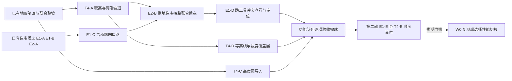

# RMMO 加载、无缝转场与编辑器统一优化计划

**2026-10-17 通用跨工具联合候选已实现并通过限定验收（206 项检查、0 失败），验收记录见文末。** 将原生整地、道路、住宅/街区、河桥、城防和植被组合为有顺序、有上限的私有候选，UI 与当前 3D HTTP MCP 同源，一次应用/丢弃与撤销重做。沿用同步作者发布及原生后台派生流程，性能实验继续后置；不改变场景搭建 worktree。

**本批追加事项 1、2（2026-10-17）已实现并通过限定功能验收：街区自动保留河岸／桥头／城门通道，以及道路变化后的已有街区联合更新。** 两项排在性能专项之前；保留原建筑与构件身份，不再要求先解除关联重建。执行范围、旧图兼容和证据见下文“第三批：街区规划与联动更新”。本批不改正式城镇或场景搭建 worktree。

**2026-10-17：两轮共十二项功能均已完成限定范围的 UI／当前 3D MCP 验收，并发布到远端功能分支和 main。** 第一轮六项随 `0d68fb7f` 发布；第二轮的弯曲道路接路、已有建筑迁移、多栋联合候选、多入口／拱廊／架空保障、PNG16、体积地形分析也均已交付，发布说明见 `6fb9d0e`。其中 **E1-F 多入口／拱廊／架空保障已在 `f276796` 实现，423 项验证通过，不能再作为未实现项重复排期**。各项支持边界与证据见下文；不修改正式城镇布局。

本次重新核对 E1-F：22 项提交内源码 LF SHA、17 项原始证据 SHA 一致，`f276796` 是已获取的远端 `main` 和 `codex/editor-reliability` 的祖先。此次是交付状态核对，不冒称重新运行全部 423 项测试。道路准备性能实验保留在隔离 worktree 的独立暂存记录，尚未完成最终 UI A/B 验收，未提交或发布；后续性能发布暂缓，不能将实验当作已交付优化。

本页是合并后的唯一工作包与验收入口，保留原文件路径以兼容既有引用。2026-10-15 将《城市：天际线 II》的地形研究并入原无缝转场计划；原地形文件改为历史来源入口，不再维护另一份执行清单。

同日补入“按街区设定搭建参考场景”会话近期问题的代码核对与技术预研。已修复个案作为回归输入，新增 E1/E2 仅覆盖可泛化的能力缺口；不另开一份场景优化清单。

**用户补充的方向：不依赖视觉逐点调试来证明几何正确。** 截图用于构图、材质、风格及视觉异常审查；承托、穿插、坡度、道路连续性、净空和事务完整性，应由可复现的数据检查保障。编辑器能够确定安全解时给出可用结果；不能确定时返回具体冲突与缺失条件，不以“看起来没问题”放行。以下保留整包合同；E1/E2 首个限定住宅闭环已在隔离分支通过功能验收，状态与适用范围见下文，不宣称全部保障已完成。

| 证据层次 | 时间与版本 | 使用方式 |
| --- | --- | --- |
| 无缝转场与加载审计 | 2026-10-14，HEAD `e344b29f11749d12b575fc90518154c56caf0a8e`，工作区含未提交修改 | 保留原视频、代码判断及[历史快照](D:/code/rmmo/review_artifacts/seamless_stream_research_20261014/plan_revision_evidence.json) |
| 地形编辑与性能审计 | 2026-10-15，HEAD `520d142197bd71920b476f10d7e5261d4f4d3db5`，工作区含未提交修改 | 保留天际线官方资料、代码判断及[历史快照](D:/code/rmmo/review_artifacts/skylines_terrain_research_20261015/evidence.json) |
| 本次文档合并 | 2026-10-15；合并输入、输出及 SHA 见[合并证据](D:/code/rmmo/review_artifacts/optimization_plan_merge_20261015/merge_evidence.json) | 统一依赖与验收，不表示所有代码在本次重新审计，也不产生新的性能结论 |
| 街区问题预研增补 | 2026-10-15；会话近期 8 个回合、当前相关代码与外部报告；报告状态截于北京时间 20:10 | [读取版本与研究证据](D:/code/rmmo/review_artifacts/reference_scene_research_20261015/research_evidence.json)、[报告字段快照](D:/code/rmmo/review_artifacts/reference_scene_research_20261015/scene_report_observations.json)。另一会话仍在工作，各文件按读取时点记录，不冒充原子代码快照或最终交付审计 |
| 收益与依赖排序 | 2026-10-15；依据上述问题、现有复用能力及用户当前制作目标 | [排序修订记录](D:/code/rmmo/review_artifacts/optimization_priority_20261015/priority_evidence.json)。定性预期贡献，不是新增性能实测或收益百分比 |

历史数字不代表当前实测，HEAD 也不能替代工作区、资源及生成器 SHA。两个原文的逐字节快照保留在合并证据目录，旧 evidence JSON 不改写。

本次优先级复核以隔离分支 `402b58c` 为代码依据：核对 `terrain_surface` 的模式与 schema、`terrain_layout_tools`／面板、住宅候选服务／面板以及当前 3D MCP 清单。已有矩形宅基、矩形整坡与道路节点联合调整、住宅接路事务及住宅冲突定位不重复列为新功能。下文各已完成批次的性能数据继续保留，其中“下一项／下一切片”的历史建议统一服从最新功能队列。

**E1-A、E2-A、E1-B 的首个住宅闭环已提交；按用户后续授权，W0-E 的住宅／道路候选基线、T1 住宅局部格构造、道路投影窗口／障碍粗筛／默认材质 CPU 准备／投影复用、单次操作内的材质批量查找／所选描述定向解析，以及街区可靠性回归已分别完成限定验收，其余工作包仍为候选。** [性能记录的当前处理决定](D:/code/rmmo/docs/reference_map_performance_20261008.md#当前处理决定2026-10-12)及[剩余事项清单](D:/code/rmmo/docs/world_editor_todo.md#当前性能事项状态2026-10-12)于 10 月 12 日将未完成性能项标为“(未解决-跳过)”。前述研究、合并与排序阶段仅修改文档；随后应用户要求保存现有工作状态，再在 `codex/editor-reliability` worktree 实施首批编辑器能力，不改原场景会话目录。新授权仅覆盖按本计划选择的下一项，不自动恢复所有历史性能专项，也不把正确性回归的耗时当性能收益。历史修复证据保持原状，本轮验收另记。

## 首批实施状态（2026-10-15）

**首个限定住宅闭环已在隔离分支通过功能验收，并提交为 `391d47818be733ffc0eca11af816a5a9ddff11e0`**：共享几何、带路缘的真实 UI／HTTP，以及实际玩家室外道路和门槛往返均通过。该批验收当时尚未合并或推送；后续已随 `8ad5e103` 推送到远端分支和 `main`。此功能验收状态不代表 E1/E2 整包完成或正式场景接入。代码位于隔离 worktree；只支持一栋已冻结的 `townhouse/hall` 住宅、一个可确认的首层入口及一条连接已有普通直线 `ground` 道路的入户路。该首批范围要求路网已有与骨架一致的沿地形铺面且不能含桥梁绑定（后续 E1-C 已扩展这一边界，见统一执行顺序）；普通高度场之外的未知支撑／入口语义明确拒绝。不改地形、不移邻物，不扩展到通用跨工具编排或自动布局整城。

| 切片 | 已落代码的范围 | 当前验收状态 |
| --- | --- | --- |
| E1-A | [residential_support.gd](../scripts/world_editor/residential_support.gd) 对实际冻结楼板／基础做连续承托和安全标高区间证明；[residential_access.gd](../scripts/world_editor/residential_access.gd) 按实际支撑切换断面核对门阶，连续地形检查坡度／接缝，并核对自家壳体／邻物净空、返回几何见证；完整入户连接段也检查全宽覆盖、坡度和接缝 | 纯 CPU 回归：承托 **52/0**、入口 **47/0**、连接段 **14/0**。覆盖真实冻结基础、混合格距接缝、连续 10% 坡、内部洞格、缺台阶、实际最外踏面升降、低梁／窄框及无碰撞装饰；连接段区分高处保留区与实际地面冲突。此结果不替代玩家物理通行 |
| E2-A | [residential_placement_tools.gd](../scripts/world_editor/residential_placement_tools.gd) 私有 Doc 候选、地图／文档版本及实际源依赖身份、完整原生房屋和道路预检、有范围发布与一次恢复事务；放弃不修改作者状态 | 带原生路缘的真实 GPU／HTTP 回归 **127/0**：含合法／非法调用、过期与源变化、范围外道路内存字节保护、34 个住宅构件和道路的一次发布／撤销／重做、保存重开。34 构件证明整组单事务，不冒称执行了超过 32 次内部 undo |
| E1-B | 同服务先联合承托区间与实际最外台阶约束求标高，再做 0.05 米步长、最多 157 次退距搜索；[建筑页](world_editor_buildings.md#冻结住宅与入户路候选) 与[三个当前 3D MCP 工具](world_editor_mcp.md#冻结住宅与入户路候选)共用预览、应用和放弃 | 同一 **127/0** 报告验证真实 UI 按钮与 HTTP 同输入结果、改参数立即失效、实际路缘几何／材质、独立选择／活动门身份和编辑器静态合批。运行时 **21/0**，真实角色完成道路—门槛—入口往返，生产 building readiness 生效、34 个构件身份保留。每次新预览仍返回 `requires_runtime_verification`，不把样例跑图推广为任意候选已测 |

当前报告：[连续承托](../review_artifacts/editor_reliability/residential_support/result.json)、[入口几何](../review_artifacts/editor_reliability/residential_access/result.json)、[连接段几何](../review_artifacts/editor_reliability/residential_connector/result.json)、[带路缘的 UI／HTTP](../review_artifacts/editor_reliability/http_kerbs.json)、[带路缘的运行时往返](../review_artifacts/editor_reliability/runtime_kerbs.json)，代码／资源 SHA 汇入[统一证据](../review_artifacts/editor_reliability/evidence.json)。路缘报告记录默认原生材质、生成／应用／重开的实际截面和网格顶点；该临时样例编辑器与运行时批次均从 12 个源表面合为 2 个渲染表面、待处理组为 0，11,844 顶点保持，不外推为整城性能收益。运行时 `reached/returned=true`，移动原因计数为 `building_pending:3 / ok:276`，仅验证室外道路和入口，不重测无关房间。首次退出出现一个 ObjectDB 警告，world／loader／导航烘焙／资产 worker 清理检查通过；[同源码 verbose 复跑](../review_artifacts/editor_reliability/iterations/runtime_verbose.json)仍为 21/0 且未复现该警告，保留观察，不宣称已根治，不阻塞本限定闭环通过。新增测试只使用原生生成后冻结的临时夹具，不打开用户地图；无新模型或正式场景接入结论。在该功能提交时，W0-E、T1/T2、W1/W2/W3 及 T4 坡道工具均未自动启动；后续授权的最小性能切片见下节。

### W0-E 住宅候选基线与 T1 首个热点切片（2026-10-15）

在 `391d478` 功能闭环之后，用户授权按本计划继续下一项优化。本轮完成住宅候选准备测量，并减少 [residential_support.gd](../scripts/world_editor/residential_support.gd) 中与支撑轮廓不相交的实心格几何构造；不是整个 W0-E 地形笔刷基线、T1 空间／依赖索引或 T2 局部 mesh／shape 更新的完成。仍在同一隔离 worktree，原场景目录和历史证据不改。上节[功能证据](../review_artifacts/editor_reliability/evidence.json)捕获于 `391d478` 提交前，其中未提交状态描述保留原样，不随本轮追写。

[测量脚本](../tools/benchmark_residential_preview.gd)使用同一冻结住宅、40 米 64×64 高度场、带原生路缘的道路及远处道路哨兵。计时直接调用 UI／MCP 共用的住宅服务，包含身份核验、完整候选准备及返回，不含 HTTP 往返。服务的 `profile_enabled` 默认关闭，`last_profile` 只供本地探针；既有 MCP 工具和 schema 不增加性能开关。分别保留首个候选、强制丢弃后的重复准备、缓存命中、实际 UI 预览构造及应用到编辑器派生就绪；首个候选不是磁盘冷启动。阶段和未归因时间分列，阶段之和不冒充完整调用耗时；探针开关的顺序和运行噪声也不用于推算精确探针开销。

正式 [A 基线](../review_artifacts/editor_reliability/t1_benchmark/before.json)与 [B 候选](../review_artifacts/editor_reliability/t1_benchmark/after.json)各 **43 项通过、0 失败**。[对照报告](../review_artifacts/editor_reliability/t1_benchmark/comparison.json)核对归一化输入摘要、源预制件、地图和归一化结果摘要一致；测量时脚本和服务版本一致，已记录的源码差异仅为 Support 的局部构造优化。[本切片证据](../review_artifacts/editor_reliability/t1_benchmark/evidence.json)记录 8 份报告、12 份源码及源资源身份。测量结束后，仅将 benchmark 的 CLI 合法格数从错误的 `64|128` 更正为 `32|64` 并检查解析；正式 A/B 均使用 64，测量路径不变。[测量时脚本原文](../review_artifacts/editor_reliability/t1_benchmark/measurement_script.gd.txt)另行归档，报告原 SHA 保留，不用最终脚本 SHA 覆盖历史。

| 实测区间 | A | B | 解释 |
| --- | --- | --- | --- |
| 关闭阶段探针的重复准备，中位数，各 2 次 | 3181.736 ms | 1788.146 ms | 本固定输入观察到约 **43.8%** 降低；原始值分别为 3216.435／3147.036 与 1863.644／1712.647 ms |
| 开启阶段探针的重复准备，中位数，各 2 次 | 3072.152 ms | 1790.056 ms | 用于定位阶段，不与关闭探针的样本混合统计 |
| 同进程首个住宅候选，各 1 次 | 3249.262 ms | 1767.317 ms | 引擎、道路和 OS 缓存可能已热 |
| 候选缓存命中，各 1 次 | 54.562 ms | 55.740 ms | 身份／版本检查仍执行，候选历史计数不代表命中时又做了一次计算 |

该受控样本返回摘要中的住宅承托格构造由 **4096→418**、连接段由 **4096→108**；两处仍各扫描 4096 个格标记，裁剪数 **608／90** 和实际交叠数 **606／89** 均保持。这些计数不包含入口检查中全部重复地形调用。窗口通过逆变换取得保守格范围，额外边界格仅保障本段三角构造，不可套用为笔刷法线、侵蚀或混合格距依赖的通用 halo。所有地形有效性、洞格减除及原顺序、精确三角裁切、失败见证和保护预算继续执行；没有持久空间索引或跨候选复用。

归一化摘要排除 ID、token 和计数，只证明记录的几何／诊断摘要一致，不证明完整候选 payload 或身份一致。另以 SHA 固定的原 Support 做[严格差分](../review_artifacts/editor_reliability/t1_validation/differential/result.json)：**41 个案例、79 项通过、0 失败**，仅排除 `counts`，保留 ID、精确数值、错误和原始 Access `pieces`，同时检查双方输入不变；覆盖边界、远坐标旋转、混合格距、孔洞、无效远地形及文档操作后的状态。共享[承托](../review_artifacts/editor_reliability/t1_validation/support/result.json) **52/0**、[入口](../review_artifacts/editor_reliability/t1_validation/access/result.json) **47/0**、[连接段](../review_artifacts/editor_reliability/t1_validation/connector/result.json) **14/0** 复验通过。优化后的[真实 UI／HTTP 复验](../review_artifacts/editor_reliability/t1_validation/http_kerbs.json) **127/0**，覆盖工具发现、同输入一致、非法调用无副作用、整组撤销重做、保存重开、实际路缘、身份和合批。本有限切片通过验收，不把测试总耗时当作性能指标，也不宣称重新完成了运行时物理跑图。

这是顺序固定、少量重复的局部测量，保留原始值和中位数，不声称 P95/P99、统计显著性、整城收益或 RSS／VRAM 下降。真实预览构造 **386.018→389.918 ms**、缓存按钮回调 **85.564→105.372 ms**、应用到编辑器派生就绪 **395.546→354.128 ms** 各只有一个样本，不能据此宣称 UI 或发布改善；编辑器拾取就绪也不替代玩家物理通行。四个地形相关阶段合计中位数由 **1664.844→250.128 ms**，占开启探针的重复准备约 **54.19%→14.03%**；B 中完整道路阶段中位数仍为 **913.462 ms**。后续先测残余道路准备内部成本或其他高频工具，再决定下一切片；不因此提前启动 T2 或放宽完整道路预检。

### W0-E 道路准备与 T1 投影窗口、街区回归（2026-10-16）

按用户授权继续在 `codex/editor-reliability` 隔离 worktree 实施，基于 `784e2cbc27cbd5196b949d0b989a04e92f2b7995`，完成后单独提交、暂不合并。此次不改场景搭建会话的目录和用户地图。此前住宅切片及历史报告保持原样。

[road_tools.gd](../scripts/world_editor/road_tools.gd) 增加默认关闭的本地阶段探针，区分源保护、路口、桥绑定、路面构造、贴地、材质、记录保护、障碍展开、碰撞和最终清单；失败也结算当前阶段。`record_preservation` 包含默认刷面几何准备，`potential_shape_pairs` 仅是路块数与障碍形状数的乘积，不是实际裁切次数。探针不进入作者数据、UI 参数或 MCP schema。

正式 A 指向贴地投影，而非障碍展开。因此 [terrain_projection.gd](../scripts/world3d/terrain_projection.gd) 仅对旋转严格为 `[0,0,0]`、实际单位 Basis 且数值安全的高度场，按道路 XZ 范围缩小格构造窗口。每轴在 double 中加入 `8 × 2^-23 × (abs(origin) + size + 1)` 的保守误差边距，再外扩一格；误差超过半格、旋转、微小倾斜或不可信范围均使用完整扫描。原 native float32 顶点、格／三角顺序、精确裁切、孔洞、坡度见证、512 片限制、材质细分、稳定 ID 和路缘采样不改；不新增缓存或更改承托豁免。该共享函数也供河道及地形跟随调用，相应功能回归与道路性能收益分别记录。

[独立旧链差分](../review_artifacts/road_prepare_20261016/differential.json) **75 个案例、356 项检查、0 失败**。冻结旧 `road_tools → road_terrain_fit → terrain_projection`，仅替换两处 preload 路径以隔离旧投影，原文 SHA 与替换记录见[清单](../review_artifacts/road_prepare_20261016/full_chain_metadata.json)。整个返回 `var_to_bytes` 比较保留数值类型、数组顺序、ID、token、材质和错误，输入／历史／参数也须无修改。覆盖首冲突顺序、隐藏／无碰撞障碍、分路承托豁免、真实桥翼柱、旋转与微小倾斜、远坐标微格、孔洞／跨块、陡坡、投影片与刷面预算、自动子块及路缘；另外直接确认局部窗口和安全回退均实际命中。

正式 [A](../review_artifacts/road_prepare_20261016/before/result.json)／[B](../review_artifacts/road_prepare_20261016/after/result.json) 各 **149 项通过、0 失败**；[比较器](../tools/compare_road_prepare.py)的[对照报告](../review_artifacts/road_prepare_20261016/comparison.json) **514 项通过、0 失败**。相同引擎、benchmark、夹具和实际外部资源 SHA，五组输入、完整结果二进制及各六次返回 SHA 均一致；测量期间唯一生产源码差异是投影窗口。benchmark 内旧 road_tools 仍共享当前 helper，单靠它不能证明旧投影等价，故另以 A/B 二进制与上面的完整独立旧链交叉验证。

| 完整道路 prepare，关闭探针重复 3 次的中位数 | A | B | 本夹具观察 |
| --- | --- | --- | --- |
| 路口与原生路缘 | 62.826 ms | 55.896 ms | 未走贴地投影，作为控制观察 |
| 本地 40 米、64×64 高度场 | 1901.219 ms | 477.017 ms | 约降低 **74.9%** |
| 同一道路＋远处地形／原生建筑／道具，共 610 记录 | 2076.315 ms | 665.608 ms | 约降低 **67.9%** |
| 河道配方绑定桥梁 | 23.670 ms | 29.787 ms | 增加 6.117 ms；未走贴地投影，不归因于本优化 |
| 冻结石桥与引道 | 76.674 ms | 60.208 ms | 原始值保留，不据此作独立收益承诺 |

每组固定顺序为首个 ON、重复 ON 两次、OFF 三次；准备外的构造、序列化、SHA、原实现对照均不计时。首个调用不代表磁盘／OS 冷启动，ON/OFF 不混合统计；阶段计时与完整调用分列。ON 的本地／远景贴地阶段中位数分别 **1559.834→189.227 ms／1462.749→192.092 ms**。河道桥 OFF 原始范围 A **22.337–28.841 ms**、B **21.831–32.222 ms** 重叠，ON 中位数则下降；固定顺序和少量样本不足以支持显著性或精确探针开销结论。仅隔离了本任务的测量进程，没有接管其他会话的进程或系统负载。保留所有原始值，不宣称 P95/P99、HTTP 延迟、UI 帧时间、整城性能或内存改善。

街区测试另外发现并修复了已有的保存重开问题：原生 JSON 状态中的 `0.0` 与生成器 `0`、字典插入顺序，使相同道路误计为更新，并替换远处原记录。共享准备现在只在完整记录精确同值且所有手刷／事件保护通过后，深复制原记录，准确计入 `unchanged`；完整清单同值时重复生成不增加历史。比较不使用 epsilon 或 token 的量化容差，数组顺序、字段集合和非数值类型保持严格；跨 int/float 超过安全整数范围则保守不复用。真实微小数值变化仍更新，碰撞和失败顺序不改。

这项正确性修复晚于 B；测量时 [road_tools 原文](../review_artifacts/road_prepare_20261016/measured_road_tools.gd.txt) 与 SHA 已单独保存，不把 B 的性能数字标为该修复的收益。最终源码[独立差分](../review_artifacts/road_prepare_20261016/differential_final.json)为 **74 个严格旧链全等案例＋1 个明确的正确性变化案例、364 项检查、0 失败**。变化仅为附带事件／分组的记录保留输入字典顺序；[双方完整字节与差异证据](../review_artifacts/road_prepare_20261016/differential_final_record_order.json)独立归档，没有归一化后宣称完全相同。原生 reference save/read 的[记录保留回归](../review_artifacts/road_prepare_20261016/record_preservation_native.json) **24/0**：旧实现将 6 条未变记录全部计为更新，修复后为 0 更新／6 未变，原 manifest 和 plan_token 字节不变；深复制无副作用，直接重开后重复生成无历史，真实 `1e-10` 净空变化仍更新。整记录 JSON 模拟会改变部分几何浮点末位，不能充当原生几何二进制保存；这类实际数值变化另作拒绝复用的负例。

最终源码另外运行完整 [C 复测](../review_artifacts/road_prepare_20261016/final/result.json) **149/0**，[A/C 核对](../review_artifacts/road_prepare_20261016/comparison_final.json) **514/0**，三份生产源码 SHA 与最终文件一致，五组完整输入／结果及每组六次 SHA 仍相同。本地／远景 warm OFF 中位数为 **381.232／604.090 ms**，相对 A 约降低 **79.9%／70.9%**；该固定性能集初始没有已生成道路，未覆盖记录保留分支，不能把它写成保存重开后的重复生成性能。C 的河道桥 OFF 为 **36.224 ms**，比 A 增加 **12.554 ms**，原始范围 **35.416–42.166 ms** 与 A 不重叠；同进程 ON 两次却为 **23.316／21.974 ms**。保留此上升，不以 B 的区间重叠解释 C，也不据少量顺序样本宣称所有路径无回退。

针对河道桥追加[同进程交错对照](../review_artifacts/road_prepare_20261016/waterway_control/result.json) **95/0**：双方各预热一次，再以新／旧交替先后的 10 对 OFF 样本比较完整旧链与最终源码，全部输入和完整返回字节一致。当前实现 6 对较慢、4 对较快，配对耗时差中位数 **+3.372 ms**；两组单独中位数为 **28.6655／24.4385 ms**。没有重现 C 的固定差值量级，也没有排除较小回退；不改称“只是噪声”，保留为后续测量项。此路径不进入贴地或旧记录保留分支，本轮不以继续改造无关几何来追逐小样本数字。

[最终街区 UI／HTTP](../review_artifacts/road_prepare_20261016/district_http_final.json) **113 项通过、0 失败**，在从不激活的独立 Windows 桌面、唯一临时资源包／地图中执行。覆盖真实 UI 预览与应用按钮、当前 3D 工具及 schema 发现、同输入同 token／作者结果、过期和非法参数、锁定／隐藏、隐藏实体障碍、手刷保护、失败无副作用、保存重开后直接无操作、局部改路／一次撤销重做及远处两条道路的完整字节保持。延长本地端点后，16 条路块中 **7 更新／9 未变**；实际共享合批为 **48→12 个表面、5592 顶点不变、待处理组 0**，独立作者节点和拾取身份保留。保存后由原生运行时加载，在路口、32 米区块缝、两端桥头、实际延长段和远路／空院落做 **10 处就绪与碰撞射线检查**，两端桥头高度连续；这是物理发布与表面验证，不是胶囊角色全程往返，也不重测住宅室内。

迭代失败原样保留：首轮用分块锚点误判道路位置；第二轮把手刷保护负例与合法改路混合，正确拒绝后仍继续测试，且清理已释放 loader；修正测试后才复现远路字节缺陷。最终测试按实际世界轮廓定位、先原生撤销手刷负例、合法改路失败立即结束，并修正测试清理；没有放宽生产保护。旧住宅、桥梁或正式场景报告均未改写。

共享调用的复验还包含带原生路缘的[住宅 UI／HTTP](../review_artifacts/road_prepare_20261016/residential_http_final.json) **127/0**、真实 PBR 铺路材质的[自动细分／雕刻跟随 HTTP](../review_artifacts/road_prepare_20261016/adaptive_textured_final_engine.log) **70/0**，以及道路／河道共用投影的[边界 CPU 回归](../review_artifacts/road_prepare_20261016/terrain_projection_bounds.log) **22/0**。本轮住宅回归是候选与编辑器发布，未重新执行上一批已经记录的角色往返或室内检查。源码、报告与最终临时地图身份见[本批证据清单](../review_artifacts/road_prepare_20261016/evidence.json)。

此切片未实现全图障碍索引、重复路缘采样优化、T2 局部 mesh／shape 发布，也不扩展住宅候选的桥绑定支持范围。B 的远景夹具中，障碍展开／记录保护／碰撞 ON 中位数仍约 **175.983／152.240／121.678 ms**，可作为后续测量候选；先由实际创作需求与阶段占比决定下一切片，不直接启动 T2。

### W0-E / T1：道路障碍准备粗筛（2026-10-17）

继续在 `codex/editor-reliability` 隔离 worktree，以上批提交 `12e3c91` 为本批基线。目标是减少已验证承托和远处地形的无用展开，继续共用 UI／当前 3D MCP 的 `road_tools.prepare`，没有新增工具或参数，也没有修改场景搭建会话的地图。

共享准备在展开地形格之前，逐条道路确认：该地形已被这条道路的贴地投影验证为承托，或者它与道路的保守 XZ 范围分离。**只有全部道路都满足时才跳过地形**，不能把一条道路的承托豁免推广到整图。远处判定仅用于严格零旋转、实际单位基、有限正尺寸的高度场；使用原生端点及随世界坐标增长的浮点余量。旋转、倾斜和其他形状回到原检查；田垄高度、近处障碍、精确几何与首个冲突顺序保持。单次调用只按需缓存道路 XZ 矩形，不保留全部精确碰撞面，也不跨编辑缓存；移动、删除、撤销和重做都重新计算。最终精确碰撞、手刷／事件保护、作者字节、token、事务、保存和派生发布路径不改。

[配对测量](../review_artifacts/road_obstacles_20261017/paired/result.json) **583 项检查通过、0 失败**。同进程、同输入、探针 OFF，每个版本两次预热后，普通夹具运行 10 对交替先后样本；河道桥运行旧完整链／上批基线／本批三个版本的全部六种顺序各四轮。所有完整返回、输入状态与参数均做字节核对，外部材质及原生桥资源 SHA 一致。预热与单次 ON 阶段诊断另存，不混进 OFF 统计。

| 完整 prepare 的 OFF 中位数 | 上批基线 | 本批 | 样本观察 |
| --- | --- | --- | --- |
| 路口与原生路缘 | 42.412 ms | 40.676 ms | 10 对中 3 对较慢，控制路径，不单独承诺收益 |
| 本地 40 米、64×64 高度场 | 401.716 ms | 290.1935 ms | 约降低 **27.8%**；10 对均较快 |
| 同一道路＋远处地形／建筑／道具，610 记录 | 553.464 ms | 287.8705 ms | 约降低 **48.0%**；10 对均较快 |
| 河道配方绑定桥梁 | 19.8885 ms | 19.991 ms | 配对差中位数 −0.0305 ms，12 对较慢／12 对较快 |
| 冻结石桥与引道 | 52.464 ms | 48.0215 ms | 10 对中 3 对较慢，保留完整原始值 |

本地障碍面从 **4096→0**；远景夹具跳过 7 条地形记录，障碍面从 **10843→603**，潜在配对从 **86744→4824**。这是实际展开计数，未跳过附近建筑或放宽碰撞。远景最终一次 ON 诊断的障碍展开／碰撞合计 **32.492 ms**，剩余贴地投影／记录准备约 **184.056／139.073 ms**；单次阶段数据只帮助选下一项，不能当稳定分位数。`record_preservation` 包含默认材质网格构造和刷面分析，不等同于记录复制。

河道桥三方对照中，最初完整旧链中位数 **20.079 ms**；上批／旧链配对差中位数 **−0.0265 ms**，本批／旧链为 **−0.097 ms**。本次未重现前批持续上升，不能倒推旧报告错误，也未定位系统波动或证明所有负载下无回退。原 2026-10-16 数据保留；本批初版与收紧缓存后的测量分别归档，不混用两个版本的收益。计时只覆盖 CPU prepare，未隔离用户其他进程，不外推 HTTP 延迟、UI 帧时间、整城 FPS 或 RSS／VRAM。

[严格差分](../review_artifacts/road_obstacles_20261017/differential.json)覆盖 **59 个完整返回案例、336 项检查、0 失败**：所有字段、字典顺序、数值类型、token 和失败结果原样比较，没有归一化或例外。包含大坐标地形边界、孔洞、田垄、旋转／微小倾斜回退、道路净空、逐道路承托、先后冲突、手刷／事件、同 UUID 移动和原生撤销重做；另核对 32 组确定种子的实际地形格 AABB 均落在保守范围内。首轮有一条测试预期错误：小道具只覆盖较后道路块，却期待全图按文档先后返回冲突；新旧实现当时已字节相同。改为两类障碍覆盖同一首块后通过，初始日志和当时测试源码保留，未更改生产碰撞顺序。

最终源码在独立、不激活的 Windows 桌面完成[街区 UI／HTTP](../review_artifacts/road_obstacles_20261017/district_http.json) **113/0**、带路缘的[住宅 UI／HTTP](../review_artifacts/road_obstacles_20261017/residential_http.json) **127/0**、带实际 PBR 材质的[贴地细分／雕刻跟随 HTTP](../review_artifacts/road_obstacles_20261017/adaptive_textured.log) **70/0**。街区继续覆盖工具与 schema 发现、同输入同结果、非法／过期调用、保护及失败无副作用、局部改路、远处作者字节、撤销重做、保存重开与 10 处原生碰撞射线；共享合批 **48→12 表面、5592 顶点不变、待处理 0**。未重测住宅室内或胶囊角色全程通行。测试全部使用唯一临时地图／资源包；源码、报告、外部依赖及最终作者地图身份见[证据清单](../review_artifacts/road_obstacles_20261017/evidence.json)。

下一切片仍按 T1 排序：优先拆分默认铺路材质的网格构造／刷面分析耗时，再决定是否复用候选几何；同时观察剩余贴地成本。暂不启动 T2 发布改造或全图持久障碍索引，先以实际创作需求和共享调用的端到端成本确认收益。

### W0-E / T1：默认铺路材质准备（2026-10-17）

先将最新远端 `main` 的 `d2cd069` 快进合入隔离分支，再以此为本批基线。上游新增的冻结房屋／导入建筑道路接触校验、地形及场景能力保留；本批生产改动仅在 `road_tools.paint_default` 与共享 `surface_materials.geometry`，不修改场景地图。

[基线分项诊断](../review_artifacts/road_paint_20261017/profile.json)在真实准备过程中插入本地计时，完整结果与未插探针版本一致，**30/0**。本地细地形三次刷面分析约 **64.893–81.993 ms**、网格构造 **28.339–30.139 ms**，作者条目生成、校验及依赖存在检查各不到 1 ms。这里含重复调用和缓存影响，不是冷启动或稳定分位数；据此选择几何准备，不改动已很小的材质校验。

默认铺路现在把**原生成器的全部 CPU 数组**交给已有 CPU 网格适配器，避免为候选构造渲染网格和临时材质。只为实际要刷的第 0 个铺面槽计算相邻共面组和签名；底面、侧面、路缘仍逐槽检查通道类型及 **1–50000 三角形**上限，不能借此放过未刷槽超限。**128 个刷面**上限、完整数组、顶面 face ID／签名／UV、依赖验证和错误返回均保持。部分结果不写入完整手工刷面缓存；后续手工选择侧面或底面仍能获取所有槽。实际网格生成、后台准备、共享合批、碰撞和发布未改。

[同进程配对测量](../review_artifacts/road_paint_20261017/paired/result.json) **580 项检查、0 失败**。7 组夹具各预热两次，再执行 10 对交替先后的探针 OFF 调用；完整返回与输入／历史／参数均逐次核对字节。旧链独立冻结本批基线的 road_tools、road_surface、surface_materials，其他未改 helper 共用并记录 SHA。单次 ON 阶段数据另存；不把分项探针与 OFF 混合统计。

| 完整 prepare 的 OFF 中位数 | 本批基线 | 本批优化后 | 观察 |
| --- | --- | --- | --- |
| 路口与原生路缘 | 46.6125 ms | 32.7125 ms | 约降低 29.8%，10 对均较快 |
| 本地 64×64 地形 | 328.109 ms | 250.6445 ms | 约降低 **23.6%**，10 对均较快 |
| 610 记录、含远处地形／建筑／道具 | 384.443 ms | 294.4105 ms | 约降低 **23.4%**，10 对均较快 |
| 河道配方绑定桥梁 | 22.546 ms | 13.525 ms | 约降低 40.0%，10 对均较快 |
| 冻结石桥引道 | 58.381 ms | 53.812 ms | 约降低 7.8%，4 对较慢，保留原始波动 |
| 起伏高度场 | 345.284 ms | 277.189 ms | 约降低 19.7%，10 对均较快 |
| 已生成道路的重复准备 | 272.3155 ms | 214.959 ms | 约降低 **21.1%**，10 对均较快 |

CPU 性能夹具使用内置材质；真实 PBR 另做功能回归，不能将这些数字当作纹理解码、HTTP 或 UI 端到端收益。旧准备顺带提前创建的路缘材质现在由实际发布阶段正常创建，本批没有把延后的工作宣称为整体加载缩短。未控制其他会话／系统负载，未宣称 FPS、RSS／VRAM、尾延迟或显著性，也不将各批比例相加。

[严格差分](../review_artifacts/road_paint_20261017/differential.json) **376/0**：36 个完整 prepare 案例，加上原生道路逐块默认刷面、真实 PBR、128 面接受／129 面拒绝、未刷路缘三角形超限、后续槽为空／骨骼／自定义通道、材质缺失和非法值、UV／厚度变化。完整返回、作者记录、顶面数组／面组／签名均逐字节比较；还验证顶面分析前后的全槽手工刷面结果、缓存完整性与输入无修改。[通用 UV 合批](../review_artifacts/road_paint_20261017/surface_uv_batch.log) **6/0**，不同 UV 偏移、平面投影及不同材质仍保持正确。

最终源码在独立、不激活的 Windows 桌面完成[街区 UI／HTTP](../review_artifacts/road_paint_20261017/district_http.json) **113/0**、[住宅与原生路缘 UI／HTTP](../review_artifacts/road_paint_20261017/residential_http.json) **127/0**、[实际 PBR 贴地细分／雕刻跟随](../review_artifacts/road_paint_20261017/adaptive_textured.log) **70/0**，以及[JSON 重开后的默认刷面与手刷保护 HTTP](../review_artifacts/road_paint_20261017/terrain_follow_paint.log) **33/0**。覆盖工具／schema 发现、合法／非法调用、失败无副作用、撤销重做、保存重开及原生发布；偏移、旋转、缩放和混合材质的手刷仍阻止自动覆盖。街区共享合批仍为 **48→12 表面、5592 顶点不变、待处理 0**。仅临时地图／资源包，未重测无关室内或整城通行。初版 370/0 后补充冻结依赖校验、128 面边界和按夹具选择的测试分支，再运行最终 376/0；生产实现未因测试放宽。源码／引擎／依赖 SHA、原始报告及最终作者地图见[证据清单](../review_artifacts/road_paint_20261017/evidence.json)。

当前一次 ON 诊断，本地／远景记录准备阶段约 **63.741／60.763 ms**，贴地阶段约 **156.505／143.058 ms**；已有道路重复准备中分别为 **51.754／129.127 ms**。下一切片优先细分贴地投影剩余计算，并补充高频预览／应用的端到端阶段测量，再决定复用候选几何还是处理发布。仍不依据这组 CPU 数据直接启动大规模 T2 或持久几何缓存。

### W0-E / T1：贴地格点与路缘采样复用（2026-10-17）

以合并远端 `main`（`99893d9`）后的 `0ed9c43` 为基线。生产只修改 `terrain_projection.gd`，继续在 `codex/editor-reliability` 隔离 worktree 工作。道路生成、地形雕刻跟随及水面投影沿用原入口，原场景会话目录与正式地图未修改。

先在冻结基线上拆分投影阶段，再选择单次调用内的计算复用：相邻实心格共享两行惰性世界格点，保持原生 `T.point` 与变换表达式；路缘复用地形变换及完全相同的原生世界坐标采样。没有舍入键，也不按地形 ID 混用不同记录。格点状态最多两行；路缘高度最多缓存 **4096** 个坐标，满后继续精确计算。所有状态在一次 `fit` 返回时释放，跨候选、雕刻、撤销或重开均重新建立。

典型 64×64 夹具仍调用投影 **16 次**，访问 **2160 个实心格／4320 个三角**；原生格点构造 **8640→2632**，世界变换 **12960→2632**。本地／远地形路缘采样分别 **1056→416／7392→2912**，实际普通夹具缓存峰值仅 **32** 个坐标。[计数回归](D:/code/rmmo_runtime/review_artifacts/road_projection_20261017/counts_final.json) **152/0**；超量路缘案例实际峰值为 **4096**，另有 **15456** 次超容量坐标按原逻辑重算，完整输出仍相同。裁剪、覆盖、坡度错误见证、分片与刷面预算、面序、UV、路缘端帽和作者字节均不变。没有实施跨自适应子块的结果复用、持久几何缓存或 T2 发布改造。

最终有界实现先进行每夹具 12 对 OFF A/B 测量；其中未贴地对照也出现 17.2% 中位数变化，本地结果被噪声淹没，不能据此放行。保留该轮后，固定扩大到 **9 组夹具各 40 对 A/B、12 对 A/A**，不修改生产代码或删去样本。每版本先预热两次，A/B 交替先后；输入／完整返回字节和源依赖逐次核对，**3016/0**。下表为扩大样本后的完整 `prepare` OFF 中位数，A/A 列为两次基线调用的绝对差中位数：

| 夹具 | 基线 ms | 优化后 ms | 变化 | A/A ms | 较慢对数／40 |
| --- | --- | --- | --- | --- | --- |
| 路口与路缘（未贴地对照） | 33.931 | 32.931 | -2.9% | 11.377 | 17 |
| 本地 64×64 地形 | 239.198 | 218.987 | -8.4% | 17.245 | 9 |
| 相同局部操作＋远处复杂记录 | 237.290 | 218.523 | -7.9% | 10.809 | 6 |
| 河道绑定桥（未贴地对照） | 31.758 | 32.073 | +1.0% | 4.540 | 24 |
| 冻结石桥引道 | 56.346 | 54.481 | -3.3% | 4.630 | 17 |
| 起伏高度场 | 246.064 | 231.529 | -5.9% | 19.951 | 8 |
| 本地地形＋路缘 | 292.358 | 258.168 | -11.7% | 19.977 | 9 |
| 远处地形＋路缘 | 307.669 | 273.694 | -11.0% | 17.074 | 7 |
| 已有道路重复准备 | 233.612 | 209.560 | -10.3% | 20.671 | 6 |

本地／远处复杂记录／本地路缘／远处路缘四项预定主案例的中位数改善超过各自 A/A 绝对差，约 **7.9%–11.7%**；全部对照中位数回退在预定 10% 容差内。起伏高度场的中位差低于 A/A 波动，小幅对照变化也不记作稳定收益。其他用户会话／系统负载未控制；不以这组原始中位数宣称统计显著性、每次请求均更快或整城收益。首轮未限容量实现、最终小样本及扩大样本各自独立留档，不混成同一版本曲线。

另以同一原生 `road_terrain_fit.fit`（包括校验、128 刷面预算及自适应切分）做 **40 对 A/B、12 对 A/A** 的阶段隔离测量，**1094/0**，作为归因补充，不替代完整准备和 UI：

| 独立贴合阶段 | 基线 ms | 优化后 ms | A/A ms |
| --- | --- | --- | --- |
| 本地 64×64 地形 | 143.037 | 121.874 | 10.117 |
| 相同局部操作＋远处复杂记录 | 169.211 | 156.982 | 39.805 |
| 起伏高度场 | 149.856 | 130.997 | 31.348 |
| 本地地形＋路缘 | 170.761 | 152.904 | 10.244 |
| 远处地形＋路缘 | 185.743 | 154.513 | 29.118 |

阶段隔离中本地和路缘案例体现出计算节约；远处普通地形、起伏高度场的 A/A 仍较大，保持不确定性。CPU 夹具使用内置材质和隔离材质库，因此不能代表真实共享库的扫描成本。完整原始数值、顺序、较慢样本及源码 SHA 保存在外部回执中。

真实 UI 使用 64×64 地形、贴地、原生路缘及共享库的真实 PBR；两版本各一次预热，再做 3 对 A/A 与 6 对交替 A/B，最后各一次 ON 诊断。每次均从同一作者状态按真实按钮预览／应用，再原生撤销并等待派生就绪。所有版本的完整应用作者字节一致；HTTP 按所有字段精确比较，只允许 JSON 数值类型和键顺序差异，未使用几何误差容限。

| UI OFF 中位数 | 基线 | 优化后 | A/A 绝对差中位数 |
| --- | --- | --- | --- |
| 实际预览按钮回调 | 1462.423 ms | 1426.885 ms | 63.779 ms |
| 实际应用按钮回调 | 1761.947 ms | 1821.025 ms | 136.807 ms |
| 应用按钮至编辑器派生／拾取及后续绘制就绪 | 1893.849 ms | 1951.945 ms | 144.665 ms |

这组 UI 数据**没有证明端到端提速**。应用至就绪中位数约增加 3.1%，小于 A/A 波动及预先规定的 10% 回退容差；保留全部原始样本，不宣称没有任何较慢样本。该面板预览显示统计文本，没有住宅式 ghost 网格；后续绘制帧不是屏幕光子延迟。编辑器拾取就绪不冒充角色行走验收。本批不宣称 GPU 时间、FPS、RSS／VRAM 或 P95/P99 改善。

最终源码功能验证：严格差分 **505/0、120 个案例**，含同 ID 改高度／位置／旋转／缩放、混合格距、孔洞与稀疏格、重复地形 ID、既有路缘跟随、缓存超限、锁定／隐藏／手刷和冲突顺序；边界与独立已知坡面 **22/0**。独立后台桌面真实 UI／HTTP **263/0**、街区 **113/0**、住宅与原生入户路 **127/0**、实际 PBR 自适应道路／雕刻 **70/0**、JSON 刷面跟随及手改保护 **33/0**、真实 HTTP 坡度诊断 **12/0**，合计 **618** 项 UI／HTTP 检查通过。覆盖工具发现、合法／非法调用、无副作用失败、撤销重做、保存重开及真实合批。新夹具表面 **24→12、18792 顶点不变、待处理 0**；街区原有 **48→12／5592 顶点** 合同保持。只使用临时资源包和地图，不重复建筑室内验收。

首轮 UI 测量脚本误把材质字段传给数值表单，表单拒绝更新，实际未启用贴地，产生两项比较失败；该轮已明确排除，原始 `ui.json/ui.log` 与脚本保留。修正后逐项断言真实表单参数，重跑得到上述 263/0。首轮未限容量的实现测量与加限后的小样本噪声也分别保留，不能将早期数据冒称最终源码结果。冻结旧链、最终源码／引擎 SHA、所有原始数据和失败说明见[证据清单](../review_artifacts/road_projection_20261017/evidence.json)，大体量原始回执在外部 `rmmo_runtime/review_artifacts/road_projection_20261017/`。本批不改变保存格式，可以独立回退本提交恢复旧投影实现，无需迁移地图。

**下一项改为优先优化真实材质定向查找。** 最终 UI 的 ON 诊断中，材质查找／依赖校验阶段约 **1090–1181 ms**，投影约 **151–235 ms**。前一阶段包含路面与路缘两次 `library.find`；代码核对发现 `find` 每次调用 `entries()` 遍历材质目录与共享资源包。下一批先单独计时两次扫描与必要校验，确认各自占比。先缩小同一 ID 查询的目录枚举和重复解析，保持资源根／符号链接限制、材料有效性、资源包身份、外部变化可见性和失败语义，并继续验证 UI／MCP 的真实调用及完整应用到就绪延迟。此数据不足以优先启动 T2；投影内的原生校验与切分另留候选，不越过验证直接跳过。

### W0-E / T1：道路材质批量查找与方案过期保护（2026-10-17）

本批继续在 `codex/editor-reliability` 隔离 worktree，基于已与远端 `main` 同步的 `8ad5e103`。只改共享材质库的批量查询和道路准备；没有操作场景搭建目录、正式地图或模型资源。上一节要求的定向查找先收敛为**同一次准备只扫描一次目录**，更进一步的按 ID 跳过目录／描述校验仍未实施。

先拆分两次真实 PBR 查询。预热后每次完整查找约 **464–493 ms**：资源包目录约 **19–20 ms**、52 份描述文件的读取／JSON 解析约 **9–10 ms**、全部材质校验约 **258–273 ms**；其余包括目录枚举、逐路径权限与路径处理。所选路面／路缘自身合法性检查约 **6.7／5.1 ms**，本样例缺图检查约 **0.07–0.09 ms**。首次查询为 1611 ms，单独保留，不宣称磁盘冷启动。诊断计时开启探针，不与下述 OFF 对照混算。

`surface_material_library.find_many` 仍调用原 `entries()`，从一次新目录中取得所选 ID 的首个有效项并深复制。道路和路缘均有材质时扫描 **2→1** 次；单材质保持 1 次，两者为空为 0 次。目录深度、数量上限、同名优先级、资源包发现与路径限制不变，也兼容覆盖 `entries()` 的目录实现。没有跨调用缓存、面板快照复用、异步提交或全局索引。每次预览与应用仍分别重新读目录并完成选中路缘的合法性、透明度和缺图检查。

真实 HTTP 回归同时发现旧缺陷：原 `plan_token` 仅含材质 ID，外部改写同 ID 的合法描述后仍可能用旧 token 提交。本批将**实际选中的路面和路缘定义**纳入 token；修改描述须重新预览，缺失描述／路缘贴图继续无副作用拒绝。该 token 是临时预览凭据，不存入地图，不改变作者格式。这里没有新增同路径贴图内容的字节 SHA 身份合同，不能把描述过期保护说成完整的外部素材版本锁。

为隔离性能收益，两侧测量都包含同一行 token 修复：A 为 `8ad5e103` 原道路代码加该修复，B 再增加批量查找。原始 A、修复后的 A、替换规则及 SHA 均保留；所有完整准备输出字节逐次比较，未删除 token 字段来制造一致。真实 UI 最终作者字节一致，HTTP 与 UI 仅允许 JSON 数值类型／字典顺序差异。

正式 CPU 每组每版本预热 2 次，随后 4 对 A/A、12 对交替 A/B，最后各一次 ON；真实 UI 每版本预热 1 次，再做相同配对数量，样本之间原生撤销并等待派生就绪。OFF 中位数如下，A/A 是两次基线调用的绝对差中位数，所有原始值和较慢样本均保留：

| 区间 | A ms | B ms | 变化 | A/A ms | B 较慢对数 |
| --- | --- | --- | --- | --- | --- |
| CPU 完整准备：路面＋路缘 | 1348.528 | 837.094 | -37.9% | 36.981 | 0/12 |
| CPU 完整准备：仅路面材质 | 718.053 | 721.976 | +0.5% | 35.905 | 7/12 |
| CPU 完整准备：无材质对照 | 58.163 | 60.994 | +4.9% | 14.193 | 7/12 |
| UI 实际预览按钮 | 1380.182 | 865.115 | -37.3% | 54.506 | 0/12 |
| UI 实际应用按钮 | 1715.918 | 1246.657 | -27.3% | 122.977 | 0/12 |
| UI 应用至编辑器派生／拾取及后续绘制就绪 | 1845.827 | 1376.325 | -25.4% | 123.514 | 0/12 |

双材质 CPU 完整准备减少约 **37.9%**，UI 预览约 **37.3%**，应用到编辑器就绪约 **25.4%**；本固定夹具的 12 对主样本均改善，中位差超过 A/A 波动。单材质和无材质对照分别增加 0.5%／4.9%，均小于各自 A/A 绝对差及预先设定的 10% 容差，不宣称对照也得到稳定收益。CPU 双材质最后一次 ON 中材质阶段 **944.597→500.603 ms**，贴地阶段 **132.870→132.151 ms**，仅作归因补充。

CPU 配对检查 **237/0**，材质边界与 token 专项 **80/0**，完整道路／地形差分 **505/0**，真实 UI／HTTP **469/0**。UI 每次实际预览和应用均验证扫描次数 **2→1**，表面 **24→12**、顶点 **18792** 保持、待处理组为 0。应用就绪包含独立对象／拾取体、批次清空、两个物理帧及后续绘制帧，不代表玩家行走、屏幕光子延迟、GPU 时间、FPS、整城加载或 RSS／VRAM 改善。其他会话和系统负载未受控，不宣称冷启动、P95/P99 或统计显著性。

街区 UI／HTTP **113/0**、带原生路缘的住宅／入户路 UI／HTTP **127/0** 复验通过。街区保留 **48→12 表面、5592 顶点不变、待处理 0**。本批六组正式检查合计 **1531 项通过、0 失败**；其中包含性能配对中的重复一致性断言，不等同 1531 个独立场景。

专项覆盖外部描述替换／删除／恢复、资源根变化、资源包 ID 变化、目录被 junction 替换、深度与 2048 项边界、自定义目录及同 ID 顺序。完整道路差分沿用此前 120 个案例；街区和住宅验证工具发现、合法／非法请求、失败无副作用、真实独立拾取与合批、一次撤销重做、保存重开。测试只使用独立临时目录；GPU／UI 在不激活的 Windows 桌面运行，不重复室内或整城角色通行验收。

首轮 UI 的 3 个失败是本次发现并修复 token 缺陷的证据，不能算通过；初版 CPU 的“plain”组实际继承了内置材质，已保留为历史观察，最终脚本显式清空材质并记录每次请求及结果 SHA。测试脚本中途的夹具／解析失败也留档。所有正式与初始记录、源码身份及范围说明见[本批证据索引](../review_artifacts/material_lookup_20261017/evidence.json)，大体量报告位于 `D:/code/rmmo_runtime/review_artifacts/material_lookup_20261017/`。

**下一候选仍是剩余的一次目录读取／校验。** 若真实编辑等待仍以此为主，再做保持目录上限、重复 ID 顺序和外部变化可见性的定向解析；不能直接用面板缓存或持久化“文件已验证”结果替代提交校验。本批未扩展其他工具为批量查询，也未启动 T2 网格／碰撞发布改造。

### W0-E / T1：所选材质定向解析（2026-10-17）

先拉取远端 `main` 并确认已合入当前隔离分支，随后将上一批 `7be7f41` 原子推送至 `origin/codex/editor-reliability` 和 `origin/main`。本批继续在独立 worktree 上，以该提交的道路与材质库原始源码作冻结基线；未更新场景搭建目录或正式地图。

原生 `find_many` 先按原遍历顺序枚举文件名，只有确定不会触及目录容量规则时，才仅解析所选 ID 的候选描述。仍在每次调用发现当前共享资源包身份，检查目录及选中文件的资源根／链接限制，再执行原描述解析、贴图路径约束及材质校验。内置项使用原定义，同 ID 采用首个有效项，返回独立数据；没有长期索引、面板快照复用或“文件已验证”缓存。标量 `find`、完整目录及自定义子类继续使用原完整查找。

原目录上限是在进入目录时检查有效条目数，并不在目录内逐项截断。为保持这个行为，预扫描把所有 `.json` 文件名（包括无效描述和链接）计作有效数量的保守上界；加上两个内置项达到 **2048**，或已打开目录超过 **256** 时，立刻回退原完整遍历。回退不减少库容量、深度或允许选取的范围。超大／很宽的目录会多出一次有界预扫描，不能声称所有库都更快。

[工作量计数](../review_artifacts/material_targeted_20261017/work_counts.json)通过 **18/0**：本机真实共享库包含 52 份描述，双材质读取／解析从 **52→2**，单材质 **52→1**，内置／不存在的 ID 为 0。普通查找仍枚举 62 个目录；内置项在生产调用中直接返回，计数脚本另行枚举目录仅用于诊断。容量和宽目录回退的读取数分别保持 **2046→2046、1→1**。计数只放在归档源码副本中，原生身份判断指向副本自身，避免误入子类回退；逐项验证副本与未插探针版本的完整输出一致，不把计数运行作为计时数据。

CPU 使用真实共享 PBR、64 格地形夹具，每版本两次预热、4 对 A/A、12 对交替先后的 A/B；真实 UI 每版本一次预热，其余配对方式相同。主结果均关闭探针，最终 ON 样本只用于阶段归因。每次验证完整返回或作者数据一致，保留全部较慢样本；测量串行运行，未控制其他会话／系统负载。[完整配对数据](../review_artifacts/material_targeted_20261017/comparison.json)：

| 路径 | 基线中位 ms | 本批中位 ms | 变化 | A/A 绝对差中位 ms | 本批较慢对数 |
| --- | ---: | ---: | ---: | ---: | ---: |
| CPU 完整准备：路面＋路缘 | 1025.931 | 582.660 | -43.2% | 154.832 | 0/12 |
| CPU 完整准备：仅路面材质 | 929.630 | 482.553 | -48.1% | 62.534 | 0/12 |
| CPU 完整准备：无材质对照 | 87.069 | 87.911 | +1.0% | 9.164 | 5/12 |
| UI 预览回调 | 841.387 | 466.378 | -44.6% | 26.522 | 0/12 |
| UI 应用回调 | 1268.836 | 849.751 | -33.0% | 87.210 | 0/12 |
| UI 应用至编辑器就绪 | 1393.354 | 996.071 | -28.5% | 84.462 | 0/12 |

本夹具的双／单材质和真实 UI 中位差均超过 A/A 波动；无材质对照差异小于自身波动，不宣称收益。应用就绪包含独立对象和拾取体、待处理批次清零、两个物理帧及后续绘制帧；实际表面仍为 **24→12**，顶点 **18792** 不变。这里不测量玩家完整通行、光子延迟、GPU 时间、FPS、整城加载或 RSS／VRAM，不宣称冷启动、尾延迟和统计显著性，也不与上一批百分比累加。

材质边界测试 **92/0**、完整道路／地形差分 **507/0**、CPU 配对 **237/0**、真实 UI／HTTP **469/0**。覆盖目录深度与容量、无效描述不消耗实际上限、重复 ID 首项失效后选择后项、自定义库、路径与资源包身份变化、外部描述删除／恢复、缺图、非法调用无副作用、一次撤销重做和原生保存重开。初次测试因 Windows 账户无法创建文件符号链接而有 1 项环境失败，原始记录保留，最终明确跳过该样本；目录被 junction 替换后的拒绝验证通过，不能将其当作文件符号链接的运行证据。上一批描述进入 `plan_token` 的保护继续有效，未新增同路径贴图字节的版本锁。

最终源码的街区 UI／HTTP **113/0**、带原生路缘的住宅／入户路 **127/0**、完整材质目录发布与菜单保留 **34/0** 通过。街区合批保持 **48→12 表面、5592 顶点不变、待处理 0**；住宅保存重开后仍有实际路缘几何与材质依赖。八组正式检查合计 **1597 项通过、0 失败，另有 1 项环境跳过**；包含配对中的重复断言，不等同于 1597 个独立场景。GPU／UI 均在不激活的独立 Windows 桌面运行，仅使用临时地图／资源包。

源码／引擎／实际纹理身份、冻结基线、原始日志及失败说明统一收录在[本批证据](../review_artifacts/material_targeted_20261017/evidence.json)；大体量回执在 `D:/code/rmmo_runtime/review_artifacts/material_targeted_20261017/`。生产变更仅在共享材质库，无 schema 或保存格式迁移，可单独回退本提交。

**功能队列完成后的性能候选，当前不启动：真实 PBR 的记录准备与应用发布。** 最后一次 UI ON 应用样本中，材质查找／贴地／记录准备分别约 **153／161／168 ms**，原来由目录扫描占主导的情况已改变。性能阶段再拆分 `record_preservation` 内同一 PBR 定义的重复校验、刷面分析和记录生成，同时测量 prepare 之外的应用回调工作；依据届时真实占比决定是否做单次调用内复用。继续保留被修改记录的保护、每次提交的外部变化检查和 UI／MCP 完整闭环，再决定 T2 发布粒度。单次 ON 诊断不足以直接启动持久缓存或大规模网格／碰撞改造。

## E1-C 含桥路网住宅接路（2026-10-17）

本批最初在隔离 `codex/editor-reliability` 分支完成并单独本地提交，之后已随第一轮功能发布合入 main。住宅候选可在含 `bridge_ref/stone_bridge` 的路网中连接普通直线 `ground` 道路，仍要求已有与骨架一致的沿地形铺面。桥面、直接桥头节点接驳、改变地形和自动修改桥体均不属于本操作。UI 道路列表与共享服务使用同一目标判断；当前 3D MCP 沿用三个住宅工具及请求参数，新增 `bridges` 摘要和 `checks.bridge_context`。

[桥梁上下文](../scripts/world_editor/residential_bridge_context.gd) 捕获桥梁／关联河道构件、桥头节点、绑定和资源依赖，私有 Doc 接入原生河道归属检查，整图道路准备继续检查引道、净宽和实际净空；组合后再次核对保留身份，应用前校验地图与依赖版本。接路重算所在道路块时，旧桥头路缘可能因整体桥梁包围盒被误拒；现将完整路缘保守体积交给已有冻结碰撞面检查，只放行桥外翼墙之间的真实空隙，碰到翼墙、进入桥体或无法解析碰撞结构时继续拒绝。

[本批证据](../review_artifacts/residential_bridges_20261017/evidence.json) 共 **254 项通过、0 失败**（包含事务与 HTTP 的重复断言，不等同于 254 个独立场景）：

- 含原生石桥和河道绑定桥的实际 UI／HTTP **102/0**：合法接路；桥面／桥头拒绝；锁定、隐藏、缺失、手改、桥头或净宽变化和真实走廊阻挡；桥梁独有纹理字节变化后拒绝旧候选；失败不改变地图、选择或历史；完整撤销／重做／保存重开。桥梁、河道、地形和远处道路逐值保留，旧记录精确数值相等。新记录保存精度检查上限 `1e-10`，最大实际差为 `4.44e-16`，没有扩大生产几何容差。
- 保存后的室外入户路双向、石桥及两端引道双向原生碰撞回归 **11/0**：58 个生产碰撞体，四条路线都无离地或被拒绝移动。使用生产 `WorldAuthority` 与胶囊，不包含角色渲染和完整游戏流式就绪，也未重复住宅室内验收；河道绑定桥的物理行走不在本批覆盖内。
- 原有无桥、带路缘住宅闭环 **127/0**，连接段 CPU 几何 **14/0**。混合夹具的自动合批保留 **16→2 表面、12852 顶点不变、待处理 0**，这是功能保障，不作为新的性能收益。

图形测试全部通过 `tools/run_godot_background.py` 在不激活的独立 Windows 桌面运行，地图、素材及 MCP 端口独立。复跑先用 `tools/test_residential_placement_http.gd --kerbs --report=<新回执>` 准备已验证的冻结住宅，再给 `tools/test_residential_bridges_http.gd --source-report=<上述回执> --report=<新含桥回执>`，最后运行 `tools/test_residential_bridges_runtime.gd --manifest=<新含桥回执> --report=<新运行时回执>`。原有资源与正式场景不改写。每个新预览仍返回 `requires_runtime_verification`，样例通过不自动证明任意候选通行。

## E2-B 整地、住宅与入户路联合候选（2026-10-17）

基于隔离分支 `8ebbdee`，新增 [联合候选服务](../scripts/world_editor/residential_site_tools.gd) 和 [整地参数面板](../scripts/world_editor/residential_site_panel.gd)。建筑页选择住宅及地面道路后，可开启联合整地、编辑多个矩形及已有道路节点，并追加两端定高坡道。当前 3D MCP 同步提供 preview/apply/discard_residential_site；住宅与独立坡道旧入口保留。住宅、地形、桥梁支持边界与[建筑说明](world_editor_buildings.md#整地住宅与入户路联合候选)、[MCP 合同](world_editor_mcp.md#整地住宅与入户路联合候选)一致，不自动重排街区。

整组 1–64 项整地配方在私有 Doc 中形成最终地形，沿用联合整坡的工作量预算、跟随构件、完整道路与保护校验，再复用住宅承托、入口和接路有界求解。两端坡道拆出共享配方及最终地形证明供两类入口复用。成功结果包含原图到最终地形的挖填积分、增改删／道路／跟随构件集合、桥梁保护摘要、源版本及派生范围。提交前校验候选完整性、原生保存结构、地图与资源身份；从最后校验到作者记录替换没有 await 或事件派发，整组只记一笔恢复事务。

验收证据在 [residential_site_20261017](../review_artifacts/residential_site_20261017/evidence.json)，共 **360 项检查通过、0 失败**（含重复 HTTP／事务断言，不等同于 360 个独立场景），原历史回执保持不变：

- 联合候选真实 UI／HTTP **128/0**：未整地的丘地先因承托失败，显式矩形＋坡道后通过；实际控件与 MCP 同输入结果一致，预览／放弃无副作用，参数变化失效。整地、住宅及原生带路缘道路一次应用／撤销／重做、保存重开通过。冻结住宅、桥梁、河道和范围外记录身份保留。
- 在历史已满 32 项时执行 **33 个矩形＋1 个坡道**，不是以住宅构件数量替代内部操作数量；私有步骤不占用原图历史，最后住宅失败无副作用，一次 undo 恢复整组起点。非法数量、锁定／隐藏、桥体保护、真实走廊障碍、失效资源和过期地图均拒绝。损坏缓存候选在作者替换前失败，随后编辑保留；派生批次空结果保留原网格，后续编辑也不被回退覆盖。
- 同一保存 SHA 的原生碰撞及 `WorldAuthority` 回归 **11/0**：住宅室外与主路双向、石桥及两端引道双向均无离地或被拒移动。58 个生产碰撞体，未实例化角色渲染、未重复室内检查；不包含完整游戏流式就绪或另一处河道绑定桥的物理行走。
- 原有含桥住宅 UI／HTTP **102/0**；共享坡道逻辑 **10/0** 及独立坡道 UI／HTTP **109/0**（日志 PASS 计数）复验通过。联合样例共享静态批次 **16→2 表面、12852 顶点保持、待处理 0**，仅作功能保障，不作为性能收益。保存往返最大数值差 `4.44e-16`，检查上限 `1e-10`，生产几何容差不变。

本批复用原生同步作者发布和派生回退，没有新增异步关键发布管线或通用执行框架。若以后引入可让出控制权的关键阶段，仍须另验提交互斥、失败恢复及并发编辑；本次同步路径不能充当该未来合同的证据。每个新候选继续返回 `requires_runtime_verification`，外围柔边不被坡道全宽证明覆盖。

所有图形测试通过 `tools/run_godot_background.py` 在独立、不激活的 Windows 桌面执行，使用唯一临时包／地图和 loopback 端口，冻结住宅从前批已验夹具原生复制，不改原资产或正式场景。UI 截图为原尺寸、有损 WebP quality=90，记录 SHA 并确认 VP8 编码。复跑：`tools/test_residential_site_http.gd --source-report=<已通过的含桥住宅回执> --report=<新目录>/http.json`；再用 `tools/test_residential_bridges_runtime.gd --manifest=<新目录>/http.json --report=<新目录>/runtime.json` 检验同一保存图。独立坡道测试新增 `--output=<新目录>`，避免覆盖历史证据。该批最初按用户要求单独本地提交，之后已随第一轮功能发布合入 main；当时后续项 E1-D 也已完成，当前按第二轮功能队列执行。


### 跨工具冲突解释与定位（2026-10-17）

住宅、联合住宅候选、两端定高坡道和联合整坡共用诊断列表。保留原始错误与几何校验，新增 `diagnostic`（类别、原原因码、阶段、对象 ID、位置、实际值／限制值、上下界见证）和会话内 `diagnostic_token`。搜索穷尽、暂不支持和具体冲突分别标识，不把缺少几何见证的错误伪装成可定位结果。UI 可选择具体条目并定位高亮，当前 3D MCP 使用 `focus_editor_diagnostic {diagnostic_token,index?}`（index 从 0 开始）与 `clear_editor_diagnostic`；均不修改选择、地图或撤销历史。诊断最多 32 条、缓存最近 8 份，地图／楼层查看范围变化后旧定位拒绝且高亮清除。坡度失败附实际坡度、15% 限制及端点位置；锁定整坡返回具体地形 ID。

真实 UI／HTTP 36 项通过，0 失败，含同输入诊断一致、见证／对象定位、非法与过期定位、后续编辑保留、嵌套上下界和保存重开；[证据](../review_artifacts/editor_diagnostics_20261017/evidence.json)。定位覆盖层只用于解释既有检查，不放宽约束或替代运行时通行验证。


## 等高线与坡度覆盖层（2026-10-17）

地形页「分析」对所选原生高度场显示等高线、逐三角坡度色层和兼容邻块边界高差。等高距 0.1–100 米，陡坡阈值为坡度比值（0.15 表示 15%）；三个图层可独立开关。使用实际地形三角面、米制世界标高和旋转，不用颜色贴图近似坡度。洞格留空；首版支持绕 Y 旋转的普通高度场，不支持倾斜、体积地形或农田垄沟。白线为等高线，红色表示超过阈值的坡面，绿色表示其余坡面；相邻边界高差超过 0.002 米以紫色短线标记。边界查询包含可见、同朝向邻块两侧格点，兼容不同格距；边界高差展示不构成通行认证。

当前 3D MCP：`query_terrain_analysis {id,interval?,slope_threshold?,contours?,slopes?,seams?}` 返回 `base_version/geometry_token`、逐段 `contours`、逐三角 `slopes` 和边界见证 `seams`；`set_terrain_analysis` 使用同参数并增加必填 `enabled`，关闭只需 `{enabled:false}`；`get_terrain_analysis` 返回开关、参数、统计与最近结果。最大 16384 等高线段、32 个兼容邻块，超预算拒绝；不丢掉部分几何后冒充完整分析。

显示只生成会话内无碰撞、不可选择的派生网格，不修改地图、选择或撤销历史；修改、撤销、重开后按新文档身份与版本刷新，隐藏／不受支持时清除覆盖层。查询和 UI 使用相同计算。重开身份采用原生对象 ID 的字符串形式，避免大整数指纹溢出，同时修正 E1-D 的旧诊断定位身份。

实际逻辑／UI／HTTP 38 项通过、0 失败，覆盖解析平面、负／零等高线、洞格、混合格距与真实高差、绕 Y 旋转、无效与超预算拒绝、查询／显示一致、雕刻／撤销／保存重开和隐藏恢复；原尺寸 Q90 WebP 已核对。[证据](../review_artifacts/terrain_analysis_20261017/evidence.json)。本项是地形辅助视图，未修改正式地图，不作为性能收益或玩家通行证据。


## 高度图导入（2026-10-17）

地形页「高度图」导入空白区域，UI 与当前 3D MCP 使用同一私有候选。首版支持 **8 位单通道灰度 PNG** 和 **无头、无尾部的 16 位无符号小端 RAW（r16le）**；PNG16、彩色／调色板图明确拒绝，不经隐式 8 位转换。源文件必须位于外部资源根内，沿用原生路径／链接检查；实际 Windows 目录 junction 已通过拒绝测试。每轴支持 17、33、65、129、257、513 个采样点，按最多 64×64 格切为原生可雕刻地块，共享源边界采样，不重采样、不做 gamma 转换。最大 64 块、262144 格、4 MiB 输入，实际格距须为 0.25–4 米。

`center:[x,y,z]` 中 X/Z 为整个导入区域的中心，Y 为黑色样本的世界垂直基准；`width/depth` 是世界宽深，`height_scale` 是黑到白的高差，均为米。高程为 `center.Y + normalized_sample × height_scale`，8/16 位源量化步长分别为 `height_scale/255`、`height_scale/65535`。作者高度保留原采样计算值，原生渲染／碰撞顶点仍为 float32；不把源量化步长冒称完整世界坐标误差上限。默认首行位于 -Z、列向 +X、行向 +Z，`flip_z:true` 翻转行向。底床默认在基准下 16 米，可用 `bedrock_depth:1..100` 调整。PNG 尺寸从文件头读取；R16 必须填写 `samples_x/samples_z`，字节数严格匹配。

预览显示整组半透明实际地形，并报告来源 SHA、位深、米制范围、格距、块／格数、标高范围和量化步长。源数据、参数或地图变化使候选失效，极小参数差异也不会误用缓存。新地形与既有内容重叠会整组拒绝，包括旧地形、桥体和受保护物件；不覆盖原图、不自动填桥洞或挪动物件。导入后为原生高度场快照，可继续雕刻、跨块同步、独立选择和碰撞；无需保留对外部高度图文件的运行时依赖，也不提供修改源图后自动重导入覆盖。

当前 3D 工具：

- `preview_heightmap_import`：必填 `path,format,center,width,depth,height_scale`；R16 另需 `samples_x/samples_z`。可选 `name,bedrock_depth,flip_z`。返回 `plan_token/base_version`、源 SHA、`samples/cell_size/tile_count/cell_count/terrain_ids/height_range/quantization_step/bounds`。
- `apply_heightmap_import {plan_token}`：再次核对源文件字节、路径约束、地图版本、候选完整性与原生保存校验；同步一次提交整组地形，原生刷新和共享静态合批继续执行。一次 undo/redo 恢复整组，随后仍需 `save_world`。
- `discard_heightmap_import {plan_token}`：丢弃候选，不改变原图、选择和历史。

```json
{"name":"preview_heightmap_import","arguments":{"path":"<资源根内的 input.r16 绝对路径>","format":"r16le","samples_x":129,"samples_z":129,"center":[32,0,32],"width":32,"depth":32,"height_scale":1,"bedrock_depth":16,"flip_z":false}}
```

真实 UI／HTTP **73 项通过、0 失败**，覆盖源精度、原生边界、翻转、PNG8、PNG16 拒绝、坏尺寸、超预算、真实链接、源变化、极细参数变化、过期地图、候选损坏、整组撤销重做、自动合批、保存重开及继续雕刻。保存图另执行四块交点的上下坡物理通行，4 项通过、0 失败，两向均无掉地或移动拒绝；具体结果与源／代码／地图身份见[本批证据](../review_artifacts/heightmap_import_20261017/evidence.json)。全部使用独立临时地图和不激活图形桌面，未修改正式场景；高度图可表达陡坡，此导入功能不承诺任意输入都可通行。

### 本轮发布前兼容回归（2026-10-17）

三项新功能分别提交：跨工具诊断 `efaaa0b`（重开身份修正随 `13164b9`）、等高线／坡度覆盖层 `13164b9`、高度图导入 `2ff0120`。最终代码版本 `2ff0120` 上，住宅联合候选 UI／真实 HTTP **128/0**，两端定高坡道 UI／真实 HTTP **109/0**；日志无引擎错误。分别沿用临时资源包和不激活 GPU 桌面，复核保护、无副作用失败、撤销重做、自动合批及保存重开。专项验收保留各自代码身份，不把所有统计冒称同一次独立测试或整城性能结论。见[兼容回归证据](../review_artifacts/feature_release_20261017/evidence.json)。

### 远端发布结果（2026-10-17）

最新远端 `main` 为本分支祖先；在隔离 worktree 合并检查无新增变更后，使用非强制原子推送，将远端 `codex/editor-reliability` 与 `main` 一并快进至 **`0d68fb7fa9bd1f94ab12a13731c4ba11045e8d84`**，`ls-remote` 已确认两者一致。该提交包含本轮六项功能及最终兼容回归；随后仅补本发布记录。详见[远端核对记录](../review_artifacts/feature_release_20261017/publication.json)。

`D:/code/rmmo` 的本地 `main` 仍为 `8ad5e103`，未切换、重置或合并该工作目录，未触碰正式地图。其他会话可在各自合适的保存点拉取远端 `main`；需要运行新版编辑器进程才能使用新增 UI／MCP。此次仅完成功能交付，未提前启动性能专项。

## 统一执行顺序

**本节按用户 2026-10-17 的新要求替换原排序：新功能先交付，性能专项后实施。** 不再把 W0 专项测量、T1/T2 热点分析或运行时优化插在未完成的新功能之前。已完成的功能和优化继续保留；下表列的是剩余交付范围，按制作收益和依赖排序，不将已完成条目重新排入开发队列。

首个 E1-A／E2-A／E1-B 住宅闭环、住宅和道路准备的已提交优化、街区回归均保留完成状态。普通矩形整平已有 `target_height/plot_grade`，`preview_terrain_layout/apply_terrain_layout` 已支持矩形整坡与已有道路节点联合调整；住宅面板也已有“定位结果／冲突”。下面新增的是两端约束、支持范围扩展及跨工具组合，不是重做这些功能。

### 第一轮功能队列与完成状态

| 顺位与状态 | 功能切片 | 新增交付及收益 | 依赖、范围与最低验收 |
| --- | --- | --- | --- |
| **1 · 已验收并发布 main** | **T4-A：采样标高与两端定高地形坡道** | 实际地形三角面取高、世界 XYZ 两端约束、净宽与柔边；UI 预览坡度、接缝、挖填、网格外扩和影响对象，MCP 同步 | 复用联合整坡与保护事务，逐三角面证明全宽覆盖与平面误差，保留锁定／保留区／道路／桥体／物件保护。通过真实 UI/HTTP、原子失败、一次撤销重做、保存重开和原生碰撞双向行走；普通高度场首版，外围柔边不保证通行。范围见[坡道说明](world_editor_terrain_sculpt.md#地形取高与两端定高坡道2026-10-17)，[证据](../review_artifacts/terrain_ramp_20261017/evidence.json)。未修改正式场景 |
| **2 · 已验收并发布 main** | **E1-C：含桥路网中的住宅接路** | 含 `bridge_ref/stone_bridge` 的路网可连接已有普通直线 `ground` 路；共享 UI/MCP 候选保留桥梁及关联河道，修复桥头路缘被大包围盒误拒 | 完整预检桥绑定／引道／净空，捕获并核对桥体、桥头节点、河道归属与资源身份；不直接接桥面或桥头节点。真实 UI/HTTP、原子失败、一次撤销重做、保存重开及室外／石桥双向物理行走通过，见[本批证据](../review_artifacts/residential_bridges_20261017/evidence.json)。未修改正式场景 |
| **3 · 已验收并发布 main** | **E2-B：整地＋住宅＋入户路的联合候选** | 显式矩形／坡道与住宅接路共用一个私有最终候选，UI/MCP 同步，显示挖填、增改删及派生影响；一次应用或丢弃 | 复用 T4-A、E1-C 与原联合整坡保护。实际 34 步、最后一步失败、发布前失败／后续编辑、派生回退、过期拒绝、一次撤销重做、保存重开与样例双向通行通过；[本批证据](../review_artifacts/residential_site_20261017/evidence.json)。同步作者事务，不扩展为异步通用框架；未修改正式场景 |
| **4 · 已验收并发布 main** | **E1-D：跨工具的冲突解释与定位** | 将住宅已有的原因码／几何见证／定位能力扩展到坡道和联合候选；统一显示具体对象、位置、实际值与限制，区分真实冲突、范围外不支持和搜索未找到 | 复用前 3 项输出；各项自己的必要错误说明随功能一起交付，此项补统一查看与定位流程。UI 高亮／定位与 MCP 结构化结果来自同一检查，合法与非法回放可复现；不靠截图判定承托和通行，不放宽原保护 |
| **5 · 已验收并发布 main** | **T4-B：等高线与坡度覆盖层** | 在编辑器中查看标高走势、陡坡与接缝，辅助确定改坡范围；与 T4-A 的局部反馈衔接 | 复用真实高度场与已有坡度计算；现有坡度材质不是诊断覆盖层。UI 显示和 MCP 查询共用数据及版本；变形／撤销／重开后刷新，开启查看不修改作者数据，不将可视化当成安全证明 |
| **6 · 已验收并发布 main** | **T4-C：高度图导入** | 增加大范围基础地貌输入，再用原生工具精修 | 先限定输入格式和位深，明确米制宽深、垂直基准、精度、分块接缝及数据预算；映射到现有高度场和保存结构，不依赖先做 clipmap、LOD 或 T1/T2。资源根／链接约束、超预算拒绝、导入预览、一次撤销、保存重开、UI/HTTP 同步；不覆盖既有场景或自动填实桥洞 |

T4-A 排第一是因为已有地形业务可复用且能直接补足合法坡道的创作入口；E1-C 随后移除有桥街区使用住宅闭环的范围障碍；E2-B 再把它们组合成一次可靠操作。后续两项地形辅助工具沿用原 T4 中已列出的功能方向，仍排在性能专项前。未知结构、任意曲线接路、自动重排整城、可穿越传送门等未列入第一轮功能验收（用户后续批准的曲线接路与结构扩展见第二轮），不以“所有想象得到的新功能”无限扩大队列。

### 第二轮功能扩展（2026-10-17，用户追加）

第一轮六项保持已发布状态。用户要求的第二轮六项扩展也已完成：前三项住宅连接弯曲道路、已有建筑迁移闭环、多栋住宅街区联合候选以 `863fe769` 原子推送到远端功能分支和 main（当时最新远端 main 为 `d10af23e`，已是祖先，无合并冲突）。未修改场景搭建 worktree。E1-F、T4-D／T4-E 均已完成限定范围验收，并以 `4b7d99ce` 原子发布到远端功能分支和 main。下表记录已完成的实施顺序，不是尚待开发的队列；新增范围另列增量任务，避免重复实施。

| 顺序／状态 | 功能 | 支持边界、依赖与验收 |
| --- | --- | --- |
| **1 · 已验收并发布 main** | **E1-E 住宅连接弯曲道路** | 从现有三次贝塞尔 ground 道路求接驳点，保留子曲线控制点、切向和沿参数变化的宽度；新增入户路仍为直线。复用单栋及联合整地候选、完整路网预检和桥梁保护。UI 可选弯路、展示接点，MCP 同源；非法／过期无副作用、撤销重做、保存重开、原生路缘与双向通行验证。拒绝自交、退化、越预算及直接桥头接驳，不以近似折线替换作者曲线 |
| **2 · 已验收并发布 main** | **E2-C 已有建筑可靠迁移、重新整地及接路** | 单栋冻结 townhouse／hall：保留原建筑、构件、楼层、活动件与资源身份，复用刚体移动和 E1-E 接路。旧路默认保留；有未改且唯一归属时才移除末端支路，公共接点／主路保留。旧、新地块只执行显式整地，一个最终候选、一次撤销；UI 与当前 3D MCP 同源，手改／锁定／共享／过期／资源变化无副作用拒绝。无归属的历史道路不猜测、不清除 |
| **3 · 已验收并发布 main** | **E2-D 多栋住宅的街区联合候选** | UI 队列与当前 3D MCP 同步；1–16 户混合新增／迁移，共享整地，全部迁移建筑先移出后支持互换。同路后代追踪、最终逐户入口／路缘复查，失败整组无副作用，一次撤销保存；不自动回溯重排整城 |
| **4 · 已验收并发布 main** | **E1-F 多入口、拱廊和架空建筑保障** | 显式入口选择、通行走廊及真实支撑域；先补可验证的语义再开放相应结构。不得把全部底面积填实当作承托，不能放宽未知碰撞或桥下净空保护；按结构类型分别验收 |
| **5 · 已验收并发布 main** | **T4-D 高度图格式扩展** | 优先 PNG16，其他格式按实际输入需要逐项限定；保留位深、单位、垂直基准、路径／预算与共享边界合同。已有 R16 不重复开发，不把隐式降精度或无限放大输入预算当作格式支持 |
| **6 · 已验收并发布 main** | **T4-E 体积地形分析覆盖层** | 明确选择的表面／层次，处理多层、洞穴、悬垂面；复用实际几何输出等高线和坡度，不将高度场假设直接套到体积地形。只读 UI／MCP 同步，更新、撤销和重开失效一致 |

功能顺序为 **E1-E → E2-C → E2-D → E1-F → T4-D → T4-E**。前 3 项直接减少场景搭建中的人工调整；后 3 项在限定支持范围内分别交付，不以无限支持所有建筑和文件格式作为完成条件。继续在隔离 worktree 开发，每批独立提交，推送／合并遵守当批授权。

### E1-E 弯曲道路接路交付（2026-10-17）

共享住宅业务已支持普通三次贝塞尔 ground 边，单栋与整地联合候选均可使用；UI 标记弯路并显示接点和可编辑子段，当前 3D MCP 沿用参数并增加 `road_connection` 摘要。最近接点搜索有距离下界与 4096 次细分预算，超预算拒绝；双精度作者接点／控制点保持子曲线形状、切向与参数宽度。原生铺面按新路口重新采样生成，不冒称派生网格逐顶点不变。入户路仍为直线，保留桥头、锁定／隐藏、地形／邻物及完整路网检查，未处理的搜索空间不宣称无解。

验收：几何 **52/0**，弯路真实 UI／HTTP **92/0**，原有直路 UI／HTTP **127/0**；同一弯路保存图的原生碰撞／移动 **14/0**，入户路、弯路接点与相邻石桥双向均无掉地或移动拒绝。包括联合整地、非法和过期无副作用、整组撤销重做、实际路缘、合批、独立身份及保存重开。独立远坐标计算记录了原生 float32 的毫米级偏差，数学搜索距离界不作为物理精度保证；边界见[建筑说明](world_editor_buildings.md#住宅连接弯曲道路2026-10-17e1-e)，源／夹具／图像 SHA 及报告见[本批证据](../review_artifacts/residential_curves_20261017/evidence.json)。

仅隔离 worktree 和临时地图发生变化，本批独立本地提交，未推送、未合并。第一轮发布不受影响；性能专项未启动。

### E2-C 已有住宅迁移交付（2026-10-17）

UI 新增「迁移已有住宅」及明确旧路处置，当前 3D MCP 新增 `preview_residential_relocation`／`apply_residential_relocation`／`discard_residential_relocation`。同一私有候选内移出原建筑、选择性移除确认归属的旧支路、执行可选整地，再保留原 UUID 放回、重新接路；最终验证通过才一次发布。原楼层、活动门窗开合、事件与资源引用保持，派生刷新继续使用原生批次；不复制新楼后删除原楼。自动街区仍管理的建筑需先使用已有解除关联功能。新建、联合整地及迁移产生的接路登记同一归属记录；复制／导出建筑会移除该地图局部记录。

本批 UI／真实 HTTP **168/0**，入口几何 **57/0**，同一保存结果的生产碰撞与胶囊移动 **19/0**。覆盖保留历史未知旧路、移除唯一归属支路、旋转和实际填土、锁定／手改／共享路段保护、道路节点版本、资源过期与候选损坏、无副作用失败、UI／MCP 等价、一次撤销重做、复制归属、保存重开、独立身份及实际合批。并修复旋转入口断面与走廊的浮点运算顺序误差；真实洞格负例继续拒绝，不放宽覆盖容差。

室外台阶—新入户路—街道、弯路接点和相邻石桥均双向走通。台阶的 2／3 帧 `is_on_floor=false` 属于控制器跨台阶过程：逐帧真实静态支撑未缺失，脚底最大间距约 0.153 米，无穿地／移动拒绝，终点落地；不将其描述为始终接触地面。直路、弯路与桥面检查仍要求全程落地。不包含重复室内验收、完整游戏流式加载或任意输入可通行保证。

细节见[建筑迁移说明](world_editor_buildings.md#已有建筑可靠迁移重新整地及接路2026-10-17e2-c)，源码／报告／Q90 WebP 和兼容回归见[本批证据](../review_artifacts/residential_relocation_20261017/evidence.json)。本批仅在隔离 worktree 独立本地提交，不推送、不合并，不改正式地图或场景搭建会话；下一项 E2-D，性能专项继续后置。

### 第三批：街区规划与联动更新（2026-10-17，事项 1、2）

用户选择本批完成此前建议中直接提高搭建效率的第 1、2 项。继续在 `codex/editor-reliability` 隔离 worktree 开发，UI 与当前 3D MCP 同步，完成验证后独立提交并按既有授权推送功能分支及 main；不修改场景搭建工作区、正式地图或启动后置性能实验。

| 实施顺序／状态 | 功能 | 本批交付与依赖 |
| --- | --- | --- |
| **1 · 功能验收通过** | **街区自动规划补全** | 原生河道及两岸、曲线地形河流岸坡自动排除；桥头两端各 10 米、城门双侧通道自动预留。实际桥梁姿态／城门门轴参与，隐藏和开门不会解除保留。整个地块及入口连接证明同高实地覆盖，窄沟不能靠角点样本漏过。UI 轮廓与逐地块原因和 MCP 同源；不强行填满空地，不向普通手动布局新增禁令 |
| **2 · 功能验收通过** | **道路变化后的已有街区更新** | 依赖第 1 项共享约束；新增私有联合候选预览／应用／放弃及道路联动开关。节点移动／旋转、路宽及退让变化后仅移动可对应的原建筑，原 UUID／房型／种子／材质／事件／门窗与整栋手工偏移保留；不受影响住宅保持原字节。道路铺面和住宅在最终状态一次校验、一次事务，保留独立拾取、合批、撤销重做和保存重开 |

第二项新增 `preview_block_update`／`apply_block_update`／`discard_block_update`，既有 `update_road_graph` 可选 `update_blocks:true`。UI 在城镇街区页预览／应用，也可勾选“编辑道路时联动更新已有街区”直接修改属性或拖动节点。原生 v1 关联新增可选 anchor；旧图只在原道路基线及唯一入口仍能确定时升级，不能从已丢失基线猜测位置。

当前范围仍是水平道路、保守矩形地块，一次最多移动 16 栋。拓扑拆分／合并造成旧街区或槽位消失、原房屋超出新地块、未知手改几何及保护冲突均拒绝整批更新；不缩放、删房、最近邻猜配或重新生成覆盖手工内容。删除住宅保留墓碑，不自动补回。联动不新增台阶／坡道／入户铺面，复杂坡地继续使用已交付的住宅整地和接路候选；几何检查不代替对应场景的实际玩家通行。

本批主流程真实 UI／HTTP **222 项检查、0 失败**；边界 UI／HTTP **97/0**；原生河流／桥门及完整地面几何 **28/0**；既有街区数学 **131/0**；原街区生成 UI／HTTP 兼容回归 **84/0**，合计 **562 项通过、0 失败**（检查项数量，不是独立案例数）。覆盖旧 v1、非法与过期请求原子性、节点旋转、未受影响记录完整字节、冻结预制件刷面保护、门窗状态、保存重开。样例实际共享静态合批 **32→11 个表面、2628 顶点保持、待处理组 0**；这是派生接入验证，不是性能收益测量。全部 GPU 检查位于从不激活的独立桌面，使用临时原生地图。报告、源码／资源身份、图像 WebP Q90 压缩记录和兼容回归见[本批证据](../review_artifacts/block_planning_20261017/evidence.json)，使用方法见[街区说明](world_editor_blocks.md)。

未完成的道路记录准备性能实验单独暂存（`d70e9ed03f734263cb26e727c69e120d12e85e2f`），未并入功能改动；本批没有性能 A/B、整城压测或新模型美术验收结论。后续新增功能按用户选定事项继续排在性能之前，不将上述限定范围扩写成通用整城自动重排。

### 传送体验扩展（2026-10-17，用户追加）

本批从 W3 单独交付**展示体验**，不启动 W2 的预取租约，也不改变原完整就绪门槛。当前 3D 同图、跨图和编辑器临时试玩共用 `TransferLoading`：约 180 ms 淡出、220 ms 淡入；源渲染保留到完全遮挡且实际绘制之后。等待超过 700 ms 显示真实阶段、阶段内完成量与已用时间，超过 8 s 补充等待提示；这些时间只控制展示，不能推动加载完成或跳过安全校验。

目标完成碰撞／导航／材质／合批／雷达与落点复核后，先在遮罩下定位相机、完成目标视口首帧，再执行适用的建筑／复活权威激活，最后淡入并恢复输入。小距离及垂直跳转也重置相机跟随缓动，保留 FOV、抗锯齿、输出分辨率与各地图环境设置；没有虚构通用 TAA 清历史接口。半透明阶段不授予覆盖加载预算，目标视口禁用或相机不匹配也不能凭全局绘制回调通过。首次显示和输入恢复分别留时间戳。

提交前失败沿原事务恢复安全源区并淡入；权威／恢复／画面无法完成时保持输入锁和遮罩，给出可鼠标或键盘操作的“返回角色选择”。旧遮罩退休仍同步摘除，退出中的淡化不发布迟到结果，退出世界恢复其临时改变的视口渲染开关。保留既有同图提交前替换及提交后完成当前事务的顺序；跨图请求仍遵循既有并发限制。

UI 事件面板和当前 3D MCP 的 `create_event_template`／`set_event_template` 自动使用上述效果，原参数保持兼容，没有逐事件演出配置或新的绕过就绪选项。联测同时修复编辑器试玩首次进入误用 reference glTF 代理场景的问题：改用已校验的原生文档快照构建场景，保留事件和作者记录；测试在真实 HTTP 创建、UI 修改、撤销重做、保存重开后触发两种传送，不修改正式地图和角色数据。

已验收 **487 项通过、0 失败**（headless 合同 189 项；独立桌面 GPU／真实 HTTP 298 项），最终日志无脚本错误或资源清理警告。验收与源码身份见 [本批证据](../review_artifacts/transfer_experience_20261017/evidence.json)。此批不包含接近预取、跨图双场景预算、可穿越传送门、加载时间收益或任意硬件上的时域残影保证。W2、W3 的预取接管与性能验证、W4 仍在后置队列；已暂停的道路准备性能 stash 继续保留。

### 性能队列（按用户后续指定的 CPU／驻留／预取优先）

**已确认范围内的功能队列均已完成。道路与首批地形增量已交付；用户随后指定继续变化地块 CPU 网格、远景与资源驻留、建筑提前加载与跨地图预取。** 本轮先完成这些方向的有界切片；场景搭建会话继续以布局与镜头为主，专项工作留在隔离 worktree。下列“完成”均限于已列范围，不代表整个 W/T 工作包全部完成。

| 后置顺序 | 性能工作 | 恢复时的依据 |
| --- | --- | --- |
| **1 · 本批完成** | **W0-E 最小复测 → T1 单次道路准备内的材质校验复用** | 当前版本重新测量后选择重复 PBR 校验；真实 UI 应用到网格／拾取体／合批及后续渲染就绪一并验证。PBR 准备中位数下降约 18%–21%，UI 预览下降 20.5%，应用到就绪下降 10.3%。本批未修改 T2 发布实现，剩余发布成本仍为后续独立候选；详见文末本批记录 |
| **2 · 本批完成** | **T1 → T2：地形笔刷、空间／接缝索引、局部网格和碰撞发布** | 保持完整校验、同版本拾取、整笔撤销、UI／3D MCP 一致及自动合批；详见文末验收记录 |
| **3 · 本轮限定完成** | **T1/T2：变化地块 CPU 网格／切线局部生成** | 内部修改与完整数组一致；边界、洞口切边、法线依赖变化及大范围操作完整回退。UI／HTTP 与物理、合批和画面对照见文末 |
| **4 · 本轮限定完成** | **W5：远景／跨图复用的原生材质热缓存预算** | 256 MiB 唯一上传数据预算＋原有数量限制，活动资源弱引用复用，真实 renderer 纹理计数验证；该批未包含的代理／LOD 与完整静态资源退役已在第 6 项另行实现 |
| **5 · 本轮限定完成** | **W4：前方完整建筑优先准备＋跨图原生 CPU 预读** | 共用现有组闭包与源队列额度，保留完整就绪；CPU 预读之后的目标 GPU 预加载见第 6 项；建筑提前入场默认开关继续关闭 |
| **6 · 本批限定完成** | **W5：建筑远景代理／索引 LOD、完整静态所有权单元退役；W4：目标场景 GPU 预加载** | 240/200 米回差、原材质与投影分组、楼层／屋顶／活动件保护；渲染／碰撞／导航／工作线程共同同意后释放完整静态单元，回访验证源并恢复身份与开合值；有预算的私有目标 GPU 准备接入真实 UI／HTTP 传送，完整入场门槛保留。范围及证据见[交付报告](runtime_completion_20261017.md) |
| 7 | **W0-R → W1/W2/W3 其余发布与同图预取；W4 提前入场；其他类型的地形／植被远景策略** | 按实际瓶颈与独立证据推进；第 6 项不等于任意模型／动态对象／未知依赖均可退役，不等于提前允许未就绪建筑通行，也不将其余 W/T 整包标为完成 |

其他历史“未解决-跳过”的性能专项、整图保存系统重写、硬件利用率和旧 RSS 归因仍不因本次排序自动恢复。性能包彼此的技术依赖保留，但当前排期由功能优先规则控制。

### 技术依赖与交付门槛



图中 E1-C→E2-B 是含桥街区交付范围的依赖；不含桥的联合候选可复用既有住宅逻辑。覆盖层和高度图不要求先实现通用候选框架，按表中顺序交付即可。功能完成后进入性能阶段是用户指定的排期门槛，不宣称 T1/T2 在技术上依赖这些新功能。

每项仍要求共享 UI/3D MCP 业务、工具发现和合法／非法真实 HTTP 调用、失败无副作用、撤销重做、原生保存重开，以及相关几何／物理就绪验证。诊断不能只做 UI 文本，联合候选不能只交暂存框架。新增场景生成接入现有共享批次、后台几何准备和派生缓存失效，保留独立选择、楼层／屋顶和活动门窗语义。

### 执行约束与顺序变更

- 正确性缺陷、数据丢失、无法安全恢复或资源越界仍须立即修复；只处理阻碍功能交付的必要范围，不借此恢复独立性能专项。
- 不再因候选预检耗时、已测热点或运行时优化空间自动将 T1/T2/W1 等插到功能之前。功能存在不可接受回退时修复该功能引入的问题，不扩大到无关旧性能待办。
- 按本表顺序在 `codex/editor-reliability` 隔离 worktree 开发，UI 与当前 3D MCP 同步，每批独立提交；推送／合并遵守用户当次授权。场景搭建目录、正式地图和另一会话的布局／镜头主线不改动。
- 功能验收侧重可用能力、支持范围、机器可验证的正确性与人工操作减少；不以 FPS 提升作为完成功能的条件，也不将真实冲突的正确拒绝计成误报。
- 下文 W/T/E 章节继续作为合同与技术依据；历史“首批测量”“并行性能”“下一热点”等安排均服从本节新顺序。原 T0 仍归 W0-E、T3 仍归 W5，不新建重复工作包。

## 视频内容及适用范围

原视频：[游戏没有加载画面的无缝转场是怎么实现的？揭秘异环的解决方案](https://www.bilibili.com/video/BV1qezSY3Erk/)，作者搅拌摩擦的石叶，2024 年 12 月 4 日发布，12 分 05 秒。读取完整公开播放源，并按 2 秒间隔核对全片画面中的烧录字幕；没有取得独立字幕轨或进行逐音频转写。细节动画的判断限于这些画面，以下归纳为作者的分析，不视作《异环》官方架构披露。

| 视频段落 | 核对到的讲解 | 对本项目的启发 |
| --- | --- | --- |
| 00:49 至 02:07 | 常规空间流式加载适用于连续移动；远距离突然切换需要提前准备或用走廊、电梯等过程掩盖等待 | 分开衡量普通行走和传送，传送不可只依赖玩家当前位置需求 |
| 02:09 至 03:43 | 在触发前准备目标场景，用画面捕获和视觉遮挡隐藏切换，并匹配目的地机位 | 先做可取消的目的地预取，再考虑演出；覆盖画面不能代替就绪证明 |
| 03:59 至 05:19 | 传送门通过目标相机画面呈现另一空间；第三人称中角色和跟随相机穿越时机不同 | 必须保留第三人称相机偏移、碰撞与角色跨门的连续性 |
| 05:21 至 06:53 | 目标世界可先准备但隐藏，随后以分层和着色器遮罩显示；特效也承担引导注意力的作用 | 资源准备、渲染显示、物理激活、玩法提交应分别有状态 |
| 06:55 至 08:03 | 作者将倒转世界解释为画面翻转及相机演出，并指出控制映射要配合 | 视觉效果未必需要重做物理世界；这类玩法不列为当前加载优化 |
| 08:35 至 09:23 | 光影、分辨率、焦距、环境切换和卡顿都会破坏无缝感 | 验收同时检查画面一致性和切换帧耗时 |

视频最有用的结论是把等待移到玩家尚未触发切换的阶段，并让显示切换服从真实就绪状态。它没有证明所有机器、任意冷目标都可以瞬间完成加载，也没有给出可直接套用的 Godot 实现。

## 技术资料与论文

以下资料各自回答不同问题，不能将其它引擎或硬件的性能结果套到 RMMO。

| 来源 | 可借鉴内容 | 采用范围 |
| --- | --- | --- |
| [Guerrilla 的 Streaming the World of Horizon Zero Dawn](https://www.guerrilla-games.com/read/Streaming-the-World-of-Horizon-Zero-Dawn)及[原始演讲 PDF](https://d3d3g8mu99pzk9.cloudfront.net/AstridHuntjens/Streaming%20the%20world%20of%20Horizon%20Zero%20Dawn.pdf) | PDF 第 7 至 19 页讨论完整依赖图、初始化和激活；第 28 至 42 页讨论预取索引和按领域的加载策略 | 复用已有依赖索引与准备队列，增加传送意图策略；不复制 Decima 内存池与主机常量 |
| [Epic World Partition 官方文档](https://dev.epicgames.com/documentation/en-us/unreal-engine/world-partition-in-unreal-engine) | 在传送目标放置临时 streaming source，完成后传送；区分 Loaded 和 Activated | 借鉴目标需求租约和状态分离，不更换引擎或移植 UE 系统 |
| [Godot 4.7 管线编译文档](https://docs.godotengine.org/en/4.7/tutorials/performance/pipeline_compilations.html) | 区分 Mesh、Surface、Draw、Specialization 编译；预编译需要引擎观察到真实材质、网格与渲染特征 | 为风材质、夜灯、角色及转场增加编译观测；Shader Baker 主要改善启动，不能保证消除运行卡顿 |
| [Godot 后台加载](https://docs.godotengine.org/en/stable/tutorials/io/background_loading.html)与[线程安全说明](https://docs.godotengine.org/en/stable/tutorials/performance/thread_safe_apis.html) | 未完成时调用 `load_threaded_get` 仍可阻塞；活动场景树和 GPU 操作有线程限制 | 后台处理不可变 CPU 数据，主线程有界发布；不把 GPU 创建随意移到 worker |
| Losasso 与 Hoppe，2004，[Geometry Clipmaps](https://hhoppe.com/proj/geomclipmap/) | 以嵌套层级和增量补充维持大地形的连续性与受控工作量 | 为远地形分层提供参考；不以高度场替换桥洞、洞穴、台阶与建筑碰撞 |
| Lengyel，2005，[Oblique View Frustum Depth Projection and Clipping](https://terathon.org/lengyel/Lengyel-Oblique.pdf) | 传送门、镜面等虚拟相机画面需要沿边界裁剪；修改投影也影响远平面和深度精度 | 仅在未来传送门原型使用；Godot 的投影接口、reverse-Z 和 TAA 适配需另行验证 |
| Lazem 等，2007，[Prediction Based Prefetching for Remote Rendering Streaming in Mobile Virtual Environments](https://eprints.cs.vt.edu/archive/00000984/) | 比较运动预测预取与纯空间局部性预取，收益随移动模式和场景变化 | 借鉴评价命中率、误取率和额外成本的方法；论文研究远程图像流，不直接证明本地模型预取收益 |
| [Godot HLOD 与可见距离](https://docs.godotengine.org/en/stable/tutorials/3d/visibility_ranges.html) | 远处代理可减少提交，近处保留剔除粒度；透明渐变会增加成本 | 在真实远景瓶颈被测出后试验小范围代理，保护房屋逐层隐藏与活动件 |

### 地形编辑与渲染资料

| 一手资料 | 确认内容 | 对本项目的意义与证据边界 |
| --- | --- | --- |
| [Colossal Order：Map Editor](https://colossalorder.fi/news/development-diary-map-editor/)，2024-03-20 | 高度图导入/导出；4096²、16-bit 灰度 PNG/TIFF；可玩区与外围 worldmap 分别输入，后者中央 1024² 对应可玩区 | 支持“大范围地貌与近处精修分开考虑”。输入格式不能证明其内部 chunk、LOD 或碰撞架构。不要直接采用其固定分辨率作为我们的规格。 |
| [City Corner #4 — A Peek into Performance](https://steamcommunity.com/games/949230/announcements/detail/532128384944178048)，2026-04-09 | 官方区分 GPU 渲染与 CPU 仿真问题，讨论过多三角形、过晚剔除、LOD、阴影和 GPU 水模拟成本 | 特定情形约 65% 地形提交几何随后因视野剔除；另报告提交三角中 40–60% 因屏幕占比太小被丢弃。口径不同，不能相加，也不是 RMMO 的数字。这说明天际线本身仍有优化空间。 |
| [City Corner #8 — Transforming the Terrain](https://steamcommunity.com/ogg/949230/announcements/detail/699893179027030812)，2026-06-11 | 岩壁三轴投影、独立光滑度贴图、纹理层级/混合及地形法线修正 | 画质改善不全靠增加面数；法线、投影与材质过渡值得优先检查。其性能改善声明没有给出可复现测试数字。 |
| [Patch 1.6.0f1 — Summer Solstice](https://steamcommunity.com/games/949230/announcements/detail/699893179027031260)，2026-06-22 | 游戏与编辑器加入纹理笔刷及旋转；调整笔刷尺寸与强度关系；纹理平铺细节层级由两级变三级；低纹理质量可减少地形 VRAM | **此处是纹理 LOD，不是几何 LOD。** 这是已发布补丁，区别于上一条发布前介绍。不要由此宣称其采用某种地形流式系统。 |
| [paavohtl：Why Cities: Skylines 2 performs poorly](https://blog.paavo.me/cities-skylines-2-performance/)，2023-11-05 | 原作者对 1.0.11f1 的帧捕获与代码观察，拆分渲染 pass、细节模型和阴影成本 | 可学习分析方法，不能当作 2026 年现状或标准性能基准。作者当时观察到的虚拟纹理路径还明确排除了地形，因此不能拿这篇文章证明“天际线地形用了虚拟纹理”。 |
| [Unity 6.0：SetHeightsDelayLOD](https://docs.unity3d.com/6000.0/Documentation/ScriptReference/TerrainData.SetHeightsDelayLOD.html) | 局部写入高度时暂缓 LOD/植被更新，交互结束后同步 | 支持区分高频编辑反馈与低频派生工作；**这是独立引擎设计参考，不是天际线实现证据**，也没有授权我们延后必要碰撞校验。 |
| [Terrain3D 1.0.2 架构](https://terrain3d.readthedocs.io/en/stable/docs/system_architecture.html)及[作者性能说明](https://github.com/TokisanGames/Terrain3D/blob/main/doc/docs/performance.md) | 固定 clipmap 网格由 GPU 高度图位移，区域按需分配；纹理、植被、材质成本独立于网格成本 | 提供 Godot 侧可阅读的实现参考。检索时 main 文档仍把区域流送和 Runtime Virtual Texture 列为未来工作，不能将其当作现成完整流式替代品。 |

检索日期为 2026-10-15。Steam 个别单篇网页正文抽取不完整，#4、#8 与 Summer Solstice 正文进一步通过 Steam 官方 News API 的 `steam_community_announcements` 核对；标题、时间戳与查询入口保留于地形历史证据清单。没有取得足够一手资料证明天际线的笔刷 dirty rectangle、碰撞更新粒度、后台取消或原子发布协议；下文相关方案均为针对 RMMO 的设计建议。

Geometry Clipmaps 论文已列在上表，两条方向共用此参考；它不是天际线内部实现证据。城市分区、经济仿真和建筑自动生长不属于本计划。

### 街区问题的补充技术依据

以下来源于 2026-10-15 检索，解决几何、数据和依赖处理问题；迁移方式是本项目预研建议，不是天际线架构披露，也不要求引入新的引擎或 USD 格式。

| 一手来源 | 可确认的方法 | 本项目的采用边界 |
| --- | --- | --- |
| Shewchuk，1997，[Adaptive Precision Floating-Point Arithmetic and Fast Robust Predicates](https://www.cs.cmu.edu/~quake/robust.html) | 接近共线/共圆时，普通浮点计算可能给出错误符号；自适应精度为困难输入增加计算 | E1 对方向、共线及相交分类做小规模对照。可靠谓词不保证交点构造准确，也不能恢复输入已损失的精度。 |
| [Clipper2：Robustness](https://www.angusj.com/clipper2/Docs/Robustness.htm) | 整数缩放仍有量化误差；极短边、近零面积结果可能消失 | 研究局部坐标、明确尺度和输出拓扑复核。不能统一删短边、扩大 epsilon；先核对 Godot 当前后端，避免重复量化。 |
| [Godot：Large world coordinates](https://docs.godotengine.org/en/stable/tutorials/physics/large_world_coordinates.html) | 默认 GDScript 标量 float 为 64 位，Vector2/3 为 32 位；远离原点时精度下降。全引擎双精度有资源成本及扩展兼容要求 | 局部面积与交点问题先在局部坐标解决；不能因一个远坐标误判就迁移整个项目到双精度或浮动原点。 |
| [JSON Schema：Numeric types](https://json-schema.org/understanding-json-schema/reference/numeric)与[Annotations](https://json-schema.org/understanding-json-schema/reference/annotations) | `1` 与 `1.0` 表示相同数值，字符串另论；`default` 不会由验证器自动写入 | 共享业务显式补齐版本化默认值，只规范化 schema 定义的数字字段。缺失、null、非法值与未知版本分开处理，不能靠字符串相等或宽松强转判断作者修改。 |
| [OpenUSD：Dependencies and Change Processing](https://openusd.org/release/api/pcp_page_front.html)及[PcpChanges](https://openusd.org/release/api/class_pcp_changes.html) | 依赖帮助收集受影响的计算；先汇集变化，再应用缓存失效 | E2 分开显式作者修改和派生影响闭包。依赖允许重算，不自动授权删除源记录；原子性仍由 RMMO 事务实现。 |
| [OpenUSD：ObjectsChanged](https://openusd.org/release/api/class_usd_notice_1_1_objects_changed.html) | 区分结构变化与属性变化；通知不会自动沿任意关系传播 | 借鉴分级失效，避免小属性变化重建全部内容；道路图、地形 follower 和资源依赖仍须由本项目明确维护。 |
| [Epic：PCG Generation Modes](https://dev.epicgames.com/documentation/en-us/unreal-engine/using-pcg-generation-modes-in-unreal-engine) | 分区和层级生成让不同尺度采用不同处理粒度；跨层复制数据也可能产生重复工作 | 为 T1/T2 的预算分片与共享准备提供参考，不能证明分块越小越快，更不能把 UE 网格大小作为我们的常数。 |
| [CGAL：3D Minkowski Sum](https://doc.cgal.org/latest/Minkowski_sum_3/index.html) | 固定朝向、只平移时，可由障碍与物体反射形状构造非法位置集合 | E1 先研究局部足迹与高度区间的安全退距，完整三维 Minkowski 运算不作为默认交互方案；二维重叠不能抹掉桥洞。 |
| [CGAL：AABB Tree](https://doc.cgal.org/latest/AABB_tree/index.html) | 包围盒层级筛选后检查真实基元，可返回相交基元身份 | 用于理解粗筛与精确裁决的分工；点到表面的距离不证明完整承托。下文连续支撑域算法是本项目推导，不是该文档提供的现成地形算法。 |
| [Recast：rcConfig](https://recastnav.com/structrcConfig.html) | 角色半径、净高、台阶、坡度为不同约束，部分参数需按体素尺寸转换 | 借鉴共享通行参数合同，复用现有 Godot 控制器及检查；不引入 Recast 作为新前置，导航可达不能代替物理就绪与实际通行。 |

### 从参考街区暴露的问题中提取回归集

核对对象为“按街区设定搭建参考场景”会话近期 8 个回合与当前相关文件，并非整个会话的全量故障审计。**修复存在、测试通过、候选构建完成、正式接入是不同状态。** 截至 20:10，住宅 `build.json` 记录 `candidate_complete`、14 栋、`failures=0`，候选 SHA 为 `f2b7a5d025428c35e121fc2655c111fa7308a9989c95184893a11fd611037df8`；本次读取时未找到该目录的 `publication.json`、`visual_acceptance.json` 或 `runtime/result.json`。不能从早期布局页“0 栋”判断最新状态，也不能由候选成功宣布正式交付。具体报告路径、读取时刻与 SHA 见[字段快照](D:/code/rmmo/review_artifacts/reference_scene_research_20261015/scene_report_observations.json)。

| 已观察的问题 | 当前核对与分类 | 纳入统一计划的内容 |
| --- | --- | --- |
| 草根轻微降土被误判为失去承托 | `terrain_prop_contact.gd` 已加入实际接触细查，原会话有 57 项 HTTP 检查；真实挖空/埋入仍阻止 | E1 保留正负成对样本；T1 粗筛后继续走精确判断，不重新开发草根保护 |
| 坡地被屋檐整体占地“向下挤出”挡住；采到檐下外部高点导致整屋抬升 | `building_footprint.gd` 的实际构件/地形交叠已修；`axel_house_placement_support.gd` 已按真实地面承托范围取样。后者仍是内容工具辅助，不等于通用 UI/MCP 已有安放高度建议 | E1 分离承托、实体碰撞与通行范围；公共预览可返回地基和门阶衔接诊断 |
| 保存后的默认道路材质被认成手绘；拱门模板缺省参数不能保存 | 道路默认 UV 数值等价已有共享修复；专用模板制作脚本已保存 `plan.parameters` 完整参数，公共库本来就要求有效元数据 | E2 复用既有参数准备并统一入口与身份，不把专用脚本补齐当成新增通用迁移功能，不放宽手绘保护或旧版本校验 |
| 细地形上的长水面/道路超预算，远坐标面积与路缘极短边异常 | 水面按格距缩分、道路自适应分片、局部面积与路缘短边处理已有实现 | E1 增加坐标平移/退化输入回放；T1/T2 测剩余成本，不能把“自动分片”再列为新功能 |
| 修改住宅入户路却使远处旧路超坡 | 配方曾误删本轮范围外的 `entry_11`，路口度数改变后新端帽进入约 32.149% 陡坡；原地图道路可通过。当前配方已限制替换集合 | E2 明确作者改动范围及派生闭包；这是配方范围问题，不是原生道路回归，不放宽 15% 坡度限制 |
| 只看道路中心线或主干无法发现短引道、端帽与真实占地冲突 | 共享道路 `prepare()` 已检查生成铺面；当前专用 `s12_native_preflight.json` 已对 324 道路块、14 栋及道具返回通过，保存校验通过 | E2 复用完整候选生成再检查，并把专用串联变成通用入口；不再声称“完全没有道路预检” |
| 多次原生放置累积历史，可能挤掉外层批次撤销起点 | `build_axel_town_houses.gd` 已改为独立 Doc 暂存、整组一次 recovery 提交；本次读取到专项事务报告 `ok=true` | E2 补通用跨工具事务；已有单工具批量提交继续复用，不能只增大 32 条历史上限 |
| 远桥端没有碰撞，被测试误判为道路断裂 | 原测试在目标尚未流入时提前查询，后改为实际行走再检查；不能据此判断生产碰撞系统仍有同一缺陷 | W0-R/E 分开未就绪、超时与就绪后缺陷；验证必须记录目标与物理版本，不能用任意等待或全图加载掩盖问题 |
| 屋檐/窗扇互碰、旗柱踩道路端帽、入户路撞房屋预留空间 | 其中有真实布局冲突，已通过间距、端头退距和柱位调整处理；桥孔被包围盒填满的误判与这些真冲突分开 | E1 返回冲突构件与位置，E2 整组复核；不能统一扩大容差、取消碰撞或取消保留区 |
| 河岸太陡、沙带过宽、水面不显眼、门阶衔接突兀 | 属造型、材质及第三人称可读性；几何有效并不代表参考画面完成 | T4 补坡度/挖填/门阶反馈；沿现有材质、同机位图像审查，不借机重做水模拟或自动整平全城 |

已修路径以当前工作区文件为准；原会话的检查数只说明对应历史版本及测试范围，本轮没有重跑这些检查。绿色彩旗柱也已有正式库验收记录，不再将“缺绿色柱素材”列为待开发功能。最终画质与正式发布继续由原内容任务验收。

## 已核对代码与能力边界

以下运行时判断沿用上列 10 月 14 日审计，地形判断沿用 10 月 15 日审计；实施前复核受影响路径及开关。项目为 Godot 4.7 Forward+ 客户端，外部资源根提供地图、GLB 和派生资源；`MockServer` 与 `GameSession` 是进程内服务器和会话适配。传统二维流式记录不能作为当前三维入口的验收依据。

| 模块 | 已有能力 | 下一轮需要处理的边界 |
| --- | --- | --- |
| `scripts/world3d/map_loader.gd`、`entry_plan.gd`、`map_dependency_index.gd` | 入口核心区和安全区、32 米空间单元、选区依赖闭包、源身份验证 | 预取应复用同一闭包及最终验证，避免另建未经验证的资源清单 |
| `deferred_asset_loader.gd`、`resource_admission.gd` | 有界 worker、ready 结果仍计入额度、优先需求、取消回收、定向桥贴图准备及 off-tree 私有入口预取 | 任务额度不是整个进程 RSS 或 GPU 总驻留；现有私有预取不能直接在活地图调用；通用共享预制件纹理与原生入口预取候选仍默认关闭 |
| `world_stream.gd`、`asset_residency.gd` | 临时源区 pin、几何和碰撞准备、远区延迟退役与重访逻辑 | 当前 cell pin 同时影响绘制与碰撞，不能直接拿它实现隐藏预取；原生建筑和地形完整退役仍待验 |
| `ground_batcher.gd`、`runtime_mesh_cache.gd`、`compiled_asset_cache.gd` | 共享静态派生合批、后台几何、派生缓存与独立源语义 | 保留逐层、屋顶、门窗和相机遮挡语义；远景代理是后续实验 |
| `frame_work_budget.gd` | 共享账本和公平保护回合，交互总额度 6 ms、遮挡时 24 ms | **默认 `enabled=false`**；限制工作开始，无法打断一次引擎上传或 shape 创建 |
| `entry_readiness.gd`、`building_entry_transaction.gd`、`world_3d.gd` | 带 epoch 和版本的建筑就绪合同、本地权威适配与首帧激活 | **`building_readiness_enabled=false`**；默认仍使用原完整门槛，影子观测不能提前解锁 |
| `world_3d.gd` | 同图传送复用地图，保留源区、目标区，落点复核与提交前恢复；跨图独立暂存场景 | 缺少触发前的通用传送意图预取；提交后源图或旧导航可能已释放，不能承诺回到源处 |
| `world_3d.gd`、`wind_material_preparer.gd` | 导航、风材质有独立准备路径 | **后台导航和后台风开关默认 false**，不能将候选实现称为默认提前入场 |
| `scripts/net/game_session.gd`、`transfer_loading.gd` | 角色与环境部分离屏预热，输入锁保持到目标真实绘制帧 | 已有可靠遮罩接力；首先缩短遮罩时间，再扩展演出 |
| `event_templates.gd`、`scripts/world_editor/event_panel.gd`、`mcp_schema.gd` | UI 和当前 3D MCP 的传送事件配置 | 目前传送参数为目标地图与落点；新增预取或演出字段需同步 schema、业务、保存与文档 |

没有在 `scripts`、`scenes` 或 `project.godot` 中发现上述默认关闭开关被生产入口改为 true。测试脚本的临时开启不能替代正式配置。

### 地形编辑链与已完成能力

| 链路 | 当前代码事实 | 下一步判断 |
| --- | --- | --- |
| 作者数据 | [terrain_surface.gd](D:/code/rmmo/scripts/world3d/terrain_surface.gd) `MAX_CELLS=64`；一条记录保存高度、洞格、底床；雕刻支持平移、Y 轴旋转和缩放，拒绝 X/Z 倾斜；支持不同格距几何接缝。另有独立体积地形 | 保留 UUID 与现有存档语义。渲染分块可以是派生表示，不需要把作者对象拆散。高度场与体积地形需继续共存。 |
| 雕刻功能 | 已有隆起、下沉、整平、平滑、洞口/补洞、侵蚀，以及矩形宅基、河道非破坏改线、体积隧洞 | 这些不能再次列为待开发。当前公开 UI/MCP 中未发现两端定高的地形坡道笔刷、高度图导入或等高线覆盖层；坡度材质不等于坡道工具。 |
| 单笔计算 | [terrain_stroke_batch.gd:5](D:/code/rmmo/scripts/world3d/terrain_stroke_batch.gd:5) 先搜完整连通组，再逐块调用 stroke，两轮成对接缝处理，最后逐格复核差异；[terrain_surface.gd:141](D:/code/rmmo/scripts/world3d/terrain_surface.gd:141) 的升降/整平/平滑等路径对进入作用范围的样本复制高度并遍历整块网格 | 已限制单次连通组最多 256 块，但计算量不只取决于实际刷中的格子。侵蚀已有局部矩形及工作量上限，不能笼统称所有笔刷都无界。空间/邻接索引、样本局部范围和边界依赖是明确可研究的缩减点。 |
| 邻接与保护 | [terrain_neighbors.gd:16](D:/code/rmmo/scripts/world3d/terrain_neighbors.gd:16) 先扫描地形和边界，再按局部签名复用；[terrain_tools.gd:99](D:/code/rmmo/scripts/world_editor/terrain_tools.gd:99) 检查改变的体积，并遍历物件保护承托 | 已有缓存和精确保护。应减少候选遍历，保留普通物件接触细查、隐藏物件、锁定、保留区与跨缝校验。 |
| 派生网格 | [terrain_surface.gd:76](D:/code/rmmo/scripts/world3d/terrain_surface.gd:76) 重新生成整块顶面、底床/切边及可选垄沟；[world_editor.gd:790](D:/code/rmmo/scripts/world_editor/world_editor.gd:790) 已按受影响 UUID 和邻块刷新 | 当前是对象级局部刷新，不是格子级顶点更新。`SurfaceTool.index()` 后的输出不能未经证明就按格点编号直接写 GPU。 |
| 编辑器碰撞 | [picking_shape_cache.gd:10](D:/code/rmmo/scripts/world_editor/picking_shape_cache.gd:10) 缓存不可变网格的碰撞；新网格仍同步生成 faces / `set_faces`，供精确拾取及编辑器行走使用 | 每次雕刻更换网格会经过这条路径。它与运行时后台碰撞准备不同，是必须单独计时的阶段。 |
| 依赖更新 | [terrain_follow_tools.gd:19](D:/code/rmmo/scripts/world_editor/terrain_follow_tools.gd:19) 按 terrain_ids 选 follower，整条拟合并复核障碍；[terrain_brush.gd:30](D:/code/rmmo/scripts/world_editor/terrain_brush.gd:30) 已将城防重新冻结延至松手，失败整笔回滚 | 贴地铺面仍参与每次 dab；不能声称所有依赖已推迟，也不能把“城防松手更新”作为新优化。精确影响范围可减少无关重算。 |
| 渲染与材料 | 已有共享地面批次、后台 CPU 几何、派生缓存，合批使用高度纹理数组；[river_terrain.gdshader](D:/code/rmmo/scripts/world3d/river_terrain.gdshader) 已有三轴投影、坡度露岩和高度混合 | 天际线材质更新中的不少思路我们已经采用。下一步是检查近远采样成本与实际画质，不能重复开发已有功能，或只拿 draw call 降低证明整体性能提升。 |
| 历史与保存 | [world_document.gd:91](D:/code/rmmo/scripts/world3d/world_document.gd:91) 的 recovery snapshot 深拷贝记录和元数据；保存沿用现有原子提交/冲突检测 | 松手一次撤销已实现。若计时表明快照占比明显，再评估记录/地形区域差量历史；不先重写保存系统。 |

上述是静态代码事实，**还不能断言其中哪一项是当前最大耗时**。本轮没有生成新的性能数字。

另一个需要单独验收的边界：[terrain_neighbors.gd:7](D:/code/rmmo/scripts/world3d/terrain_neighbors.gd:7) 的法线及高度采样邻域兼容条件要求相同格距；跨不同格距的几何接缝虽然已经支持，却不等于这些视觉上下文也已统一。应区分几何裂缝、法线亮暗接缝和材质过渡接缝，先确认现状，再决定是否扩展兼容规则。

已有[地面批次历史测试](D:/code/rmmo/docs/world_editor_terrain_sculpt.md)曾在限定地面视口中将城镇绘制调用从 2972 降至 720，GPU 绘制中位数从 0.581 ms 降至 0.416 ms；同记录的首次后台构建仍出现 87.2 ms 峰值。它说明“稳定绘制”和“编辑/构建尖峰”必须分别测量，不能据此推定今天完整编辑器或游戏的帧率，也不能把已完成合批再次排进待办。

### 运行时性能证据与已完成优化

优先读取 [reference_map_performance_20261008.md](D:/code/rmmo/docs/reference_map_performance_20261008.md) 顶部的 10 月 12 日处理决定，再读取各历史专项。下列数字均为历史证据，相关剩余工作当前为“未解决-跳过”；碰撞先行整入口对照慢 13.7%，候选保持关闭。不能通过直接打开所有实验开关完成下一轮。

历史桥贴图专项已经默认启用：发布均值由 455.092 ms 降至 86.010 ms，而整入口均值仅由 17.017 s 降至 16.769 s。旧约 445 ms 材质恢复属于已被定向修复的历史热点，不应再次当作未处理任务；旧专项剩余约 85 至 87 ms 发布是否仍是当前热点，需新基线确认。

后续正式纹理共享配对记录入口 off 15.205 s、on 15.554 s，renderer 纹理计数减少约 431.6 MiB，保留开启的依据是驻留收益，未证明加载提速。编辑器共享预制件双 worker 已有完整打开约 65.212 至 59.993 s 的对照，不需重复实施；后续仍应定位模型等待、验证和精确拾取。

外部原始旧默认路线 `D:/code/rmmo_runtime/review_artifacts/loading_default_final_route_20261011.json` 为 4437 条记录，入口 16.634 s、核心 9.549 s，四段路线 P99 为 247.613、201.721、180.024、265.998 ms，功能失败为 0。该报告属于后续正式资源迁移前版本，说明曾经存在严重运行卡顿，不能作为当前工作区帧率结论。其 core 与 entry 差值也不能全部解释成无用等待：期间仍包含完整安全与首帧工作。

## 下一轮工作包与依赖

E1-A、E2-A、E1-B 的限定住宅闭环及已记录的 T1 切片已完成；剩余范围见上文状态。下表定义整包技术边界，实施先后以上文“统一执行顺序”的功能优先队列为准；不按 W/T/E 编号大小排期。先完成一个可独立回退的改动并验证，再扩大范围；代码与资料中的已有能力不重复计入新交付。

| 包 | 具体交付 | 前置与完成条件 |
| --- | --- | --- |
| E1 编辑器几何与通行保障 | 共享承托/实体/净空语义、可定位冲突；首个试点自动计算房屋落地标高及入户路安全退距，有界求解后完整校验 | 复用已修路径与正负回归；独立功能包。无法证明安全时不提交；不能以采样、截图或扩大容差代替正确性 |
| E2 有范围的候选事务 | 跨地形、道路、房屋与道具的候选预检、源身份、显式修改集合与派生依赖闭包、整组提交/丢弃 | 复用现有单工具事务和快照；一次撤销、过期拒绝、任意阶段失败无 live 副作用；UI/当前 3D HTTP 同步 |
| W0-R 运行时基线 | 修复统计口径；建立当前默认配置的入口、行走与真实传送基线 | 功能队列完成后再开展；原始帧、代码及资源身份、失败样本完整，区分 CPU 发布、GPU、等待与未知原因 |
| W0-E 地形基线（原 T0） | 分阶段记录笔刷计算、接缝、保护/依赖、邻接、mesh、shape、批次发布及松手历史；记录反馈/就绪延迟 | 功能队列完成后再开展专项测量；固定路径、初态和采样序列，分别测拖动、松手与静止视图 |
| W1 运行时发布 | 针对 W0-R 证实的一个热点，抽取 CPU 准备或拆分私有构建 | W0-R；证明端到端收益，保留完整建筑发布；收益不明则保持候选关闭 |
| T1 地形局部计算 | 空间/邻接索引、局部格点范围、完整接缝依赖及物件/follower 候选 | W0-E 的热点证据；作者结果及失败语义等价，索引随移动/删除/撤销/重开正确失效 |
| T2 地形显示与碰撞 | 固定拓扑局部更新或有界派生小块；明确编辑器拾取/物理版本与就绪 | W0-E 证明 mesh/shape 热点即可进入，不强制先完成 T1；拓扑改变可回退，下一次拾取不得使用过期碰撞 |
| W2 同图预取 | 独立意图租约、仅准备队列、共享接管及取消回收 | W0-R；先证明无副作用、额度与竞争正确，再测当前玩家受到的影响 |
| W3 传送与短遮挡 | 淡出淡入及等待提示已由传送体验扩展交付；剩余为正式传送接管预取、保持完整门槛并验证性能 | 预取接管依赖 W2 生命周期；若对应 W1 热点阻塞则先解决；已交付展示切片独立，不依赖 T1/T2/T4 或建筑提前入场 |
| W4 合同与跨图 | 建筑候选逐阶段对账，另行扩展跨图预取 | 与 W3 分开配置和验收；跨图先解决 raw 导入互斥、双场景总预算和退出收尾 |
| W5 远景与驻留（含原 T3） | 按证据选择建筑代理、地形几何/材质 LOD、纹理驻留或安全退役的一项试验 | 使用 W0-R 或 W0-E 对应 GPU/驻留基线；不要求先完成传送；已有桥 LOD、合批、纹理共享及双 worker 不重复实施 |
| T4 坡地创作 | T4-A 采样标高／两端坡道，T4-B 等高线／坡度覆盖层，T4-C 高度图导入 | 功能阶段按上文排序先交付；复用保护及事务，同步 UI/3D MCP 并通过真实 HTTP 验证 |

当前先完成 E1/E2/T4 剩余功能；W0/W1/W2/W3/W4/W5 及 T1/T2 剩余专项后置，同一机器性能对照届时仍串行运行。编辑器整图加载、保存系统重写、硬件利用率和旧 RSS 归因不自动恢复。T1/T2、W2/W3 在技术上不依赖 T4，但排期须等功能队列完成；E1/E2 不要求先交付远景 LOD 或新的物理引擎。

### 共用基础与各自必须保留的合同

| 共用原则 | 运行时/转场 | 编辑器地形 |
| --- | --- | --- |
| 可追踪身份 | 地图、依赖、会话、intent/authority epoch 与资源 SHA | 文档 epoch、笔画、地形/follower 源版本、作者及派生 SHA |
| 准备与发布分开 | prepare-only 不修改 live specs、作用域、碰撞/导航/事件或 active ticket | CPU 准备可私有暂存，但显示、精确拾取和试玩物理必须指向适用版本 |
| 有界工作和取消 | 复用 admission/worker 与消费者引用；取消仍在安全回收前计费 | 复用适用的批次 generation/缓存失效；异步队列有上限，旧笔画结果不能覆盖新笔画 |
| 原子性 | W1 保留完整建筑成员/活动件发布；传送区分提交前恢复与提交后失败 | 整笔保护/回滚、Esc、松手一次撤销；派生小块不拆散作者 UUID 或保存语义 |
| 可解释测量 | CPU 复用率不等于目标可玩；首帧和输入恢复分别计时 | 对象级刷新不等于格点级刷新；视觉更新不等于 shape 已可用 |

共同原则不意味着已经存在统一执行器、线程池或形状缓存。运行时 `terrain_collision_preparer` 与编辑器 `PickingShapeCache` 是不同路径；不要为了合并文档先做全局框架重构。每包分别报告功能、性能、画质与默认启用状态。

### E1 编辑器提供可验证的几何与通行保障

首包限定“放置一栋坡地住宅，接通一条入户路，并检查邻近道具”。输入包括作者期望姿态、允许移动/抬升范围、实际模板及地形、门阶位置和已有角色通行参数。输出为通过完整校验的确定方案，或带几何位置的失败原因；不扩展为自动重排整城。

**先区分三种几何用途。** 承托范围来自实际首层地板/基础；实体碰撞保留各构件的真实高度与桥洞、拱洞；通行及活动范围包含门扇、窗扇、角色体积和道路净空。屋檐不应决定整屋落地高度，但不能因此从房屋间碰撞、道路净空和保留区检查中删掉屋檐。共享依据为 [building_footprint.gd](D:/code/rmmo/scripts/world_editor/building_footprint.gd)、[terrain_prop_contact.gd](D:/code/rmmo/scripts/world_editor/terrain_prop_contact.gd) 与原生生成/预制件入口。

当前建筑 `terrain_conflict` 的实际三角交叠主要解决侵入判断，不能当作完整承托覆盖证明；公共中心射线贴地也没有这种保证。首层楼板不是所有结构唯一的承托语义：柱、桥墩、架空和悬挑应声明其真实支撑域，不能强制填实楼板下所有空间。首个普通住宅试点先定义其基础应覆盖的区域；未知结构保守返回不支持。

| 保障对象 | 编辑器应计算并验证 | 不能作为通过依据 |
| --- | --- | --- |
| 房屋落地和草根承托 | 对实际支撑区域与地形三角形求交，核对接触、基础延伸上限、孔洞与新增埋入；输出可行标高及限制它的构件/地形位置 | 包围盒向下挤出、只取全屋最高点，或有限采样点全部通过。现有专用 9×9 采样只是标高建议，仍须原生验证 |
| 入户路与门阶衔接 | 基于生成后的实际铺面、端帽、路缘、房屋占地及门扇包络，求允许走廊内的合法接入点/退距；同时检验坡度、接缝高度和可行走连接 | 只看中心线、统一退 30 cm、一次退远后仍有缺口，或只看端头没撞房屋 |
| 邻近房屋与道具 | 用空间粗筛找候选，再进行对应几何细查；在作者允许的局部位置范围内给出可行姿态，并复查关联路段与挂点 | 仅按视觉看屋檐不重叠；用整棵树冠包围盒推断树干挡路；为放置成功取消保护 |
| 实际通行 | 依据当前角色体积、台阶/坡度和净高合同验证门前至主路的路径；运行复验使用相同候选版本且物理已就绪 | 单个落脚点有地面、导航图有边或渲染画面连通，均不能独自证明可走 |

**求解必须有边界和最终裁决。** 先使用既有准确校验判断原姿态，再只在请求允许的高度、位置或端头参数范围搜索；选择规则固定、结果可重放，报告所有实际调整。道路退距随地形和邻物可能出现多个合法区间，不能假定“退得越远越安全”。有限候选搜索未找到解时只能报告该搜索范围内未找到，不能声称数学上绝对无解；不得悄悄移动范围外对象、削坡或改真实开口。自动布局的美术间距/保留规则继续只作用于自动布局，不能升级为手动全局禁令；几何有效性、锁定及原有保护继续遵守。

首版复用当前 CPU 几何和保护逻辑，先让 UI 与 3D MCP 得到同一可用方案。需要修地形时显式输出候选挖填差异，并经 E2 一起验证；不能在“摆房”时隐藏修改整片地形。碰撞数据、活动件包络或承托语义缺失时返回不支持/待补全，保守拒绝与精确冲突区分记录。

**可实施的两个预研切片：** 普通高度场下，将指定支撑面与地形三角形的 XZ 投影求交并检查覆盖缺口/洞；双方均为分片平面时，交叠分区内高度差为线性函数，可在分区顶点求极值，联合判断悬空、基础可下延范围和侵入。该方法不覆盖多层桥面、竖直面与洞穴，须明确分支。入户路则复用 [audit_axel_house_access_setbacks.gd](D:/code/rmmo/tools/audit_axel_house_access_setbacks.gd) 已有的有限候选搜索，再接完整道路图预检；其 75 次、5 cm 步长、8 cm 余量是专项配置，不升级为全项目固定标准。现有 [player_clearance.gd](D:/code/rmmo/scripts/world3d/player_clearance.gd)、`physical_traversal` 与 `step_support` 是角色验收入口，不另造一套与实际角色不符的通行尺寸。

统一冲突结果包含阶段、稳定原因码、源 UUID、构件/地形格或道路边、世界位置/交叠区域、实际值与限制、精确或保守判断、输入版本。UI 可定位高亮，MCP 返回同一结构，兼容保留现有错误文本。应让用户知道是“实际门扇侵入道路”“基础可下延不足”还是“算法暂不支持”，避免把所有失败显示为碰撞。高亮用于解释算法结果，不代替算法校验。

**数值算法单独验证。** 当前局部面积、路缘短边修复先保留。只有回放证明还有问题，才对局部坐标、稳定谓词或量化策略做独立实验；分别定义长度、面积、接触与坡度误差，不能共用一个全局 epsilon。禁止无条件删短边或补洞。输入坐标已量化丢失的信息不能靠后续双精度恢复，未知结果应返回保守失败。

最小验收集：同一真实失败样本在支持范围内平移、旋转及合法缩放；小接触可通过、真实挖空/穿墙/埋屋必须拒绝；有效窄通道与短边保留；生成房屋和冻结模板一致；退距同时满足避碰与门阶连续；UI/真实 HTTP 取得相同方案，最终物理通行一致。纯几何检查在无截图、无人工选点条件下自动完成，图片仅作为独立画质验收。

必须加入“采样间反例”：中心和四角、乃至旧 9×9 点均通过，但点之间存在窄沟、孔洞或小障碍，完整区域检查仍应检出；同时用合法桥洞、屋檐下斜坡和真实架空支撑检查分类。支持范围内的合法案例必须通过；首版范围外的结构应返回“不支持/缺少支撑语义”，不能误报真实碰撞，也不要求首包自动求解这些结构。分别报告数值稳定性、约束覆盖和物理版本就绪，任一项未知都不宣布完整保障。

### E2 有范围、可失效、可一次撤销的候选事务

现有 [building_tools.gd](D:/code/rmmo/scripts/world_editor/building_tools.gd) 已有建筑批量 prepare/commit，[road_tools.gd](D:/code/rmmo/scripts/world_editor/road_tools.gd) 已有完整生成、plan_token 与提交前重算，[placement_tools.gd](D:/code/rmmo/scripts/world_editor/placement_tools.gd) 已有整批变换，[world_document.gd](D:/code/rmmo/scripts/world3d/world_document.gd) 已有 recovery 原语。此外，`terrain_layout_tools.gd` 已有矩形整坡与道路节点联合事务，`residential_placement_tools.gd` 已有冻结住宅与入户路候选。2026-10-17 的 E2-B 已将显式整地与住宅接路组合为同一最终状态；后续仅按真实需求扩展公共候选业务，不重写这些已交付能力，也不将异步通用框架提前列为下一项。

1. **声明改动范围。** 记录显式增改删 UUID/道路边、允许调整参数和源身份；派生受影响集合另列。旧/新占地并集只用于发现候选，不自动授权删除范围内记录。删除一条支路可能改变远处端帽，派生闭包须沿道路连接及地形 follower 展开；未知依赖回退完整预检。
2. **在隔离候选中准备。** 复用各业务的参数准备、校验与生成，在候选 Doc/差异集合里形成完整最终状态。临时不完整的内部步骤不得发布 live 节点、事件、碰撞或历史。初版可用受控快照，不先发明差量存档；候选数量、对象数、内存及生命周期有上限，相关成本进入 W0-E。
3. **检查最终状态及影响解释。** 校验新增和保留对象、道路主干/短引道/路口/端帽/路缘、承托、门口通路、活动件和源资源。记录哪条作者修改引起哪个派生变化；验证范围外作者记录和手绘材质不变。道路 `prepare()` 与最终保存结构验证继续复用，不能用只检查 12 条门路的报告代替完整场景预检。
4. **绑定实际内容身份。** 方案 token 包含基文档版本、显式修改及依赖版本、每个实际模板 payload/资源 SHA 和生成器/参数版本。当前住宅脚本固定配方与模板索引 SHA，但读取 `loaded_path` 时未在该处核对 `t.sha256`；通用方案不能只相信索引。源模板被替换、地形/道路改变、资源缺失、撤销或重开时旧方案失效，提交前重新核对。
5. **统一参数规范化与作者意图。** 复用业务生成的完整参数，按版本解释缺失字段；保持 null、错误类型、未知字段/版本的现有校验。数值等价不等于字节相同；规范化副本只用于业务比较，不覆盖手绘或迁移全部旧图。未来需要明确标注自动生成与手工覆盖时另定向后兼容格式，旧数据不能无依据推断为自动内容。
6. **整组提交或丢弃。** 重计算在候选准备阶段完成；基版本仍匹配才进入有界关键提交阶段，一次提交作者状态和撤销记录，派生更新接现有共享批次、后台准备及失效链。必要发布/物理就绪前保持该文档的作者提交互斥，禁止后续改动与失败回滚交错；超时或关键失败须恢复作者状态、dirty/history、选择及登记后再释放，不能拿旧快照覆盖后来编辑。非关键后台合批失败使用同版本可用渲染回退，不回滚已经完成的作者事务；没有这种回退的阶段不得标成非关键。未就绪时不得报告可试玩。内部操作超过 32 次也不能逐条挤掉外层起点。取消/失败不留下 live 副作用；ID 按现有单调分配合同，不为了字节相同强行回退分配器。

公共业务建议采用 prepare/validate/commit/discard 生命周期，UI 和当前 3D MCP 复用；具体工具名称与 schema 在实现时统一确认。已有单工具调用和同步成功语义保留，不能把现有 `save_world` 或 `sculpt_terrain` 改成排队即成功。不强制每次操作增加人工批准步骤；预览与提交是业务协议，可由一次已授权的操作完成。

首批限定闭环已有 34 构件私有 Doc 单次发布、真实住宅／入户路／远处支路、版本与资源变化、重复／取消、保存重开及实际通行证据，见首批状态表。扩展 E2 通用多工具或异步关键发布前，继续用住宅、入户路、草和远处保留支路复现误删 `entry_11` 的后果；增加超过 32 个内部操作、最后一步失败、锁定/隐藏冲突及派生发布失败，注入提交期间的后续编辑，验证互斥及失败恢复，并分别检验关键失败回滚和非关键合批回退。要求一次撤销/重做恢复整组、保留逐层/屋顶/活动件语义、范围外作者数据不变、过期候选无副作用。只有候选完成、实际通行/画质和正式发布分别有相同身份的回执，才报告对应阶段完成；旧检查点不能覆盖新版本状态。

E1/E2 的主要收益指标是自动检查覆盖、误报/漏报、首次得到有效候选的比例、人工定位/调整次数、预检到可提交时间及失败恢复完整性。固定输入集、约束和统计分母，真实冲突正确拒绝不算误报。功能交付不要求先证明 FPS 提升，也不能以少报错误换取“成功率”。

### W0 共用测量规则与运行时子包 W0-R

固定 Godot 可执行文件及 SHA、工作区相关源码 SHA、临时地图及引用资源/native 产品/生成器 SHA、驱动、画面设置、窗口尺寸、帧率限制与全部实验开关。A/B 使用同一资源集合与同一缓存条件，修改资产或生成器后另开基线。新进程、派生几何缓存重建、依赖索引重建、native 命中、OS/驱动缓存状态分列；新进程不称作磁盘冷启动。

复用 `load_trace.gd`、`tools/load_monitor.gd`、`tools/profile_game_entry.gd` 和 `tools/town_loading_route.gd`。先修以下测量缺口：

- `--monitor` 当前只采样可玩后静止 10 秒，且在固定路线开始前结束。扩展成可标记入口、行走、传送及恢复后 30 秒的区间；新增参数和输出字段先实现后再使用。
- 管线编译五类计数、renderer 内存及视口 CPU/GPU 已有观测。补足路线和传送的关联即可；200 ms 采样得到的编译增量只能归到相应区间，不冒充精确到某一帧的因果证据。视口关闭时标记数据无效或陈旧，CPU/GPU 嵌套时间不相加。
- 统一 nearest-rank 百分位，保留原始帧间隔、单调时间、区间边界、请求/资源/租约身份与 trace 丢失数。当前路线使用另一种百分位算法并丢弃原始帧，不能直接与 monitor 的尾延迟混比。
- 原固定路线只覆盖街区短距离首访和返回，不能证明远区退役。新增持续普通移动、区块边界、昼夜、城防及明确跨出保留范围的路线，分别报告，避免拼成一个掩盖最差区间的 P99。
- 正常性能对照不加 `--wait-deferred`：它人工要求全图加载；其内部的 `--teleport-probe` 是直接改位置的防护探针，不代表真实传送事件。传送指标必须从生产事件/事务入口取样。

对每个长帧记录：排队等待、后台读取/解码、结果接收、材质/网格实例构建、原子发布及回调、碰撞安装/同步、导航、渲染编译、退役。父子 span 不叠加计算总耗时；没有证据时保留“未知”，不把桥的整段发布都归因于 GPU 上传。详细诊断运行与低开销性能运行分开，并验证探针对帧时间的影响。

优先核查 `DeferredAssets.prioritize()` 中玩家附近需求与 ±1000 米、priority 10 的建筑后台需求是否竞争。后者可能覆盖本图多数建筑，但并不等于入口同步加载整城；先测排队、发布和实际可见性，再决定调整加载策略。

### W0-E 地形交互子包（原 T0）

已完成的最小测量范围仅为上文住宅候选准备，包含阶段探针和独立的 UI／应用观察；下列连续笔画、原始帧、尾延迟、扩大地图和派生队列基线仍待实施。

沿用 W0 的版本、原始帧、nearest-rank 百分位及 A/A 噪声检查，另增加编辑器专用采样；不通过运行时入口计时推断编辑体验。

固定笔刷初态、完整世界坐标路径、距离采样序列、半径/强度/硬度、格距及关联对象。分别记录拾取、连通组枚举、stroke、接缝、承托/依赖校验、邻接上下文、arrays、shape、批次发布、松手历史；只读 preview 也走完整 prepare，不能预设它廉价。记录实际访问候选/改动格点、重建 mesh/shape、上传量、队列深度和最旧任务年龄。

街区回归另记录访问地形格数、三角裁剪数、全图障碍形状展开数、路缘采样次数、同输入重复准备次数、持久道路记录/刷面数与派生块数。E1/E2 测候选求解、整链预检、快照及提交的耗时与峰值，不把“拖动更快但候选检查更慢”藏在计时范围外。旧远地形回归的单次 59 ms、历史 1056→90 合批和静态 GPU 数字均不能充当本轮基线。

区间分为按下前、连续拖动、松手完成派生、可保存/试玩、静止俯瞰、低空行走。计输入到反馈和松手到就绪，不能只看静止 FPS，也不能将拖动中的工作搬到松手后就宣布提速。快照若证实昂贵，再评估差量历史；保存系统仍保持独立边界。

使用小型规则地形、相同局部区域加大量远处记录、混合格距/T 接缝、洞口/垄沟/河岸材质，以及道路/草根承托场景。冷缓存与重复编辑分开，扩大地图时保持局部操作和保护对象相同。此子包不要求运行整图加载或全部旧性能专项。

场景通行验证显式区分未就绪、就绪超时、版本不匹配和就绪后缺陷。经生产传送/普通行走到达后，查询相应区域的碰撞；离开并卸载后的旧位置不能继续当作已就绪检查。计时仍包含真实加载等待，不通过固定等帧、无限重试或 `--wait-deferred` 全图加载掩盖问题。W0-R 的桥路验证沿用同一口径。

### W1 控制主线程长操作并保留内容原子性

只处理 W0-R 证实仍存在的热点。先复用定向桥贴图准备、`shared_prefab_images.gd` 和资源额度账本，按完整内容身份共享不可变 CPU 工作；继续保留源、产品和生成器身份的最终验证。旧桥剩余约 85 至 87 ms 是历史线索，不是本轮必定存在的瓶颈。

将可拆分计算、实例构造和准备结果私下暂存，逐帧推进；最后按原完整建筑和 fixture 命名空间一次接入。`DeferredAssets._publish_items()` 的整组语义不能改成半栋建筑逐件可见。最终原子接入、监听回调或单次引擎资源创建仍可能不可分，需分别计时、减少其输入或前置准备；切片外层循环不能消除内部长调用。

共享帧预算当前默认关闭。先验证各阶段切片，再分别比较预算关闭、单项开启和必要组合。6 ms/24 ms 是现有账本允许启动工作的额度，不是实际帧耗时上限；一个被允许的调用仍可能超额。在当前场景仍可见、角色仍可走动时始终采用交互策略，只有遮罩已完整绘制且输入锁定后才能使用 covered 策略。worker 数增加也需单独对照，不与其它变量同时修改。

### T1 局部候选、采样与接缝依赖

已实施切片包括上文住宅连续支撑的局部实心格构造，以及 2026-10-16 道路贴地投影的安全格窗口。住宅切片仍完整扫描格标记和校验地形；道路投影仅在严格零旋转、安全数值范围内缩小格循环，其他情况完整回退。两者均未实施本节后续的空间索引、接缝依赖缓存或笔刷增量计算；T2 也未启动。

先按 W0-E 的热点选择索引或格点计算中的一项：缓存地形邻接及物件空间候选，计算刷迹涉及的格点范围，给接缝及材质查询补齐必要依赖；道路 follower 的整体拟合只能在完整依赖和保护语义等价的前提下缩小。沿用连通组与单笔预算，不能靠提高上限或略过校验伪装优化。

候选索引只是粗筛，后续仍走既有精确承托、隐藏/锁定、保留区和道路超坡检查；移动、删除、撤销、重做、重开与外部源变更都必须失效。未知索引状态回到完整校验，不把未知当空区域。扩大远处地图时，局部工作计数应能证明缩减来源。

街区审计时 [terrain_projection.gd](../scripts/world3d/terrain_projection.gd) 已有远地形粗筛，但命中块仍遍历全部格点；本轮实测后已实施上述有限域窗口。此后已完成可排除地形的障碍粗筛、默认铺面 CPU 准备，以及上述单次投影格点／路缘采样复用；follower 每次 prepare 仍重新收集记录。最新真实 UI 测量将材质库定向查找列为下一热点，随后再依占比选择地形校验或接缝依赖工作。源几何、姿态、格距、孔洞、道路依赖及撤销重开均进入失效条件，不能跨候选误复用。

以下为 T1/T2 的候选编辑流程；它描述 RMMO 的建议，不是天际线内部实现。


“局部”必须包含完整依赖：平滑会读取邻点，侵蚀会跨迭代传播，混合格距边界可能牵动相邻边，当前材质上下文还有最多 8 m 查询及额外插值采样。不能统一写成“扩大一个格子即可”，也不能只凭笔刷圆心决定更新范围。

交互按路径距离采样的现有强度语义保持不变。减少鼠标事件处理次数时仍须重放同一有效采样序列，尤其不能把 smooth/erode 简化为只处理最后一个点。天际线补丁中的尺寸/强度调整可启发新预设，但不能悄悄改变已有 MCP 参数含义。

### T2 局部网格、精确拾取与编辑器物理

仅在 W0-E 确认 mesh/shape 热点后试验固定拓扑的顶点/法线/切线局部更新，或有界派生小块；作者记录、UUID 与整笔撤销不拆散。先建立稳定的格点到渲染顶点映射，不能假定现有 `SurfaceTool.index()` 输出可直接寻址。洞格、底床/切边或垄沟等拓扑派生改变保留完整块回退。新增细粒度须比较 CPU 节约与 draw call、GPU、内存的增量。

道路已有自适应分片，并受 512 投影片、128 材质刷面等预算约束；这些分片包含持久身份、UV、材质及路缘，不能当作任意重排的纯渲染缓存。T2 新增派生块须与持久子记录分列计数，保持雕刻后的身份/材质及保存合同。水面当前按全局最细格距决定分片并做地形覆盖校验，水面本身仍水平；仅局部细网格时是否导致粗区过度分片，先由 W0-E 测量，再考虑局部预算，不能改成随地形起伏的水面。

1. [Godot ArrayMesh](https://docs.godotengine.org/en/4.7/classes/class_arraymesh.html)支持区域更新，但我们仍要建立稳定的格点→渲染顶点映射，处理法线/切线、AABB、缓存版本、材质高度上下文及合批失效。不能修改共享不可变缓存来影响其他来源。
2. [线程安全约束](https://docs.godotengine.org/en/4.7/tutorials/performance/thread_safe_apis.html)继续适用。worker 处理私有 CPU 数据；活动节点与物理/GPU 发布走适当线程及边界。复用现有地面批次的 generation 检查和缓存失效，扩展交互任务所需的文档 epoch、源版本和笔画身份；撤销/取消/新笔画后迟到结果不能覆盖新状态，队列必须有上限。
3. 若延迟碰撞发布，笔刷拾取必须切换到同版本 CPU 高度/三角查询，或等待该区域就绪；试玩也要等待正确物理状态。桥、洞口、体积地形不能只用单值高度采样。现有同步 `sculpt_terrain` 成功语义不能静默改成“后台任务刚开始”。[HeightMapShape3D](https://docs.godotengine.org/en/4.7/classes/class_heightmapshape3d.html)可作为规则顶面的对照候选，但底床、切边、洞穴及非均匀缩放需单独适配，不能一键替换所有三角碰撞。

### W2 建立仅准备的同图预取

第一版限定为可只读解析的、目标固定的同图传送模板，复用 `world_events.gd` 中已有作者事件描述。先在临时小图验证，再到当前地图临时副本验证实际规模。脚本动态决定目标、跨图导入和预测普通移动留到扩展包。

**现有入口不能直接充当新预取接口：**

| 当前入口 | 限制 | 所需改动 |
| --- | --- | --- |
| `set_demand()` | 结果可直接接收并发布 specs、记录和信号 | 增加按消费者区分的 prepare-only 权限，准备结果与可发布结果分离 |
| `begin_entry_prefetch()/pump_entry_prefetch()/finish_entry_prefetch()` | 已有不发布、持续计费的私有准备范例，但只允许 off-tree、inactive 且没有现存 jobs | 抽取 packet 所有权、admission 和交接机制，补活地图安全路径，不直接在活地图调用旧入口 |
| `set_demand_scope()/Stream.set_entry_scope()` | 会收紧其它需求、取消任务或覆盖当前绘制/碰撞范围 | 仅正式传送沿原路径使用，预取不改玩家作用域 |
| `Stream.pin_source()` | 同时扩大绘制和碰撞范围 | 不用作隐藏预取；正式事务需要的源/目标 pin 保留 |
| `AssetResidency._needed()` | 当前遍历 demands 判定已发布实例是否仍需要 | 分开“准备结果租约”和“已发布实例保留”权限，防止误取永久留住远区实例 |
| `BuildingEntryTransaction.begin()/prepare()` | 会推进正式 authority epoch、替换该 session 的票据，且修改 live scope/建筑状态 | 预取只读目标信息，不提前开始正式入场；正式触发后另取新票据和状态水位 |

租约只表达“这个意图需要这些准备结果”，不授予可玩或通行权。实现至少满足：

1. **身份与所有者。** 意图记录会话、事件 UUID、事件参数版本、地图及依赖版本、目标脚点、范围和独立 intent epoch；建筑存在时记录结构及位姿版本。共享任务键包含源 SHA、生成器及准备参数；结果不绑定可变实例状态。沿用 `WorldLocation` 脚点约定，进入旧传送接口时集中换算角色中心，不能重复增加或漏掉 0.9 米偏移。
2. **额度与优先级。** 初始最多预取一个候选目标，使用既有受控 worker 总池和账本，不额外创建一套无总限额的池。优先级低于当前安全和正常可见需求；给关键工作保留可用额度和执行机会。预算不足则不预取，不驱逐玩家必需资源。运行中的不可中断工作仍会竞争 CPU/I/O，必须计入当前场景的退化验证。
3. **防抖与取消。** 进入距离小于退出距离，配独立 TTL 和失败冷却；离开、目标改变、地图/源版本改变、退出世界均释放该消费者。TTL 不续期正式入场 deadline。准备中的 worker 可完成后丢弃；安全回收前仍计费，主线程不为取消同步等待重活。
4. **共享与接管。** 多个意图或玩家需求共享同一不可变结果；玩家正常需求可提升发布权限。取消一个租约只减自己的引用。正式传送接管时先取得结果所有权并复核身份，再释放预取所有权，不出现“先释放后引用”的窗口，也不重复准备/发布同一实例。
5. **无副作用。** 停放结果不登记 live specs、碰撞、导航、事件、灯光或建筑权威状态，不视为完整就绪。其它独立的玩家需求正常发布同一资源不算预取越权，但必须可追溯到其所有者。

初始预取距离可参考 `接近速度 × 对应目标准备时间 P99 + 余量`，再由最大距离、额度和实测命中率约束。没有足够样本时使用有上限的固定配置，不能把估算 P99 当保证；突然传送允许退回原加载流程。

### W3 复用传送事务并实现短遮挡

2026-10-17 更新：下文淡出淡入、等待提示与展示时序已由“传送体验扩展”实现，详见统一执行顺序中的本批记录。仅展示切片不依赖 W2；以下预取接管及相关性能目标仍未交付，不将本批等同于 W3 全部完成。

预取完成只代表部分 CPU 工作可复用，仍需主线程发布、物理同步、导航/材质/合批、落点复核和真实首帧。正式触发调用原 `transfer_map()`，在原准备阶段接管结果；第一版保持当前完整就绪门槛。建筑合同、导航和风材质的候选开关保持原值。

下面是要落实到现有事务中的阶段，不要求另写一套传送系统：

| 阶段 | 必须完成 | 失败处理 |
| --- | --- | --- |
| 意图准备 | 仅停放可复用结果；源场景正常运行 | 取消租约，源场景不受影响 |
| 触发并完整遮挡 | 锁输入，遮罩实际绘制；取得/接管结果，沿原路径保留源区 | 遮罩尚未绘制时不得停用源渲染或切换场景 |
| 提交前准备 | 完整依赖及建筑适用门槛、碰撞同步、必要导航、最后动态占用与条件复核 | 撤销目标准备，确认源区驻留/碰撞及源状态可用后恢复；恢复失败则保持锁定并提供退出 |
| 不可逆提交 | 原子切换角色/地图/导航和权威归属；记录 committed 标记 | 从此不承诺源图 rollback；跨图已可能释放旧图，同图也已退役旧导航 |
| 提交后首帧 | 目标渲染启用、相机与目标版本正确、实际 frame_post_draw、适用的激活校验 | 保持遮罩和输入锁，提供明确退出；不重复执行事件。未来如需回源，另做补偿事务 |
| 展示与恢复 | 按原策略移除遮罩、解锁输入，释放源保留和传送租约，恢复后台处理 | 收尾幂等；记录目标首帧和输入恢复两个时间点 |

保留现有“提交前较新有效请求替代旧请求、提交后先完成当前切换”的顺序约束。应用迟到回调前核对当前事务身份；地图退出、角色死亡、场景销毁和失败退出也必须收尾。所谓回滚只包含事务确实保存并能恢复的状态，不能覆盖已经释放的源场景或任意事件副作用。

第一版只扩展 `TransferLoading` 的淡出淡入及等待提示，尽量保留当前源渲染到遮罩完全覆盖。固定演出时长是表现参数，不能强行跳过未完成加载。暂不加入源画面截取：`ViewportTexture` 是动态纹理，CPU `get_image()` 再创建纹理有额外成本，不等同于免费冻结一帧。若后续确需冻结，单独测量 GPU 保留/复制方案的兼容性、HDR 色彩、尺寸变化和资源寿命。[Godot ViewportTexture 文档](https://docs.godotengine.org/en/stable/classes/class_viewporttexture.html)

两端保持输出分辨率、抗锯齿、FOV 和第三人称跟随规则一致；环境曝光按各地图设定在遮挡中切换，不强行覆盖地图美术参数。验证相机平滑、碰撞和时域残影；先确认当前 Godot 的可用重置方式，不预设存在通用 TAA 清历史接口。`frame_post_draw` 是渲染时序标记，须同时满足目标 viewport、内容与事务条件，不能单凭一个全局回调授予就绪。

### W4 独立验证建筑合同和跨图预取

只有计划放宽完整等待门槛、允许后台导航/风准备或交付建筑提前入场时，才让候选合同接管。先在相同事务逐门槛对账，再做单项和组合试验；影子观测不能先解锁，未知建筑归属不能当室外。完整建筑成员、姿态、活动件状态水位、真实物理同步和首帧必须来自当前 epoch。可选导航降级须展示点击寻路不可用，并证明键盘通行安全；碰撞不能降为可选。

跨图继续利用已有私有物理世界，但不直接在玩家正常运行时复制原 `transfer_map()` 的冻结、quiesce 和卸载动作。现有 raw GLTF 导入要求旧 worker 安全收束；扩展前明确全局互斥及共享 admission，不能让两张图各自满足局部额度却共同超出预算。覆盖目标作废、迟到完成、退出游戏和双场景峰值。外部持久服务器协议单列未来工作，进程内票据不等于其已经交付。

### W5 统一远景、地形材质与驻留（含原 T3）

只有对应 W0-R/W0-E 基线证明远景提交或总驻留主导成本时，才选择建筑代理、地形几何、材质采样或驻留中的一项试验，不一次打开全部策略。建筑方向可从一个街区代理与层级显示实验开始。远处保留完整轮廓与必要支撑，近处恢复真实外观及活动件；作者 UUID、逐层/屋顶隐藏、独立选择、碰撞、撤销与保存仍由原模型承担。派生代理进入共享静态渲染批次、后台几何及源版本失效链，不能用额外永久节点绕开编辑器。

分别观察 CPU 准备结果、源定义、派生网格、renderer 纹理计数、RSS/private 和可识别的资源所有者。远区退役路线必须实际离开保留半径并等待宽限期，灯光、风接收者、拾取及导航登记一起核对；仅隐藏不能证明释放。地形子项（原 T3）还需分别记录几何、阴影、河岸材质、多层纹理采样和驻留，检查混合格距的几何、法线与材质边界，避免扩大合批后损失剔除收益。

近处需要真实可走地形、洞口和细节；远处主要需要轮廓、河岸线和稳定光影。几何 LOD、材质采样 LOD、纹理驻留和碰撞范围应分别设计、测量。更换远景材质不能降低近处碰撞精度，减少可见面数也不保证降低 VRAM。

我们的城镇包含第三人称通行、桥洞、切边与体积洞穴，不能全部压成一张高度图。较稳妥的演进是先给既有派生地形增加可验证的局部更新/远景表示；若后续尺度与测量证明需要，再对普通开放高度场试验 clipmap，复杂结构保留现有表示。

Geometry clipmaps、细粒度 mip 流送、全城 HLOD、DirectStorage 和可穿越传送门仍属独立后续课题，不扩大本轮首包。

### T4 坡地创作功能，独立排期

本包 T4-A、T4-B、T4-C 均已完成上文限定范围的功能验收，随本轮功能队列一并发布。T4-A 从现有地面取目标标高，在两点之间定义起终高度和宽度，实时展示坡度、接缝、挖填范围及被影响物件，通过同一地形业务提交。现有矩形 `flatten/plot_grade` 和联合整坡保留，两端约束是新增入口，不将基础整平重复算作新功能。

已有道路贴地会对超过允许坡度的结果拒绝，而不会自动替用户削坡。新工具可让用户明确塑造桥头、院门及坡地通道，再由既有道路/承托保护判断是否有效。不得全图自动整平，也不得绕过锁定、保留区或把桥下空间填实。两端坡道属于新功能，应同时提供当前 3D MCP schema、预览/提交与撤销保存验收。

T4-B 等高线／坡度覆盖层作为同版本诊断反馈独立交付；T4-C 高度图导入作为基础地貌输入，先定义米制尺寸、垂直基准、精度、跨块边界及数据预算。两者的优先级和验收见功能队列。仅导入 4096² 图片不能使现有编辑链自动具备高性能。

T4 的内容制作收益和性能收益分开记录；它不依赖预取演出，T1/T2 也不是其实施前提。两者虽无统一技术依赖，用户指定的执行顺序仍是 T4 等新功能完成后再优化性能。暂不将替换 Terrain3D、ECS 重写、虚拟纹理或全城水模拟列入必做项。

## 编辑器和事件兼容

本节区分事件持久字段与地形操作合同；两者都需要 UI/当前 3D MCP 同步，但不能共用错误的 schema 或入口。

初版运行时预取可先读现有固定目标模板，不必新增作者字段。需要作者控制时，再增加少量有实际用途的预取/演出选项，技术额度和内部状态不暴露成普通用户表单。

UI 与当前 3D MCP 统一经过 `event_templates.gd.parameters_schema()/prepare()` → `gameplay_tools.gd`；同步 `event_panel.gd`、`mcp_schema.gd`、`mcp_ops.gd` 及 [MCP 文档](D:/code/rmmo/docs/world_editor_mcp.md)。沿用 `list_event_templates`、`create_event_template`、`set_event_template`，不新增一次性专用工具。预取租约、停放结果和会话状态不写回地图。

**旧图兼容必须先修。** 当前 `valid_record()` 要求 `prepare()` 补全的参数与原记录完全一致，直接给 `SPECIFIC.transfer` 添加默认字段会拒绝旧记录。若新增持久字段，按版本保留 v1 默认值和校验，新增 v2 规范；只在用户实际修改该事件时写新版本，其它事件保持原样。读取时的运行用规范化不弄脏文档，不在打开或预取时批量重写地图。未知版本、非法值和越界目标仍拒绝。

**事件副作用与传送结果不能混为一谈。** 当前 `compile()` 把 `set_switch` 放在 transfer 之前，`event_runtime.gd` 已修改开关后才返回传送 action；因此现有真实传送失败并不保证撤销此前事件命令。预取只能只读发现目标，严禁通过 `run_event()` 探测。首个试点使用无完成开关/奖励的固定传送模板；原 v1 事件顺序保留。若要提供“成功到达才写完成状态”的新语义，需另加带事务 ID 的一次性提交、失败补偿与重复请求测试后再交付，不能仅把副作用塞进仍可能失败的 `before_commit` 回调。

所有新增作者参数先通过共享校验，再一次撤销事务提交。验收包括实际 UI、真实 HTTP 工具发现和调用、非法调用无副作用、隐藏/锁定保护、撤销重做、旧图/新图保存重开、事件依赖打包及试玩退出恢复；不得重新注册二维 MCP。发现编辑器能力缺失时先修复并验证编辑器，再继续内容试点。`open_world` 仍表示完整可编辑，不改成部分打开即成功。

地形的 `preview_terrain_stroke/sculpt_terrain` 继续共用 `terrain_tools.gd`，保持现有强度含义、同步成功语义及整笔事务。T4 的新参数/模式先补共享 schema、业务、预览与文档，再同步 UI/MCP；新异步协议若确有需要，需明确任务状态及失败语义，不能静默改变旧调用。

## 复用测试与新增覆盖

按受影响范围选择现有入口，再补缺失场景，避免重跑无关整城功能或逐屋室内美术验收。

| 范围 | 已有入口 | 本计划需补的覆盖 |
| --- | --- | --- |
| 队列和额度 | `test_resource_admission.gd`、`test_deferred_admission_priority.gd`、`test_deferred_entry_prefetch.gd` | 活地图 prepare-only、共享取消/升级、停放结果计费、线程失败和退出回收 |
| 帧预算 | `test_frame_work_budget.gd` | 当前场景可见时禁止 covered、不可分超额归因、关键需求与误取竞争 |
| 合同 | `test_entry_readiness.gd`、`test_local_entry_authority.gd` | 预取不改变 active ticket，迟到结果与事件/结构/位姿版本失效 |
| 同图传送 | `test_same_map_transfer_gpu.gd`、`test_same_map_transfer_failure_gpu.gd` | 命中/部分命中/失效，动态占用，提交前取消、源恢复失败、提交后首帧失败 |
| 遮罩和收尾 | `test_transfer_loading_gpu.gd`、`test_transfer_cover_lifecycle.gd`、`test_transfer_cleanup.gd` | 相机/resize/退出、遮罩完全绘制与移除顺序、重复请求及收尾幂等 |
| 候选和驻留 | `test_building_entry_gpu.gd`、`test_asset_residency_gpu.gd` | 分别验证候选门槛及真实远区生命周期；前者会主动开实验开关，后者测试时钟不能当正常性能基准 |
| 事件和编辑器 | `test_world3d_gameplay.gd`、`test_world3d_playtest.gd` | v1/v2 共存、新字段 HTTP 与 UI、预取无事件副作用、跨请求状态隔离 |
| 地形计算/接缝 | `test_terrain_cross_tiles.gd`、`test_terrain_neighbors.gd` | 局部候选与原路径结果等价，混合格距/T 接缝、法线/材质边界、索引失效 |
| 地形承托/依赖 | `test_terrain_house_plots.gd`、`test_terrain_prop_contact_http.gd`、`test_terrain_follow_paint_http.gd` | 草根及道路保护、隐藏/锁定/保留区、局部失败原子性、新坡道 UI/HTTP |
| 地形派生/事务 | `test_ground_cpu_mesh.gd`、`test_world3d_ground_batching.gd` | 固定拓扑/拓扑回退、共享资源隔离、迟到结果、同版本拾取/试玩、Esc/撤销/保存重开 |
| 接触与可靠安放 | `test_house_terrain_contact_http.gd`、`test_terrain_prop_contact_http.gd`、`audit_axel_house_access_setbacks.gd` | E1 新增公共求解回归；连续支撑域、采样间窄沟/障碍、真实桥洞、合法活动包络、确定性退距和实际通行；专项审计不冒充公共功能测试 |
| 道路/水面预算与精度 | `test_adaptive_terrain_roads.gd`、`test_terrain_projection_bounds.gd`、`test_kerb_sliver_mcp.gd`、`test_terrain_projection_http.gd`、`test_river_boundary_review.gd` | 真实材质刷面预算、混合格距、孔洞、健康短边及平移不变性；同局部输入加远记录，核对实际工作量 |
| 跨工具候选事务 | `build_axel_town_houses.gd` 的专项流程及 `house_batch_transaction_review.json` 作为参考 | 首批共享 UI/HTTP 已验证 34 构件私有 Doc 单次发布、范围外支路、模板载荷改变、过期/取消/失败、一次撤销/重做与保存重开；本轮通用同步候选已补超 32 步、末步失败与原生发布回归；未来若引入异步关键发布，仍须补失败／后续编辑互斥注入 |
| 目标就绪与通行 | `review_axel_town_roads.gd`、`review_axel_town_houses.gd` | 区分就绪状态与几何缺陷，桥路边界双向通行、卸载后返回；不能复测远区未流入的碰撞来判定断路 |

上述脚本均位于 `tools/`；专项事务 JSON 位于外部住宅证据目录，路径见本轮读取清单。表格是复用清单，不宣称它们已覆盖新增能力。本次仅修订文档，没有运行这些测试。

每个准备/传送生命周期至少覆盖：两个消费者共享素材、取消一个仍供另一个使用、准备中升级为真实需求、源 SHA/地图版本改变、旧回调晚到、目标被占、权限条件改变、重复触发、commit 前取消、commit 后失败、源恢复失败、退出世界。检查 live specs、碰撞/导航/事件、缓存所有者和额度，而不只检查函数返回值。

## 性能口径与发布条件

### 共用统计口径与分支指标

- **运行时传送**时间点固定为：意图发现、申请、准备完成、正式触发、遮罩完全覆盖、提交、目标真实首帧、输入恢复。分别报告确认到首帧、确认到可操作、遮罩总时长及预取耗时；演出等待不能被扣掉以制造提速。
- **预取命中**统计以符合策略的有效正式传送请求为分母。触发时依次判定为未发起预取、租约身份失效、无可复用结果、部分 CPU 结果可复用、全部 CPU 准备可复用，五类互斥；另记录是否曾发起及取消原因。CPU 完整复用不叫完整就绪；整体收益报告必须包含未命中请求，不能只挑热目标。
- **预取误取**统计取消/过期且未被任何消费者使用的独占读取字节、CPU 工作和停放额度时间。共享结果只计一次；取消回收耗时和最旧任务年龄也记录。
- **地形交互**分别报告拖动/松手的输入反馈、派生完成及可保存/试玩延迟；同路径作者高度/洞格等价、保护失败无副作用。浮点顺序确需调整时先约定误差，不能放宽旧保护来换取提速。
- **渲染与驻留**分别报告 draw call、三角形、GPU pass、CPU 工作/上传量、进程内存、renderer 计数和保守预算；不同口径不能互称实际 RSS/VRAM。
- **两分支帧时间**先报告全部样本的 P50/P95/P99、最大值及每分钟超过 50/100 ms 的次数，再按运行时发布/流式或地形编辑阶段拆出可归因、未知和外界干扰。帧间隔不是 GPU 时间；未知尖峰不能从主表删除。

### 从初筛到默认启用

两组 ABBA 只是四次 A、四次 B 的初筛，不能证明传送 P95 或几个百分点的改善。先用 A/A 重复估计本机波动，并在运行前固定主指标、可接受退化容差、样本数与缓存矩阵；若波动超过希望识别的收益，先改善测量或增加样本。试点传送 P95 至少收集每条件 40 次请求并报告样本数和不确定性；这是初步尾延迟观察，不是普遍性能保证。地形分支按笔画作为独立操作样本，逐帧样本与笔画完成延迟分开统计，另行预设重复笔画数量及缓存矩阵，不套用“40 次传送”作为笔刷验收。

性能候选默认启用需同时满足以下条件。E1/E2/T4 作为功能包，按其约束、事务、兼容、画质及无不可接受性能回退验收，不要求证明性能主指标显著改善；W0 测量包交付口径校准与基线，不套用优化收益条件。E1/E2 的安全解必须由同版本机器校验给出，视觉审查不能替代或覆盖失败结果。

1. 所有安全和语义矩阵通过，所有错误/超时/设备丢失保留记录；通过样本不能抵消失败样本。
2. 预先选定的主指标改善超出 A/A 波动；运行时检查当前行走、首次入口、未命中传送及峰值额度，地形检查拖动、松手、静止视图、拾取/物理就绪及峰值内存，均不得超过预先写定的退化容差。结论不清楚时保持候选关闭。
3. 冷准备、已准备、取消及重访分别通过，单一区间显著回退不由整体均值抵消。详细 trace 与无详细 trace 的性能运行结论一致。
4. 运行时连续 20 次往返/取消后，等待规定宽限及 drainer 收尾，未归属租约为零；地形执行连续笔画、取消及撤销重做，按预定轮次检查过期任务清零和历史容量上限。对象、附属登记与内存占用回到基线或可解释的有界缓存平台。RSS 高水位不单独证明泄漏，“没有单调增长”也不足以排除泄漏。
5. 运行时实际目标首帧和正常行走画质通过；地形同相机灯光曝光的近中远、岸线/洞口、接缝与阴影通过，第三人称通行正确。新优化可独立关闭，仍能读取原地图配置并回退各自旧执行路径；作者功能新增则提供相应版本兼容策略。

运行时 P99 ≤33.3 ms、命中请求确认到目标首帧 P95 ≤500 ms 保留为原试点体验目标，不能代替上述发布条件，也不要求任意冷目标都达到 500 ms。若当前基线已更好则保持其标准；未达到体验目标的局部改善应如实记录，不宣布加载或持续卡顿全部解决。地形反馈/松手延迟目标由 W0-E 和目标设备确定，不从传送的 500 ms 目标推导。

### 图像和测试环境

Windows GPU 测试统一通过 `tools/run_godot_background.py` 的独立后台桌面；硬件监控包装器只有实际调用同一 runner 时才使用。使用临时地图和资源包，性能阶段不抓图、不隐藏角色；用户同时使用电脑产生的外界负载记录在报告中，不擅自停止用户程序。

普通场景截图在计时完成后仅隐藏人物渲染模型，截图后恢复。真实首帧视觉测试另开非计时夹具，记录目标帧标记并让人物渲染不遮挡场景，保留角色、碰撞和真实就绪路径；最终巡视截图不能冒称首帧。上传审查图统一有损 WebP quality=90，保留原尺寸和色彩，记录 SHA 与压缩参数。

出现穿透、落点不安全、错误版本被采用、源状态损坏、重复事件或可见非预期画质损失立即停止候选启用。运行时传送在提交前按事务恢复，提交后失败保持安全锁定并提供退出；代码开关回退不等于已经释放场景的运行时回滚。地形编辑按笔画取消/撤销及派生版本恢复处理，在匹配物理就绪前不开放试玩；不套用传送提交后的退出策略。新增或改变模型、LOD、风场、骨骼或导出时执行 `rmmo-model-review`；纯代码/文档阶段不重复模型 GPU 验收。

## 每包交付物

每包提交变更说明、影响的 UI/MCP/格式边界、原始 JSON/日志、版本与 SHA 清单、失败样本和独立回退方式；实现包附源码说明，性能改动附逐次 A/B 结果，W0 附测量校准与基线，E1/E2/T4 附功能及性能回归结果。E1 另附约束覆盖矩阵、解及失败见证，E2 附显式改动/派生影响集合与阶段身份回执。通过项与待验项分开，达到哪个范围就报告哪个范围。新运行证据归档到外部运行资源目录，仓库保存报告和必要索引；研究修订只保留文档快照及读取清单，不为每次试点复制整份正式地图作备份。

本次合并记录见 [merge_evidence.json](D:/code/rmmo/review_artifacts/optimization_plan_merge_20261015/merge_evidence.json)。合并前的[加载计划快照](D:/code/rmmo/review_artifacts/optimization_plan_merge_20261015/streaming_before_merge.md)和[地形研究快照](D:/code/rmmo/review_artifacts/optimization_plan_merge_20261015/terrain_before_merge.md)与原证据 SHA 对应；旧 evidence 中的原路径和计划 SHA 表示历史检查时点，不要求与本次合并后的文件相同。原视频核对和官方资料证据继续保留，不将历史报告重新标记为当前性能结果。

街区研究及用户补充方向的本次增补，另存[修改前统一计划](D:/code/rmmo/review_artifacts/reference_scene_research_20261015/unified_plan_before_scene_research.md)与[研究/校验清单](D:/code/rmmo/review_artifacts/reference_scene_research_20261015/research_evidence.json)。不覆盖上一次合并证据，不修改另一会话的代码、场景或验收状态；后续活动报告变化，以新 SHA 的新回执为准。

收益与依赖排序另保留[排序前快照](D:/code/rmmo/review_artifacts/optimization_priority_20261015/unified_plan_before_priority.md)及[本次修订校验](D:/code/rmmo/review_artifacts/optimization_priority_20261015/priority_evidence.json)。仅调整建议排期、并行关系与首批范围，没有新增实测收益，也不改变上述技术合同或将候选标为已实施。


### E2-D：多栋住宅的街区联合候选（2026-10-17）

已完成 1–16 户有序队列，新增和已有住宅迁移可混合；可选共享 1–64 项整地／两端定高坡道和道路节点调整。原图先验证全部源建筑、保护状态和旧路归属，在私有文档统一移出迁移建筑后再整地安放，支持占位互换；原建筑／构件 UUID、活动件、楼层和资源引用保持。多户接同一原始边时持续追踪本批拆分后代，最终逐户复核几何、入口走廊、全宽连接地面和路缘，桥河、邻物及保留区保护继续执行。

UI 新增街区队列的加入、载入、更新、删除、调整顺序及逐户结果；当前 3D MCP 新增 `preview_residential_block`／`apply_residential_block`／`discard_residential_block`，同一业务、同一最终候选和一次事务。失败返回户 ID／索引与可定位见证；最后一户失败也不改变原图、选择或历史。全组资源变化、地图过期、候选损坏拒绝，撤销／重做和保存重开保留整组身份。派生渲染继续接原生刷新和共享批次。

同步补齐重接弯路时对不足 5 厘米邻近既有端点的复用，分别报告数学投影和实际接点偏移，未放宽原生路网保护。新增 `building_position` 区分实际建筑登记原点与素材放置锚点，后续互换可直接使用实际原点。

本批 UI／真实 HTTP **146/0**、曲线几何 **55/0**、保存后生产胶囊与原生碰撞 **28/0**；物理覆盖两户外部台阶与入户路双向、弯路接点及相邻石桥。共享批次实际由 36 个源表面形成 4 个渲染表面、待处理组 0，仅证明既有批次接入，不作为性能优化结果。代码、资源、Q90 WebP、原始日志及单栋兼容回归见[本批证据](../review_artifacts/residential_block_20261017/evidence.json)。测试均在隔离 worktree、独立临时地图和不激活桌面执行，未修改场景搭建目录。本批单独本地提交，未推送或合并。

本批完成时的后续顺序为 **E1-F 多入口／拱廊／架空保障 → T4-D PNG16 等格式 → T4-E 体积地形分析 → 性能专项**；其中三项功能随后均已实现并发布，见以下验收与发布记录，不再作为当前未完成项。本批限定顺序候选，不自动回溯全局布局，不将特定临时场景的运行验证当作任意候选通行保证。


### E1-F 多入口、拱廊与架空保障验收（2026-10-17）

UI 与当前 3D MCP 共用显式入口选择和支撑模式；新增只读 `inspect_residential_entrances`，新建、迁移、整地与街区候选均沿用。拱口依据冻结碰撞证明净宽／净高，柱墩仅要求真实落脚域承托并保护楼下 1.8 米净空，其他活动件按完整开合范围检查。旧冻结素材缺少入口标记、未知支撑形状或不完整支撑凸包仍明确拒绝，不靠重新生成配方替代实际几何。

几何 29/0、支撑 52/0、入口 57/0、分型 UI／HTTP 109/0、街区兼容 146/0、原生碰撞通行 30/0，共 423 项通过。含非法调用无副作用、撤销重做、保存重开、后续整地保护及迁移继承支撑模式。仅使用临时资源与不激活桌面；不改正式场景，不是任意建筑的美术或结构工程验收。[证据与源码／资源 SHA](../review_artifacts/residential_structure_20261017/evidence.json)。本批独立提交 `f276796`；PNG16 和体积地形分析随后均已完成，三项已随 `4b7d99ce` 发布到远端功能分支及 main。


### T4-D PNG16 验收（2026-10-17）

新增非交错、无透明／动画的 16 位单通道灰度 PNG 原样解码，五种行滤波与混合行、低位精度、CRC 和压缩长度均有验证。沿用既有资源根／单位／分块／候选合同，UI 与当前 3D MCP 同步。解码 14/0、PNG16 UI／HTTP 79/0、原生跨块通行 4/0，PNG8／R16 兼容 70/0。实际共享批次合并、一次撤销重做、保存重开和后续雕刻通过。[证据](../review_artifacts/png16_20261017/evidence.json)。

支持边界与参考见 [地形文档](world_editor_terrain_sculpt.md#png16-高度图2026-10-17)；其他格式按实际输入需求追加，本项不承诺彩色、交错或任意尺寸图像。后续 T4-E 体积地形分析也已完成，见下节；性能专项尚未启动。


### T4-E 体积地形分析验收（2026-10-17）

UI 与当前 3D MCP 可选择体积的朝上／朝下／近垂直或全部表面，并明确世界标高范围。读取真实原生体积三角面，在边界平面裁切，保留同 X/Z 多层、源三角序号和法线，正确区分洞内地面与洞顶；垂直坡度使用 null 与有限角度，覆盖层沿法线偏移。体积不套用高度场邻边高差；32768 面／16384 线段预算超限整次拒绝。

体积几何／UI／真实 HTTP 48/0，原高度场兼容 38/0，共 86 项通过。含旋转体积、双端标高裁切、源三角平面一致性、非法请求原子性、UI 错误提示、雕刻／撤销重做／隐藏及保存重开失效。[证据与源码／地图 SHA](../review_artifacts/volume_analysis_20261017/evidence.json)。没有新增碰撞或作者记录，没有修改正式场景。

第二轮六项新功能现均在上述限定范围内完成，已知输入或建筑支持边界继续保留明确拒绝；不将无限兼容任意模型／图像作为完成条件。性能专项仍未启动，后续恢复其既定优先级时使用统一方案原依赖顺序。


### 第二轮剩余新功能发布记录（2026-10-17）

依用户“完成后推送到远端和合并到 main”的授权，本次在隔离 worktree `codex/editor-reliability` 完成并独立提交：

- `f276796`：E1-F 多入口、拱廊与架空住宅保障，423 项通过。
- `47e279f`：T4-D PNG16 高度图导入，167 项通过。
- `4b7d99ce`：T4-E 体积地形分析，86 项通过。

共 676 项通过、0 失败；已逐批核对提交内源码的 LF SHA 和原始证据文件 SHA。发布前重新 fetch 并合并 `origin/main`，远端 `863fe769` 已是祖先，无冲突；正常非强制 atomic push 同时推进功能分支和 main 到 `4b7d99ce0851101f51bd2709c1386bfe23174f7c`，`ls-remote` 已验证一致。此记录随后单独提交同步。

未切换、拉取或重置 `D:/code/rmmo`，其本地 main 工作区继续保持 `d10af23e`，没有修改场景搭建会话的地图、编辑器进程或现场状态。新功能队列的六项均完成限定范围交付，性能专项仍未启动。


### E2-E 通用跨工具联合候选（2026-10-17）

用户指定的本批功能实现于隔离 `codex/editor-reliability`。复用现有工具的 prepare、保护、资源和作者语义，增加独立私有上下文、允许操作清单、顺序执行、最终交叉检查与一次发布。并非重新编写一套建筑/道路生成器。

已覆盖 17 个操作：联合整坡、两端坡道、道路骨架/路径/铺面、保留区、住宅接路/整地/迁移/多户联合、空地块住宅、已有街区更新、河道、桥梁、河桥接路、城防、植被。UI 可从原工具面板收集、替换和排序步骤，整组预览/应用/放弃；3D MCP 同步发现 `list_joint_candidate_operations` 与 `preview/apply/discard_joint_candidate`。完整参数和边界见 [MCP 说明](world_editor_mcp.md#通用跨工具联合候选2026-10-17)。

一次候选限制 64 步、16 栋住宅、8192 个变化构件及 256 MiB 私有快照，整地预算按整组累计。已有对象 ID 与资源 SHA 明确固定；按步骤列出显式原生操作与派生增删改，区域本身不授权清除所有对象。后续步骤仍须服从原生保护；互相依赖的地形/住宅采用已有复合操作。最终复核坡道端点/全宽、完整道路、桥梁上下文、受影响建筑、已有可靠住宅入口、街区保留区和植被避让，不允许后一步破坏前一步的保障。未知入口不能唯一恢复时返回具体失败。

提交保持同步，无等待期间的 live 中间状态，不引入异步关键发布或跨后续编辑的回滚。提交前完整性/资源/版本/原生保存失败均无作者副作用；提交后使用既有派生刷新与合批。未来若改成异步关键发布，仍须另做发布锁、故障注入、后续编辑互斥及恢复验收，本轮不将其冒称已完成。运行时通行与正式地图接入仍按各自回执判断。

验证与源码身份汇总在 `review_artifacts/joint_candidate_20261017/evidence.json`。本批不启动道路记录准备性能实验，不修改正式地图，不切换场景会话工作区。

验收分项：联合队列/HTTP 76、混合住宅 58、七类生成器组合 27、原生运行时通行 28、最终 UI 17，共 **206 项检查、0 失败**。已验证 38 步超过原生历史深度、末步失败、资源/版本/完整性变化、保护对象、元数据与空操作、保存重开、原生构件物理/拾取，以及实际共享批次（24 个源表面合为 8 个渲染表面，非性能收益声明）。后加整地改坏先前坡道、删除已有入户连接、后加禁植区冲突均整组拒绝。UI 实际显示 12 个道路构件改动的半透明预览并提交；1440×1000 截图为有损 WebP Q90，SHA/VP8 格式与查看载荷已核对。

发布以 `D:/code/rmmo_runtime/review_artifacts/joint_candidate_20261017/publication.json` 的提交及远端引用回执为准；场景 worktree 的检出版本保持独立。当前功能批次到此结束，未恢复已暂存的道路记录准备性能实验。

## 性能事项 1 完成：当前版本复测与道路材质校验复用（2026-10-17）

用户确认已列功能完成后要求“完成 1”。本批在原隔离 worktree 恢复 W0-E，按统一方案选择 **T1 的一个热点**，没有自动开始第 2–4 项。此前 `d70e9ed0` 暂存实验中的道路基线与当前 `b04623f0` 的 Git 源码完全一致，但旧测量未用作本轮收益；重新运行当前 UI、CPU 归因及全部正式配对。暂存本身保留作历史回退。

最小 UI 复测为一次预热、3 次 OFF 与 3 次 ON。OFF 预览／应用回调／应用到派生就绪中位数为 **469.639／831.542／970.165 ms**；ON 的材质查找／贴地／记录准备中位数约 **155／146／157 ms**。独立诊断副本进一步拆分记录准备，同输入完整返回一致；本地与含远景夹具的重复材质校验中位数约 **98／115 ms**。应用回调中 prepare 之外仍有约 **393–461 ms**，没有将其全部归因为 mesh／shape，也没有宣称发布瓶颈已全部解决。

因此本批仅在同步 `road_tools.prepare` 内，将各默认铺路记录的 `SurfaceMaterials.valid` 校验表复用。源定义在操作中不改写，没有 await 或文件写入；操作结束后释放，下次预览、提交及候选准备新建校验表。每块对象的独立结构、透明度等约束与缺图检查保留；手刷、事件、保护、几何预算、作者数据、拾取、碰撞、后台准备及共享合批实现不变。8 块道路的实际材质路径校验 **59→10 次**，下一次 prepare 仍从头执行 10 次；计数只存在于已验证的诊断副本，不进入正式计时或生产代码。

正式 CPU 每版本预热 2 次，真实 UI 每版本预热 1 次；随后各做 **4 对 A/A、12 对交替先后的 A/B**，最后 ON 诊断单列。以下为 OFF 样本中位数，所有原始数据及较慢样本保留：

| 测量范围 | 基线 ms | 本批 ms | 变化 |
| --- | ---: | ---: | ---: |
| CPU：路面＋路缘双 PBR | 521.218 | 428.471 | -17.8% |
| CPU：单 PBR | 432.779 | 355.183 | -17.9% |
| CPU：同局部道路＋远景地形／建筑 | 540.435 | 426.968 | -21.0% |
| CPU：已有生成道路再次准备 | 522.869 | 426.683 | -18.4% |
| CPU：无 PBR 对照 | 63.102 | 64.600 | +2.4% |
| UI：实际预览按钮回调 | 480.529 | 382.195 | -20.5% |
| UI：实际应用按钮回调 | 854.967 | 737.743 | -13.7% |
| UI：应用至网格／拾取体／合批及后续渲染就绪 | 993.655 | 891.234 | -10.3% |

无 PBR 对照增加约 1.50 ms，A/A 配对绝对差中位数约 12.13 ms，满足事先约定的“10% 或 A/A 绝对波动”回退容差；不宣称所有输入均提速。已有道路与 UI 应用到就绪各有 1/12 对较慢观察，未删去。测试串行执行，其他会话及系统负载未控制；这些结果不是冷磁盘、稳定分位数、统计显著性、GPU 帧率、整城延迟或 RSS／VRAM 结论。UI 就绪门槛为所有道路节点与拾取体存在、合批待处理组为 0、两次物理帧及随后实际渲染帧，不能等同于游戏运行时通行或屏幕光子延迟。

验收合计 **1786 项检查、0 失败**：最小 UI 复测 121、材料校验与工作量 25、120 个差分案例中的 506 项检查、CPU 配对 390、真实 UI／HTTP 配对与事务 469、街区 UI／HTTP 113、住宅与入户路 UI／HTTP 127、配对完整性与容差核验 35。另有 6 个归因观察全返回相等，不混入上述数量。检查项包含重复配对断言，不是 1786 个独立场景。

完整准备结果按 `var_to_bytes` 对照冻结基线；包括非法输入、锁定／隐藏、手刷／事件、桥梁及地形保护。真实 HTTP 验证工具发现、非法／过期操作无副作用、预览后外部描述更改／删除、缺图、UI 同输入等价、一次撤销重做与原生保存重开。UI 夹具仍为 **24→12 表面、18792 顶点不变**；街区为 **48→12 表面、5592 顶点不变**，均清空派生待处理队列。已保存街区的实际运行时碰撞射线在路口、分块边、桥头及远端路段通过；本批不重复建筑室内、不声称新增玩家全路径行走验收。

源码、引擎、实际纹理身份、冻结与诊断副本、原始配对及最终日志见[证据索引](../review_artifacts/road_record_prepare_20261017/evidence.json)和[性能对照](../review_artifacts/road_record_prepare_20261017/comparison.json)。UI／3D MCP schema 和保存格式不变，使用说明已同步至道路与 MCP 文档。没有新模型或导出变更；全部 GPU 测试通过不激活的私有桌面运行，仅使用临时原生地图／资源包，未修改 `D:/code/rmmo` 场景搭建工作区或正式地图。

本批独立提交并按既有授权发布功能分支及远端 main，最终引用以 `D:/code/rmmo_runtime/review_artifacts/road_record_prepare_completed_20261017/publication.json` 为准。第 1 项在上述单热点范围完成；当时后续为 W0-R；用户随后把编辑器地形增量与局部发布提到运行时之前，现以更新后的性能队列为准。本批道路准备提速仍不等于 T2 发布改造。


### T1／T2 编辑器地形增量与局部发布验收（2026-10-17）

本批按用户追加优先级，在 `codex/editor-reliability` 隔离 worktree 完成地形笔刷增量窗口、地形空间邻接／接缝依赖索引，以及固定拓扑的局部 GPU 网格和精确碰撞发布。原 `sculpt_terrain`／预览与 UI 共用业务，工具 schema、保护规则、作者 UUID、整笔撤销及原生保存不变。实现范围、物理同步间隙的精确拾取和回退条件见[地形文档](world_editor_terrain_sculpt.md#编辑器地形增量计算与局部发布2026-10-17)。

冻结基线为 `c41f77c`，原代码及测试适配 SHA 保存在 [baseline.json](../review_artifacts/terrain_incremental_20261017/baseline.json)。CPU 对比交替执行，UI 为一轮双方预热、3 对 A/A 和 8 对交替 A/B；外部负载未受控制，以下为这组样本的中位数，不作冷缓存、尾延迟或任意城镇性能保证。UI 基线使用冻结准备／邻块实现和完整发布，双方共用当前 CPU 数组保留及拾取宽阶段，因此没有把这些共同成本的改善另计为收益。

| 测量范围 | 对照 | 当前 | 变化 |
| --- | ---: | ---: | ---: |
| 64×64 地形，小半径两点连续笔刷计算 | 127.866 ms | 4.245 ms | −96.7% |
| 15 地块的暖邻接查询 | 0.550 ms | 0.048 ms | −91.2% |
| 同组地形修改一个内部格点后的法线／材质上下文 | 27.707 ms | 14.595 ms | −47.3% |
| 4 块 64×64 地形，实际 UI 三次落笔＋松手回调 | 3238.999 ms | 1264.995 ms | −60.9% |
| 同笔画到物理步、合批和后续渲染就绪 | 3385.926 ms | 1418.385 ms | −58.1% |

CPU 各夹具与 UI 夹具不同，百分比不能相加。A/A 就绪范围 3355.863–3583.898 ms；当前 A/B 范围 1375.937–1504.291 ms，满足预设就绪中位数不得退化超过 10% 的门槛。两侧最终均为 4 个作者地形、8 个源表面→1 个合批表面，36904 个源顶点／19000 个渲染顶点，派生队列归零。没有新增渲染分块；编辑器精确碰撞从整块形状改为最多 16 个有界形状，物理主体和作者对象数保持不变。本轮没有独立的进程 RSS／VRAM 收益结论。

后续 5 次局部更新的 GPU 缓冲上传合计 3380 字节，完整上传对照 1792100 字节；这组字节对比排除了首次私有网格复制，不含材质纹理或物理形状成本。实际 UI 总耗时包含首次复制。改变地块仍生成完整 CPU 三角网格／切线；邻块几何不变时直接复用。洞口拓扑、尺寸、材质、垄沟与不支持布局继续完整重建。这些限制已公开，不把本批称为全量地形编辑流水线均已增量化。

最终验证与源码、日志、图像身份见 [evidence.json](../review_artifacts/terrain_incremental_20261017/evidence.json)。差分覆盖 7 种笔刷、矩形斜面、极细格距／大坐标、混合格距与旋转接缝、移动／删除／重排、256 块上限、邻块 RF 图像和法线一致性。GPU 覆盖私有资源隔离、原始缓冲字节、精确碰撞三角面、同帧拾取／遮挡／排除／碰撞层，以及近中远／洞口同机位同灯光曝光的像素对照；像素对照两侧均关闭 TAA 抖动，正常 UI 性能测量沿用项目设置。上传观察图为实际有损 WebP quality=90，原尺寸，原 PNG 仅用于本地精确比较。

功能联测使用临时地图和不激活桌面，覆盖真实 HTTP 发现、合法／非法调用、保护失败无副作用、UI 整笔撤销与 Esc、撤销重做、保存重开、道路跟随／默认面材质、路缘贴地、自动合批和运行时洞口／坡面碰撞。旧验证脚本对正式城镇元数据的硬编码依赖已改为内存中的 2／8／16／64 格夹具，避免验收依赖正在搭建的地图。场景搭建 checkout 和正式地图未修改。

按既有授权独立提交并发布功能分支及远端 main；发布 SHA 以 `D:/code/rmmo_runtime/review_artifacts/terrain_incremental_20261017/publication.json` 为准。后续运行时性能工作仍按上表顺序排队，不在本批自动启动。

### 变化地块 CPU、材质驻留、建筑与跨图预读（2026-10-17 后续）

用户在首批地形增量后明确要求继续这些方向，本轮基于 `3f7b835e` 在原隔离 worktree 实施三个有界切片。没有改变场景搭建会话的工作主线，也没有修改正式地图或模型资源。原生 UI／当前 3D MCP 共用操作与保存合同继续保留。

**T1/T2 的变化地块 CPU 网格**：保存格点到原渲染顶点的映射，仅准备内部高度变化、法线影响区及完整切线贡献 halo。使用相同三角顺序和切线算法，原索引、UV、底床和切边保持；复制变化通道后再发布，避免 Packed 数组别名污染上一版本。边界／洞口切边、法线上下文变化、大于半块的局部包围区与不支持布局继续完整生成。完整高度差扫描、CPU 通道复制和共享批次重建仍存在，不宣称整条流水线已完全局部化。

80 组内部笔刷的 CPU 数组完全相等，另覆盖非均匀缩放、极细尺度、既有洞口、稳定法线覆盖、连续发布和完整回退。GPU 验证原缓冲字节、碰撞三角面、同帧拾取及近中远／洞口像素一致；UI 采用同一当前工具／邻接／GPU 发布，仅切换 CPU 增量标志，执行真实三次落笔与松手、一次事务及 HTTP 撤销重做／保存重开。最终耗时和 A/A 波动见[配对数据](../review_artifacts/editor_runtime_followup_20261017/comparison.json)，不沿用上一批更早基线的收益。

**W5 的远景与资源驻留切片**：原生绘制材质的热缓存增加 256 MiB 唯一纹理上传数据预算，同时保留 64 张纹理／128 个材质数量上限。按最近使用关系撤下缓存强引用；弱目录有界，不延长活动地图资源寿命，仍在使用的材质和贴图可复用同一实例。准备源 SHA 改变时失效，不修改旧活动材质。分帧材质准备在原任务额度内临时持有当前材质的完整贴图，完成／失败／取消后释放，零热缓存预算也能有界推进，不因相互淘汰卡住建筑发布。

临时夹具为 16 张 512×512 RGBA 含 mip 纹理，测试预算 4 MiB：热缓存唯一上传数据 **22369600→4194300 字节**；等待渲染器处理完在途帧后，真实 renderer 纹理内存计数 **29321264→12019760 字节**。活动材质身份和源变化隔离通过，原有 GPU 像素／mip、DirectX 法线、透明度、整栋原子发布和取消释放通过。这些数字仅属于该夹具；缓存预算是数据口径，renderer 计数也不等于进程 RSS 或显卡总 VRAM。没有改变远景外观、模型几何或 LOD，建筑／地形及其他全局缓存的完整退役仍是剩余工作。

**W4 的建筑提前加载与跨图预读切片**：运动方向前方 160–256 米、96 米范围内的完整原生建筑组以优先级 2 准备，低于当前玩家 0 和碰撞负优先级，高于原有远景 10；停止或传送撤销此需求。触及单个构件仍准备整个已验证建筑组，不从预读推导碰撞／导航／入场许可。

每 250 ms 选择 24 米内最近的原生 warp／事件跨图入口，最多预读一个原生 glTF 目标的同次读取文档、依赖目录和目标选区定义。临时试玩先解析沙盒路径，再排除同图。源队列共用 512 MiB 保守 CPU 租约及一个工作线程槽，底层资源读取不再嵌套启动线程；header 4 MiB、目录 8 MiB、4096 条记录及按实例的解压定义包络超限即回退。就绪结果释放工作线程槽但继续计字节，源图关键工作可请求取消，实际结果销毁／worker 加入后才释放；退出交给树级 drainer 回收。

确认传送时单次接管后交给原加载器：重新读取当前依赖目录及资源闭包、完整源字节检查，匹配选择与资源 SHA 后才能复用；变化或未命中使用新读取。未完成 worker 先取消并异步收回，再开始确认目标加载。真实 UI／HTTP 保存事件的运行验证覆盖源图仍可操作、命中接管、脚点转换、碰撞／导航／目标首帧、失败退出、停止试玩和原地图 SHA 不变。UI 提示与 MCP 发现说明同步，无新增必填参数。

本轮不包含 raw GLTF 提前导入、目标场景／GPU／导航并行预装、整套双场景入场、未就绪建筑提前通行或传送耗时收益保证；原 `building_readiness_enabled` 等提前入场开关继续关闭。W0-R/W1/W2/W3 其余发布、W5 代理／LOD／完整驻留和 W4 提前入场仍按独立证据推进，不能由本轮局部通过推断整体完成。最终源码、完整检查与外部图像 SHA 见[证据索引](../review_artifacts/editor_runtime_followup_20261017/evidence.json)；发布引用以外部同名目录的 `publication.json` 为准。

最终源码版本的 UI 配对为双方预热、3 对 A/A、8 对交替 A/B，4 块 64×64 地形的真实三次落笔与松手：

| 同一次 UI 操作范围 | 完整 CPU 生成中位数 | 局部 CPU 生成中位数 | 变化 |
| --- | ---: | ---: | ---: |
| 输入回调合计 | 1376.090 ms | 1194.475 ms | −13.2% |
| 到物理、合批和随后绘制就绪 | 1527.701 ms | 1354.932 ms | −11.3% |

A/A 就绪范围为 1413.654–1540.715 ms；A/B 两侧各保留 8 次，当前就绪范围 1139.334–1650.871 ms，有 1 对当前较慢。通过就绪中位数不得退化超过 10% 的门槛；不称为任意负载、冷缓存或稳定尾延迟结论。第一次诊断配对与最终配对分目录保存，最终表只采用携带执行前源码 SHA 的后者。独立 CPU 差分另有 73 次实际变化、7 次无变化输入，纯生成计时排除无变化输入，不与 UI 百分比叠加。

本轮最终 **1322 项检查通过、0 失败**，包含配对重复断言，非 1322 个独立场景。地形纹理负例故意写坏临时 PNG，保留引擎拒绝解码日志并通过全部 26 项断言；其余接受的日志无引擎／脚本错误。源码 LF SHA、原始检查记录、参数、配对与 Q90 WebP 清单均随本轮证据归档；媒体仍位于外部 runtime，不放入 Godot 项目。发布前已再次 fetch／合并远端 main，无新增差异，之后按既有授权独立提交并发布功能分支及 main。
