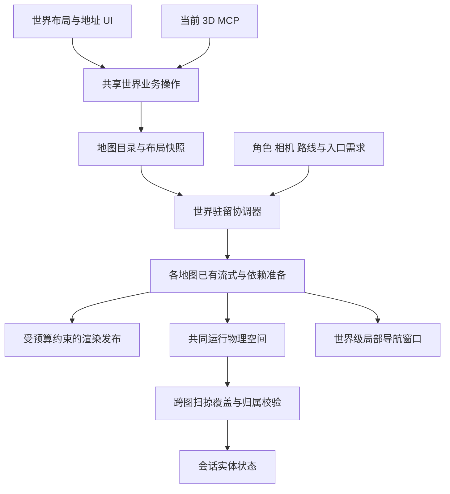

# 多地图世界地址与空间登记研究

2026-10-18，设计修订 2，原研究状态为提案；2026-11-01 开始分批实施，当前范围见下方实施更新。用户提出的公开地址形式为 `资源包:地图ID（地图文件名末尾的数字）:x,y,z`；本文据此补齐身份、空间、运行生命周期和交付约定。除明确列为已交付的 D1 部分外，新增接口名、文件布局和字段仍为拟议合同。

本轮只新增研究文档，保留[统一优化方案](seamless_streaming_optimization_plan_20261014.md)及其既有排序。未修改正式地图、运行代码、UI 或 MCP，未启动性能实验。地图加载与渲染会话正在推进的准备、发布和退役工作继续由该会话处理。

2026-11-01 实施更新：用户授权按本修订计划开始开发，并要求以最新 main 为基线。D1 在 `codex/world-address-d1` 实施，基线与已拉取的 `origin/main` 均为 `6a1bf861973ea08af04a5ba2042587423862676c`；使用当前默认 Godot 4.8。为旧地图地址可实际使用，将目录登记、撤销和原子保存的小闭环从 D2 提前；D2–D7 其余范围保持。进度、实测及当前接口以 [D1 记录](world_address_d1_20261101.md)为准。上文及后文的“本轮研究”“拟新增”保留 10 月 18 日设计阶段事实，不代表下列全部能力已经交付。

## 地址约定

建议采用用户给出的形式，示例为 `default:123:30,5,100`。这里表示资源包 `default` 中编号为 `123` 的地图，地图内米制位置为 `(30, 5, 100)`。示例编号不代表已给任何现有地图分配编号。

| 字段 | 建议语义 | 约束 |
| --- | --- | --- |
| 资源包 | 地图所属包的稳定 `id` | 使用元数据身份，不使用中文显示名、安装目录或当前选中的包；首版沿用当前位置协议允许的 ASCII 字母、数字、下划线，保留大小写 |
| 地图 ID | 包内唯一、稳定的数字编号 | 对外称地图 ID，新增内部字段暂称 `map_number`，避免混淆当前字符串 `map_ref`；以非负十进制整数字符串传输，前导零归一化，例如 `000123` → `123` |
| `x,y,z` | 地图内位置，单位为米 | Y 为高度，XZ 为水平面；允许负数和小数，使用英文逗号及小数点，必须恰好三个有限数值 |

地址解析、地图范围检查、可站立位置验证分别执行。能解析的地址不一定能直接传送；不自动把越界位置钳回地图、不默默贴地或修改 Y。楼层、桥面和地面之间的选择必须保留现有表面及入场验证。公开地址本身表示一个点；复制角色位置和新的传送地址统一使用脚点，复制物件位置使用其作者原点，UI 标签和结构化上下文明确 `anchor_kind`。旧 `transfer_map()` 使用角色中心，而当前入场协议和移动快照使用脚点，须由适配层转换一次；当前 0.9 米偏移不能成为所有角色永久通用的协议常量。

UI 可以减少显示小数位，但复制、保存和 MCP 返回的坐标须保证约定精度内往返一致。字符串只作为输入、复制和日志格式，业务内部使用结构化字段，共享同一解析器和格式化器。例如：

```json
{
  "pack_id": "default",
  "map_number": "123",
  "position_m": [30.0, 5.0, 100.0]
}
```

拒绝空字段、带符号或小数的地图编号、NaN、Infinity、多余坐标及无法解析的数字。不得将用户输入直接拼成文件路径；从登记表解析到路径后继续执行现有资源根约束。

## 文件名与稳定身份

新地图可以采用明确的数字后缀命名，例如 `Map000123.gltf`。创建时读取编号并登记，之后编号是稳定身份；文件名是可校验的存储表现。地图尺寸变化、显示名变化和目录搬迁均不应改变地址。新规范文件的后缀若与登记编号不一致，报告冲突；修改编号必须经过显式迁移并更新引用，不能把普通文件重命名当成隐式换号。

同一包内的 `Map001.gltf` 与另一个登记为 `1` 的地图冲突，不能根据发现顺序选择其中一个。复制为新地图需分配新编号；同一地图的保存版本继续保留编号。删除后保留编号墓碑，避免旧任务、传送点和存档意外指向新地图。并发创建及分支合并必须检测编号占用，不自动改写已有引用。

当前检查的外部 `maps/` 和 `packs/` 两个根目录中，排除资源定义、保存代际和验收目录后发现的 10 个顶层地图入口均叫 `map.gltf`。这只是这两个根的盘点，不是对所有安装布局的完整枚举。正式城镇入口为 `packs/default/maps/axel_town/map.gltf`，其根节点 `extras.map_ref` 为 `default/axel_town`；直接取文件名末尾数字无法得到编号。

因此旧地图通过登记表获得编号，并保留原文件路径和 `map_ref`。不能把目录中的 `v8` 或日期 `20261006` 猜成地图编号，也不能批量改名破坏相对资源引用。新登记与既有身份冲突时先报告，研究阶段不分配正式编号或迁移内容。

包目录当前支持版本化安装。地址本身不携带版本，由当前世界选择并固定包版本；同一解析上下文出现多个同 ID 活动版本时应报歧义。可复现的存档、传送准备和编辑操作另外记录版本或修订号，提交前复核。显示名不能作为别名自动覆盖包身份；历史不符合首版字符约束的包需显式登记兼容身份。

## 不同尺寸地图与连续世界

地图可以大小不同，也不必为正方形。资源包承载世界定义时，在世界清单中引用所属地图及共享包地图即可；共享资源包的存在不意味着所有包都处于同一片连续空间。

建议分开记录两类信息：

| 登记层 | 必要信息 | 负责的问题 |
| --- | --- | --- |
| 地图目录 | `pack_id + map_number`、现有 `map_ref`、受约束的文件路径、地图修订号、本地有效范围 | 这个地址指向哪份地图 |
| 世界布局 | 世界与连续空间身份、地图放置身份、原点偏移、归属范围、邻接边或传送连接、布局修订号 | 地图放在哪里，与哪些地图相接 |

首版建议相邻室外地图统一轴向和米制单位，只允许平移放置，不引入旋转或缩放。地图已有内容继续使用自己的本地原点，不要求把现有顶点、建筑和道路重新搬到左下角。

```text
连续空间位置 = 地图在该空间中的原点 + 地图内位置
运行时位置   = 连续空间位置 - 当前运行原点
```

下面是同一连续空间的示意，地图本地 XZ 范围在这个例子中都从零开始，实际旧地图允许负坐标：

| 地图编号 | 尺寸 X × Z | 在连续空间中的原点 X,Y,Z | 世界水平归属范围 |
| --- | --- | --- | --- |
| 1 | 1,200 × 800 m | `(0, 0, 0)` | X `[0,1200)`，Z `[0,800)` |
| 2 | 2,400 × 800 m | `(1200, 0, 0)` | X `[1200,3600)`，Z `[0,800)` |

此布局下，`default:1:1199,0,100` 与 `default:2:0,0,100` 相距 1 米。编号只用于身份，不能通过“编号 × 固定地图尺寸”计算位置。不同连续空间中的两个地址没有天然的欧氏距离，应通过传送或入口连接表达关系。

归属查询采用确定的边界规则，例如矩形范围左闭右开；地形渲染仍可保留共同边界顶点。边界几何、预读缓冲和建筑跨界范围不等于归属范围，不应通过裁掉跨界内容解决归属冲突。首版可限制同层室外归属范围互不重叠，复杂多边形和重叠空间另行扩展；洞穴、室内等通过空间身份区分。

现有运行时 `WorldStream.CHUNK_M` 为 32 米，是地图内部的流式查询尺度。它与地图文件大小没有一一对应关系，不要求全部地图等大，也不应为凑整除去缩放内容。边缘可以只有部分有效区域；跨地图缓存与任务键需要携带地图身份及修订，不能仅用本地 chunk 的 XZ 编号。

地形连续性另有约束。目前 `TerrainNeighbors.compatible()` 要求变换基一致、采样间距相等并满足接边位置条件。不同地图尺寸可以兼容这些条件；不同采样密度则需要重采样或过渡网格，现有实现不能据此宣称已支持。未来跨地图接缝应在同一空间下比较边界，验证高度、采样对齐、法线、材质和碰撞；第一阶段优先保证共同边界采样规则，不先做任意分辨率拼接。

## 运行上下文与精度

公开地址标识地图内容中的位置。若同一地图被放置多次，或存在多人副本，运行时还需要明确所在世界、连续空间、放置或实例。保持用户提出的短地址，通过结构化调用上下文补充这些字段；有歧义时返回候选或错误，不默认选择第一个。首版可限制同一空间内同一地图只有一个放置，但需在登记校验中明确执行。

当前 `WorldLocation` 还包含 `surface_id`；入场协议还包含世界、会话、地图修订和 epoch。地址转换必须保留这些信息。只有 XYZ 的输入需要通过目标地图业务校验确定可用表面，不能伪造表面或把地址解析成功等同于目标碰撞、导航和整栋依赖已就绪。玩家移动继续遵守既有方向意图与权威校验。

建议长期保留“地图身份 + 小范围本地坐标”作为存档和引用基础，连续空间 XYZ 作为布局派生量。布局移动地图后，本地地址仍指向同一内容；需要重放旧布局的场景另存布局修订。地图编辑删除或移动目标表面时，旧坐标也必须重新验证，稳定编号不能保证落点永远有效。

逻辑原点及跨图运算应保留双精度标量，先相减再转换到运行时小坐标，避免过早放进单精度 `Vector3`。Godot 官方说明 GDScript `float` 默认 64 位而向量默认 32 位；引擎全双精度需要重新编译编辑器和导出模板，原点移动则增加运行逻辑复杂度。因此本轮不决定全项目切换双精度，也不把短地址方案当成已经解决远距离物理精度。[Godot 大世界坐标文档](https://docs.godotengine.org/en/stable/tutorials/physics/large_world_coordinates.html)

只有换图式世界时，可继续围绕各地图局部原点运行。实现无缝跨界时，再验证渲染、物理、导航、相机、声音、粒子和材质相位的一致变换；项目河流地形 shader 已使用世界位置计算部分效果，不能只移动节点而不检查材质连续性。单张地图本身若极大，地图内坐标仍可能失去精度，届时还需区域锚点或双精度方案。

## 跨大地图的无缝加载

可以支持玩家持续行走跨过大地图边界。条件是这些地图登记在同一连续空间、接边成立，并在玩家到达前完成相关区域的准备。地图文件继续独立编辑和保存，运行时由世界层协调多个地图的局部驻留；地图尺寸不必相同。

当前代码具备可复用的 CPU 预读、目标场景 GPU 预热和入场校验，但尚不是连续跨界流程。[target_scene_prefetch.gd](../scripts/world3d/target_scene_prefetch.gd) 将真实目标保留在树外，以独立视口中的视觉副本预热资源，明确不提前激活目标事件、导航和物理。[world_3d.gd](../scripts/world3d/world_3d.gd) 的 `transfer_map()` 则锁定角色、绘制遮罩、在独立物理世界验证目标，提交时释放旧地图、替换 `_map_root`、清零速度并重置相机。这些行为适合现有传送流程；直接走过边界需要新增连续驻留与归属接管路径。

建议在现有地图内流式机制之上增加世界层驻留协调器。它把玩家、相机及前方预测范围与地图归属范围相交，再将需求转换到各地图本地坐标，复用各自的区块及完整建筑依赖查询。运行时保留一个活动地图集合；角色当前所属地图只是其中一个成员。边角和一大图连接多张小图时可能同时涉及三张或更多地图，不能把实现固定为只能同时加载两张。

跨界过程应满足以下合同：

| 阶段 | 行为与就绪条件 |
| --- | --- |
| 接近边界 | 提前查询相邻地图的必要地形、建筑与资源；可见远景按独立需求准备，不能等角色脚点到达边界才开始加载 |
| 两侧共同驻留 | 将通过版本及身份验证的必要区域有界发布到共同运行坐标和物理世界；准备地形接缝、通行面与导航连接，等待相应服务同步完成；GPU 预热完成本身不授予通行 |
| 穿过边界 | 在确定的物理步边界更新角色地图归属及本地地址，保留角色实例、运行位置、速度和相机；路由需跨图维护或连续重算，避免重新出生或相机跳转 |
| 离开旧区域 | 旧区继续满足相机回望、返回移动及活动对象依赖；超过卸载滞回范围并释放所有 pin 后才退役，避免边界反复加载卸载 |

以前述示意布局为例，角色接近 `default:1:1199,0,100` 时，地图 2 的相邻部分应已在运行世界中准备好。经过世界 X=1200 的边界后，地址归属转为 `default:2:0,0,100`，世界位置持续变化。切换地图归属不必同时移动运行原点；二者分别管理，避免每次过界都触发整个活动世界变换。

地图边界上的道路、桥梁和建筑须有唯一作者与运行身份。邻图只引用依赖，不重复生成碰撞、事件或 NPC；跨界对象需覆盖其完整必要依赖，不能在文件边界处截断。角色和可跨界 NPC 的状态归属要显式移交，保存和事件触发不得执行两遍。首版建议限定同一运行世界与权威域，跨服务器移交另立协议，不由客户端地图流式自然获得。

首版选择世界级局部导航窗口，向现有 `WorldNavigation` 提供覆盖相邻地图的几何并集；导航数据不再只来自角色所属地图。手动行走继续使用物理覆盖、支撑和净空校验，不能退回等待全部导航烘焙；点击寻路和 NPC 路线才需要相应路径范围的导航就绪。Godot 支持多个 NavigationRegion 向同一导航 map 提交数据，但连接取决于边界条件，区域启停也不会自动更新旧路径；后续扩大到多个独立烘焙区域时仍要验证连接与路径失效。[Godot NavigationRegions 文档](https://docs.godotengine.org/en/stable/tutorials/navigation/navigation_using_navigationregions.html)

预取距离应按最大支持移动速度、实测完整准备时长和安全余量计算；准备时长包含读取、解码、主线程发布、物理及必要导航同步，而不仅是后台读取。总预算需覆盖当前活动区域、邻区准备、远景和共享资源去重，不能简单为每张地图分别使用完整预算。普通步行、高速移动、突然折返及远距离传送分别验证；远距离传送仍可沿用已有遮罩流程。

正常目标是无需切图遮罩、保持可操作和连续帧呈现。冷资源、I/O 故障或预算不足时无法无条件保证零等待，应在进入未就绪通行区域前保留安全支撑并明确等待状态，必要时回退既有受控加载。验收分别记录无缝成功率、等待次数、帧时间与内存；“没有黑屏”不能代替性能达标。

最小原型使用两张不同尺寸的临时地图，包含负坐标、接边坡地和跨界道路。随后覆盖多图交汇、跨界建筑、快速往返、邻图修订、取消、慢 I/O 和预算不足；验证无地面裂缝、掉落、重复碰撞、事件重放、相机跳变及状态丢失。UI 与当前 3D MCP 应共享邻接配置和就绪诊断，显示每个区域的准备、可见、可通行及等待原因。所有这些仍是待验证的研究建议，不改变原优化队列或启动运行代码改造。

## 对现有架构的接入位置

代码核对基线为隔离分支 `codex/editor-reliability` 的 `c333a6466009d910957b2b05d8fc58ad2f81741f`；其他会话尚未提交的底层改动不视作本提案已实现的能力。

| 现有代码 | 已有能力 | 建议接入边界 |
| --- | --- | --- |
| [world_location.gd](../scripts/world3d/world_location.gd)，9、56、79 行 | `map_ref + position_m + surface_id`；身份校验；负坐标 chunk 索引 | 增加外部地址适配，先映射到现有 `map_ref`，保留表面与校验；不直接替换全部旧引用 |
| [resource_pack_catalog.gd](../scripts/world_editor/resource_pack_catalog.gd)，43、53、67 行 | 包元数据、版本化目录、共享地图；地图条目为名称、路径、包 | 补稳定编号登记及冲突诊断；共享地图使用实际归属包 |
| [map_paths.gd](../scripts/world3d/map_paths.gd)，29 行 | 存储路径与逻辑 `map_ref` 分离，资源根保护 | 地址经目录解析后沿用保护，不接受任意路径输入 |
| [local_entry_authority.gd](../scripts/world3d/local_entry_authority.gd)，92、103、115 行 | 位置快照、地图修订、会话与入场票据 | 地址解析结果接入既有入场流程；保留版本和取消后的失效语义 |
| [world_3d.gd](../scripts/world3d/world_3d.gd)，1236、1429 行 | authored `map_ref` 或路径哈希回退；已有换图流程 | 路径哈希只作现状兼容，不作为永久数字身份；连续多地图驻留另行设计 |
| [world_stream.gd](../scripts/world3d/world_stream.gd)、[terrain_neighbors.gd](../scripts/world3d/terrain_neighbors.gd) | 32 米地图内分区；受兼容条件约束的地形邻接 | 复用地图内机制，新增世界层邻接与身份作用域，不重写现有性能流水线 |
| [world_authority.gd](../scripts/world3d/world_authority.gd)、[physical_traversal.gd](../scripts/world3d/physical_traversal.gd) | 方向意图、扫掠范围、碰撞发布帧校验；手动移动独立于导航 | 扫掠范围可跨多个地图；连续归属变更保留移动序列，不能重新调用会重置序列的 `mount()` |
| [world_navigation.gd](../scripts/world3d/world_navigation.gd)，597、862 行 | 自建导航 map、局部几何提供者、异步迭代确认 | 首版复用一个世界级局部窗口，提供邻图并集及跨图缓存身份；不为每图叠加一个全量烘焙 |
| [world_combat.gd](../scripts/world3d/world_combat.gd)、[world_state.gd](../scripts/world3d/world_state.gd) | 状态与场景驻留分离，但按地图路径存放于 MockServer 会话 | 增加稳定作用域及跨图实体归属；当前会话缓存不等于已有落盘存档或跨服务器协议 |
| [reference_map_save.gd](../scripts/world3d/reference_map_save.gd)、[atomic_file.gd](../scripts/world3d/atomic_file.gd) | 原生引用地图及单文件替换 | 世界清单独立原子保存；不能把两个地图文件先后保存称为跨文件原子事务 |

编辑器试玩会给缺少 `map_ref` 的克隆生成临时身份，见 [playtest_session.gd](../scripts/world_editor/playtest_session.gd)。未来应由测试会话维护正式地址到临时地图的映射，避免试玩分配正式编号或改写用户登记表。

## 首版范围与数据合同

首版覆盖同一运行世界内的室外相邻地图：不同矩形尺寸、负坐标、平移放置、同一地图边接多张小图、多个地图交汇，以及有完整依赖声明的跨界静态对象。一个连续空间内同一地图只放置一次；室内及副本通过入口进入其他空间。旋转拼接、地图缩放、任意分辨率接缝、多服务器移交和跨地图同时雕刻不进入首版。范围限制由编辑器和 MCP 校验执行，不能依赖使用说明提醒。

依赖完整性或接缝兼容性尚未证明的地图保留现有受控换图能力，不进入首版连续连接。连接模式及未支持原因要明确展示，不能自动忽略保护或把一次有遮罩的换图记为无缝成功。

建议的数据所有权如下，路径均相对相应外部资源包根；文件名是拟议约定，尚未创建：

| 数据 | 唯一作者与内容 | 版本规则 |
| --- | --- | --- |
| `maps.catalog.json` | 包级目录：数字编号、旧 `map_ref`、包内相对入口路径、别名与墓碑；不保存场景节点 | 目录文件字节 SHA 作为 `catalog_revision`，编号创建及迁移检查期望修订 |
| `worlds/<world_key>/world.json` | 世界布局：空间、放置、原点、归属矩形、接缝、入口及全局环境策略 | 文件 SHA 作为 `layout_revision`；只在此处编辑地图在世界中的放置 |
| `ResolvedWorldSnapshot` | 解析器生成的只读快照：选定包版本、目录修订、布局修订、地图及依赖身份、接缝验证结果 | 构建完成后固定 `snapshot_id`；异步任务不能混用两个快照 |
| `WorldRuntimeState` | 会话拥有的实体身份、当前位置、归属、事件及状态序列 | 场景退役不删除状态；落盘存档和服务器协议另有版本，不能把 MockServer 字典称为持久化完成 |

目录到路径的转换继续检查资源根、符号链接及依赖包权限。目录中路径仅负责查找；正式缓存键和游戏状态键不依赖绝对安装路径。作者文件不把自身 SHA 填进自身内容，修订由读取结果提供。世界快照保存选定的输入身份及必要引用，不复制整份地图目录或模型资源。

`world_key` 表示稳定的世界定义，`world_instance_id` 表示一次运行或副本。现有入场协议中的 `world_id` 已承担运行上下文职责，接入时必须明确映射，不能直接替换成包 ID。`space_id` 指同一度量坐标空间，`placement_id` 指该空间中的地图放置；同一包中的两个地图不因包名相同就自动相邻。

以下布局示例只展示新协议的最小作者数据，`demo` 是示例包，需另有目录记录 `1`、`2` 才能通过完整校验。归属矩形是地图本地 XZ 范围，不是从可见对象 AABB 自动推断的范围。

```json
{
  "schema_version": 1,
  "world_key": "demo_world",
  "units": "meters",
  "up_axis": "Y",
  "spaces": [{
    "id": "outdoor",
    "placements": [
      {"id": "city", "pack_id": "demo", "map_number": "1", "origin_m": [0, 0, 0], "ownership_xz_m": [0, 0, 1200, 800]},
      {"id": "field", "pack_id": "demo", "map_number": "2", "origin_m": [1200, 0, 0], "ownership_xz_m": [0, 0, 2400, 800]}
    ],
    "seams": [{
      "id": "city_field",
      "a": {"placement_id": "city", "edge": "x_max", "interval_m": [0, 800]},
      "b": {"placement_id": "field", "edge": "x_min", "interval_m": [0, 800]},
      "mode": "continuous"
    }]
  }]
}
```

`ownership_xz_m` 顺序为 `[min_x,min_z,max_x,max_z]`，要求有限且 max 大于 min；Y 由位置与实际表面决定。沿 X 边的 `interval_m` 使用本地 Z，沿 Z 边使用本地 X；两端转换到连续空间后必须重合。`continuous` 是请求的连接方式，只有接缝诊断通过后才成为可用连接。矩形里的洞口和河流仍按实际几何判断可通行，不自动填平。

新增接口对地址限制总长度、编号位数和数字范围。建议数字编号最多 19 位且不超过有符号 64 位整数上限，仍全程以十进制字符串传输；0 是合法编号，不作为缺失值。XYZ 使用有限十进制数，可读入科学计数法，规范输出统一小数点并消除负零；UI 展示精度与协议往返精度分开。当前 `WorldLocation.POSITION_ROUNDTRIP_M=0.001` 可作为近原点地址往返回归基线，不能据此承诺任意大坐标仍有毫米级物理精度。

## 分层职责与运行生命周期

以下组件名表示拟议职责，不要求将现有底层代码整体搬迁。世界层负责把需求分发到多图及校验接管；加载器继续负责本图依赖准备和发布。



常驻区生命周期采用 `ABSENT → PREPARING → STAGED → RESIDENT → RETIRING → ABSENT`。`STAGED` 表示私有结果可供发布，`RESIDENT` 只表示部分能力已发布，不自带通行许可。远景、物理、导航和事件是独立能力，不能用一个 `loaded=true` 表达全部就绪。

| 能力或状态 | 必须携带的证据 | 不能推导出的能力 |
| --- | --- | --- |
| `metadata_ready` | 对应快照、地图修订、有效范围与依赖完整性 | 没有实际地形或碰撞 |
| `visual_ready` | 对应需求范围的实际资源与实例已发布，满足该范围近景或代理策略 | 远景代理不能作为落脚面 |
| `physical_ready` | 覆盖本次胶囊扫掠及支撑查询范围的依赖集合、碰撞发布帧 | 不能推断路径可达或事件可激活 |
| `route_ready` | 当前导航迭代、范围与路线依赖均有效 | 不能替代物理支撑和净空校验 |
| `authority_ready` | 当前世界实例、地图修订、归属及实体状态序列验证通过 | 不授予未来任意范围通行 |
| `FAILED / CANCELLED` | 失败原因、任务代际及已发布资源的拥有者 | 不允许直接释放其他需求仍持有的资源 |

就绪回执必须包含 `snapshot_id / placement_id / map_revision / request_generation / covered_bounds`，涉及运行坐标时另带 `origin_epoch`。`physical_ready` 继续要求当前物理帧晚于受影响碰撞的发布帧。手动跨界检查实际扫掠和权威归属，展示层还需保证关键近景可见；点击寻路增加对应 `route_ready`，不让无关区域的导航阻塞手动行走。

地图内 CPU 结果优先保留本地坐标，可以在内容修订一致时复用。已经转换到运行坐标的结果遇到原点变化必须重定位或失效；不能仅因源模型 SHA 相同就发布。取消先撤销需求，再让在途任务交回其资源；没有确认释放前继续计预算。退役中若出现新需求，销毁前可取消退役，销毁开始后走新代际准备，不能复活已释放节点。

渲染、碰撞、导航、事件、跨界对象、预取和相机可分别持有租约。只有所有持有者释放，且在途发布和物理查询已结束，才能退役对象。主地图身份变化本身不释放旧图。调度只复用底层已验收的预算、取消及清理接口；活动 SceneTree 的发布遵守现有主线程合同，worker 处理私有不可变数据，不以异步任务名义直接改活动场景。[Godot 线程安全文档](https://docs.godotengine.org/en/stable/tutorials/performance/thread_safe_apis.html)

## 连续跨界的提交协议

连续跨界不调用现有完整 `transfer_map()`，也不重新调用会重置 `_sequence / _last_tick` 的 `WorldAuthority.mount()`。拟新增归属接管操作，在保留角色实例和输入序列的前提下更新地图身份。

1. **运动前校验。** 使用现有胶囊扫掠范围及支撑余量查询空间目录，取得覆盖范围涉及的全部地图和跨界对象。覆盖不能只按角色中心或当前地图决定；高速一步跨过小图时仍需验证途中区域。
2. **固定本步输入。** 复核快照、内容代际、碰撞回执、原点代际与权威状态，并持有本步必要依赖。验证失败则沿用安全阻挡或受控等待，禁止先走过去再改地址补救。
3. **执行一次运动。** 在共同物理世界执行角色移动，保留速度、跳跃和碰撞响应。若本步需要移动运行原点，先走下节的原点同步流程，不能一半对象使用旧坐标。
4. **确定新归属。** 根据实际到达位置和空间身份解析新地图，在本步快照发布前一次性提交 `placement_id / map_ref / local_position / surface / membership_sequence`。保存本步输入序列，归属序列独立递增，不反复创建整图入场会话。
5. **通知并保留旧区。** 地图到达事件以 `world_instance_id + entity_id + membership_sequence` 去重，帧内多次观察不会重复奖励或重生。旧区资源按租约和滞回退役。

半开区间确定精确边界归属，数值归一化只用于有限容差内的边界查询，不修改真实角色位置。跨多个边界的一步按实际运动段处理，首版拒绝无法证明中途覆盖的移动。出生、复活、远距离传送及跨空间入口继续走单独的入场流程，不能用连续归属切换绕过落点验证。

所有可等待的准备均在运动前结束，本步固定输入后到归属提交之间不 `await`，归属解析只读该固定快照。移动前记录安全姿态、速度和状态序列，地图到达等业务事件推迟到归属提交后分发。若移动后仍发生无法归属的内部异常，停止事件分发，只在已持有并复核安全的范围内恢复检查点；不能恢复时进入明确故障恢复，禁止带着旧归属继续运动。

失败处理区分提交前后：运动前校验失败保持原有效位置和归属；提交后保留新归属并进入恢复流程，禁止把地址切回旧图却保留新位置。已提交事件按序列恢复，不能因为重试重新触发。跨图不是客户端请求一组新坐标，而是权威移动结果的归属变化。

## 接缝与跨界对象

接缝记录针对一段边，不要求整条地图边与同一张邻图连接。一大图可以连接多张小图；重复区间、未声明的空隙和角点同时相交需要明确诊断。允许设计中的非通行边界存在，不能把每个空隙都自动认定为错误，更不能自动生成地面封洞。

| 检查层 | 首版检查与处理 |
| --- | --- |
| 身份与范围 | 相同连续空间、有效放置、区间匹配、确定的水平归属；世界原点与本地边界共同参与计算 |
| 地形与物理 | 声明通行段的边界高度和采样位置一致、支撑连续、净空及步高规则有效；高度不匹配时报位置与差值，不静默取平均 |
| 视觉 | 同一世界下的边界法线、材质尺度与相位、河流水位及流向；实际高度或水位矛盾作为内容问题返回 |
| 导航 | 局部窗口包含两侧必要几何，路线不跨越无支撑区域；导航连接不能通过扩大容差把河沟或悬崖连接起来 |
| 修订 | 报告绑定两图修订、放置及接缝配置；任一变化使报告失效，旧通过结论不能沿用 |

边界来源仍属于各地图，首版只做精确诊断和可复现定位。需要改高度时分别编辑后重新检查；跨图联合雕刻和自动边界重采样另立事务设计。法线 halo、远景代理和缓存可派生，不能用派生结果覆盖作者高度来隐藏裂缝。

跨界静态对象采用 `owner_map + object_uuid` 的稳定作者身份，运行实例再加世界实例和放置作用域。一个桥梁或建筑只生成一份实际对象，空间索引可在多个地图范围中指向它。作者归属不随玩家位置改变；跨界引用保留完整建筑、楼层隐藏、活动件、独立选择与撤销语义。显示合批仍由现有派生批次负责。

实体出生来源和当前所在地图分开存储。NPC、掉落物和召唤物移动后保留 `entity_id`，跨区激活、战斗及存档读取不得因地图局部 UUID 相同而串状态。当前按路径及局部 UUID 组织的战斗、状态缓存、碰撞归属、建筑成员查询和事件观察者都属于接入审计范围；第一版不能只改 `_map_ref` 就宣布跨图身份完成。

实体身份不包含会随移动变化的当前地图编号。地图卸载前完成状态移交，重新驻留从同一会话状态恢复；出生点作者引用另存。未驻留 NPC 的计时和恢复沿用明确的会话规则，不默认继续运行全量 AI，也不把场景销毁视为击杀或任务完成。旧路径状态只有在目录能唯一映射时才迁移，冲突时保留旧数据并报告，不能合并覆盖。

世界时钟和主环境由世界实例拥有，首版相邻图使用一致全局环境；本地图中的可放置灯光仍按资源驻留。天气、雾和曝光等区域过渡预留配置但后置，避免过界时执行现有整图环境替换导致跳变。声音、粒子及世界空间纹理也要验证连续性。

## 坐标精度与运行原点

三种位置必须在 API 命名和类型边界上区分：`local_position_m` 属于地图，`space_position_m` 属于连续空间，`runtime_position_m` 属于当前渲染和物理原点。转换统一由解析层提供，业务不得各自加减原点。计算顺序为双精度标量的原点差加地图本地位置，最后才转运行向量；避免先生成巨大单精度世界向量再相减。

第一批小范围双图原型可以固定运行原点，但这不代表远距离连续行走已经完成。允许的活动范围应根据角色与镜头精度目标、物理误差和实际地图测量确定；开启任意远距跨图前必须通过原点迁移验收。禁止用“地图分开存储”替代活动世界精度验证。

拟议原点迁移采用独立 `origin_epoch`：提前准备新相对变换，在安全物理边界协调地图、碰撞、角色、导航、相机及效果坐标；原点偏移不改变速度和逻辑地址。物理及导航同步完成后才使用新代际回执，所有迟到的旧运行坐标结果失效。相机历史、粒子、音源、遮挡缓存、纹理相位与调试坐标必须一并处理；某消费者无法迁移时不启用该范围的自动迁移。

导航更新经异步同步后才可查询；项目当前已用 map / region 迭代变化确认发布，世界层应沿用这类证据，不能只等待固定一帧或调用强制更新来掩盖未就绪。[Godot NavigationServer 同步说明](https://docs.godotengine.org/en/stable/tutorials/navigation/navigation_using_navigationservers.html) 相邻导航网格连接对顶点、边和重叠关系有约束，连接容差也不等于实际可行走净空。[Godot 导航网格连接说明](https://docs.godotengine.org/en/stable/tutorials/navigation/navigation_connecting_navmesh.html)

## 编辑、保存与运行版本隔离

地图内容保存继续使用现有原子保存。目录登记和世界布局各自采用期望 SHA 校验、锁、暂存写入和单文件替换；布局预览与应用是一笔可撤销编辑，不能声称多个文件先后替换具备整体原子性。首版跨图内容修改不自动联动写入其他地图。

运行启动先解析并固定世界快照。加载期间源文件发生变化，取消对应候选并返回 `map_revision_changed`；已有安全活动内容保持，未加载邻图不混入最新文件。已有地图继续被其他会话编辑时，运行会话提示快照过期；首版通过重新启动试玩采用新快照，不对运行中的地形和布局热替换。

未来若需要不停服发布多图修改，应先准备带修订的不可变引用与世界快照，校验闭包后原子切换一个活动快照指针。该机制不复制整份模型目录，也不假设现有两个 `save_world` 调用已经实现跨图事务；作为独立后续能力保留。

作者编辑与运行发布分别保留撤销合同：布局编辑撤销恢复配置并使相关预览失效，运行中的既定快照不回溯；试玩进度和玩家运动不写入作者撤销栈。登记编号的撤销不会让已分配编号成为可随意重用的空闲编号。

## UI 与当前 3D MCP 同步合同

编辑器新增世界布局入口，展示地图实际尺寸、边界、原点和接缝状态；选择一条诊断可定位两侧对应边。单地图编辑继续原流程，邻图作为只读参考；首版不引入多地图同时可写的场景编辑。坐标栏可复制地址并查看所属地图与连续空间位置，脚点或物件原点有明确标签。

下列是完整设计中的工具及共享业务操作。D1 已接入地图目录、登记、保存、地址解析和目录撤销重做，并补充当前物件/脚点地址读取与显式放弃目录；具体可用参数以 [MCP 文档](world_editor_mcp.md)为准，表中的世界/空间上下文仍待后续实现。其余工具落地时统一接入 [mcp_schema.gd](../scripts/world_editor/mcp_schema.gd)、[mcp_ops.gd](../scripts/world_editor/mcp_ops.gd) 和 [mcp_server.gd](../scripts/world_editor/mcp_server.gd)，不能注册旧二维工具。

| UI 操作 / 拟议工具 | 关键输入 | 返回及副作用 |
| --- | --- | --- |
| 世界目录 / `list_worlds` | 所属包上下文、分页 | 已登记世界定义与状态；只读，不创建文件 |
| 读取布局 / `get_world_layout` | 世界句柄 | 布局数据、文档句柄、编辑修订、磁盘 SHA 和未保存状态；只读 |
| 地图目录 / `list_world_maps` | 世界或包上下文、分页 | 稳定编号、显示名、旧引用、登记状态；只读，不隐式登记 |
| 登记地图 / `register_world_map` | 已发现的地图入口句柄、数字编号、期望目录修订 | 经过验证的可撤销目录变更；保存目录有明确状态，不混同地图已保存 |
| 保存目录 / `save_world_catalog` | 目录文档句柄、期望编辑修订与磁盘 SHA | 仅原子保存目录，不自动保存布局或地图 |
| 解析地址 / `resolve_world_address` | 地址、世界及空间上下文，可选放置及 `anchor_kind` | 规范地址、本地与空间位置、歧义候选；只读，不贴地、不传送 |
| 布局预览 / `preview_world_layout` | `create/update` 模式、世界标识、拟议变更、期望布局修订 | `candidate_id`、绑定的输入修订和诊断；不修改作者文件 |
| 应用布局 / `apply_world_layout` | `candidate_id`、期望修订 | 全部校验后单笔修改；过期或非法候选整体失败，保留选择和历史 |
| 保存世界配置 / `save_world_layout` | 布局文档句柄、期望编辑修订与磁盘 SHA | 仅原子保存布局配置；地图及目录未保存项明确列出，不隐式代存 |
| 接缝检查 / `validate_world_seams` | 世界、接缝 ID 或选区、输入修订 | 诊断位置、两侧身份、差值、缺失依赖和可定位建议；只读 |
| 驻留诊断 / `get_world_stream_status` | 试玩会话、选区或放置、分页 | 各能力、等待原因、租约和预算口径；只读，不强制加载 |
| 世界配置撤销 / `undo_world_edit`、`redo_world_edit` | 目录或布局文档句柄、期望编辑修订 | 只处理该文档历史；现有地图 `undo/redo` 仍作用于当前地图 |

上述新增写操作使用各自文档的撤销域，UI 明示当前编辑目标；MCP 通过显式文档句柄选择世界布局或目录。候选记录 `base_edit_revision` 和全部输入 SHA，应用要求 `expected_edit_revision` 匹配；保存另要求 `expected_disk_sha` 匹配读取基线。编辑修订与磁盘 SHA 不混用，否则未保存编辑可能错误通过冲突检查。过期候选必须重新计算；撤销已登记编号保留墓碑，重做恢复原身份。

创建世界先预览合法的世界标识与布局，再应用为未保存文档；首次保存使用明确的不存在基线，磁盘已出现同名文件则报冲突，不覆盖。目录、布局页面的保存目标及脏状态独立展示，关闭未保存配置沿用编辑器的保存/放弃流程；不改变用户正在编辑的地图文档。

公共结果统一包含 `ok / reason_code / message / snapshot_or_revision / diagnostics`，异步操作另带 `job_id`。错误至少区分 `invalid_address`、`map_number_conflict`、`ambiguous_context`、`outside_ownership`、`seam_mismatch`、`candidate_stale`、`map_revision_changed`、`geometry_pending`、`physics_pending`、`route_pending`、`budget_wait`。诊断携带对象或边界标识和位置，不只返回不可定位字符串。

原点、尺寸及邻接输入执行有限数值、正范围、资源包依赖和已有文档保护校验。只读解析成功允许返回尚未验证的表面信息，不能构造一个看似有效的入场票据。UI 传送到解析地址须走显式传送操作；编辑器镜头定位只移动镜头，二者不混用。非法请求、失效候选、保存冲突和取消均无部分作者写入。

## 调度预算与验收口径

优先级按用途区分：当前角色物理及整栋依赖最高，其次当前可见区域和相机，再其次预测前方与已知入口，远景与备用候选最后。所有来源共享总额度，CPU 私有数据、待发布对象、GPU 资源和退役等待分别记账；同一不可变资源按真实拥有关系去重。各地图不能各自申请一次完整世界预算。

预取距离按 `v_max × T_prepare + safety_margin` 估算，`T_prepare` 取目标内容和硬件实测的尾部准备时长；未知冷资源使用保守策略。加载范围覆盖视野、运动预测和胶囊扫掠，不把固定 32 米 chunk 当作通用预取距离。卸载范围大于加载范围并保持短期租约，兼顾折返和相机回望；具体距离和时限需实测，本文不先给未经验证的常量。

验收先锁定地图和依赖 SHA、硬件、渲染设置、目标帧预算、允许尾部帧预算、移动速度范围以及内存额度，再运行冷/热、正向/反向和基线配对路线。记录原始帧，分别报告准备时长、主线程不可分切片、P95/P99 与最大帧、等待次数/时长、预算峰值及退役后残留。预算估算、renderer 资源计数、进程 RSS 和实际显存占用分列，不能互相代称。

功能准入要求受测路线中裂缝导致的穿透/掉落、重复实体/事件、相机跳变、身份串用和撤销保存损坏均为零。正常支持条件下的路线还应无切图遮罩和边界等待；故障注入单列为安全降级验证，不能混入正常无缝成功率。任何性能未达标结果保留原始证据，不以均值掩盖边界长帧，也不因逻辑测试通过直接启用正式地图。

## 建议验证顺序

以下是本设计的实施依赖顺序，原优化执行队列继续保留。2026-11-01 用户已授权开始实施；各批必须提供对应 UI 和真实 HTTP MCP 证据，运行原型在覆盖全部功能门槛前保持试验状态。

| 顺序 | 交付切片 | 前置与完成条件 |
| --- | --- | --- |
| D1 | 编号目录、地址解析、脚点适配 | 已实施，验证记录见 [D1 交付](world_address_d1_20261101.md)；包括旧图盘点、显式登记、独立撤销和原子保存，正式地图未分配编号 |
| D2 | 世界布局与接缝诊断 | 下一批；依赖 D1，不同尺寸、部分边相邻、负坐标和角点可解释；预览/应用/撤销/原子保存及冲突恢复通过。原计划中的编号目录保存已提前到 D1 |
| D3 | 世界快照、稳定状态身份、既有传送适配 | 依赖 D1/D2；冻结输入修订，旧单图传送保持；明确会话缓存与持久化的边界 |
| D4 | 多地图局部驻留与手动连续跨界原型 | 依赖 D3 及底层已验收的预算、发布、取消和清理接口；静态双图及三图交汇通过，导航未完成仍遵守物理行走合同 |
| D5 | 跨界建筑/桥梁、事件与 NPC、跨图路线 | 依赖 D4；完整依赖、唯一实体、连续状态和路线失效通过；覆盖相机回望与快速折返 |
| D6 | 大范围精度与原点迁移 | 依赖 D4，复验 D5 消费者；大逻辑坐标下地址稳定，物理、导航、相机和效果同代际，无未处理消费者 |
| D7 | 支持范围内的画质与端到端性能准入 | 依赖 D4–D6；锁定预算与测试矩阵，正常无缝及故障降级分别通过，之后才决定正式地图启用范围 |

D4 之前需审计所有单图假设：`_map_root` 服务查找、以地图路径为键的状态、map-local UUID 索引、`stream_library` 变换、挂在世界根下的碰撞体和单图环境。作者变换保留地图本地语义；发布适配器只能施加一次放置偏移，不能同时烘焙到顶点和父节点造成双重偏移。局部物理、建筑成员和接缝查询也必须明确输入坐标空间。

其他会话仍拥有加载器、CPU 网格、资源发布/退役、材质和性能热点的实现。本专项在实施前读取其最新已合入版本，只添加世界层需求、作用域和接管适配；接口不满足时记录明确合同差异，不另起一套重复加载或退役系统。D7 的测量只验证本功能带来的跨界成本，不自动恢复旧性能列表中的其余专项。

未来验收应覆盖下列边界，本轮未执行这些功能测试：

| 范围 | 必测案例 |
| --- | --- |
| 身份 | 前导零、跨包同编号、同包重复编号、中文显示名、目录搬迁、文件后缀冲突、复制与删除后不复用、并发登记 |
| 兼容 | `default/axel_town` 及旧 `map.gltf` 原位打开；保存重开；试玩临时身份；共享包与多版本歧义 |
| 坐标 | 负数、小数、非法数值、32 米负边界、显示与复制精度、不同尺寸接边、越界且无副作用失败 |
| 空间 | 相同本地坐标属于不同地图；不同原点下世界距离正确；跨空间拒绝直接测距；重叠归属及副本歧义 |
| 运行 | 表面不可用、地图或布局修订变化、准备取消、断线恢复；地图间切换不绕过依赖和权威校验 |
| UI / MCP | 工具发现、相同解析结果、合法与非法调用、真实 HTTP 调用；涉及写操作时补整笔撤销重做及原子保存失败恢复 |

具体夹具至少包括：两张 `1200×800` 与 `2400×800` 米示意图；一张大图边接两张小图的 T 形布局；四图角点；不同高度但通过桥面连续的有效路线；高度错缝、未覆盖区间及同坐标不同空间的非法/非相邻输入。每种布局同时跑正反方向、斜向、贴边、脚点在边界及胶囊跨边界测试。

故障注入覆盖准备期间切换意图、发布后物理尚未同步、导航异步迭代滞后、源图或邻图修订变化、保存替换失败、退出试玩、内存预算无法容纳整栋依赖、跨界后立即折返及退役中重新申请。原点迁移分别发生在准备中、跨界前和跨界后；验证旧代际结果不会污染新空间。

实现前仍需用当前引擎与代表性地图确定活动坐标精度范围、原点迁移触发距离、预取尾延迟、总预算及关键近景就绪策略；这些属于实测参数，不是等待补充的身份或状态语义。本轮只核对设计、代码接入点、文档链接和示例数据，未运行新功能或 GPU 验收。

Epic 的 World Partition 将运行加载单元按流式来源组织为网格，能借鉴的是“内容组织与加载粒度分开”的原则。本项目仍需保留自己的多地图身份、独立编辑和保存合同，不要求照搬单一持久关卡形式。[Epic World Partition 文档](https://dev.epicgames.com/documentation/en-us/unreal-engine/world-partition-in-unreal-engine)

此前观看的 [BV1QrJ86sErq 地图演示](https://www.bilibili.com/video/BV1QrJ86sErq)提供多区域组织与接缝巡检的研究动机；本页的数字地址、登记结构和接入顺序属于项目设计建议，不归因于视频作者，也不包含新的性能收益结论。
